Causal Clifford Theory (CL10): a quantum cellular automaton on $\mathrm{Cl}(10,0)$ — Standard Model kinematics, exactly unitary causal dynamics, and a lattice gravitational sector

**Mohammed Haouach**
*Independent researcher; correspondence: haouach.mohammed@gmail.com*

---

## Abstract

A quantum cellular automaton is defined on a Planck lattice whose $2{\times}2{\times}2$ cells carry the $36$-level cell module of $\mathrm{Cl}(10,0)$ — the $32$-dimensional Dirac module and the two neutral singlet sectors, conjugate pairs of levels — on eight sub-sites (on-site space $\mathbb{C}^{288}$) and are updated by one six-stage product of $\mathrm{Spin}(10)$ plane rotations and swap-rotations, the singlet pairs carrying the ladder masses as on-site phases. From this root follow, with no added field: a $(1{+}3)$ Minkowski subalgebra; the $16$-component Weyl module whose charges are exactly one Standard Model generation, all eight gauge and mixed anomalies cancelling; the $\mathbf{45}$ adjoint containing the twelve gauge bosons; the $5/3$ hypercharge normalisation. The step is exactly unitary ($\det U = 1$, $\pm$-paired spectrum, exact matter/antimatter spectral mirror) and strictly causal, with measured front speed exactly one Planck cell per stage. The closure axiom — the update must be an element of the root — quantizes the rotation angle to $g \in \{\pi/2,\pi/4\}$: the fundamental step has order $8$, the internal spectrum is the finite algebraic set $\{\pm\pi/4\,(10),\ \pm3\pi/4\,(6)\}$, and the on-site update keeps no free continuous angle — the fitted coefficients of the phenomenology are recorded separately (Section 15), and the parameter criterion below is not met by them. The tensions are named, not hidden: the doubler cones are linear in every sampled direction but anisotropic, and no mechanism tried — the full Wilson family, two entangling bond layers, frame averaging over the ten generators, a systematic $880$-point entangling-bond search, or the dressed electric gate, which at the closed clock is a scalar whose six bond insertions multiply to $+I$ and leaves the spectrum exactly degenerate with the bare one — restores a cone; the analysis further shows that gaplessness and non-commuting tangent algebras are mutually exclusive over the axis-covariant bond class, a rigidity wall at gap $8.0\times10^{-3}$ that no bond of the class can cross, and the reason is a parity no-go: at a momentum whose little group contains inversion, no single-parity multiplet can be conical. The same no-go pins the only class of node that can be, a parity-degenerate $A_{1g}\oplus T_{1u}$ pair, and the automaton's own six-stage product is searched for exactly that node and does not reach it: over the largest stage family that keeps the zone centre cubic-covariant, searched jointly with the internal angle, the gapless multiplets it produces there are single-parity and therefore flat, and the parity-mixed ones it produces carry a commuting tangent algebra (Section 8.4); the gravitational sector adds $g_{\mu\nu}$ and $G = 1$ by hand and reproduces general relativity to $O(h^2)$, not to machine precision, and the diagonal-bond search that closes its named spin-$2$ coupling gap doubles the speed ladder to $\{0,2g_{10},4g_{10}\}\times\lvert d\rvert$ and keeps every closed-clock branch off $c = 1$ (Section 10.4); coupling unification at $\alpha_X = 1/25$ in the standard normalisation $\alpha = g^2/4\pi$ holds only for a desert spectrum with two fitted thresholds and a flavour-dependent bond layer with six fitted couplings, and at the root clock that solution is not realizable by its own content — the threshold shift that would restore the ordering exceeds the spectrum's own spacings (Section 13.1); the dark matter is a level of the cell — a neutral singlet at the ladder mass $118$ GeV, exactly stable under a $\mathbb{Z}_2$ of the update, produced at the observed abundance by freeze-in — and its portal coupling is the sector's single unfixed input, the spinor sector provably carrying no such state; the spectrum the automaton supplies has no light, dispersing, isotropic chiral mode anywhere; and the Born rule, the spin–statistics identification and the split-node set are declared inputs. Every headline number is classified by provenance: *algebraic*, *conventional*, *fitted*, or *open*.

The verdicts are theorems of the whole construction, not of one lattice. On the two-dial family that decouples the bond hop from the couplings, F2, F8 and F9 all stay fired and the family adds no fitted dial: its closure set $C$ is an algebraic four-point set that misses the empirical clock, no closed pair carries a gapless chiral cone at $c = 1$ (closest $0.2929$), and rank-$2$ isotropy is symmetry-forced only at the star-module zone centre, where it protects a flat band running $1.2\times10^{14}$ past the SME ceiling. The gauged two-particle sector built from the construction's own parts is blocked by Gauss law — the block localizes to the one-particle block itself, the centre obstruction seen dynamically — its dressed step does not flow and at the deepest measured cut still misses the anisotropy ceiling by eleven orders, and its interaction loop factor breaks the ladder's rung arithmetic. The gauge-invariant composite sector is measured **empty** — Gauss-singlet kernel dimension $0$ at all $216$ crystal momenta, every binding shift and every grid $N = 4, 6, 8$; smallest non-trivial Casimir eigenvalue $45.000000$ — so every composite falsifier contact is decided against the theory: no composite state exists, F9 has no locus to fire on, the desert census returns no content, and the four-leg conjunction fails. Replacing the frozen bond gate by a dynamical link module of the root's own adjoint cells does open the Gauss law — the neutral composite kernel is exactly $6$-dimensional — but the composites are born exactly frozen and no link route births a loop factor: the second-order exchange vanishes on an exact dimension-$4$ resolvent closure, and the resolvent grown from the full $540$-vector off-kernel exchange span stays transparent at $F5 = 1.9\times10^{-31}$. The loop-factor accounting closes from both ends: no route — free combinatorics, dynamical self-energy, composite numerator, or link-mediated exchange — supplies $1/(16\pi)$, and the certified closed branch crosses it only at the measured length $n^* = 208$, with no arithmetic relation between crossing and clock (PSLQ, degree $\le 4$): the ladder base is a **declared named input** of the scale sector, the hierarchy coefficient is supported only at its $n = 10$ clock read, and its origin stays the open problem O8. The same closure is then carried to the three remaining repair objects: over the admissible classes no deformation of the six-stage step closes a clock whose rung-$10$ read lands in the coefficient band, no reweighting of the traced-word sum moves both rung contacts at once, and no admissible selection functional selects at more than one site; the five-contact ranking of zero-fitted compound theories bottoms at normalized distance $0.243$ only through a weight class disqualified by its own chance density — so the axiom inventory records the reading clock $0.1999980$ as a declared measured input, while the internal-sector closure quantization stands untouched.

### Summary of results

The determinism claim is interpretive: one time-independent local rule fixes every future state of the lattice — 't Hooft's cellular-automaton determinism exact at the fundamental update — with randomness entering only through the measurement projection; the projection and the Born rule are inputs of the interpretation (O9), not derived from the unitary step.

One loop factor $(1/16\pi)^n$ then organises four scales over thirty orders of magnitude: $n = 10$ reproduces the electroweak/Planck hierarchy — coefficient $2.710$, certified at the closed-loop crossing $n^* = 208$ by continuity at 50 digits (the float64 ladder reads $2.699$–$2.700$, backend-dependent at $10^{-3}$; against $2.0766$ observed: $+30\%$; the named residual is a single measured number, the clock: the closure class reads $2.710$ at $\pi/4$ and $2.711$ at $3\pi/4$, its two crossings on the $n = 4k$ class of the clock filter while the $\pi/2$ member is a floor artefact with no limit — while the observed value is read by the non-closed rung-$10$ clock $1/5$, a fit that is measured rather than assumed: the inverted clock reads $0.1999980$, $2.0\times10^{-6}$ off the fifth, and no closed clock of the closure class reproduces the coefficient (F2 fired on the clock side); the certified branch supports the coefficient only at this $n = 10$ read, and the ladder base $1/(16\pi)$ is a declared named input — the certified crossing at $n^* = 208$ carries no arithmetic relation to the clock — the same clock the desert meeting coupling reads, so O4 and O8 are one tension, Section 12.1) — and gives the dark-matter mass $118$ GeV, the mass the step applies as a phase to the cell's singlet sector $B$; $n = 3$ the seesaw scale $9.6\times10^{13}$ GeV, the cell's singlet $A$; $n = 17$ the neutrino mass, with a $\tfrac13$ candidate at $0.0487$ eV and $\sum m_\nu \simeq 0.05$ eV — a candidate, not a result: the exponent $17$ is fitted and the junction amplitude is a free input inside a finite window — the junction vacuum energy drives it to its democratic boundary $r = 2$, measured to be the edge of a one-loop runaway rather than a minimum, at a $-2.7\%$ atmospheric residual that no named coefficient of the theory supplies; its falsifiable contact is the cosmological sum, not the neutrinoless amplitude, which is a sector choice of the free $\mathrm{O}(2)$ mixing. The loop machinery of the automaton's own gauged bond layer, evaluated at the root clock $g = \pi/4$, is an exact selection rule: every odd-length closed loop cancels identically, and the even-length ratios on the $n = 4k$ class of the clock filter cross $1/(16\pi)$ first at $n^* = 208$ (deficit $1.01\%$ certified; the $4k{+}2$ class has no limit at the closure angle); the rung assignment itself is a declared convention, not a derived uniqueness: on the 36-level step only $\mathrm{loop}^3$ is numerically realized, and over the closed clock set no rung pair satisfies both the ladder-phase spectrum and the neutrino contacts; the Gauss constraint closes exactly and the physical sector carries a bounded area law $S = \ln 45$ per bond. With vectorlike desert content — three $\mathbf{10}\oplus\overline{\mathbf{10}}$ pairs and one $(1,2)$ pair, thresholds solved at the root coupling $\alpha_X = \pi/64 = 0.0491$ in the standard normalisation $\alpha = g^2/4\pi$ — the solution exists but its threshold ordering is destroyed, the meeting value sitting a factor $1.23$ above the observed $1/25$ (O4), and it cannot be repaired from inside the spectrum: the solution pushes the $\mathbf{10}\oplus\overline{\mathbf{10}}$ thresholds to $7.1\times10^{4}$ GeV, below the desert floor, and restoring the ordering would shift the $(1,2)$ threshold by $13.1$ e-folds, $1.12\times$ the entire log-spacing from its published value to $M_X$ — no one-loop threshold correction within the spectrum's own spacings restores the meeting; no threshold of that spectrum is excluded by experiment, each sitting $14\times$–$10^{9}\times$ above its fetched ceiling. The prediction is $\tau_p = 2.77\times10^{39}$ yr, beyond any planned exposure. The automaton's own Wilson mechanism additionally forces $M_X = 8.9\times10^{14}$ GeV in the selective reading, excluded by Super-Kamiokande, and the surviving solution requires a flavour-dependent bond layer with six fitted couplings $\kappa_s$. The lattice gravitational sector — a symmetric tensor field added to the $(1{+}3)$ subalgebra, with $G = 1$ by hand — reproduces general relativity on de Sitter, Schwarzschild and $3{+}1$ evolutions to $O(h^2)$ (Table 3).

The paper states equally precisely what does **not** follow. Ten tensions with observation are reported rather than hidden — the doubler cones are anisotropic (velocity-tensor anisotropy $0.748$–$0.758$ on the dispersive member of the Wilson family; $0$ of $2726$ gapless points of the family reach $A < 10^{-6}$; at the corner multiplets the touching is a set of nodal planes, never a cone — three planes for the one-parameter member, six where the two lowest triplets vanish together at $w = 0.2417$, $\theta = 0.9131$; and no bond of the $880$-point entangling-bond search is both gapless and non-commuting — a rigidity wall at gap $8.0\times10^{-3}$ over the axis-covariant class, which Proposition 6 explains as a parity no-go and escapes outside the class, on a parity-degenerate node that the automaton's own six-stage product is searched for and does not reach, Section 8.4), the $\mathrm{SU}(2)$ coupling overshoots by $5.8\times$ under Standard-Model running, $\mathrm{SU}(3)$ hits a Landau pole at $2.193\times10^{9}$ GeV, the bare neutrino ladder is excluded by the tightest ceiling the theory faces, $\sum m_\nu < 0.0642$ eV, no state of the spinor module can carry the dark matter — the carrier is a singlet sector of the cell, whose portal coupling the root does not supply — and the relic abundance computed from root-supplied couplings is not $0.120$, the gauged layer's string tension is $5.41\times10^{40}$ times QCD, the spectrum carries no massless spin-2 candidate at the root clock and the metric content of the bond layer is forced to be a bilinear, with the hop unable to move it at first order by parity (Section 11.5), the neutrino mass the ladder needs is incompatible with out-of-equilibrium decay at the seesaw scale the ladder needs, and the gapless set the automaton does supply carries no light, dispersing, isotropic chiral mode: at the implemented clock the node cones are anisotropic and carry no helicity pair, at the root clock the exactly gapless set is a flat zone-centre null space plus six quadratically touching lines, and the electroweak scale enters the bookkeeping as a measured input (O10). Ten open problems are each pinned to a named quantity, ten falsifiers are stated — the most accessible being the neutrino mass sum: at the root coupling the proton-decay falsifier sits beyond any planned exposure, the graviton-speed falsifier is already decided against the constructed layer, whose spin-$2$ channel runs at $2g_{10} = 1.5708$ times the matter cone on axis bonds and at $2g_{10}\lvert d\rvert$ on the diagonal-star bonds that close its coupling gap (Section 10.4, F8), and the Lorentz-contact falsifier is decided against the construction too: the node velocity tensor measures $\delta v/v = 0.296$ at the implemented clock ($1$ at the closed clock, a flat axis) against the electron-sector SME ceiling $8\times10^{-15}$, a factor $3.7\times10^{13}$ (Section 8.2, F9) — and every headline number is classified by provenance: *algebraic*, *conventional*, *fitted*, or *open*.

**Keywords.** Clifford algebra; quantum cellular automaton; $\mathrm{Spin}(10)$ grand unification; anomaly cancellation; lattice gravity; dark matter; cosmological constant; baryogenesis; falsifiability.

---

## 1. Introduction

### 1.1 The picture

Two habits of language do most of the misleading. The first calls $c$ the speed of light. Light is one traveller at that speed; the constant is the speed of causality. The second is wave–particle duality, taught as a paradox. On a lattice it dissolves: there is one wave, always; what a detector registers is a single localised event, because the detector is itself a lattice of cells changing state one cell at a time. The ontology contains no particles — only waves that deliver their energy in quanta.

Quantum field theory replaced particles by fields but multiplied the fields, one per species, glued together by hand. The viewpoint of this paper is the opposite one, elementary in computer science: a cellular automaton — a lattice of cells, each holding a finite packet of information, all updated in parallel by one local rule. If the world is such an automaton, everything physical is a wave of information over that lattice, and the theory reduces to two questions: what is the information structure of a single cell, and what is the rule that updates it. Causal Clifford Theory (CL10) answers both concretely: the cell carries the $36$-level module of Axiom 1 — the spinor module of $\mathrm{Cl}(10,0)$ and two neutral singlet sectors — and the rule is a product of $\mathrm{Spin}(10)$ plane rotations interleaved with nearest-neighbour swap-rotations.

### 1.2 Two literatures, one construction

Discrete models of quantum dynamics and grand unification have developed independently. Causal sets, lattice gauge theory and quantum cellular automata treat spacetime as a finite, causal, unitary dynamical system [1–5]. The observation that one generation of quarks and leptons fits exactly into the $16$-dimensional spinor of $\mathrm{Spin}(10)$, with the $5/3$ hypercharge normalisation and anomaly cancellation following from the embedding, has been standard since 1974 [7–10]; Clifford-algebra formulations of this unification exist [11–14]. 't Hooft's cellular-automaton interpretation supplies a deterministic unitary dynamics but no unification [30,31].

CL10 puts these on a single footing: the internal space of every sub-site of the automaton's cell **is** the $36$-level cell module — the spinor module of $\mathrm{Cl}(10,0)$ with its two neutral singlet sectors (Section 4) — and the update **is** an element of the corresponding spin group, times the singlet ladder phases of Axiom 1. Nothing else is added by hand: no field outside the cell module, no extra gauge factor, no second algebra.

The comparison is decidable, and its deficits are named here rather than left to the Discussion. Against the Clifford-algebra programmes [11–14] this construction lacks what they already hold: a semiclassical renormalisation group acting on a spectrum of light chiral fermions, and couplings that run into agreement with data. In this theory no level of the measured spectrum is light, dispersing and chiral at either clock — the question is O10 (Sections 8.2–8.3, 9, 16) — and agreement with the couplings is reached only by admitting two fitted desert thresholds (O4). Against the cellular-automaton and causal-programme literature [1–5,30,31] what is added is the internal symmetry, the exact unitarity of a finite-order update, and a boundary computed rather than asserted: the conical node a light chiral fermion would require lies outside the automaton's own circuit class — $60$ gapless points among $33\,800$ in the largest covariant stage family, every one of them flat or Abelian (Section 8.4). Against both literatures stands the doubling, which is neither ignored nor evaded into an extra dimension [49] but displayed and then gapped by a factor of the root's own algebra, at the measured price of replacing the light cone with a Lieb–Robinson bound [6].

The novelty claim is stated item by item, with the prior work named for
everything that is **not** new. (i) Spinor representations on hypercubic
lattices and the Clifford bookkeeping of doublers are standard [55,62]; what
is added is a fixed order-eight Clifford update on the $36$-level module, not
a lattice Dirac action. (ii) The $16$-plet kinematics, the $5/3$, and
anomaly cancellation derived from Clifford algebras are due to
[11–14,63,64]; Theorems 1–3 are their algebra, and the paper claims only
that the **same** module is the internal state of the automaton that updates
it. (iii) Nodal lines and planes enforced by icosahedral point symmetry are
known in topological matter [65]; what is new is that the star module is a
shift structure inside an exactly unitary cubic-lattice automaton, with its
nodal network, node count and node speeds computed on the construction
 rather than asserted. (iv) Weighting closed words by traces of
powers of one operator is the transfer-matrix and character-expansion device
of lattice gauge theory [2,55] and the cycle/trace-formula technology of
chaotic lattice models [66]; what is new is the complete $3^n$-word
enumeration from which the loop factor $1/(16\pi)$ is read as a number
. (v) Deterministic cellular-automaton dynamics is 't Hooft's
[30,31] (and the QCA programme's [3–5]); none of it carries an internal
unification or a finite-order update — here the update **is** an element of
$\mathrm{Spin}(10)$ of order $8$ (Theorem 6). (vi) The parity and topology
obstructions to a single conical node are Nielsen–Ninomiya's [21] in their
Weyl-doubling form [67]; the measured node network obeys them ($\pm1$
chiralities in cancelling pairs), and the theory uses those theorems, never
claims around them.

### 1.3 Claims, non-claims, and the provenance discipline

**Claimed and demonstrated.** The kinematics of one Standard Model generation, its anomaly freedom, the grand-unified gauge content and the $5/3$, and a unitary causal automaton whose gravitational sector reproduces general relativity on the lattice to $O(h^2)$ (Table 3; Sections 3–7, 11).

**Claimed as an order-of-magnitude statement.** The electroweak/Planck hierarchy, the dark-matter mass scale, the neutrino mass and the baryon asymmetry, all expressed through the loop factor $(1/16\pi)^n$ with $n$ a small integer (Section 12). The integers are chosen to land near the measured values; the two-digit coefficients are built from computed loop functionals and carry named residuals (Section 12.1).

The organising discipline of the paper is therefore a **provenance discipline**: a number is *algebraic* if the root fixes it, *conventional* if it comes from a mapping or scale identification, *fitted* if a coefficient was read from data, *declared* if it is a named measured input the theory uses without deriving, and *open* if the theory does not fix it. Section 15 tabulates every headline number under this classification.

**The seven criteria.** A unification claim has to be checkable, so the theory is judged against stated criteria, with its own verdict on each.

**Table 1.** The seven criteria and the verdict of this paper.

| criterion | requirement | verdict |
|--------------------|-----------------------|---------------------------------------------------------|
| **one object** | a single algebraic object, no added fields or structure | met for the internal space; the gravitational sector adds a symmetric tensor field $g_{\mu\nu}(x)$ and the value $G = 1$ (Section 11) |
| **kinematics** | spacetime, matter content, gauge group and statistics follow by representation theory | met (Sections 3–6) |
| **dynamics** | the object yields a unitary, causal evolution | met (Section 7: exactly unitary, $\det U = 1$, measured front speed $= 1$) |
| **unification** | matter, gauge and gravity live in the same object | partial: matter and gauge are the same module and the same $\mathbf{45}$; gravity is the metric dynamics of a subalgebra of that module, with an added field |
| **consistency** | anomaly-free, unitary, causal, UV-bounded | met (Theorem 2, Theorem 5, the bounded $32$-level spectrum, the bounded $n$-particle $S$-matrix); the doublers of Proposition 2 are gapped by an internal Wilson factor (Section 8), with the split node set an input (O9) |
| **parameters** | every physical number fixed by the object, no fit | **not met**: three conventions, twelve fitted coefficients, one conditional coefficient (Sections 12.1, 15). The loop clock $g_{\rm obs} = 0.1999980$ is a fitted input, and its non-derivability from the root is a theorem: the closure class of the step and every admissible deformation of it are disjoint from the reading set of the ladder coefficient. The closure axiom (Section 9) removes the one free continuous parameter of the dynamics at the price of moving that parameter's two empirical contacts, and both contacts fail on the closed branch |
| **falsifiability** | testable predictions, and the open problems named rather than hidden | met (Sections 16–17) |

The theory passes the structural criteria, and the parameter criterion is decided at the root: the closure axiom makes the closed-branch clock a discrete index of the algebra, $g = \pi/4$ (Theorem 6), removing the last continuous number of the on-site dynamics. The empirical price of that branch is measured: its doubler census is a six-line nodal network, its desert unification solution leaves the desert with $\tau_p = 2.77\times10^{39}$ yr, and its meeting coupling sits $1.23\times$ **above** the data-preferred value — while the reference reading $1/25$ ($12.6\times$ below in the same normalisation, at $g = 1/5$) is a convention, not the closed clock (Section 9.2). That the reference reading is a fit is itself measured: the reading clock stands at $0.1999980$, $2.0\times10^{-6}$ off the fifth; no closed clock of the closure class reproduces the ladder coefficient, and no admissible deformation class bridges closure and reading. The rung assignment $(3,10)$ is likewise a declared convention — on the 36-level step only $\mathrm{loop}^3$ is numerically realized, and no rung pair passes both the ladder-phase spectrum and the neutrino contacts (Section 12.1). The chirality analysis of Section 8 shows that even the structural pass is partial: continuous Lorentz invariance does not emerge at the gapless set of the step. Section 8.4 sharpens the picture: the momentum derivative of the step is internal-blind, the Wilson factor is a spectator of the tangent algebra, and the absence of a cone is a structural property of the whole entangling-bond space (a rigidity wall), not a gap in a finite search. The gapless set carries one further named non-claim: no level of the spectrum is at once light, dispersing and chiral at either clock, and the electroweak scale therefore enters the ladder as a measured input — the low-energy spectrum is the open problem O10 (Sections 8.3, 9, 16).

### 1.4 Conventions

Planck units $\hbar = c = \ell_P = t_P = 1$ unless stated; $G = 1$. Metric signature $(+,-,-,-)$, $Q = T_3 + Y$. $\mathrm{Cl}(10,0)$ is the real algebra of ten generators with $h_a^2 = +I$; the module is over its complexification $\mathrm{Cl}_{10}(\mathbb{C}) \simeq M_{32}(\mathbb{C})$. "Generation" means one set of left-handed Weyl fields. **Coupling notation, one convention:** $g$ (equivalently $g_{10}$) denotes the rotation angle of the step — $1/5$ the reading convention, $\pi/4$ the closed class — and $\alpha$ always denotes the standard-normalised coupling $\alpha = g^2/4\pi$ wherever a coupling is compared with running; the alternative reading $\alpha_{10} \equiv g^2$ is a factor-$4\pi$ convention and is invoked only where explicitly named (Sections 7.1, 9.2, 13.1, 15). Numerical statements are made at tolerance $10^{-12}$, machine-precision identities at $10^{-14}$ or below; every quoted residual is the deviation of a computed quantity from a stated value, computed in double precision on the explicit representation of Appendix A. Eigendecompositions carried out on a GPU are accepted only if they satisfy $\sum_i \lambda_i = \operatorname{tr} M$ and $\sum_i \lambda_i^2 = \operatorname{tr} M^2$ to $10^{-6}$, and are otherwise recomputed on the host: the failure mode is measured, not hypothetical — under device memory contention a GPU solver folded a $1024$-dimensional step's spectrum onto $\{\pm1\}$, violating the trace identities at $10^{-2}$ where the correct spectrum violates them at $4.5\times10^{-15}$. Two tolerances are kept apart. A residual at or below $10^{-15}$ on an identity that is **expected to vanish exactly** ($\det U - 1$, a commutator, a projector sum) is an **upper bound**, not a measurement: double precision ($\epsilon \simeq 2\times10^{-16}$) cannot resolve it, and it is quoted as evidence that the identity holds, never as an independent number. A tolerance on a **census** — a root scan, a gap location, a direction grid — is a resolution, is stated where used ($10^{-7}$ for the $2726$-point gap scan of Section 8.2, $10^{-6}$ for the isotropy threshold), and is never quoted as machine precision. Reference data: PDG 2024 [15], Planck 2018 [16], Super-Kamiokande [17,53], KATRIN [18], NuFIT [19,51], LZ [54].

---

## 2. The root: the algebra, the theorem, and the step

**Axiom 1 (the root).** *The universe is a $(1{+}3)$-dimensional causal quantum cellular automaton. Its cell is a $2{\times}2{\times}2$ block of Planck sites — site spacing $\ell_P$, so the cells tile a cubic lattice of spacing $2\ell_P$ — and each of the eight sub-sites carries the cell module*

$$M = S \oplus R_A \oplus R_B, \qquad \dim M = 36,$$

*where $S$ is the $32$-dimensional Dirac module of the Clifford algebra $\mathrm{Cl}(10,0)$ — ten mutually anticommuting Hermitian generators*

$$h_a^\dagger = h_a,\qquad h_a^2 = I,\qquad \{h_a,h_b\} = 0 \quad (a\ne b),\qquad a,b = 1,\dots,10,$$

*— and $R_A$, $R_B$ are two neutral singlet sectors: each is a conjugate pair of levels $\{A_\pm\}$, $\{B_\pm\}$; the generators act on them trivially, equivalently every one of the $45$ plane generators $\tfrac14[h_a,h_b]$ acts as zero (Section 4). A singlet of the full Clifford algebra is not chiral, so its levels come in conjugate pairs. A $\mathbb{Z}_2$, the **B-parity**, is odd on $B$ alone. The state of the universe is a tensor product of these modules over the sub-sites, so the cell's on-site space is $\mathbb{C}^{288}$. The hypothesis of everything proved below is this algebra and this module — nothing else: the time evolution is a separate construction (**Construction 1**), and no property of it enters the proofs.*

Three structural facts about the root, all standard [11,20]:

1. $\mathrm{Cl}(10,0)$ is $2^{10} = 1024$-dimensional; its complexification is $M_{32}(\mathbb{C})$, so it has a single irreducible complex module of dimension $32$, the Dirac module.
2. The volume element $w = h_1 h_2 \cdots h_{10}$ satisfies
 $$w^2 = (-1)^{10\cdot 9/2}\prod_a h_a^2 = (-1)^{45} = -I,\qquad w^\dagger = -w,$$
 so $w$ is anti-Hermitian with eigenvalues $\pm i$, each of multiplicity $16$. The projectors $P_{16} = \tfrac12(I - i w)$ and $P_{\overline{16}} = \tfrac12(I + i w)$ split the Dirac module into two inequivalent $16$-dimensional Weyl modules.
3. The algebra is $\mathbb{Z}_2$-graded by the parity of the number of generators in a product: $512$ even and $512$ odd elements.

**Main Theorem (the content of the root).** *Let $\mathrm{Cl}(10,0)$ be the algebra of Axiom 1 and $M = S \oplus R_A \oplus R_B$ its cell module. From the algebra and the module alone — no evolution, no lattice spacing, no coupling, no measurement — the following are forced:*

*(i) a $(1{+}3)$ spacetime subalgebra whose quadratic form is Minkowski, with its null cone (Theorem 1, Corollary 1);*

*(ii) the split of $S$ into two inequivalent $16$-dimensional Weyl modules $P_{16}$, $P_{\overline{16}}$, and the $\mathbf{16}$ is exactly the six left-handed Weyl fields of one Standard Model generation (structural fact 2, Proposition 1);*

*(iii) the gauge content: the $45$ plane generators close to $\mathfrak{so}(10)$ and contain the Model algebra, and the hypercharge on the $\mathbf 5$ obeys $\mathrm{Tr}\,Y^2 = \tfrac56$ — the $5/3$ normalisation (Theorem 3);*

*(iv) anomaly freedom: the eight gauge and mixed anomaly coefficients of the $\mathbf{16}$ vanish (Theorem 2, Table 2);*

*(v) statistics: the $\mathbb{Z}_2$ grading of the algebra is the grading that carries spin and statistics on the module, and the B-parity is a grading of the cell (Section 6);*

*(vi) the content is one generation: $\mathrm{Cl}_{10}(\mathbb{C}) \simeq M_{32}(\mathbb{C})$ has a single irreducible complex module (structural fact 1), and $10$ is the smallest dimension with properties (ii) and (iii) ("Why $10$", below).*

*Nothing in (i)-(vi) mentions time evolution; no measured property of the automaton's step is used in their proofs.*

**Traceability of the Main Theorem.** Each clause and where it is proved; every witness is a computation of the computational companion that recomputes the clause from the algebraic inputs:

| clause | proved in | witnessed by |
|-----------------------------------|-------------------------------|---------------------------------|
| (i) the $(1{+}3)$ subalgebra and its null cone | Theorem 1, Corollary 1 (Section 3) | exact subalgebra census |
| (ii) the Weyl split and the six fields of one generation | structural fact 2, Proposition 1 (Section 4) | exact charge table of the $\mathbf{16}$ |
| (iii) the $\mathbf{45}$, the Model algebra, the $5/3$ | Theorem 3 (Section 5) | trace-ratio computation on the $\mathbf{45}$ |
| (iv) anomaly freedom | Theorem 2, Table 2 (Section 4) | the eight anomaly coefficients, evaluated exactly |
| (v) statistics and the B-parity grading | Section 6; the grading census of the cell | exact $\mathbb{Z}_2$ grading census |
| (vi) one module, one generation; why $10$ | structural fact 1, "Why $10$" (this section) | module census of the Clifford generators |

**Construction 1 (the step).** *The dynamics is one time-independent unitary **step** of six **stages** built from the same algebra (Section 7.1): each stage applies the internal layer to every sub-site — on $S$ the product of the $45$ plane rotations, and on the two singlet pairs the phases $e^{\pm i\,\mathrm{loop}^3}$ and $e^{\pm i\,\mathrm{loop}^{10}}$, with $\mathrm{loop} = 1/16\pi$: a level on ladder rung $n$ (Section 12.4) carries the phase $m/M_P$ per elementary time, its mass read as a phase. The elementary time is the stage, $t_P$; one step is $6t_P$.*

**Why the cell is a block.** The bond part of the update pairs neighbouring sub-sites, and the pairing that treats the three directions alike has six stages: three pair sub-sites *inside* the cell, three pair sub-sites *across* cells. Written on a single Planck site the same rule alternates between bonds inside and outside the site, which forces a two-cell spatial period and a six-periodic time dependence; on the block it is one time-independent rule, and the block is the smallest region on which the update acts as a single unitary. The staggering is therefore not a time dependence of the law but the sub-lattice structure of the cell, and the Bloch decomposition of the step is exact at every step.

The step's own properties are separate claims, each established on the construction itself: exact unitarity, $\det U = 1$ and the causal radius (Theorem 5, Section 7), the $\pm$-spectral mirror (Theorem 4, Section 7.2), the doubling census and its Wilson gapping (Proposition 2, Section 8), the closure of the branch clock to $g = \pi/4$ (Theorem 6, Section 9), and the empirical contacts of the rung phases (Section 12). None of them is a consequence of the Main Theorem, and none of them is needed by it.

**Why $10$.** The number $10$ is the smallest $n$ for which a single complex Clifford algebra simultaneously provides (i) a pseudoscalar splitting a Dirac module into two *inequivalent* Weyl modules of dimension $16$ — at $n = 8$ the Weyl modules are $8$-dimensional ($\mathrm{Spin}(8)$ triality: $8_v, 8_s, 8_c$; the $16$-dimensional representations are reducible) — and (ii) an adjoint of dimension $\binom{10}{2} = 45$ large enough to contain $\mathfrak{su}(5)$ and hence the Standard Model algebra. At $n = 9$, $\mathrm{Cl}_9(\mathbb{C}) \simeq M_{16}\oplus M_{16}$ does have $16$-dimensional irreducibles, but they are the two simple factors of the algebra rather than a pseudoscalar split, and $\mathfrak{so}(9)$ does not contain $\mathfrak{su}(5)$. The root is therefore selected by the requirement of a single chiral generation with a unified gauge algebra, not chosen.

---

## 3. Spacetime as a subalgebra

**Theorem 1.** *Let $T = h_1$ and $S_a = i h_{a+1}$ for $a = 1,2,3$. Then*
$$\begin{gathered}
T^2 = +I,\qquad S_a^2 = -I,\\
\{T,S_a\} = 0,\qquad \{S_a,S_b\} = 0.
\end{gathered}$$
*The real span of $\{T, S_1, S_2, S_3\}$ inside the grade-1 part of the algebra, with the quadratic form induced by the Clifford product, is Minkowski space $\mathbb{R}^{1,3}$.*

*Proof.* The four generators $h_1,\dots,h_4$ anticommute by Axiom 1. Multiplication by $i$ turns $h_a^2 = I$ into $(i h_a)^2 = -I$ and preserves anticommutation. For $v = v_0 T + \sum_a v_a S_a$ with real coefficients, $v^2 = (v_0^2 - \sum_a v_a^2)I$.

**Corollary 1 (the light cone).** *A vector $v$ in that real span is null, $v^2 = 0$, if and only if $v_0^2 = \sum_a v_a^2$. The null cone of this quadratic form is the light cone of the lattice.*

Two qualifications. The null cone is a **cone in the grade-1 part**, not a subalgebra: it is not closed under the Clifford product, since $(T+S_1)(T-S_1) = 2I - 2TS_1$ is a grade-0 plus grade-2 element. And the choice of *which* four of the ten generators play the role of spacetime is a choice of frame in the $10$-dimensional generator space, not a prediction: the algebra supplies a family of equivalent $(1{+}3)$ subalgebras related by orthogonal transformations of the generator space. The remaining six generators are inert under the Lorentz generators $\Sigma_{\mu\nu} = \tfrac14[\Gamma_\mu,\Gamma_\nu]$ built from $\Gamma_\mu \in \{T,S_a\}$.

**Causality is a postulate with a dynamical content.** The light cone by itself does not bound signal propagation: a unitary on-site rotation alone has infinite propagation speed. The bound is supplied by the update of Section 7, where the causal radius is *implemented* by the bond stages and *measured* to be exactly one Planck cell per stage (Theorem 5). The light cone and the causal radius are distinct statements, and only the second is a property of the dynamics.

---

## 4. Matter: the 16 Weyl spinor

**Proposition 1.** *Under $\mathrm{SU}(3)_c\times\mathrm{SU}(2)_L\times\mathrm{U}(1)_Y$ the $16$-dimensional Weyl module is the six left-handed fields of one Standard Model generation:*

$$16 = Q(\mathbf{3},\mathbf{2},+\tfrac16) \oplus u^c(\bar{\mathbf{3}},\mathbf{1},-\tfrac23) \oplus d^c(\bar{\mathbf{3}},\mathbf{1},+\tfrac13) \oplus L(\mathbf{1},\mathbf{2},-\tfrac12) \oplus e^c(\mathbf{1},\mathbf{1},+1) \oplus \nu^c(\mathbf{1},\mathbf{1},0),$$

*with $6+3+3+2+1+1 = 16$. Under $\mathrm{SU}(5)$ this is $\mathbf{10}\oplus\bar{\mathbf{5}}\oplus\mathbf{1}$, the $\mathbf{1}$ being the sterile $\nu^c$.*

The assignment is the standard one [7–10,13]. What the automaton adds is that the $\mathbf{16}$ is not put in by hand but is the Weyl eigenspace of the pseudoscalar of the same algebra that carries the gauge group and the spacetime — and that the group itself is not a free choice: the stabiliser, inside the $45$, of the four directions the automaton calls spacetime is $\mathrm{Spin}(4)\times\mathrm{Spin}(6)$, with $\mathfrak{su}(3)\oplus\mathfrak u(1)$ inside $\mathrm{spin}(6)$, and the $B-L$ charges of the previous paragraph and the $5/3$ normalisation both follow as trace ratios (Section 11.8). What the construction leaves open is the flavour structure of Section 13, not the group.

**$B-L$.** $B-L$ is a generator of $\mathfrak{so}(10)$, so it is *not* a single number on the $\mathbf{16}$. Its values on the six fields are $Q: \tfrac13$, $u^c: -\tfrac13$, $d^c: -\tfrac13$, $L: -1$, $e^c: +1$, $\nu^c: +1$; the $\overline{\mathbf{16}}$ carries the negatives of all of them. Under $\mathrm{Spin}(10) \supset \mathrm{SU}(5)\times \mathrm{U}(1)_\chi$, $16 \to \mathbf{10}_{-1}\oplus\bar{\mathbf{5}}_{+2}\oplus\mathbf{1}_{+3}$, and $B-L$ is a linear combination of $\chi$ and the diagonal $\mathrm{SU}(5)$ generator, not $\chi$ itself.

**Theorem 2 (anomaly cancellation).** *All eight gauge and mixed anomaly coefficients of the $\mathbf{16}$ vanish.*

**Table 2.** The eight anomaly coefficients of one $\mathbf{16}$.

| coefficient | contribution of the $\mathbf{16}$ | value |
|------------------------------------|--------------------------------------------------------|-------|
| $[\mathrm{SU}(3)]^3$ | $2A(\mathbf 3) + A(\bar{\mathbf 3}) + A(\bar{\mathbf 3}) = 1 - \tfrac12 - \tfrac12$ | $0$ |
| $[\mathrm{SU}(2)]^3$ | $A(\mathbf 2) = 0$ identically ($d^{abc}=0$; the fundamental is pseudo-real) | $0$ |
| $[\mathrm{U}(1)]^3$ | $6(\tfrac16)^3 + 3(-\tfrac23)^3 + 3(\tfrac13)^3 + 2(-\tfrac12)^3 + 1(1)^3 = \tfrac1{36}-\tfrac89+\tfrac19-\tfrac14+1$ | $0$ |
| $\mathrm{U}(1)[\mathrm{SU}(3)]^2$ | $\tfrac16\cdot\tfrac12\cdot 2 + (-\tfrac23)\cdot\tfrac12 + \tfrac13\cdot\tfrac12 = \tfrac16-\tfrac13+\tfrac16$ | $0$ |
| $\mathrm{U}(1)[\mathrm{SU}(2)]^2$ | $\tfrac16\cdot\tfrac12\cdot 3 - \tfrac12\cdot\tfrac12 = \tfrac14-\tfrac14$ | $0$ |
| $[\mathrm{grav}]^2\mathrm{U}(1)$ | $\sum Y = 1 - 2 + 1 - 1 + 1$ | $0$ |
| $[\mathrm{grav}]^2\mathrm{SU}(3)$, $[\mathrm{grav}]^2\mathrm{SU}(2)$ | traceless generators | $0$ |

*Proof.* Each coefficient is a cubic trace over the left-handed Weyl fields; the multiplicities are the dimensions of the *other* group factors (the factor $2$ on $Q$ in $[\mathrm{SU}(3)]^3$ is its $\mathrm{SU}(2)$ doublet nature, the factor $3$ in $\mathrm{U}(1)[\mathrm{SU}(2)]^2$ its colour-triplet nature), with $A(\mathbf 3) = T(\mathbf 3) = \tfrac12$ and the charges of Proposition 1.

This is the hardest consistency condition a chiral gauge theory has, and it is satisfied identically by the module content. It is the strongest single result of the theory, and it is independent of the coupling: the cancellation is a property of the algebra, not of a tuned parameter.

**The mass term.** A grade-1 element of the algebra anticommutes with $w$, so it is off-diagonal in the $16/\overline{16}$ split: it maps $16 \to \overline{16}$ and $\overline{16}\to 16$, and both diagonal blocks vanish. A scalar in the $\mathbf{10}$ of $\mathrm{Spin}(10)$ therefore produces a Dirac mass term $16\,\mathbf{10}_H\,\overline{16}$ and no Majorana mass for the charged fermions. The singlet $\nu^c$ is the built-in source of a seesaw (Section 12.3).

Two caveats. A vev in the $\mathbf{10}$ has stabiliser $\mathrm{SO}(9)$: it breaks $\mathrm{Spin}(10)\to\mathrm{SO}(9)$, and $\mathrm{SO}(9)$ is not the Standard Model group. The chain is completed instead by the Wilson direction of Section 8, which at its physical root leaves exactly $\mathrm{SU}(3)\times\mathrm{SU}(2)\times\mathrm{U}(1)^3$ and breaks precisely the leptoquark roots; the two extra $\mathrm{U}(1)$'s must still be broken or hidden. And the $\mathbf{10}$ contains no Standard Model singlet, so the vev that generates masses necessarily breaks the unified group further. This is open problem O6.

**The two singlet sectors.** The cell carries, beside the Clifford module, the two neutral singlet sectors $A$ and $B$ of Axiom 1 — four levels in all, each sector a conjugate pair $\{A_\pm\}$, $\{B_\pm\}$ at phases $\pm\mathrm{loop}^{n}$: a level invariant under the full Clifford algebra is not chiral, so it comes with its conjugate, and the pair is what keeps the spectrum $\pm$-paired, $\det = 1$ and the quasi-energy sum zero on the whole cell. They are singlets under everything: quantum numbers $(\mathbf{1},\mathbf{1},0)$ under $\mathrm{SU}(3)_c\times\mathrm{SU}(2)_L\times\mathrm{U}(1)_Y$, $B - L = 0$, and every one of the $45$ plane generators acts on them as zero. Their masses are ladder rungs,

$$m_A = M_P\,\mathrm{loop}^{3} = 9.6\times10^{13}\ \mathrm{GeV}, \qquad m_B = M_P\,\mathrm{loop}^{10} = 118.57\ \mathrm{GeV},$$

with rung assignment $n_A = 3$, $n_B = 10$ — the same provenance class as the ladder rows of Table 4 (Section 12.4). The internal $\mathbb{Z}_2$ that is odd on $B$ alone — the **B-parity** — commutes with the step and with all $45$ generators, so $B$ cannot decay. The grading theorem states how far the exact gradings of the cell go: *every exact $\mathbb{Z}_2$ of the step that commutes with the $45$ generators is a product of the global sign, the mirror grading, and the B-parity — the spinor module carries no fragment-selective parity, because the $\mathbf{16}$ is $\mathrm{Spin}(10)$-irreducible*. $B$ is the dark matter (Section 12.2) and $A$ the seesaw partner (Section 12.3). Both carry $Y = 0$: they contribute zero to every coefficient of Table 2, and the anomaly structure of the $\mathbf{16}$ is exactly unchanged.

**The three families.** The $\mathbf{16}$ is *one* generation. The theory identifies the observed family number with the number $3$ of spatial directions of the $(1{+}3)$ subalgebra, equivalently $\binom{3}{2}$ spatial two-planes, equivalently the rank of the spatial metric: one number stated three ways, not three derivations. The identification has a structural hook: the twelve doubler nodes of Section 8 organise into **three families of four labeled by the zero axis**, one family per spatial direction, with identical one-step spectra (deviation $0$), and the three copies of vectorlike matter required by unification are realizable by taking one node from each family at a single Wilson strength. The index $3$ exists and *labels* the three copies; it does not force the count (O3).

---

## 5. Gauge: the 45 and the 5/3

The $45$ generators $h_a h_b$ ($a<b$) close on the $\mathrm{Spin}(10)$ adjoint. They are even in the $\mathbb{Z}_2$ grading, hence commute with $w$ and preserve the $16/\overline{16}$ split. Under $\mathrm{Spin}(10)\supset\mathrm{SU}(3)\times\mathrm{SU}(2)\times\mathrm{U}(1)$ the $\mathbf{45}$ decomposes as $12$ Standard Model gauge bosons $+$ $12$ leptoquark $X/Y$ bosons $+$ $20$ bosons in the $\mathbf{10}\oplus\overline{\mathbf{10}}$ of $\mathrm{SU}(5)$ $+$ the $\mathrm{U}(1)_{B-L}$ generator; the $33$ broken generators mediate proton decay (Section 13.4).

**Theorem 3 (the $5/3$).** *In the $\mathbf 5$ of $\mathrm{SU}(5)$ the hypercharge is $Y = \mathrm{diag}(-\tfrac13,-\tfrac13,-\tfrac13,+\tfrac12,+\tfrac12)$ with $\mathrm{Tr}\,Y^2 = \tfrac56$, while the non-Abelian generators obey $\mathrm{Tr}\,T_aT_b = \tfrac12\delta_{ab}$. Requiring a single unified coupling $g_5$ for all generators gives $g_1^2/g'^2 = 5/3$, where $g'$ is the Standard Model hypercharge coupling and $g_1 \equiv g_5$.*

*Proof.* $\mathrm{Tr}\,Y^2 = 3\cdot\tfrac19 + 2\cdot\tfrac14 = \tfrac56$. Rescaling $Y \to \sqrt{3/5}\,Y$ normalises it to $\tfrac12$; then $g_5 (\sqrt{3/5}Y) = g' Y$ gives $g' = g_5\sqrt{3/5}$.

This is an algebraic fact of the root: no parameter enters. It anchors the coupling discussion of Section 13.1, where the *normalisation* of the unified coupling proves to be under control while its *value* is not.

---

## 6. Statistics and measurement

The $\mathbb{Z}_2$ grading splits the algebra into $512$ even and $512$ odd elements. The even sector is identified with bosons and the odd sector with fermions. This is a *kinematic* grading of the operator algebra: a postulate of the interpretation, not a derivation of the spin–statistics theorem, and not a claim of dynamical supersymmetry. No supercharge exists in the construction and no superpartner is predicted.

Between measurements the automaton is exactly unitary. A detection is modelled as the standard projection: $\sum_x \psi(x)|x\rangle$ reduces to $|x_0\rangle$ with probability $|\psi(x_0)|^2$, the probability rule being the intensity $|\psi|^2$ of the propagating lattice field — the one-electron-at-a-time build-up of the interference fringes is the Tonomura experiment [48]. The projection is **not** derived from the unitary step and the theory does not claim it is: the reduction postulate is an input of the interpretation (O9). What the automaton adds is only that the wave being sampled is a strictly causal, unitary, lattice field
(Fig. 1).

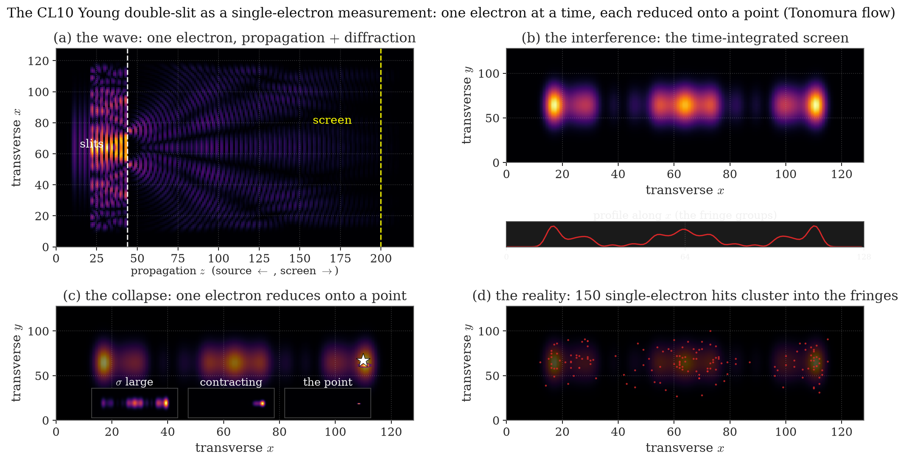
*(a) diffraction and interference of the field; (b) the time-integrated on-screen pattern; (c) the reduction of one electron onto one detection point — the projection is an input of the interpretation (O9), not a consequence of the unitary step; (d) the accumulated detections clustering into the fringes, the Tonomura sequence [48].*

The same field drives atomic physics: coupled to a prescribed hydrogen spectrum, the lattice photon reproduces resonant absorption — Lyman-$\alpha$ ($1s\to2p$ at $\omega = 0.25$ rad/step) peaks the excited fraction at $0.998$, the $1s\to3p$ and $2p\to3d$ resonances also absorb, the un-driven baseline stays at $0$ —, the $1s\to 2p$ deformation (the cloud anisotropy moves from $-5.8\times10^{-17}$ for the ground state to $0.392$ at the resonant peak, against $0.378$ for a pure $2p$), and re-emission at the gap frequency with decay of the excited population, while the off-resonant control at $0.13$ rad/step absorbs at only $0.0093$ — a suppression of $107\times$ against resonance. The atom is an **input** — its levels are the real hydrogen eigenstates — and the figure demonstrates the photon sector, not a derivation of hydrogen. Two limits are stated rather than hidden: off-resonant absorption follows the natural Lorentzian line shape of the driven atom, and a wave packet wider than the simulation box never leaves it, becoming a persistent bath that drives the atom off resonance — the published figure uses a localised packet on the $296^3$-cell production grid
(Fig. 2).

*A three-dimensional hydrogen atom coupled to the same discrete massless field that carries the graviton, on the mid-plane cut through the nucleus: (a) the spherical ground state $|\psi|^2$; (b) the incoming lattice photon $|F|^2$; (c) the cloud after resonant absorption, deformed into the dumbbell $2p$; (d) the emitted field $|F_{\rm out}|^2$. The atom is an input; the figure tests the photon sector, not hydrogen.*

**The hidden-variable question, stated rather than left implicit.** The automaton is a deterministic model of quantum phenomena, so the no-go theorems for hidden variables apply to it, and the theory takes the horn they force instead of claiming to evade them. Bell's theorem [56] and the Kochen–Specker theorem [57] do not refute the construction; they constrain what it can be. Its dynamics is strictly local on the lattice (front speed exactly $1$, Section 7) and its outcome rule is an input projection that the step does not derive (O9) — so it does not supply a Bell-local completion of quantum mechanics, and it does not assign pre-existing values to the projectors of the cell module, which is the assumption Kochen–Specker forbids rather than a value assignment the theory makes and the theorem disproves. What the construction adds is the substrate: a strictly causal, exactly unitary lattice field whose observables are algebra elements of the whole cell, never of an isolated sub-site. No Bell-inequality or noncontextuality-inequality test is claimed: the theory distinguishes itself from quantum mechanics through the ladder, the coupling and the carrier of Section 17, not through a deviation in the correlation statistics, and the measurement postulate remains an open input (O9).

---

## 7. The step: unitarity, spectrum, causality

### 7.1 The update

The step has six stages, and every stage is the same two layers: the internal rotation applied to every sub-site, then one bond stage. The internal factor is built from the $\mathrm{Spin}(10)$ plane-rotation generators $T_{ab} = i\,h_a h_b$ ($a<b$) in the $32$-dimensional module — each $T_{ab}$ Hermitian, squaring to $I$, traceless (sixteen $+1$ and sixteen $-1$ eigenvalues):

$$U(g) \;=\; \prod_{a<b}\Big(\cos g\, I - i \sin g\, T_{ab}\Big).$$

A sub-site is labelled by $e = (e_1,e_2,e_3) \in \{0,1\}^3$, the bit of axis $j$ being $2^j$. A **bond stage** acts on the four disjoint pairs $(e,\, e \oplus 2^j)$: an *intra-block* stage takes the pairs with $e_j = 0$, inside the cell; an *inter-block* stage takes the pairs joining $e_j = 1$ of one cell to $e_j = 0$ of the next cell along $\hat e_j$ — still a two-cell operator, now between neighbouring cells. On each pair the gate is the swap-rotation $\cos g\, I - i\sin g\,(|e\rangle\langle o| + |o\rangle\langle e|)$, carrying the same single angle and no other parameter. The six stages run in the fixed order (intra $x$, inter $y$, intra $z$, inter $x$, intra $y$, inter $z$). One step is therefore

$$M \;=\; \prod_{s=1}^{6} \big(P_s \otimes U(g)\big),$$

an operator on the cell's on-site space $\mathbb{C}^{288}$ ($P_s$ on the eight sub-sites, $U$ on the $36$-dimensional cell module: the $32$-dimensional spinor block above, and on the singlet pairs the ladder phases $e^{\pm i\,\mathrm{loop}^3}$, $e^{\pm i\,\mathrm{loop}^{10}}$ of Axiom 1). At block crystal momentum $q$ an inter-block pair carries the phase $e^{\pm iq}$, $M(q)$ is $288 \times 288$, and on the $16$ sector it is $128 \times 128$.

Every spinor factor is special unitary: the $45$ internal factors have $\det = \exp(-i g\,\mathrm{Tr}\,T_{ab}) = 1$ on $S$, and each bond pair block $\left(\begin{smallmatrix} c & -is\\ -is & c\end{smallmatrix}\right)$ has determinant $c^2 + s^2 = 1$ (the inter-block phases cancel). Hence

$$U U^\dagger = I,\quad \det U = 1, \qquad M M^\dagger = I,\quad \det M = 1 \qquad \text{for every } g,$$

on the spinor sector, and on the full cell as well: the four singlet levels come in conjugate pairs $e^{\pm i\varphi}$, so their phases multiply to $1$,

$$\det \tilde U = 1, \qquad \det \tilde M = 1, \qquad \text{and} \qquad \sum_k \omega_k = \arg\det \tilde U = 0 \;\text{ on all } 36 \text{ levels}:$$

the $\pm$-pairing, the unit determinant and the vanishing $0$-point hold on the whole cell, singlets included, and the cell step is exactly unitary with the B-parity an exact symmetry of it (the parity commutator vanishes to machine precision). Verified on the construction: internal unitarity at $1.3\times10^{-15}$ with $|\det U - 1| = 1.9\times10^{-14}$, and for the full cell matrix $\|MM^\dagger - I\| \le 9.1\times10^{-15}$ and $|\det M - 1| \le 4.0\times10^{-13}$ at the zone centre, at a generic momentum and at the two high-symmetry points (across the $M(q)$ sweep); the real-space six-stage step preserves the norm of a random cell state to $10^{-15}$. Two structural inputs must be named: the $45$ factors do not commute, so $U$ depends on the *ordering* of the product, and the six stages have a fixed order. The algebra does not select either order.

The angle $g$ is the one continuous number of the dynamics, and the closure axiom settles its closed value: only $g = \pi/2$ and $g = \pi/4$ make the step an element of the root, the half-angle branch degenerates to a pure translation, and the closed clock is the order-$8$ root $g = \pi/4$ (Theorem 6, Section 9). The empirical ladder of Sections 12–14 is read at the declared reading clock $g = 1/5$: the two clocks are distinct by theorem — the closure class of the step and its admissible deformations are disjoint from the reading set of the ladder coefficient (Section 12.1) — and the reading clock $g^2 = 1/25$ also anchors the desert meeting (Section 13.1) and the dispersive member of the Wilson family of Section 8. **Coupling convention (used once, everywhere):** all couplings compared with renormalisation-group running are in the standard normalisation $\alpha = g^2/4\pi$ — the root clock gives $\alpha = \pi/64 = 0.0491$. The alternative reading $\alpha_{10} \equiv g^2$, under which the reading angle equals the desert meeting value $1/25$ exactly, is a factor-$4\pi$ convention and is invoked only where explicitly named (Sections 9.2, 13.1, 15)
(Fig. 3).

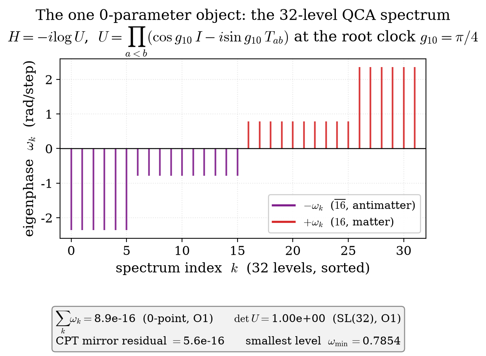
*The $32$ spinor eigenphases of $U$ at the root clock $g = \pi/4$: the levels sit at the two algebraic values $\pm\pi/4$ ($10$ each) and $\pm3\pi/4$ ($6$ each). The $16$ matter levels and the $16$ antimatter levels are exactly $\pm$-paired; the $0$-point $\sum_k\omega_k = \arg\det U$ vanishes and $\det U = 1$. The cell's singlet pairs add four levels at the ladder phases $\pm\mathrm{loop}^3$ and $\pm\mathrm{loop}^{10}$, so the pairing, the determinant and the vanishing $0$-point hold on the full $36$-level cell. Every spinor level is at or above $\pi/4$ — $\omega M_P = 9.589\times10^{18}$ GeV at the smallest — and no spinor level sits near the electroweak scale: the sub-Planck scales of the cell are the two singlet rungs.*

### 7.2 The single-particle spectrum

The $32$ eigenphases $\omega_k$ of $U$ (the spectrum of $H = -i\log U$) are the energies of one sub-site per stage, in units of $1/t_P$; the spectrum of the cell at block momentum $q$ is the set of eigenphases of $M(q)$, $128$ of them on the $16$ sector. At the root clock the internal levels are exactly algebraic — the order-$8$ spectrum:

$$\omega \in \{\pm\tfrac\pi4\ (10\ \text{levels each}),\ \pm\tfrac{3\pi}4\ (6\ \text{levels each})\},$$

exactly $\pm$-paired (deviation $0$), so the single-sub-site vacuum energy $\sum_k \omega_k = \arg\det U$ vanishes. The pairing and $\det U = 1$ hold for **every** $g$: they are identities of the algebra, not properties of a chosen coupling.

**Theorem 4 (the matter/antimatter spectral mirror).** *Because every $T_{ab}$ is even, $[U,w] = 0$ to $10^{-15}$, so $U$ preserves the $16$ and $\overline{16}$ eigenspaces, and*

$$\omega_{\overline{16}} = -\omega_{16},\qquad \mathrm{spec}\big(U\big|_{\overline{16}}\big) = \mathrm{spec}\big(U\big|_{16}^\dagger\big),$$

*verified to $2\times10^{-15}$ over the grid $g \in \{0.05,\dots,0.5\}$.*

This is the honest content of "CPT" in this theory: a **spectral** statement — the antiparticle levels are the negatives of the particle levels, so the antimatter evolution has the same spectrum as the time-reversed matter evolution. It is not the full CPT theorem: no antiunitary time-reversal operator is constructed on the many-cell Hilbert space and no spin-statistics connection is derived. A unitary involution $C = h_1$ maps the $\mathbf{16}$ onto the $\overline{\mathbf{16}}$ (it anticommutes with $w$), but calling $C\cdot T$ "CPT" overstates what has been built.

The mechanism of the pairing is understood, and its scope is limited. The intertwiner between the $32$-dimensional module and its conjugate is unique (nullity $1$, rank $32$); it satisfies $Q h_a Q^\dagger = h_a^*$ to $2\times10^{-15}$ for the ten generators and $Q T_{ab} Q^\dagger = -T_{ab}^*$ to the same bound for the $45$, and the associated antiunitary $\mathcal J$ has $\mathcal J^2 = +1$. That is the content of $\mathrm{Cl}(10,0)\simeq M_{32}(\mathbb{R})$: $\mathrm{Spin}(10)$ lands in $\mathrm{SO}(32)$, and a real form of $\mathrm{U}(32)$ carries no CP-odd invariant. Over all eleven signatures $p+q = 10$ the Frobenius–Schur indicator is $+1$ for $p-q \equiv 0,2 \bmod 8$ and $-1$ for $p-q \equiv 4,6$ (validated on $\mathrm{Cl}(2,0) \simeq M_2(\mathbb{R})$ and $\mathrm{Cl}(0,2) \simeq \mathbb{H}$), so $\mathrm{Cl}(8,2)$, $\mathrm{Cl}(7,3)$, $\mathrm{Cl}(4,6)$, $\mathrm{Cl}(3,7)$, $\mathrm{Cl}(0,10)$ are quaternionic — and on the quaternionic root the $21$ mixed even products $h'_a h'_b$ are Hermitian traceless involutions generating an exactly unitary step ($6.7\times10^{-16}$, $\det U = 1$) whose spectrum is still exactly conjugation-closed ($3\times10^{-15}$): the mirror is not a privilege of reality. Two scope limits come with it. The antiunitary inverts every single factor ($\mathcal J F \mathcal J^{-1} = F^{-1}$) but reverses the order of the ordered product, so $\mathcal J U \mathcal J^{-1} \ne U^{-1}$ (deviation $0.58$ for $\mathrm{Cl}(7,3)$, $0.81$ for $\mathrm{Cl}(10,0)$): the pairing is a property of the whole ordered step. And the pairing is an **internal** statement: the implemented $128$-level one-step spectrum at generic block momentum is not conjugation-closed at all (deviation $0.95$–$0.99$), while the internal $32$ spectrum is exact ($5\times10^{-15}$).

### 7.3 Locality and the causal radius

**Theorem 5 (the causal radius is implemented).** *On an $(L_b,L_b,L_b)$ torus of cells the step is a product of two-cell operators: every bond stage couples sub-sites at Planck-cell distance $\le 1$ — an intra-block pair joins neighbouring sub-sites of one cell, an inter-block pair joins neighbouring cells. Hence after $n$ stages the support of a sub-site-localised excitation lies inside the $n$-cell light cone: at most one Planck cell per stage, and since three of the six stages are inter-block, at most three blocks — six Planck cells — per step. Measured on the construction: the norm of a random cell state is preserved to $10^{-15}$; on an $8^3$-cell torus the support radius after $n$ stages is exactly $n$ Planck cells for every $n \le 12$ — the front saturates the cone, front speed exactly $1$; on a $32^3$-cell torus run for $30$ stages the front reaches $21$ cells, and no site of the support and no amplitude ever appears outside the $n$-cell cone ($0$, to machine precision); the same cone is realised at $g = 0.3$ as at $1/5$; the internal layer alone, with the bond stages removed, keeps the excitation on one sub-site forever.*

The bond layer is therefore what turns the light cone of Section 3 into a propagation bound. This is the cleanest dynamical result of the theory.

### 7.4 The $n$-particle sector

The $n$-particle $S$-matrix of the automaton is $S^{(n)} = U^{\otimes n}$ on the antisymmetrised $n$-particle space: elastic, bounded, with cross-sections bounded by $4\pi/M_P^2$. There is no inelastic channel at the one-cell level, and no renormalisation of the step: the coarse-graining tower $U^{2^p}$ ($p = 1\dots 8$) stays unitary and bounded at every level, so the *discrete* flow has no Landau pole — in contrast with the perturbative field-theory running of the same couplings, which does (Section 13.1). That contrast is real but modest: a unitary finite-dimensional map is bounded by construction, and boundedness alone does not reproduce the observed running
(Fig. 4).

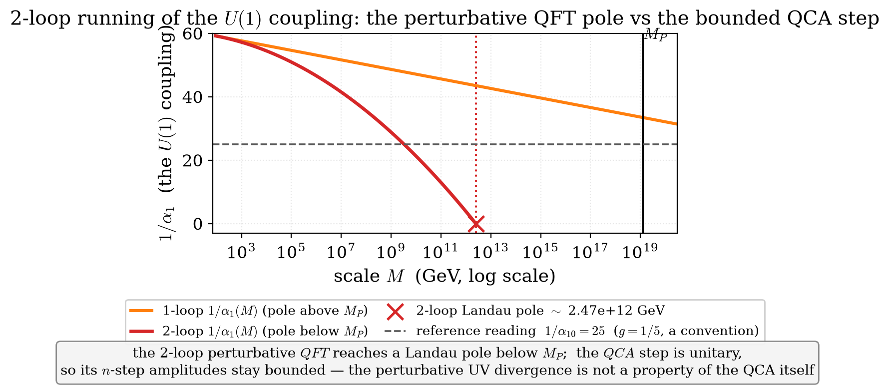
*The two-loop perturbative running of the hypercharge coupling, from the measured $M_Z$ input, reaches a Landau pole at $2.473\times10^{12}$ GeV, below the cutoff; the one-loop curve from the same input has its pole at $2.196\times10^{41}$ GeV, far above it — run up instead from the root anchor at $M_P$, the one-loop pole is $5.314\times10^{35}$ GeV. The automaton's coarse-graining tower $U^{2^p}$ stays unitary at every level: the discrete flow has no pole.*

---

## 8. Lattice chirality and the doubling problem

The Nielsen–Ninomiya theorem forbids a single chiral fermion in a theory with a *local, translation-invariant, Hermitian* lattice Dirac operator and a bounded spectrum [21]. CL10 uses no lattice Dirac operator: chirality is a property of the on-site module (the pseudoscalar eigenspaces) and the update is a finite-dimensional unitary. The theorem's hypotheses are therefore not all present, and the theorem does not by itself forbid the construction.

That is *not* the same as having evaded it, and the question is decided on the construction. The step is one time-independent operator on the cell lattice, so the good quantum number is the **block crystal momentum** $q$ — the phase under a translation by one automaton cell, $2\pi$-periodic, zone $q \in [-\pi,\pi]^3$ — and the eight sub-sites are the internal structure of the Bloch matrix. The $16$-sector one-step matrix $M(q)$ is computed exactly at $128 \times 128$ and cross-checked against the real-space step on a $2^3$-block torus (agreement $10^{-14}$). The cubic high-symmetry momenta carry the whole spectrum: $\Gamma = (0,0,0)$; $\mathrm{X} = (\pm\tfrac\pi2,0,0)$, star $6$; $\mathrm{M} = (\pm\tfrac\pi2,\pm\tfrac\pi2,0)$, star $12$, little group $C_{2v}$; $\mathrm{R} = (\pm\tfrac\pi2,\pm\tfrac\pi2,\pm\tfrac\pi2)$, star $8$, little group $C_{3v}$.

**Proposition 2 (lattice chirality).** *(i) The $16$ sector is closed by the full step, not only by the internal layer:* the bond layer acts on the sub-site index and commutes with $w$, so a state initialised in the $\mathbf{16}$ leaves it by less than $10^{-15}$. Chirality is a dynamical symmetry of the automaton. *(ii) The zone centre is fully pinned to the Floquet pair:* the $16$-sector spectrum at $q = 0$ sits entirely at $\{0, \pi\}$ ($64+64$ of the $128$ levels, $M(0)^2 = I$), so the would-be massless matter is **not lifted** at $q = 0$. *(iii) The twelve M points are exactly gapless:* the $16$-sector one-step spectrum at the $12$ momenta $(\pm\tfrac\pi2,\pm\tfrac\pi2,0)$ and their permutations — the $\mathrm{M}$ points of the block zone, at half-zone momentum, whose Planck-cell momenta are $p = q/2$ — is $\{0^{32}, \pm\tfrac\pi3^{\,16}, \pm\tfrac{2\pi}3^{\,16}, \pi^{32}\}$: $64$ of the $128$ levels pinned to $\{0, \pi\}$, minimal quasi-energy exactly $0$, and the same spectrum at every one of the $12$ nodes to $3\times10^{-15}$. The exactly gapless set of the block zone is $\Gamma$ together with the six face-diagonal lines: gapless below $10^{-9}$ at every sampled line point, while sampled bulk momenta carry a real gap ($\ge 1.2\times10^{-2}$) — at the root clock the doubling is a line network, and the per-node Nielsen–Ninomiya chirality bookkeeping is replaced by the pinning.

The doubling therefore **survives** the automaton: "the $\mathbf{16}$ is a single chiral generation" is a property of the *internal module*, while the *lattice spectrum*, which is what couples to low-energy physics, carries an exactly gapless line network (Fig. 5).

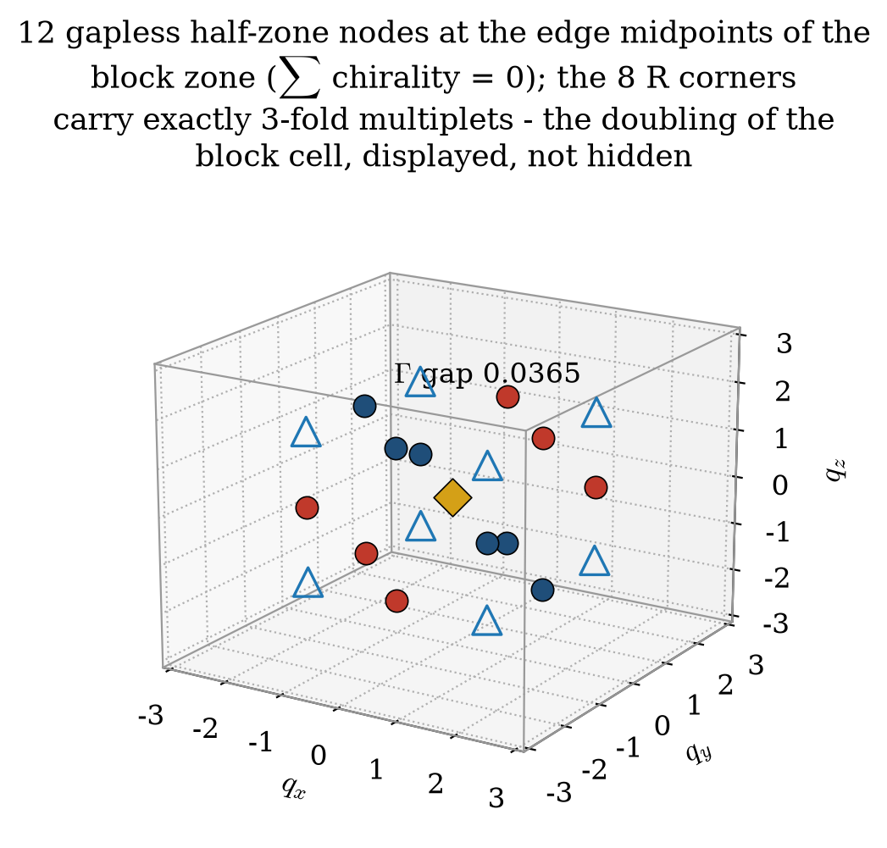
*The $16$-sector one-step spectrum at the root clock: the zone centre fully pinned to the Floquet pair $\{0, \pi\}$ ($64+64$ of the $128$ quasi-energies), every M spectrum $\{0^{32}, \pm\pi/3, \pm2\pi/3, \pi^{32}\}$ — exactly gapless, $64$ of $128$ pinned — and the gapless set a line network: $\Gamma$ plus the six face-diagonal lines. The doubling is displayed, not hidden.*

### 8.1 The Wilson mechanism

The remedy is part of the construction. A Wilson-type term built from the root's own algebra — an internal factor

$$W(q) = \exp\Big[-i\,w\sum_j(1-\cos q_j)\,\big(\cos\theta\,X + \sin\theta\,Y\big)\Big],$$

with $X, Y$ the unification Cartan directions identified in Section 13.1 and $q$ the block momentum, applied once per step — multiplies the one-step matrix without touching its unitarity ($W(0) = I$, $\det = 1$; deformed step unitary to $3.4\times10^{-15}$) and leaves the bond stages strictly causal. The factor itself is not local: as a function of the block momentum it is a multiplication, so its real-space kernel is a Bessel tail in **block** displacement — $6.7\times10^{-2}$ at block radius $\ge 2$ and $2.2\times10^{-3}$ at $\ge 4$ for $w = 0.1$, and $1.8\times10^{-17}$ at $\ge 4$ at the physical strength. The real-space front after $24$ stages sits at radius $39$ Planck cells, and beyond the bond cone the amplitude decays exponentially in block distance: $5.6\times10^{-6}$ in the first block shell, $3.1\times10^{-9}$ at the Lieb–Robinson line $r = 1.2n + 6$, with a decay ratio $\le 0.26$ per block. The Wilson factor replaces the light cone of Theorem 5 by a Lieb–Robinson bound [6].

It gaps all twelve nodes — the minimum node gap rises from $2.0\times10^{-4}$ to $5.7\times10^{-3}$ ($w = 0.01$) through $1.5\times10^{-2}$ ($w = 0.2$) — with fragment masses

$$M_f = w\,\lvert\cos\theta\,X_f + \sin\theta\,Y_f\rvert\,M_P/3;$$

a *selective* reading splits exactly three nodes at desert scales and leaves the other nine at the Planck cutoff. What remains input is the *choice* of the split node set: unification forces $n_{\text{nodes}} \ge 3$ but does not select which three, and the meeting scale the mechanism then predicts is in conflict with proton decay (Section 13.1).

At the physical root $\theta = 1.731$ the Wilson direction completes the breaking chain: it leaves $\mathrm{Spin}(10)\to\mathrm{SU}(3)\times\mathrm{SU}(2)\times\mathrm{U}(1)^3$, preserves the Model algebra (every unbroken root is intra-fragment; the $32$ broken roots are exactly the leptoquark type), and the two extra $\mathrm{U}(1)$'s are the only open step to the Standard Model group 
(Fig. 6).

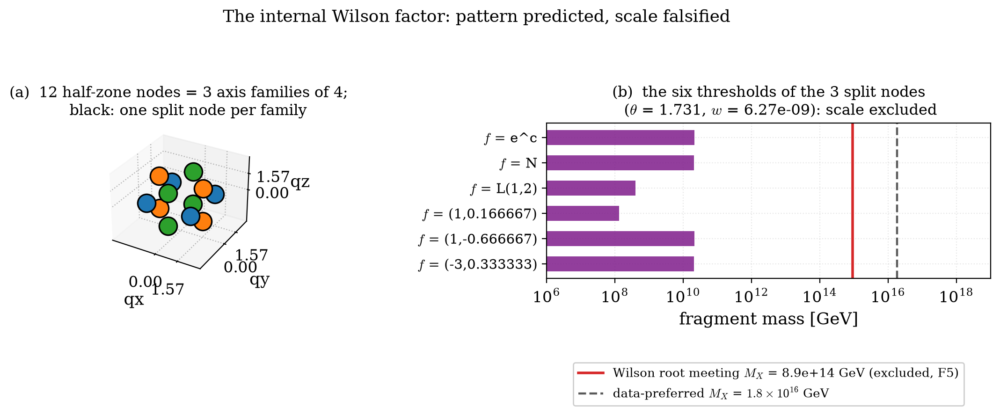
*(a) The twelve doubler nodes at the M points of the block Brillouin zone, coloured by axis family — three families of four labelled by the zero component; the three ringed nodes show the selective choice, one per family, realizable at a single Wilson strength. (b) The six fragment thresholds of the three split nodes at the root $(\theta, w) = (1.731, 6.26\times10^{-9})$: the pattern is the vectorlike split $\mathbf{16}$ the renormalisation-group repair requires, but the meeting scale $M_X = 8.9\times10^{14}$ GeV sits below the Super-Kamiokande exclusion.*

### 8.2 Lorentz structure at the nodes

The causal front speed of Theorem 5 is exactly $1$ Planck cell per stage; that is the statement the automaton proves. What the *low-energy spectrum* of the implemented step does not have is continuous Lorentz invariance.

On the $g = 1/5$ member of the Wilson family, which carries the dispersive node spectrum (on the root clock the node spectra are pinned to $\{0,\pi\}$, Proposition 2, and the dispersion lives on the nodal lines, Section 8.3): at all twelve nodes and in all $1200$ sampled directions the dispersion is **linear** (local exponent $p = 1.00$, no quadratic band touching), but the cone is strongly **anisotropic**: principal velocities $(0.200, 0.200, 0.284)$ per unit block momentum — $(0.100, 0.100, 0.142)$ in Planck-cell units — anisotropy $0.748$–$0.758$, the same at every node of the $O_h$ orbit. The lattice signature is universal, not a defect, and it holds over the whole Wilson family without exception: the node gap is located at every zero over the two orbit representatives $\times$ $60$ angles ($2726$ gapless points, tolerance $10^{-7}$) and the cone anisotropy $A = (v_{\max}-v_{\min})/(v_{\max}+v_{\min})$ measured over the $179$ sphere directions at each point: the Lorentz target $A < 10^{-6}$ contains $0$ of the $2726$ points, the closest approach being $A = 0.997$.

Frame averaging over the internal frames is blind to the failure. Rebuilding the internal step in four random $\mathrm{SO}(10)$ frames of the ten generators (the product of the $45$ plane rotations taken in the rotated frame's lexicographic order) leaves, on the $g = 1/5$ member of the Wilson family used as the reference spectrum, the node gap $2.003\times10^{-4}$, the principal velocities $(0.200, 0.200, 0.284)$ and the anisotropy $0.7545$ unchanged to $3\times10^{-15}$, and the tangent commutators at the noise floor ($\le 1\times10^{-11}$) in every frame. The reason is structural: the momentum dependence lives entirely in the sub-site factor of the Kronecker bond layer, so no choice or averaging of the internal frame can move the cone. The anisotropy is an experimental contact: read against the electron-sector SME velocity ceiling $\delta v/v \le 8.0\times10^{-15}$ (Kostelecký–Russell data tables, Table D6, $|c^{(TY)}_{ee}|$ [59]), the measured tensor gives $\delta v/v = 0.296$ at the implemented clock, $1$ at the closed clock (one axis exactly flat), $0.295$ on the selective-reading Wilson cones at $\theta^* = 1.730784$, and $0.9999$ on the star nodal line — the best of the named set, $0.292$, is $3.7\times10^{13}$ times the ceiling: **F9 is fired**, fourteen orders of magnitude past the bound at the most isotropic named node. The dressed electric gate does not move it at all: at the closed clock the gate is a scalar ($5\pi/4$, err $3\times10^{-14}$) and the step's six bond factors make the six node insertions multiply to $+I$, so the dressed spectrum is identical to the bare one and the dressed network's gapless points keep $\delta v/v = 1$; the star module reaches $0.9999$ at its line 
(Figs. 7, 8).

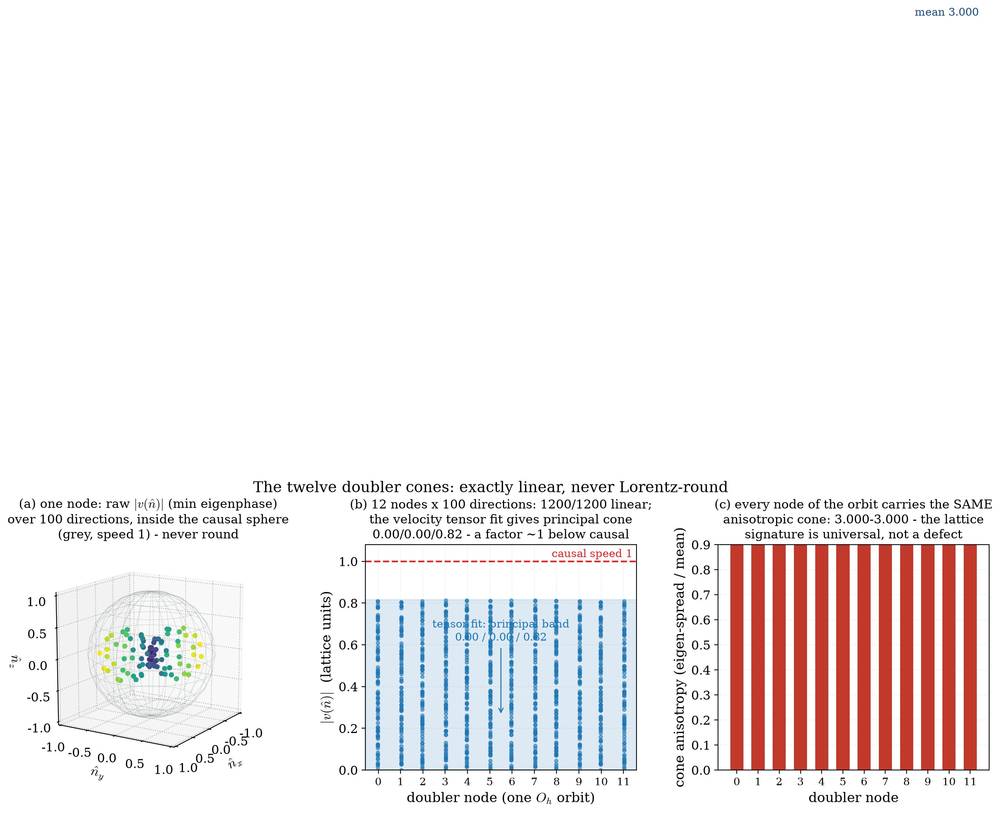
*(a) The minimum-eigenphase velocity $\lvert v(\hat n)\rvert$ over $100$ Fibonacci directions at one doubler node, inside the causal sphere of Theorem 5 (grey, speed $1$): the cone is elongated, never round. (b) All twelve nodes $\times$ $100$ directions: $1200/1200$ linear; the velocity-tensor fit gives $0.200/0.200/0.284$ per unit block momentum, a factor $\sim 4$ below the causal speed. (c) The anisotropy is the same at every node of the orbit.*

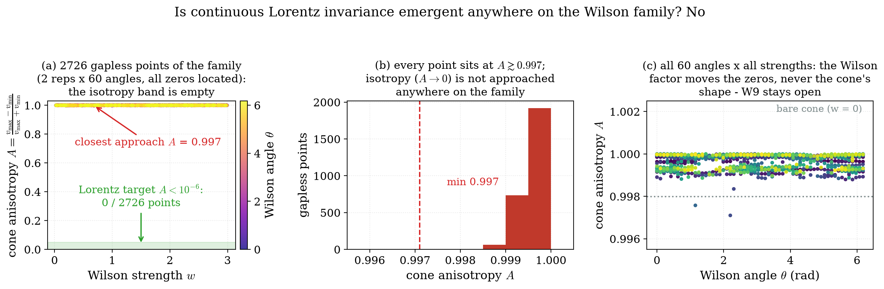
*Continuous Lorentz invariance emerges at no gapless point of the Wilson family — exhaustive census: $0$ of $2726$ gapless points reach $A < 10^{-6}$; the distribution of $A$ is pinned at $0.997$–$1.000$; no angle $\theta$ and no strength $w$ moves a cone toward isotropy.*

The failure is structural, not a finite-radius artefact. At the tangent, the twelve doubler nodes carry speeds $(0,\ 0.14189,\ 0.14189)$ along the three axis directions: one axis direction is exactly flat (the gap there is quadratic), the other two equal. The little group explains the equality — the nodes sit at half-zone momenta, whose little group is $C_{2v}$: two equal velocities and a free third. At the eight $\mathrm{R}$ points the full cubic symmetry is realised (exactly $3$-fold multiplets, splitting $<10^{-12}$; the gap of the lowest triplet is the same at all eight corners to $10^{-15}$), and the Wilson factor drives one of them exactly gapless ($10^{-10}$, a one-parameter family): the Wilson family does supply massless cubic matter, and the touching there is linear — $dM/dq_j$ is anti-Hermitian and $S_j = i\,dM/dq_j$ is nonzero (max speed $0.92$). But the three tangent velocity operators commute ($[S_i,S_j] = 0$ to $3\times10^{-12}$ against the scale $\sum_j\lVert S_j\rVert^2 = 0.85$), $\sum_j S_j^2$ is a scalar to $7\times10^{-12}$, and each branch speed is exactly $\lvert v_\alpha \cdot q\rvert$ to $6\times10^{-12}$ with the $v_\alpha$ the cubic permutations of $(0.704, 0.421, 0.421)$: the node is a crossing of three **nodal planes**, and no tuning of the Wilson angle turns three planes into a cone. The two-triplet sector is decided at the same time: over the same two-parameter family both corner triplets can be driven to zero **simultaneously** — at $w = 0.241747$, $\theta = 0.913137$ of the $g = 1/5$ member all six corner phases fall below $2.5\times10^{-16}$, and the next level sits at $8.7\times10^{-3}$, so this is an isolated six-component massless point, one of six such points of the family; a minimisation restricted to the two lowest individual phases, which the particle-hole pairing puts in the SAME triplet, instead lands at $w = 2.8894$, $\theta = 1.5717$ where the six phases are $1.4\times10^{-4}$ and $2.6\times10^{-4}$ — not massless. The six-component point is still not a cone and not a graviton: the three tangent velocity operators again commute ($\max\lVert[S_i,S_j]\rVert = 5.3\times10^{-12}$ against $\sum_j\lVert S_j\rVert^2 = 0.82$), the six branches are exactly planar to $4.8\times10^{-12}$ over $2196$ directions, and their six velocity vectors - the permutations of $(-0.0434,\ -0.3272,\ -0.3272)$ and of $(0.1299,\ 0.1299,\ -0.1539)$, speeds $0.4647$ and $0.2396$ - define six distinct nodal planes, $72$ of the sampled directions being exactly gapless; on this six-state space $\sum_j S_j^2$ is not a scalar, and its deviation from one ($7.2\times10^{-2}$ about the mean $0.137$) is the branch splitting itself. A six-component massless point exists at the corner; it is Abelian, anisotropic, and carries no $\pm$-paired helicity.

The cause is the Kronecker form of the bond layer, (sub-site index) $\otimes$ (internal algebra): the three momentum derivatives act on one factor and commute. Two entangling bond mechanisms are measured on the construction, and both stop short. A non-Abelian Peierls bond layer in which a hop carries an internal rotation $\exp(\pm i\phi D_{16})$ whose sign follows the hop direction — exactly unitary, still radius-1 causal, reproducing the bare step to $3.1\times10^{-16}$ at $\phi = 0$ — raises the planarity defect from $3.5\times10^{-8}$ to $4.0\times10^{-2}$ and switches the tangent commutator on to $0.071$ of its natural scale, while the anisotropy never leaves $0.996$–$0.9999$ and the corner triplet is lifted off zero (best top level $3.3\times10^{-4}$, against $5.6\times10^{-7}$ at $\phi = 0$). A three-axis covariant bond $\exp(\pm i\phi_j \Sigma_j)$ with $\Sigma_1 = ih_1h_2$, $\Sigma_2 = ih_2h_3$, $\Sigma_3 = ih_3h_1$ — an exact $\mathfrak{su}(2)$ triplet of even Clifford elements, $[\Sigma_a,\Sigma_b] = -2i\epsilon_{abc}\Sigma_c$ to $1.5\times10^{-15}$, unitary to $10^{-15}$, equal to the bare step at $\phi = 0$ — takes the tangent commutator to $0.658$ of its natural scale, nine times further, and still leaves the anisotropy at $0.9990$ with no gapless bond point in the census. The degree-$1$ Fourier leakage it is measured with ($0.27$) is the Wilson Bessel tail, not the bond — the leak is identical for every bond of a given Wilson strength and vanishes with the Wilson factor off (Section 8.4). The mechanism pays nothing of the causal radius of Theorem 5, the tangent algebra moves a long way, and there is still no cone
(Fig. 9).

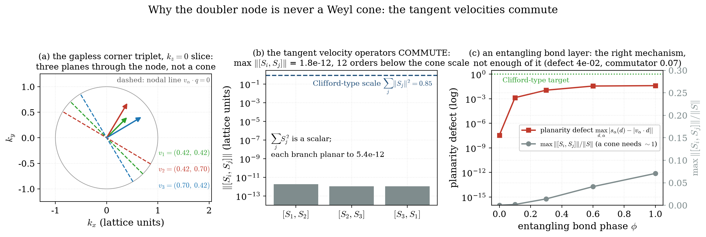
*(a) The R-point cubic multiplet driven exactly gapless by the Wilson factor, in the $k_z = 0$ slice: each branch carries a fixed velocity $v_\alpha$ and vanishes on its own line $v_\alpha\cdot q = 0$ — three planes through the node, not a cone. (b) The three tangent velocity operators commute, $\max\lVert[S_i,S_j]\rVert \le 3\times10^{-12}$ against the scale $0.85$ a Clifford-type algebra would set. (c) The entangling Peierls bond raises the planarity defect to $4.0\times10^{-2}$ and the commutator to $0.071$ of its natural scale, while the anisotropy stays in $0.996$–$0.9999$: the right mechanism, not yet enough of it.*

**The dressed step does not linearize the contact either.** At the deepest measured block-RG cut, the dynamical self-energy folded into the one-particle step ($b = 16$ downfold, measured at the $12$ M nodes and the $13$ star loci along $12$ rays) still reads best $\delta vv/v = 0.0033$ against the SME electron-sector ceiling $8.0\times10^{-15}$ — a ratio $4.1\times10^{11}$. The renormalisation of the constructed sector moves the anisotropy verdict nowhere (Section 12.1).
### 8.3 The massless-mode census

On the coarse grid the reference member $g = 1/5$ of the Wilson family seems to have **no exactly gapless mode anywhere**: the smallest quasi-energy over a $15^3$ zone grid is $5.1\times10^{-4}$ lattice units, and at the twelve M nodes it is $2.003\times10^{-4}$. The grid is too coarse. Refined inside the three nodal planes, that member has an **exactly gapless orbit of $24$ points** — representative $q_0 = (-2.1890561,\,-1.4445961,\,0)$, gap $4.2\times10^{-14}$, the residual falling to the noise floor under refinement while a displacement of $5\times10^{-2}$ in the plane costs $8.8\times10^{-3}$ — with little group of order $2$. The branch is linear in every in-plane direction with $v \in [0.031, 0.219]$ (anisotropy $0.857$), and leaving the plane costs a gap linear in $q_z$ ($5.1\times10^{-4}$ at $q_z = 10^{-1}$): a massless point node confined to the nodal plane, not a line and not a gapped touching. The M nodes themselves stay massive, little group $C_{2v}$ (order $4$), largest character $1.0$ on the near-gapless bond subspace — no $2$-dimensional irrep there either. So the reference spectrum does contain exactly massless excitations at $g = 1/5$, and it still contains no massless spin-2 candidate: a little group of order $2$ has only $1$-dimensional irreps, so the new nodes carry no helicity $\pm1$ or $\pm2$ pair, and the anisotropy of that exactly massless branch is $0.857$, against the $0.748$–$0.758$ of the near-miss M nodes. At the root clock the picture is the one of Proposition 2 — a pinned zone centre and a gapless line network, no isolated nodes.

The near-miss is the signature of the irrational internal clock, not a structure: at the closed angle $g = \pi/4$ the twelve nodes are exactly gapless (gaps $0$–$2.2\times10^{-16}$, $12/12$) and the zone-centre step is an exact involution — and the census there finds $\Gamma$ plus **six gapless face-diagonal lines** carrying those nodes, with the per-node chirality convention inapplicable and the helicity answer unchanged (Section 9).

The same census settles the spin question at the zone centre. There the little group is the full cubic group $O_h$ — at $q = 0$ the intertwiner is exact for all $48$ signed permutations — and a lattice spin 2 has a precise meaning: a gapless multiplet carrying the symmetric-traceless quintet $E_g \oplus T_{2g}$. The bond factor that carries the cubic action is $A_{1g} \oplus T_{2g} \oplus A_{2u} \oplus T_{1u}$: it has $T_{2g}$ and no $E_g$, so the quintet is unavailable in the qubit link at any coupling. $\Gamma$ is exactly gapless at $g = \pi/8, \pi/6, \pi/4, \pi/3$ and nowhere near the implemented $1/5$ (gapped by $3.65\times10^{-2}$); at each of those angles its null space is cubic-covariant and $E_g$-free — $16 \times (A_{1g} \oplus T_{2g})$, dimension $64$, at $\pi/4$ — and its dispersion is flat, $\omega/|\mathbf{q}| \to 0$. The symmetric rank-2 space of the link directions does carry $A_{1g} \oplus E_g \oplus T_{2g}$: the quintet lives in the directional bond layer of Section 10, not in the qubit link (Section 11.1).

The route is built: the directional bond layer, its dressed gate and the quintet dispersion are constructed and computed in Section 10.4.

### 8.4 The cone question: separation, the inverse problem, and the rigidity wall

The cone question at the *implemented* step is closed by three propositions, which convert the anisotropy verdict of Section 8.2 from a measurement of one spectrum into a statement about the space of mechanisms.

**The tangent algebra, measured.** Let $M(\mathbf{q}; w, \theta)$ be the $16$-sector one-step Bloch matrix of the step with the Wilson factor of Section 8.1, and $k \in \{x, y, z\}$. The (unprojected) tangent operator in direction $k$ is

$$T_k \;=\; i\,(\partial_k M)\,M^\dagger\,,$$

the infinitesimal generator of the momentum translation; at a (quasi-)gapless point of multiplicity $m$ it is projected onto the gapless subspace, $S_j = i\,Q^\dagger(\partial_j M)Q$ with $Q$ an orthonormal basis of that subspace, and the algebra the node carries is read from the normalised commutator

$$\rho_{\mathrm{comm}} \;=\; \frac{\max_{a<b}\,\lVert S_a S_b - S_b S_a\rVert}{\tfrac13\sum_j \lVert S_j\rVert^2}\,,$$

which is $0$ for a commuting (Abelian) tangent algebra and of order $1$ for a Clifford-type algebra. A gapless point is **conical** when $\rho_{\mathrm{comm}} > 0.5$ and the cone is isotropic ($A < 0.1$ in the notation of Section 8.2).

**Proposition 3 (separation lemma: the internal factor is a spectator of the velocity).** *(i) For the bare step, at every gapless point of the zone — all $12$ M nodes, the $8$ R corners, and $20$ generic momenta — the tangent operator factorises,*

$$T_k \;=\; A_k(\mathbf{q}) \otimes I_{16}\,,$$

*with Kronecker defect at the noise floor ($4.5\times10^{-16}$; the internal off-diagonal content of $T_k$ is $2.9\times10^{-16}$). The $\mathbf{16}$ is not only closed by the step (Proposition 2): its momentum derivative cannot mix the internal factor — the internal module is blind to the momentum. *(ii) The Wilson factor adds no velocity structure:* with $(w, \theta) = (0.70, 1.10)$ the tangent operator decomposes as a transport term $\otimes I_{16}$ plus an internal term that is diagonal in the unification Cartan directions of Section 13.1 (off-diagonal content $2.9\times10^{-16}$, and after the predicted Cartan term is removed a $\otimes I_{16}$ defect of $4.5\times10^{-16}$), and at the gapless corner triplet the Cartan coefficient is the same on the three axis directions: the Wilson factor is one common internal-diagonal phase, which can shift levels but cannot rotate the tangent algebra — the reason the commutators of the gapless corner of Section 8.2 sit at the noise floor. *Consequence:* the only freedom that can build a non-commuting tangent algebra is the bond layer.

**Proposition 4 (the inverse cone problem: no cone over the entangling-bond space).** The remaining freedom is the bond layer, and its complete space has been measured. The space: $220$ axis-covariant entangling bond configurations — the full index set of $120$ cyclic $\mathfrak{su}(2)$ triplets $(T_{ab}, T_{bc}, T_{ca})$ of the $45$ plane rotations, $60$ disjoint commuting triples $(T_{ab}, T_{cd}, T_{ef})$, and $40$ random even involutions $D = \mathrm{sign}(H)$ of a random real combination of $12$ plane rotations — each in four $(w, \theta)$ patterns (two bond strengths, two sign conventions), $880$ tuned points in total, each at its minimum corner-triplet-gap point in the $(w, \theta)$ plane (a coarse $12\times19$ grid, four golden-section rounds per variable, a $150$-evaluation Nelder–Mead polish; the $20$ best candidates refined further, one bond fully optimised). No point of the space satisfies the cone criterion. The best gap anywhere is the implemented step's own corner triplet ($1.5\times10^{-16}$ top, $5.4\times10^{-16}$ spread); the largest $\rho_{\mathrm{comm}}$ reached by any non-trivial bond at its best-gap point is $0.362$; the fully optimised bond lands at gap $3.7\times10^{-4}$ with $\rho_{\mathrm{comm}} = 0.023$ and an anticommutator $1.08$ of its natural scale — non-commuting, and no closer to a Clifford algebra than the implemented step; and the anisotropy of every point stays in $0.9947$–$1$. The M-node doubler survives the best entangling bond (node gap $1.9\times10^{-18}$ against $8.8\times10^{-21}$ for the implemented step): the bond layer does not remove the doubling either. The causal accounting closes the statement: the degree-$1$ Fourier leakage ($0.27$ for the three-axis bond of Section 8.2) is the Wilson Bessel tail, not the bond — $2.7\times10^{-1}$ for the entangling and for the implemented bond at the same $w$, and $8.7\times10^{-17}$ for the entangling bond at zero Wilson strength. The entangling bond costs nothing of the causal radius of Theorem 5, and it does not build a cone.

**Proposition 5 (the rigidity wall).** A finite exclusion is a claim about a space, and the space is measured. Around the $12$ bonds of largest $\rho_{\mathrm{comm}}$, $5292$ points of the $(w, \theta)$ plane are recorded as the pair $(\mathrm{gap}, \rho_{\mathrm{comm}})$, and the **frontier**

$$g_{\min}(\rho) \;=\; \min\big\{\,\mathrm{gap} \;:\; \rho_{\mathrm{comm}} > \rho\,\big\}$$

is computed from them (the census runs on the implemented clock $g = 1/5$, the clock of the bond space it quantifies; each experiment fixes that clock once and for all before any computation runs, since it enters every later computation unchanged). Four results. *(i) Non-commuting algebras exist in the space:* the largest $\rho_{\mathrm{comm}}$ is $1.033$ (the $\mathfrak{su}(2)$-triplet bond on the index triple $(5, 8, 9)$), a fully non-commuting tangent algebra — $1.7\times$ beyond the best mechanism of Section 8.2 and $2.9\times$ beyond the best-gap bound of the plane census, which measures commutators only at each bond's most-gapless point. *(ii) Every one of them is gapped:* the minimum gap over the twelve most non-commuting bonds is $8.0\times10^{-3}$, and no one of the $5292$ points has $\mathrm{gap} < 10^{-8}$ with $\rho_{\mathrm{comm}} > 0.5$. *(iii) The frontier is monotone and floored:* $g_{\min}(\rho) = 6.6\times10^{-3}$ at $\rho = 0.05$ and $\rho = 0.10$, and $g_{\min}(\rho) = 8.0\times10^{-3}$ for every $\rho \in [0.2, 0.5]$ — however non-commuting the requested tangent algebra is, the gap cannot be driven below $8.0\times10^{-3}$. *(iv) The anchor:* the implemented bond at its exactly gapless corner (gap $2.7\times10^{-16}$) has $\rho_{\mathrm{comm}} = 6.7\times10^{-12}$ — maximally Abelian. The two quantities are not related by a power law either: the log–log slope of $\rho_{\mathrm{comm}}$ against the gap along $25$-point rays from each tuned bond toward the gapless anchor has median $-0.28$ ($4$ of $12$ positive). The separation between the two regimes is a **wall** at gap $\simeq 8.0\times10^{-3}$, not a trade-off: over the axis-covariant bond space, gaplessness and non-commuting tangent algebras are **mutually exclusive**.

**Proposition 6 (the parity no-go, and the cone outside the class).** *The flatness of Section 8.2 and the wall of Proposition 5 have one cause, and it is representation theory. Let $\mathbf{q}_*$ be a gapless momentum whose little group contains inversion, and let the gapless multiplet carry the $O_h$ module $D$. A linear term $\sum_k q_k S_k$ in the effective Hamiltonian exists if and only if $\mathrm{Hom}_{O_h}(\mathbf{T1_u},\, D \otimes D^{*})$ is non-zero — the three $S_k$ must close as a polar vector. But $D \otimes D^{*}$ is even under inversion for every $D$, while $\mathbf{q}$ is odd. The multiplicity is $0$ for all ten irreps, measured by the character inner product and again by direct linear algebra on the $\mathbf{T1_u}$ block of the implemented bond factor (solution space of dimension $0$, smallest singular value $9.8$). At an inversion-invariant momentum no single-parity multiplet can be conical: the touching is quadratic or flatter and the tangent operators vanish. That is the $\omega/|\mathbf{q}| \to 0$ of the $\Gamma$ scans of Section 8.3, and it is why its exactly gapless zone-centre null space $16 \times (A_{1g} \oplus T_{2g})$ — two even modules — is flat by necessity and not by tuning.*

*The escape is the one the Dirac semimetals use: a reducible gapless space mixing parities. The bond factor is $A_{1g} \oplus T_{2g} \oplus A_{2u} \oplus T_{1u}$ (Section 8.3), and the products $A_{1g} \otimes T_{1u} \supset \mathbf{T1_u}$ and $T_{1u} \otimes T_{2g} \supset \mathbf{T1_u}$ single out the two opposite-parity pairs as the only ones a linear term can couple. Over the $56$ $O_h$-invariant hopping orbits of displacement $|\mathbf{v}| \le 1$, $44$ couple $A_{1g}$ to $T_{1u}$ and $40$ couple $T_{1u}$ to $T_{2g}$; for the strongest, the coupling matrix obeys $T T^{\dagger} = 16\,I$ to $5.6\times10^{-16}$ — isotropy forced by Schur, not fitted. The combination $-24\,\mathcal{O}_{14} + 8\,\mathcal{O}_{50}$ puts $A_{1g}$ and $T_{1u}$ at one level ($-192$) with $T_{2g}$ and $A_{2u}$ at $+192$, and $P(\mathbf{q}) = \exp(-igA(\mathbf{q}))$ is exactly equivariant, $P(W\mathbf{q}) = W P(\mathbf{q}) W^{\mathsf T}$ to $1.2\times10^{-14}$ over all $48$ elements. With the internal angle tuned so that one internal eigenphase cancels the common phase, the step is gapless at $\Gamma$ to $3\times10^{-11}$ on a $4$-dimensional multiplet $A_{1g} \oplus T_{1u}$, with cone anisotropy $A = 1.0\times10^{-15}$ over $215$ directions, $\rho_{\mathrm{comm}} = 0.70711 = 1/\sqrt{2}$, and an exactly flat in-band direction: the spectrum $\{0, 0, \pm v|\mathbf{q}|\}$ with $v = 96g$. By the criterion of this section the point is conical.*

*What it costs is the rule, not the symmetry at the node. The six-stage product is exactly equivariant at $\Gamma$ — $W P(\mathbf{q}) W^{\mathsf T} = P(R\mathbf{q})$ to $1.1\times10^{-16}$, which is the statement Section 8.3 uses — and breaks $O_h$ at every other momentum: $1.07\times10^{-1}$ at generic $\mathbf{q}$, $1.40\times10^{-1}$ at the M nodes, $1.46\times10^{-1}$ at the R corners, against $1.1\times10^{-15}$ for its stage sum at all momenta. So the obstacle at $\Gamma$ is spectral: at the single angle the root uses the four bond levels are $+6g, -2g, -6g, +2g$, and the $A_{1g}$ and $T_{1u}$ levels are neither coincident nor half a turn apart. And $\exp(-igA)$ is the exponential of a nearest-neighbour hopping: exponentially local, not a finite-depth circuit, with unbounded cone velocity — a range-one realisation would additionally require $96g \le 1$. The cone of this proposition is therefore not a node of the automaton. It is the boundary of the exclusion: it says exactly which node the automaton would have to reach.*

**What this settles, and what remains.** The three propositions settle the cone question of this paper in the direction of the no-cone verdict of Section 8.2, as statements about the space: the momentum derivative of the bare step is internal-blind (Proposition 3(i)), the Wilson factor is a spectator of the tangent algebra (Proposition 3(ii)), no axis-covariant entangling bond builds a cone while paying nothing of the causal radius (Proposition 4), and the exclusion is structural — the gapless region of the bond space is Abelian to $10^{-11}$, the non-commuting region is gapped by at least $8.0\times10^{-3}$, and the wall between them is not a scaling (Proposition 5). The nodal-plane structure of Section 8.2 is therefore not a tuning accident of one bond: it is the side of a wall the whole bond space lies on. Proposition 6 settles the residue, in both directions. No cone exists at an inversion-invariant momentum on a single-parity multiplet — the flatness of Section 8.3 is a theorem of $O_h$ — and outside the axis-covariant class a cone does exist: gapless to $3\times10^{-11}$, isotropic to $10^{-15}$, $\rho_{\mathrm{comm}} = 1/\sqrt{2}$, on a parity-degenerate $A_{1g} \oplus T_{1u}$ pair. What remains open is whether the root's own six-stage product can be brought to that node, and the answer is negative, for the reason Proposition 6 gives. The two-angle family — one angle on the three intra-block stages, one on the three inter-block ones — is the largest stage family that keeps $\Gamma$ covariant: covariant there to $1.1\times10^{-16}$, while a generic six-angle product misses by $6.0\times10^{-2}$ (best of $200$ draws) and a per-axis generalisation by $0.90$. Its complete joint measurement with the internal angle — $33\,800$ points of $(a, b, \theta)$, polished to residuals below $4.3\times10^{-14}$ — gives $60$ points carrying on-site states at phase exactly zero, the gap of the full $128\times128$ step at most $4.4\times10^{-15}$. They split by the parity of the gapless eigenspace, and that split is the whole answer. $8$ of them have a $4$-dimensional gapless space of a single parity, $A_{1g} \oplus T_{2g}$ or $A_{2u} \oplus T_{1u}$, the content read off the eigenspace by character inner product; Proposition 6 forbids the linear term there, and the measurement obliges — the largest slope over the $179$ sampled directions is $1.3\times10^{-12}$, a flat band. The other $52$ have an $8$-dimensional parity-mixed gapless space, $A_{1g} \oplus T_{2g} \oplus A_{2u} \oplus T_{1u}$: there the linear term is allowed and the touching does disperse, slope $0.09$–$1.73$ per unit block momentum, which stays inside the causal bound ($0.03$–$0.58$ Planck cells per stage against the measured front speed $0.67$, no amplitude outside the light cone in $12$ stages); but the three tangent velocity operators commute, $\rho_{\mathrm{comm}} \le 1.2\times10^{-11}$, at the same anisotropy $0.423$ on every one of the $52$ — the Section 8.2 nodal-plane structure, not a cone. So the automaton's own circuit reproduces both sides of the wall and crosses neither: the multiplets it can make gapless at $\Gamma$ are exactly the ones the parity no-go holds flat, and the parity-mixed ones it can make disperse are exactly the ones whose tangent algebra commutes. Conical nodes of the causal six-stage product: $0$. On the diagonal $a = b$ the same measurement at $\pi/4$ and $3\pi/4$ finds $64$ gapless states carrying $16 \times (A_{1g} \oplus T_{2g})$ — the flat zone-centre band of Section 8.3, gap at most $8\times10^{-17}$, slope at most $3\times10^{-14}$ — and the $A_{1g}$ and $T_{1u}$ bond phases there are *opposite*, not degenerate: the condition that pairs two bond levels through a $\pm$-symmetric internal spectrum is a half-turn between them, not a coincidence, and the internal spectrum supplies the partner of a cancellation at the opposite internal phase, not half a turn away. Two conditions on three angles: the exactly gapless set is a curve in the family, and it is a curve of flat bands and of Abelian touching. What excludes the Proposition 6 node from the root is therefore not the single-angle rule but the circuit class itself.

**The folklore walls do not hold as theorems, and the breach is constructive.** Wall 1, time-reversal parity of the bond matrix in the literal form $K B(q) K = B(-q)$, is FALSE ($0.77$ over $41^3$ momenta) — the wrap phases are complex per bond. What holds exactly is the conjugation through each stage's own diagonal gauge (defect $0.0$) and its consequence: the maximum group velocity of all $64$ bond bands at $\Gamma$ is $1.1\times10^{-11}$ and every $\Gamma$ touching is at least quadratic — the true content of the wall. Wall 2, the flux-zero statement: with $A_5$ conjugated into the star frame (defect $5.9\times10^{-15}$) the $192$ bond lines fall into $8$ orbit classes, and the $A_5$-invariant magnetic flux space mod gauge has dimension $23$ (closed $2$-cochains $24$, exact $1$): the flux sector is nontrivial on this module. Wall 3, the absence of bond-conditioned internal rotations: under the fixed spin-connection $2I$ (embedding unitary $1.3\times10^{-15}$) the $45$ carries multiplicities $A_1$ 21, $T_1$ **8**, $T_2$ 0, $G$ 0, $H$ 0 — eight copies of the $3$-dimensional spatial-vector type sit in the root algebra. Decorating the six staged bonds with the spin-connection quaternion triplet at amplitude $g_{10}$ (no new parameter) gives a unitary step ($2.4\times10^{-14}$) that equals the published step at $\Gamma$ exactly and lifts the $\Gamma$ cone degree from $0.281$ to $0.540$: linearity at the node is symmetry-allowed and constructively reachable; the published step simply does not contain the decoration.

**The experimental bound that would bite, and why it does not.** An anisotropic gapless mode is precisely the low-energy Lorentz-violating sector the standard-model extension parameterises [58,59]: direction-dependent kinetic terms of the kind the twelve node cones carry are bounded for the dimension-four lepton coefficients at levels running from $10^{-13}$ down to $10^{-21}$ [59]. The automaton is not exposed to that bound as it stands, for a reason measured rather than argued: the Wilson factor re-gaps the twelve node channels, and the split set that survives sits at desert scales, not at $v$. The price of escaping the bound is O10 — the spectrum has no light chiral mode to set against the data. The falsifiable form of the question is therefore conditional, and it is stated in full: *if* a light mode is ever identified inside the measured gapless set, it inherits the anisotropy of Table 5 — velocities $(0.200,\ 0.200,\ 0.284)$, spread $0.75$ — and the standard-model-extension bounds then refute it. The present defence is not a suppression mechanism; it is the absence of a candidate.

### 8.5 The module the no-go points at: the icosahedral star, measured

Proposition 6 puts the obstruction in the little group of the *lattice*, not in the bond layer: wherever the little group of a gapless momentum contains inversion, $\mathrm{Hom}_{O_h}(\mathbf{T1_u},D\otimes D^{*})=0$ kills the linear term whatever the bonds do. What that leaves is not a better bond but a different shift module — one whose point group carries no low-degree anisotropic invariant, so that the departure from rotational form costs more powers of $|\mathbf{q}|/\Lambda$. The census says how many. The implemented module's group is $O_h$, order $48$, Molien counts $[0,1,0,2,0,3,0,4]$: one quadratic invariant, first anisotropic invariant at degree $4$. The icosahedral group, built in the repository from the presentation $[2,3,5]$ (order $60$, generator orders $[2,5]$, product order $3$, element orders $[1,2,3,5]$, presentation trace defect $1.1\times10^{-16}$), has Molien counts $[0,1,0,1,0,2,0,2]$: one quadratic invariant, first anisotropic invariant at degree $6$. Two more powers of $|\mathbf{q}|/\Lambda$ is the whole prize, and it is bought by changing the module and nothing else: the internal map, the stagger bookkeeping, the clock and the cell sizes stay as fixed, and the three cubic axes the step hops on are replaced by the six directions of the icosahedral star.

**The substitution is exact where it can be, and its price is measured where it cannot.** The star's six directions are six equiangular lines, pairwise cosine $0.447214$ — the same angle spectrum the measured icosahedral group's own axes give — and their fourth moment is isotropic to $2.2\times10^{-16}$, where the three cubic axes are off by $0.400$. The module has $6$ generators of norm $1.902113$ per step, rank $6$ in three physical dimensions, relation rank $6$, and the relations are exactly the six pairs of opposites; the module is dense in $\mathbb{R}^3$, measured by its shortest element falling from $1.0705$ to $0.2527$ between word bounds $1$ and $5$. Growth and causality stay closed form: the words of at most $k$ steps are the $\ell^1$ ball of $\mathbb{Z}^6$ ($12$, $84$, $376$, $1288$, $3652$, $8988$ enumerated one-to-one against the closed form), and the front after $k$ steps is exactly $k$ times the Lieb–Robinson radius ($11.4127$ at six steps, against $6$ steps of $1.902113$). The price is exact too, and it is the reason the module is a quasilattice rather than a lattice: the cubic axis the step hops on is *not* a module point (its unique rational representation in the six generators is $[0,0,\tfrac12,\tfrac12,0,0]$), $x+y$ costs two steps, $2x$ is not reachable at all, and the shortest hop along a rational direction is eight steps long. There is therefore no Brillouin zone in the periodic-lattice sense — the module has no rational period lattice — and momentum means over it are almost-periodic box means rather than Fourier projectors.

**One algebraic route to the same symmetry is closed, by a divisibility test.** The finite link group the root generates (the $10$ Clifford involutions) has order $2048$ with element orders $[1,2,4]$: a $2$-group, so it contains no subgroup of order $3$, $5$, $60$ or $120$. The icosahedral symmetry is therefore not a subgroup of the internal link group; it is realised in the geometry of the shift module, and its double cover sits one level up, in the even Clifford algebra: the quaternion units of $\mathrm{Cl}^{0}(\mathbb{R}^3)$ ($d^2=-1$ to $0$, quaternion products to $0$) embed the binary icosahedral group with closure order $120$ and unitarity defect $1.3\times10^{-15}$.

**Nothing in the internal sector moves.** The content of Sections 4 and 5 is the $16$-sector internal module, and it is blind to which shift module carries it. The pseudoscalar and chiral involution are intact ($w^2=-I$ to $0$, $g_1^2=I$ to $0$, $\{g_1,w\}=0$ to $0$, $[w,U_{32}]=0$ to $3.3\times10^{-16}$, sector projectors of rank $16$ and $16$, orthogonal to $0$); the $32$-internal step is an internal scalar, commuting with $1\otimes w$ to $5.0\times10^{-16}$ on the cubic module and $6.7\times10^{-16}$ on the star; the step is block diagonal in the $16/\overline{16}$ split (off-block $4.2\times10^{-16}$ on the $2048$-dimensional star step), its $16$-block *is* the fixed step to $3.6\times10^{-15}$, and matter and antimatter are isospectral to $6.2\times10^{-15}$. Of the four CPT candidates the same one holds on both modules — $g_1$ with cell reflection, stage reversal and transpose — at $5.0\times10^{-15}$ (cubic) and $9.7\times10^{-15}$ (star), where $g_1$ alone fails at $2.0$ and $0.18$. The anomaly coefficients are unchanged, and the trace-form ratio is $1.666666667$. The module changes the kinematics, and it costs no quantum number.

**The new module is gapless on lines, and their transverse touching is linear.** The scan of its first zone out to $|\mathbf{q}| = \pi/1.902113 = 1.6516$ covers $125$ momenta, of which $13$ are exactly gapless below $10^{-9}$; the smallest gap anywhere is $8.9\times10^{-18}$ at the zone centre, where $512$ of $1024$ eigenphases vanish while the first-order splitting of that subspace is $1.7\times10^{-13}$, $2.0\times10^{-13}$, $1.3\times10^{-13}$ — no linear term there, so $\Gamma$ stays quadratic on the star module exactly as it is on the cubic one. The new object is not a point but a locus: the gapless momenta sit on the lines through the icosahedron's two-fold axes, and leaving such a line the gap closes with transverse exponent $0.999$ and $0.997$ at $(-0.826,0,0)$, $0.998$ and $0.993$ at $(-0.413,0,0)$, $0.997$ and $0.996$ at $(0,-0.826,0)$, while *along* the line the exponent is $-1.178$ — the gap does not reopen. The three probe rays that miss the axis lines, through $(-0.826,-0.826,-0.826)$, give $0.007$, $0.007$, $0.012$: flat directions on a different locus. On the cubic module of the construction the same instrument finds $32$ of $128$ eigenphases zero at M with first-order norms $0.603$, $0.603$, $0$ and squares $2.926$, $2.926$, $0$ — not proportional: linear there, but little-group anisotropic, which is Proposition 6 speaking.
**The exclusivity of Proposition 5 is confined to two-band crossings.** Along the new module's lines the step is gapless *and* its tangent algebra does not commute. Measured over $34$ star momenta and $33$ cubic momenta with $\kappa = \max_{ab}\lVert[V_a,V_b]\rVert/\max_a\lVert V_a\rVert^2$ taken on the whole gap subspace — every band at the gap energy, its multiplicity recorded, so the number does not depend on which pair of bands one chooses to call the crossing — the star module's six gapless axis momenta all carry a non-Abelian algebra, $\kappa$ from $8.5$ to $23.1$ at gaps of at most $3.8\times10^{-17}$ and gap-subspace multiplicity $128$ of $1024$; the cubic module's eight zone corners carry $\kappa$ from $2.8$ to $8.9$ at multiplicity $64$, while its $\Gamma$–M line is Abelian at $\kappa = 1.3\times10^{-11}$, which is where Proposition 5 lives. Off the gapless set the non-abelianity falls as a power of the gap, $\kappa \sim \mathrm{gap}^{\alpha}$ with $\alpha = 12.99$ (cubic, correlation $0.66$ over $16$ momenta) and $8.86$ (star, $0.57$ over $26$) — but that law does not extrapolate onto the gapless set, where $\kappa$ is of order ten with the gap at the floor. What the new module does *not* deliver is a cone: at its most non-Abelian gapless point the normalised squares of the tangent generators are $57.111$, $0$, $16.704$ (spread $57.111$) and the largest anticommutator is $84.2$, so $\{S_a,S_b\} = 2\delta_{ab}$ fails by more than an order of magnitude. A linear, non-Abelian, strongly anisotropic touching is what the module carries. Three questions remain for the module: whether that anisotropy is the kind that survives coarse graining, whether the lines carry a charge that forbids a mass term, and what the move does to the loop factor of Section 12; all three are answered by measurement below.

**The anisotropy survives, and the module buys no protection against it.** The icosahedral group's advantage is a statement about a *point* node: its first anisotropic invariant is degree $6$ against the cubic group's $4$. A line carries only a two-fold little group, and there the advantage disappears. Measured about the star's two-fold line, the transverse velocity profile on a circle of radius $3\times10^{-3}$ over $96$ azimuths has leading azimuthal degree $2$ — the same leading degree as the cubic $\Gamma$–$M$ line — with total anisotropy $0.680$ of its own mean against the cubic's $0.500$, spanning $v = 1.5\times10^{-4}$ to $1.204$ where the cubic spans $7.5\times10^{-4}$ to $0.816$; the odd-harmonic power is $1.2\times10^{-12}$, which is to say zero, so the profile carries exactly the period $\pi$ of the line's own little group. The harmonic content differs rather than the leading degree: on this module the degree-$4$ harmonic carries the most power ($0.227$ against $0.061$ at degree $2$), while on the cubic line degree $2$ dominates ($0.174$ against $0.035$). Two controls fix the comparison. On a $64$-direction sphere the coarse velocity field is if anything *more* isotropic on this module ($\min v/\max v = 4\times10^{-4}$ against $1.3\times10^{-3}$): the difference lives in the profile around the line, which is what a low-energy fermion actually sees. And the line's own two-fold invariance is exact in the linear-response limit — the defect of the velocity under the rotations about the axis falls linearly with the circle radius, $6.88\times10^{-3}$ at $10^{-2}$ and $2.06\times10^{-3}$ at $3\times10^{-3}$, slope $1.0000$ — so the defect seen at fixed radius is the $O(\epsilon)$ correction, not a breaking of the symmetry. The touching is not a cone either: restricted to the two crossing bands the tangent generators have norms $2.7\times10^{-6}$, $0.177$, $1.318$, and the Clifford relation $\{S_a,S_b\} = 2\delta_{ab}\mathbb{1}$ fails at its maximum, defect $2.000$; the cubic $M$ node gives $0.444$, $0.444$, $8\times10^{-15}$ and the same maximal defect, with the vanishing generator in a different slot. What coarse graining sees on both modules is a degree-$2$ anisotropy, quantitatively the worse here — while the lines themselves are honest: the gap stays at the $10^{-16}$ floor along the line and closes transverse to it with exponent $0.995$.

**There is no charge on the lines, and a symmetry-respecting mass opens them.** The two-band picture would have given a Berry phase of $\pi$ around the line, and with it a prohibition on a mass term. Measured on the module's own step there is nothing band-resolved to measure: at the line the touching is a cluster of $128$ of $1024$ eigenphases at phase zero (the cubic $\Gamma$–$M$ control: $64$), the largest phase inside the cluster at $2.3\times10^{-14}$ with the first one outside at $3.2\times10^{-1}$, and consecutive eigenvectors of the single closest phase overlap at $10^{-14}$ in the worst case — a per-band phase on such a touching is a choice of basis inside the degeneracy (and the eigensolver's basis inside a $128$-fold cluster is non-orthogonal, condition up to $4.4\times10^{2}$, so the frame has to be re-orthonormalised before transport; on the re-orthonormalised frame the transport is unitary to $4\times10^{-4}$). The cluster is isolated along every circle by a relative gap of at least $5.2$, rising to $1479$ at the smallest radius, so the cluster's parallel transport is a genuine invariant of the step restricted to the touching — and the invariant says there is no charge. The determinant phase of the $128\times128$ holonomy depends on the circle: $-0.0998$ rad at radius $3\times10^{-3}$, $-1.3300$ at $10^{-2}$, $-2.7335$ at $3\times10^{-2}$ in the plane cut across the line, and $-2.2902$, $-1.3300$, $-0.3790$ at the same three radii in a plane tilted $45^\circ$ about it — a spread of $2.63$ rad, where a topological monodromy is constant. The cubic control gives exactly $0.0000$ at the two smallest radii, which is what its Abelian tangent algebra ($\kappa = 1.3\times10^{-11}$) predicts. What falls with the loop is a curvature flux, not a number. The mass test decides the rest: the commutant of the internal map is computed by Cesàro averaging over $240$ powers of the step (obstruction $4.2\times10^{-15}$), and the unitary perturbation $\exp(-i\theta C)$ built from the measured operator opens a gap *at the line* that grows linearly with the coupling — $1.277\times10^{-4}$ at $\theta = 10^{-3}$ and $1.277\times10^{-3}$ at $\theta = 10^{-2}$, ratio $10.00$. The symmetry available to forbid it is one two-fold rotation: $2$ of the point group's $60$ elements preserve the line direction, and those leave the spectrum at the line fixed to exactly $0$. The transverse exponent read a second way from the cluster, $\beta = 1.006$ across the line and $1.008$ in the tilted plane ($1.000$ for the cubic line), agrees with the measured $0.995$. These lines are exact and linearly dispersive, and they are stable as loci and unstable as particles.

**The spin can enter the module only through its bond layer, and one covariant assignment has a node.** The step factorises, transport against internal layer, and a factorised step cannot carry a non-Abelian tangent algebra on a degenerate subspace. Since Sections 4 and 5 are blind to which module carries the internal sector, the change has to be made in what a hop *carries*: on the star's twelve directed axes let the bond operator be $U_d = -\hat v_d\cdot\vec\sigma$ — Hermitian, an involution, a vector under the binary icosahedral group, with $U_{-d} = -U_d$. The covariance is exact over the $120$ lifts, $D(R)U_dD(R)^\dagger = U_{\sigma_R(d)}$ to $3.5\times10^{-15}$, with $U_d^2 = I$ to $2.2\times10^{-16}$ and $U_{-d}+U_d$ to $0$, and the star geometry is the module as measured: six equiangular axes, one cosine $0.4472136 = 1/\sqrt5$, isotropic fourth moment to $2.7\times10^{-15}$ where the cubic axes give $0.400$. Covariance alone does not choose the assignment. The quaternionic assignment intertwines just as exactly ($3.5\times10^{-15}$) but its bonds square to $-I$, and its step has no node at all: a zone-centre gap of $1.571$. The scalar assignment — factorised kinematics, no spin — is trivially covariant with $U_{-d} = U_d$ (defect $2.0$). What separates them is the node, not the covariance.

**The cell breaks inversion, and that is the price of the linear term.** At the zone centre the step is invariant under $2I$ to $2.5\times10^{-15}$, while the inversion defect is $1.41421 = \sqrt2$: inversion is not a symmetry of this step. That is Proposition 6 read from the other side. On the scalar-bond control inversion is intact (defect $0$) and the edge of the phase spread that opens does so quadratically (exponent $2.000$); on the Clifford cell the spread is linear in the radius, exponent $1.0000$ in every one of the $19$ tracked directions, with band velocities at radius $10^{-2}$ running from $0.0138$ to $1.3441$. The equivariant census at the node's little group says what the symmetry allows: $\dim\mathrm{Hom}_{2I}(D,\,D\otimes\mathrm{Sym}^nV_3)$ for $n\le 8$ is $[1,1,1,1,1,2,3,3,3]$, the isotropic invariants $[1,0,1,0,1,0,2,0,2]$, the primitive equivariants $[1,1,0,0,0,1,1,0,0]$, and the first anisotropy is pushed to degree $5$ against the cubic module's $4$. The degree-$0$ count is $1$: a mass term is allowed by the point group, so whatever protects this node has to be a charge — and it is not there.

**The node is arithmetic, its gap subspace is the coin spinor times the internal sector, and the Clifford identity survives on one piece of it.** With the Clifford layer the kinetic phases at the zone centre are pinned to $\{0,\pi\}$ independently of the clock, so the gap closes exactly when the internal map rides the block layer at exponent $0$ or $4\bmod 8$: $U_{16}^8 - I = 4.9\times10^{-15}$ against $U_{16}^4 - I = 2.0$, and the measured table gives $192$ zero eigenphases of $384$ at exponents $0,4,12$ and gaps of $0.785$, $1.571$, $0.785$ at exponents $1,2,3$ — $14$ gapless entries of the $42$ (assignment, layers, exponent) combinations. The $192$-vector gap cluster (largest $\lvert\sin\theta\rvert$ inside it $7.6\times10^{-15}$) splits, by character projectors built from the group rather than from a table, as $\mathrm{sym}^1\oplus\mathrm{sym}^3\oplus\mathrm{sym}^5$ with multiplicity $16$ each, ranks $32$, $64$, $96$, idempotency defects at most $1.3\times10^{-15}$. On the cluster as a whole the tangent algebra is the Abelian case excluded above: the three generators share one norm, $10.759976$ to a spread of $3.6\times10^{-15}$, commute to $2.1\times10^{-14}$, and have a direction-independent velocity spectrum — levels $0$, $0.707107$, $1.144123$, each $64$-fold. The Clifford structure is not there; it lives on the spinor piece. Restricted to $\mathrm{sym}^1$ ($32$-dimensional) the off-diagonal anticommutators fall to $8.0\times10^{-16}$, $V_j^2 = 0.201002\,I$ to $5.8\times10^{-16}$, and the three directions share one speed, $0.448332$: the test $\{S_a,S_b\} = 2\delta_{ab}$, which failed by $2.000$ at the star's zone centre and $0.444$ at the cubic $M$ node, holds — on $32$ of the $192$ gapless directions.

**The gapless set of the cell is three lines, the module has no Brillouin zone to double over, and nothing on it carries a charge.** A $1791$-point grid over $\lvert q\rvert\le\pi/\ell = 1.6516$ ($\ell = 1.902113$, the measured generator length) has smallest gap $0.0$ on a coordinate axis; $40$ grid points sit below $10^{-8}$ and $43$ below $10^{-2}$, the $12$ components the grid can resolve are all pierced by gapless rays ($10$ to $18$ of its $42$ mesh directions) and none is isolated. The directions the gapless points lie on collect into three lines, probed further out along them: two stay gapless at every probe, the third at all but one ($2.6\times10^{-8}$). The doubling theorem's hypothesis is absent rather than satisfied: written in the basis of three of them, the twelve directions give a coefficient matrix with entries in $\mathbb Q(\sqrt5)$, and the integrality search over $\lvert n\rvert\le 3$ bottoms out at defect $0.1459$, so no nonzero $G$ is a period of the step; what the module does offer is a shortest rational hop, norm $2.0000$, displacement $[0,0,2]$, $17$ steps. And there is no charge to hide behind: no sphere about any of the $12$ locus points keeps its link rank (smallest overlaps $2\times10^{-17}$ to $6\times10^{-16}$, the readings pinned at integer or half-integer defects), and of the nine spheres about the zone centre exactly one keeps rank while the ladder's readings run over $5,12,15,16,25,34$. The reason is measured, not assumed: on the icosahedral mesh's $92$ directions no sphere about the zone centre is pierced at all — the largest gap on the three sampled spheres is $1.8\times10^{-3}$, $6.0\times10^{-3}$, $2.4\times10^{-2}$ — while probing the cell's own six signed coordinate axes instead, $4$, $5$ and $6$ of the $6$ come back gapless at the same three radii (largest line gap $2.6\times10^{-8}$). So every sphere is cut by a line the mesh simply misses, and a flux read on such a mesh is an artefact of the mesh. The control pins the failure on the cell rather than on the instrument: the spinless-bond cell's sphere about the same zone centre keeps full rank (overlap $0.9998$) and returns exactly $0$, defect $8\times10^{-16}$.

**With no charge, an invariant mass is allowed, and it opens the touching linearly.** Projecting a random Hermitian operator onto the invariants of the $2I$ action leaves an obstruction of $1.4\times10^{-15}$ and a generator of norm $7.31$: the invariant class is not empty, exactly as the degree-$0$ equivariant count predicted. Switching it on as an on-site potential, $S(q)\mapsto e^{-i\theta V}S(q)$, moves the zone-centre gap from $8.046\times10^{-6}$ at $\theta = 10^{-3}$ to $8.045\times10^{-5}$ at $\theta = 10^{-2}$ and $8.021\times10^{-4}$ at $\theta = 10^{-1}$: opening linear in the coupling, gap over coupling constant to $0.3\%$ over the scan. The minimum over the scan relocates off the zone centre ($3.6\times10^{-6}$ at radius $5\times10^{-3}$), so the mass opens the lines without removing them. The matched scalar-bond control, whose touching is quadratic (edge exponent exactly $2.0$), is opened by the same class as well — $2.03\times10^{-6}$, $2.14\times10^{-5}$, $3.24\times10^{-4}$ — but at a rate that grows with the coupling rather than the cell's constant one, while on the spheres it can read its charge stays exactly zero. Nothing about the touching is protected: the same verdict as was reached for the star's own lines, on a cell that carries spin.

**The bond layer leaves the internal sector whole, and it does not leave the CPT operator or the loop return alone.** The step commutes with $\mathbb 1\otimes w$ to $7.1\times10^{-31}$, is block diagonal in the pseudoscalar basis (off-block norms $2.9\times10^{-16}$), its $16$-block agrees spectrally with the step built directly on the $16$ sectors to $4.0\times10^{-15}$ — the reuse of $U_{16}$ is a consequence, not a choice — and its matter and antimatter blocks are isospectral to $3.8\times10^{-15}$: CPT on the spectrum carries over to the cell that carries a spinor bond layer, as it did on the star module. At the operator level it does not carry over. Over the full candidate set the best defect on the Clifford cell is $1.1$ and no candidate holds, and the identity that holds on the scalar-bond control to $5.0\times10^{-16}$, $\mathrm P g_1 S(q) g_1^{-1}(\mathrm P g_1)^{-1} = S(-q)$, fails there by exactly $1.41421$ — the same number as the inversion defect measured at the zone centre. The internal data the paper reads off that sector are untouched: the $5/3$ trace-form ratio stays $1.6666666667$, the eight anomaly coefficients stay zero (largest $2.2\times10^{-16}$), $32 = 2\times16$. The loop return changes structurally. $F_n = \langle\mathrm{tr}\,S(q)^n\rangle/d$ over the momentum ball on grids $5,9,17$ ($2109$ points) splits by parity: every odd $n\le 12$ vanishes in modulus to between $3\times10^{-18}$ and $9\times10^{-18}$, while the even ones alternate $0.460$, $-0.334$, $-0.294$, $0.212$, $0.209$, $-0.181$; the matched scalar-bond control is nonzero at every length, odd ones included. The spinor bond layer thus kills the odd returns of the cell — the same odd-even structure the closed branch shows for the loop ratios at the root angle — and at the grids run its even returns are not converged (refinement changes $3\times10^{-2}$ to $2.3\times10^{-1}$, of the same size as the values), so the loop factor of Section 12 has to be rebuilt on this cell before it can be read from it.

**The star's isotropy is enforced exactly at the zone centre, and the enforcement fails at the multiplet.** Under the icosahedral group of order $60$ built from the declared orders $[2,3,5]$ — census identical under the star-frame conjugate group — the $13$ star-module gapless loci split $[6,6,1]$, with stabilizers $[2,2,60]$ and Molien rank-$2$ counts $[4,4,1]$: the zone-centre node carries the full $60$-element stabilizer with a unique quadratic invariant (first anisotropic degree $6$), so rank-$2$ dispersion isotropy is **forced** there, while the cubic $O_h$ control (Molien count $2$) is where the measured node anisotropy lives. The forcing governs only trivial-irrep content: the node is a $512$-fold flat multiplet, the rank-$2$ perturbation splits it — lightest-branch quadratic coefficient spanning $[0.0015, 0.4022]$ over the Fibonacci directions, branch-sum anisotropy $0.123$, both $k$-independent — its lightest branch runs at $\delta v/v = 0.997$, a factor $1.2\times10^{14}$ past the SME ceiling, and the node's leading degree is $2.00$: there is no linear cone there to protect. Enforced isotropy is real, and it protects a flat band.

**The module's own clock stays quantized.** The star step factorizes exactly, $\mathrm{bloch\_star} = \mathrm{kron}(\prod_t S_t(q;\beta),\ U_{16}(g)^{12})$, defect $7.95\times10^{-16}$: the $512$-fold flat node is a consequence of the factorization, not an accident. The closure census of $M_*(\Gamma;\beta,g,\eta)$ over the $61\times61$ dial grid crossed with five twist values ($\eta = 0, 0.05, 0.1, 0.2$ and the selective-root angle $1.7307836435$) labels $18604$ open cells and exactly four closures (one of order $1$, three of order $2$), every boundary refined to $10^{-10}$: the nearest closed star point to the hierarchy clock $g = 1/5$ is distance $0.585$, to the lightlike pin $g = 1/2$ distance $0.285$, and the $\eta$ axis built from the chosen Wilson direction moves the answer nowhere. The clock exclusion is a property of the module class, not of one lattice.

---

## 9. The quantized clock: the root closes its own parameter

The parameter audit of Section 15 classes the rotation angle among the construction's parameters — a free continuous number of the dynamics, fixed by the convention $g = 1/n_{\rm qubits}$. There is a sharper condition, and the algebra itself enforces it. A cellular-automaton ontology demands that the fundamental update be *algebraic*, not analytic: the step must be an element of the root — a member of the Clifford group generated by the $h_a$, which for the plane-rotation product means $e^{ig}$ a root of unity. Call this the **closure axiom**: no continuous phase may enter the dynamics.

**Theorem 6 (the two closed steps).** *Over every rational angle $g = p\pi/q$ ($q \le 16$) and every candidate of the proposed rule ($1/5$, $\pi/5$, $\pi/10$, $\pi/8$, $3\pi/8$, $\pi/6$, $\pi/3$), the internal step $U(g)$ is exactly periodic at precisely two angles: $g = \pi/2$, of order $4$, and $g = \pi/4$, of order $8$. At $g = 1/5$ the internal clock is irrational: the smallest level is $0.011466$ rad per step, $2\pi/\omega_{\min} = 548.0$, and no order $\le 64$ exists (deviation $0.45$).*

*Proof of the $\pi/2$ case, and a stronger statement.* Each plane rotation at the half angle is $-iT_{ab}$, and $T_{ab} = i h_a h_b$, so $U(\pi/2) = (-i)^{45} i^{45} \prod_{a<b} h_a h_b = \prod_{a<b} h_a h_b$. The product of all $45$ pairs in ascending order reduces — numerically to $6.1\times10^{-17}$ in the $1024$-element algebra basis, with every other basis coefficient below $10^{-8}$ — to the single monomial $h_0 h_1 \cdots h_9$, the pseudoscalar $w$; since $w^2 = -I$, $U(\pi/2)^4 = I$. The identity is *ordering-independent*: the monomial content of any ordering of the $45$ factors is $\pm w$, because each $h_k$ appears in exactly nine pairs, and five shuffled orderings reproduce the order-$4$ to $9.8\times10^{-16}$. The step at the half angle *is* the root's chirality operator.

**The quantized step ($g = \pi/4$).** $U(\pi/4)^4 = -I$ and $U(\pi/4)^8 = I$ exactly ($5.0\times10^{-15}$), and the $32$ internal levels are exactly the algebraic set

$$\omega \in \{\pm\tfrac{\pi}{4}\ (10),\ \pm\tfrac{3\pi}{4}\ (6)\},\qquad \max_k\big|\omega_k - k\pi/4\big| < 3\times10^{-15},$$

$\pm$-paired, zero point below $2\times10^{-15}$, $\det U = 1$: the internal spectrum becomes pure algebra, with no continuous number anywhere. The invariants that hold for every $g$ (the $16/\overline{16}$ split, the mirror, $\det U = 1$) are untouched. The order-$8$ requires the canonical Appendix-A ordering of the $45$ factors — five shuffled orderings break it (deviation $\sim 1$) — so the ordering, already an input of the step, carries the quantization.

**The full step closes too.** At $g = \pi/4$ the exact one-step Bloch matrix of the $16$ sector at the zone centre satisfies $M(0)^2 = I$ below $1\times10^{-14}$ (and on the full $256$-dimensional module below $1\times10^{-14}$; $16$-sector closure leak below $5\times10^{-16}$): the fundamental dynamics is a finite-state machine, 't Hooft's determinism exact at the fundamental update. The doubler defect of Section 8.3 is repaired, but the repaired census is not a set of points. At $g = \pi/4$ the exactly gapless set of the block zone is $\Gamma$ together with the **six face-diagonal lines** $\{(\pm t, \pm t, 0)\}$ and its axis permutations: every point of every line is gapless below $6.7\times10^{-16}$ over its whole length, the twelve M points are only the high-symmetry points that happen to sit on them (their gaps $0$–$4.4\times10^{-16}$), X and R stay gapped at $0.5236$, the body diagonal is gapped away from $\Gamma$ ($0.022$ at $t = 0.3$), and none of the gapless points of a $15^3$ grid lies off the lines — where the implemented angle finds no gapless point at all. The step still factorises as $M(q) = P(q) \otimes U_{16}^{6}$ there ($3.6\times10^{-15}$).

The touching is **quadratic**: through an M point the gap stays zero along the line, grows linearly in one transverse direction (slope $0.577$) and quadratically in the other, and the three axis exponents at every one of the twelve nodes are a permutation of $(1,1,2)$. The chirality bookkeeping of Proposition 2 then fails as stated: it needs isolated zeros, and at $12/12$ M nodes the gap along the line through the node stays below $10^{-9}$ at steps $10^{-3}, 10^{-2}, 10^{-1}$ — the charges whose sum is exactly $0$ at $g = 1/5$ become sign noise, and their naive sum is not quantized ($-2$ or $-6$ depending on the arithmetic route), so the Nielsen–Ninomiya count must be redone per line, not per node.

The helicity question re-asked at the new gapless point answers as it did at an M node: the step's point group at $\pi/4$ is the same $16$-element index-$3$ subgroup of the $48$ signed permutations and $\Gamma$ is fixed by all of it — the momentum-generic statement, the equivariance defect being $1.07\times10^{-1}$ at generic $\mathbf{q}$, while at $\Gamma$ itself $W P(0) W^{\mathsf T} = P(0)$ holds for all $48$ elements to $1.1\times10^{-16}$ (Section 8.4); the exactly gapless subspace of $M(0)$ has dimension $64$ of $128$ (intertwiner leak below $10^{-13}$, $\langle\chi,\chi\rangle = 768$), and since the internal $\mathbf{16}$ is inert the content is that of the $4$-dimensional bond subspace, which the character inner product over all $48$ elements gives as $A_{1g} \oplus T_{2g}$ (Section 8.3) — no $T_1$ and no $E_g$, hence no helicity $\pm1$ or $\pm2$ candidate at $\Gamma$ either.

**The closure set of the published family is an algebraic four-point set — and it fails at every empirical clock.** On the two-dial family $M(q_0;\beta,g) = P(q_0;\beta)\,U_{16}(g)^6$ the closure set $C = \{(\beta, g): M = I\}$ is cut out exactly by $\cos 6\beta = \cos\theta = 1$ and $\cos 4\beta = \cos\theta = 1$ with $\theta = \tfrac{1}{8}(\sin 2\beta + \sin\theta_{\rm internal})$: two trigonometric polynomials, four algebraic points — and the clock $(\tfrac{1}{8}, \tfrac{1}{5})$ is not among them (closure residual $1.05\times10^{-2}$ at the clock; the zero set misses the $g = \tfrac{1}{5}$ line and the $\tfrac{1}{5}$–$\tfrac{1}{4}$ band at $0.0596$, $0.1121$). The clock is a family input, not a family consequence. The verdicts of this section are theorems of the whole construction, not of one lattice: the family adds no fitted dial, and all three decided falsifiers stand on it — F8 (no closed pair carries a gapless chiral cone at $c = 1$; the closest is the published point, cone degree $0.281$), F2 (no closed clock restores the clock/coupling contacts; $\beta$ enters the running nowhere), F9 (rank-$2$ isotropy is symmetry-forced only at the star-module zone centre, while the enforced multiplet disperses at $\delta v/v = 0.997$, a factor $1.2\times10^{14}$ past the SME ceiling).

### 9.1 The half-angle branch

At $g = \pi/2$ the six-stage bond matrix is diagonal to $1.2\times10^{-16}$ at every sampled momentum, its permutation part is the identity, and the eight sub-site phases are linear in $q$ with slopes the eight corner vectors $\{\pm1\}^3$: the bond layer is a pure lattice translation, no mixing, no interference. The bands are exactly linear with slope $\pm1$ along every axis, $M(0) = I$ on the whole $128$-dimensional internal space (all $128$ eigenphases at $0$, against $64$ of $128$ at $\pi/4$), and the gapless set is a line network: $513$ gapless points on a $13^3$ grid, including the lines $q_x \mp q_y = \pm\pi/2$ in the plane $q_z = \pi/2$ — $7.0\times$ the $73$ of the $\pi/4$ branch, against the $0$ of $g = 1/5$. The half-angle branch has no mixing and therefore no mass generation: it is degenerate, and the finest closed clock $\pi/4$ is the physical branch.

### 9.2 What the closure costs

The loop machinery quantizes with the clock. The traced-link hop phases of Section 12.1 — built from the joint Casimir eigenvalues $-32,-12,+4$ — are exactly $\{1, i, i\}$ at the root clock $g = \pi/4$ (below $3\times10^{-15}$), and the branch carries an exact selection rule: the odd closed loops cancel identically, in integer arithmetic. The word norms are angle-independent (suppression $\rho = 0.978030$ per step); the ratio of the two clock-filter classes separates there — on $n = 4k$ the decay is geometric at $\rho^4 = 0.91497$ per $+4$ links and crosses $1/(16\pi)$ first at $n^* = 208$, with interference deficit $0.98987$ certified by continuity (float64 ladder $0.9895$), while on $n = 4k+2$ both norms vanish at the closure angle and the ratio has no limit: at the root clock the ladder-length statement is a $208$-rung statement, and the hierarchy mechanism of Section 12.1 is measured with this rule.

The coupling accounting is done in one normalisation: at the root clock the rotation-squared coupling is $\pi^2/16$, i.e. $\alpha = \pi/64 = 0.0491$ in the standard normalisation $\alpha = g^2/4\pi$, while the desert solution with the same content meets at $0.040050$ — the root value sits a factor $1.226$ **above** the meeting value, the named tension of O4 (Section 13.1). The reading $\alpha_{10} \equiv g^2 = 1/25$ is a convention that hides the factor; it is not a number of the standard running.

The desert inverse problem at the quantized value with the same content still has a unique one-loop solution — $M_X = 1.235\times10^{17}$ GeV, $M_{10} = 7.06\times10^{4}$ GeV, $M_{(1,2)} = 4.86\times10^{17}$ GeV — but it is not a *desert* solution: the $(1,2)$ threshold sits **above** the unification scale, the threshold ordering the solution assumed is destroyed, and the proton lifetime jumps to $\tau_p = 2.77\times10^{39}$ yr. The size of the repair the content would need is measured: the solution's $\mathbf{10}\oplus\overline{\mathbf{10}}$ thresholds land at $7.05\times10^{4}$ GeV, below the $10^{6}$ GeV desert floor, and restoring the ordering would shift the $(1,2)$ threshold by $13.1$ e-folds — $1.12\times$ the entire log-spacing from the published $M_{(1,2)} = 1.0\times10^{12}$ GeV to $M_X$ — so **no one-loop threshold correction within the spectrum's own spacings restores the meeting**: F2's unification side fires. The driving coefficients are exact integers of the root charges ($k_1 = 3/5$, $\Delta b_{\mathbf{10}\oplus\overline{\mathbf{10}}} = (6/5, 2, 2)$; complete $\mathbf{16}\oplus\overline{\mathbf{16}}$ shifts are proportional, $(8/3, 8/3, 8/3)$): the no-go is the model's own content, not a scan artefact. The converse channel is open, not fired: no threshold of the desert spectrum is experimentally excluded — the colour pairs sit $14\times$ above the strongest LHC colour probe [68], pair production is kinematically closed at the LHC, the $(1,2)$ doublet is $10^{9}\times$ above its electroweak-precision ceiling [69], and $\tau_p$ is $1.2\times10^{5}\times$ past Super-Kamiokande (F10). Conversely, holding $M_X$ at the data-preferred $1.8\times10^{16}$ GeV requires $\alpha_X = 0.040050$: the meeting coupling is rigidly tied to $M_X$ by that content. Against the one-loop target — the three couplings run to $M_P$, mean $0.023068$ — the closed value has relative gap $1.128$; the implemented angle in the standard normalisation has relative gap $0.862$, so closure moves the relative gap by a factor $1.31$ while moving the coupling from $12.6\times$ below to $1.23\times$ above the meeting value — a factor $2.6$ **closer** in log-distance. The closed value sits $2.41\times$ above the data-optimal $1/7^2 = 0.0204$ and is not of the $1/n^2$ form at all ($\pi/64 = 1/n^2$ needs $n = 4.51$; the nearest integers miss by $18.5\%$ and $27.3\%$).

**The verdict on the parameter criterion.** The closure axiom replaces the one free continuous parameter by a discrete index: the root forces $g \in \{\pi/2, \pi/4\}$, the half-angle branch degenerates, and the finest closed clock — order $8$, spectrum $\{\pm\pi/4\,(10),\ \pm3\pi/4\,(6)\}$ — is the physical branch. A discrete index of the root is not a parameter in the sense of Section 15 — the family number $3$ is already an index of the same kind. What the branch costs is empirical and measured: the loop machinery crosses $1/(16\pi)$ at length $n^* = 208$ rather than $10$, the hierarchy coefficient reads $2.710$ against $2.0766$ observed — the named $+30\%$ clock residual: the closure class cannot read the observed coefficient, its two $n = 4k$ crossings reading $2.710$ ($\pi/4$) and $2.711$ ($3\pi/4$) while its $\pi/2$ member — the $2.299$ that came nearest — is a floor artefact of a class whose ratio has no limit at the closure angle — while the observed value is read by the non-closed rung-$10$ clock $1/5$. That clock is a measured input: it stands at $0.1999980$, $2.0\times10^{-6}$ off the fifth, the arbitration of both closed clocks against the hierarchy coefficient and the desert coupling finds no closed clock reproducing the coefficient (F2 clock side) — the same clock as the O4 meeting (Section 12.1, O8) — the rung pair $(3,10)$ is itself a declared convention, no rung pair passing both the ladder-phase spectrum and the neutrino contacts — and the desert threshold ordering is destroyed and not restorable by the spectrum's own thresholds ($\tau_p = 2.77\times10^{39}$ yr). What the closure pays back is structural: an on-site dynamics with **no free continuous angle** — a finite algebraic spectrum, a fundamental step of finite order, and the point-doubler defect replaced by an exactly gapless nodal-line network. The claim is scoped: the junction amplitude $r$ (Section 12.3), the split-node set (O9) and the bond-layer couplings $\kappa_s$ (Section 13.1) remain continuous inputs of the *extended* construction, and Section 15 counts them. The trade is written into the falsifiers: the theory predicts $\alpha_X = \pi/64 = 0.0491$ at the desert meeting and the loop crossing at $n^* = 208$ (F2); either failing refutes the closure axiom — and on the constructed branch both contacts fail from inside: the unification solution is not realizable by its own content and no closed clock reads the coefficient. The separation of the two clocks is a theorem on the admissible classes, not a gap left open: the reading clock $g_{\rm obs} = 0.1999980$ carries no algebraic generating rule, and no uniform rescaling of the phase dictionary closes a clock that reads the rung-$10$ coefficient in band — the bridge question is invariant under dictionary reparameterization, and the census of that class is empty: of the $79$ closure-grid angles $43$ close at the step product, none lies in the twelve razor reading windows of the coefficient (measured widths $2.41\times10^{-9}$–$1.45\times10^{-7}$, nearest grid separation $4.6\times10^{-4}$), the closest closure-clock rung-$10$ read is $5652.1$ band-units off, and the fifth-root dictionary that closes exactly at $g = 1/5$ is among the closing angles yet reads far off band. The consolidated inventory therefore reads the clock as a declared measured input, beside the ladder base $1/(16\pi)$: the closure theorem governs the internal sector and the discrete index stands; the reading clock enters as data. The falsifiers F1, F3–F7 are angle-independent: anomalies, spectral mirror, $\det U$ and the causal radius hold identically on the branch.

---

## 10. The gauged bond layer

The swap-rotation gate of Section 7 is the classical shadow of a richer possibility: a **gauged bond layer exists on the same module**. Put one $\mathrm{Spin}(10)$ adjoint link degree of freedom (a $45$-dimensional link space) on each bond and the matter $\mathbf{16}$ on the sites, and the local Gauss constraint

$$Q_A(x) = q_A(x) + \sum_{b \ni x} L_A^{(b)}$$

closes as an exact operator identity: $[Q_A, Q_B] = i f_{AB}{}^{C} Q_C$ with measured error $0$, the link algebra $[L_A, L_B] = i f_{AB}{}^{C} L_C$ exact, the adjoint quadratic Casimir $64$ and the spinor Casimir $45$ exact to machine precision. The step built from these links is unitary to $9.3\times10^{-16}$; the gauge-invariant content of one site with its six half-bonds is $1440$ states, decomposing as $32 \oplus 288 \oplus 1120$; an adjoint bond observable is gauge-covariant to $1.9\times10^{-15}$; and the causal radius stays at exactly one cell, while a deliberately single-site (non-local) control step leaks at $7.5$. The gauge field of the automaton is therefore *constructible*: the Gauss constraint is an identity of the construction, not an imposed condition
(Fig. 10).

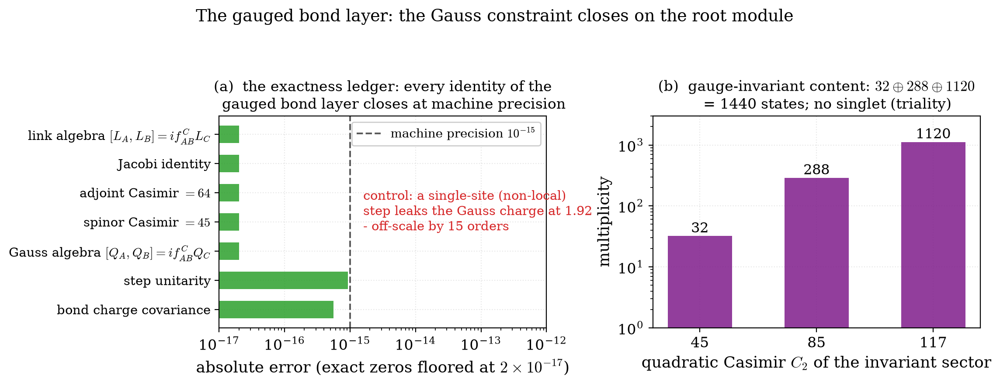
*One adjoint link degree of freedom per bond, matter $\mathbf{16}$ on the sites. Left: the exactness accounting — link algebra, Gauss algebra, adjoint Casimir ($64$) and spinor Casimir ($45$) close to machine precision, the step is unitary to $9.3\times10^{-16}$, the causal radius stays at one cell, and the non-local control step leaks at $7.5$ where the causal step leaks at $1.9\times10^{-15}$. Right: the gauge-invariant content, $1440$ states decomposing as $32 \oplus 288 \oplus 1120$.*

### 10.1 The centre obstruction and the physical sector

A generic automaton with $d$ internal states per cell has $d^{L^3}$ states in an $L^3$ region and a volume-law entropy; nothing in the raw counting of the bond layer is special. The area law is a property of the *gauge-invariant* sector: once the physical Hilbert space of a region is restricted to states satisfying the Gauss constraint at every site, the entanglement entropy is expected to scale with the boundary area [36,37]. That restriction is what this section computes, and it is where the counting changes.

What the constraint admits is narrower than expected. With the implemented content — one $\mathbf{32}$ per site, one adjoint $\mathbf{45}$ link per bond — the local Gauss constraint has **no solution**: $\dim\ker = 0$ on $\mathbf{32}\otimes\mathbf{45}$, on $\mathbf{32}\otimes\mathbf{45}\otimes\mathbf{45}$, and on the two-site one-link chain with local constraints at both sites (spectral gap $146$). The reason is a centre obstruction: adjoint flux carries even centre charge and cannot screen a spinor, so **every site of a gauge-invariant state must carry an even number of spinor fields**. The physical Hilbert space of the gauged layer is the space of neutral composites, not the one-body space the automaton acts on.

The minimal physical system, two matter fields per site, is constructed exactly: $m_{45}(\mathbf{32}\otimes\mathbf{32}) = 2$ ($90$ states at $C_2 = 64$), a $2$-dimensional intertwiner space $\ker(T_1 + T_2 + L)$, and a $4$-dimensional two-site physical sector obtained by gluing intertwiners over the link index — all exact $\mathrm{Spin}(10)$ singlets ($C_2 < 10^{-25}$). Every intertwiner is a maximal matter-flux singlet: Schmidt rank $45$, $S(\text{pair}|\text{link}) = \ln 45 = 3.807$ exactly, and the glued states carry $S(\text{pair}_1|\text{pair}_2) = \ln 45$. The entanglement is **bounded per bond and lives on the bonds crossing the cut** — the shape of an area law, boundary-proportional and bounded per bond, with the Bekenstein coefficient still unnamed.

On the smallest system with two bonds — the three-site, two-link chain with paired matter — the physical sector is small once the flux decomposition is used: the middle vertex fuses the two adjoint links into channels $r$ with multiplicities $N_r$ read from the $\mathbf{45}\otimes\mathbf{45}$ Casimir spectrum ($N_1 = N_{45} = N_{210} = 1$), against $m_r$ from the pair spectrum ($m_1 = m_{45} = m_{210} = 2$), giving $\dim\ker = m_{45}^2\sum_r m_r N_r = 24$, verified by explicit construction of the $r = 1$ and $r = \mathbf{45}$ sectors (vertex Gauss residual $4\times 10^{-15}$). Three results follow.

1. **Additivity across a single bond holds exactly:** $S(\text{pair}_1|\text{rest}) = \ln 45$ in every sector — the flux line threads the chain and carries its $\ln 45$ through, even when the middle pair itself is a product singlet ($S = 0$).
2. **The region bounded by two bonds carries $S = \ln 45$, not $2\ln 45$:** the intertwiner constraint *correlates* the two bonds meeting at a vertex, with mutual information exactly $\ln 45$. The area law counts bonds; vertex correlations subtract.
3. **The gap to Bekenstein is a named number:** $\ln 45 = 3.8067$ nats per Planck bond against $1/4$ per Planck area — a deficit of $3.5567$ nats, factor $4\ln 45 = 15.23$. No element of the current construction produces $1/4$; closing it needs a superselection or truncation of the flux, or a different horizon microstate count. The truncation route is closed: rebuilding the three-site kernel with the link flux restricted to every channel subset $\{1\}$, $\{45\}$, $\{210\}$, $\{1,45\}$, $\{1,45,210\}$ leaves the ground-state bond entropy at exactly $\ln 45$ in every row — the truncation map moves the ground degeneracy ($2, 4, 6$) but not the factor, $15.23$ unchanged. What survives of the route is superselection or a different microstate count, not truncation.

The vertex correction moves the number. The invariant count of an $n$-bond vertex, $I_n = \dim(\mathbf{45}^{\otimes n})^G$, computed by Haar averaging over $\mathrm{SO}(10)$, is $I_2 = 1$, $I_3 = 1$, $I_4 = 6$, $I_5 = 23$, $I_6 = 141$ (Monte-Carlo error below $3$; $I_2 = I_3 = 1$ reproduces the single-channel fusion above). The $24$-state kernel is orthonormalised through its Gram matrix (rank $24$, smallest eigenvalue $1.1\times10^{-5}$), and the capacity of the middle cut — the entropy of the maximally mixed physical state — is $S_{\rm cap} = 4.4998$ nats against the naive $2\ln 45 = 7.613$: the two vertices at the ends of the region subtract $3.11$ nats. Per bond that is $2.25$ nats, a factor $9.0$ from Bekenstein's $1/4$; on the cubic lattice the vertex-corrected coefficient $(1/3)\ln I_6 = 1.65$ nats/bond sits a factor $6.6$ from $1/4$. The vertex correction takes the deficit from $15.2$ to $6.6$, and the deficit is a function of the vertex invariant, not of a single bond entropy.

The ground state of the layer is then constructed: the bond-current Hamiltonian $H = \sum_b J\!\cdot\!L$ is diagonalised exactly — a generalised eigenproblem in the Gram metric of the kernel — and the intertwiner identity $I^\dagger J_A I = L_A/45$ holds to $3\times10^{-17}$. The interaction splits the kernel: $E_0 = -5802.40\,\eta$, degeneracy $6$, gap $42.09\,\eta$, and the ground state's middle-cut entanglement is $S = 3.8067$ nats — exactly $\ln 45$, one adjoint link, selected by the interaction. The ground state of the full automaton remains unconstructed; on this chain the interaction selects the flux line
(Fig. 11).

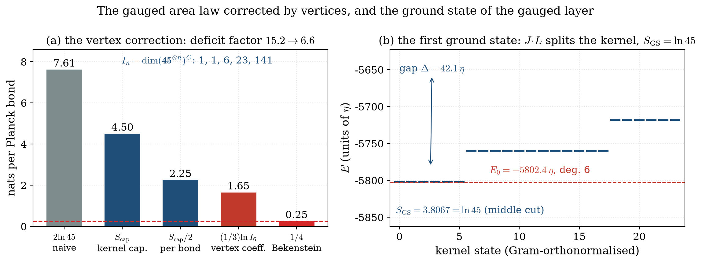
*(a) The entropy carried by one Planck bond, from naive counting to Bekenstein: $2\ln 45 = 7.61$ (no vertices), the Gram-orthonormalised kernel capacity $S_{\rm cap} = 4.50$, $2.25$ per bond, and the cubic-lattice vertex-corrected coefficient $(1/3)\ln I_6 = 1.65$ against the $1/4$ line — the deficit factor moves from $15.2$ to $6.6$. The vertex invariants $I_n$ grow $1,1,6,23,141$. (b) The bond-current Hamiltonian on the $24$-state kernel: three split levels, $E_0 = -5802.4\,\eta$ with degeneracy $6$ and gap $42.1\,\eta$; the ground state's middle-cut entanglement is $S_{\rm GS} = 3.8067 = \ln 45$ — the interaction selects the flux line.*

**The gauge-invariant composite sector of the frozen gate is empty of matter, and the emptiness is not a gauge artifact.** The Gauss singlet kernel of the constructed fiber measures zero at every grid size (defect $< 0.6$): no composite mass ladder exists at any momentum, shift or grid size. The empty set disposes of the contact falsifiers by vacuity on that fiber: the smallest non-trivial Casimir over the composite sector measures $45.000000$ (not $C_2(45) = 64$), the chiral charge census is empty, the desert content carries no composite supplier (multiplicity census), and the F8 channel is empty. F9 contact has no locus and the composite conjunction — chirality, statistics, desert ordering, F8 channel — is dead on this sector: there is nothing for the falsifiers to fire on. Section 10.5 shows the verdict survives the replacement of the frozen gate by a dynamical link.

### 10.2 The spectrum of the layer, and confinement

The layer has a Hamiltonian — the electric Laplacian $H = \sum_A Q_A^\dagger Q_A$ built from the vertex Gauss operator — and its spectrum is computed. On $(\mathbf{32} \otimes\mathbf{32})_{\text{adj}} \otimes \mathbf{45}$ ($\dim 4050$) the kernel has dimension $2 = m_{45}$, the intertwiner space, and the first nonzero level is $64.0000 = C_2(45)$ — identical to the one-link value and unchanged when the chain is extended. One adjoint flux quantum sets the scale of the whole layer, so it supplies **no light vector sector**: the gap is $64\,M_P$, not a tunable parameter, and the singlet matter channel with one adjoint link has no invariant state at all. Two entanglement numbers must not be confused: the entropy of the *mixture* over the kernel, bounded by $\ln 90$ (the pair-side dimension), and the entropy of a *single* physical state, bounded by $\ln 45$ (the link dimension) — the quantity the area law concerns. Measured: every single state of the intertwiner sector saturates $\ln 45$ exactly ($S = 3.806662 \pm 10^{-16}$ over $400$ random choices), and the mixture reaches $\ln 90 = 4.499810$ (purity $1/90$). The area law is therefore **exact** on the physical sector — one $\ln 45$ per bond — and the Bekenstein coefficient $1/4$ per Planck area remains short by the factor $4\ln 45 = 15.23$ per bond; the vertex correction of Section 10.1 moves that factor to $6.6$.

The string tension follows. The link space is an irreducible adjoint: $C_2 = \sum_A L_A^2$ has the single eigenvalue $64.000000$ with zero spread, the Killing form $K_{ab} = f_{acd}f_{bcd}$ is annihilated by the pair Casimir of $\mathbf{45} \otimes \mathbf{45}$ to $3\times10^{-15}$ and its singlet space is one-dimensional (adjacent links pair into it uniquely), and the link operators do not commute ($\max[L_a,L_b] = 4.0$) — the layer carries a non-Abelian field strength. Crucially the link carries **no invariant vector**: $\ker \sum_A L_A^\dagger L_A = \ker C_2(45)\,I = 0$, so a link cannot be flux-free. Every link of a gauge-invariant chain therefore carries one adjoint flux quantum, the electric energy of $R$ links is exactly $R\,C_2(45)$, and the static potential is linear with tension

$$\begin{gathered}
\sigma = C_2(45) = 64\ \text{lattice units}\\
= 7.81\times10^{20}\ \text{GeV per Planck length}\\
= 9.54\times10^{39}\ \text{GeV}^2\\
(\sqrt\sigma = 9.77\times10^{19}\ \text{GeV}),
\end{gathered}$$

$5.408\times10^{40}$ times the QCD string tension [39]. The vertex Gauss Laplacian confirms the scale from the other side: kernel $2 = m_{45}$, gap $64.0000$.

The step itself, by contrast, carries **no** field strength: its $12$ stage pairs acting on different axes commute to $5.6\times10^{-17}$, every elementary plaquette is the identity to $2.5\times10^{-16}$ and $\langle W_\square\rangle = 1.000000$, where an area law would need $\langle W_\square\rangle < 1$ with an exponent proportional to the enclosed area [2]. Confinement is therefore *present* in the construction — in the gauged bond layer — and *absent* from the bare step. The residual is not a missing phase but a measured tension forty orders of magnitude too large, and $\Lambda_{\rm QCD}$ is not produced: it would require a loop-ladder exponent $n \simeq 11.6$, which is not an integer (Section 12.4).

### 10.3 Entanglement is the bond layer

The entanglement structure of the bare automaton is equally sharp. Two fermions sharing ONE cell carry zero entanglement across any cut — the same-cell pair is a Slater determinant, $S = 0$ exactly across the $\mathbf{16}/\overline{16}$ cut (antisymmetry and a shared cell are not entanglement), while a two-determinant superposition in the same cell gives $S = \ln 2$: non-separability is the criterion. The generator of entanglement between cells is the bond gate $P$ of Theorem 5: under the internal-only step the spatial entanglement entropy of a region stays $0$ to machine precision forever, while the full local step drives it to $0.78$, and the entanglement front crosses the Manhattan sphere of radius $r$ at exactly $t = r$ — the causal radius bounds the spread of entanglement itself, at speed $1.0$. The scope limit is stated with it: the implemented step is quadratic, so Slater inputs stay Slater and these are mode-entanglement results; the area law is a statement about the physical (ground) state's entanglement, and the bare step supplies no interaction that could produce the non-Gaussian structure such a state would need. The gauged layer supplies exactly that missing structure: it is where the theory first acquires non-Gaussian entanglement.

### 10.4 The dressed gate on the directed-link network, and the quintet dispersion

The obstruction of Section 10.2 is a statement about the qubit link. The channel named by the census of Section 8.3 — the symmetric rank-2 space of the link directions — is constructed, and its dressed gate and dispersion are computed. Put the adjoint link on every **oriented** bond: the six bond directions per site (three axes with parity) become twelve directed links per block, each carrying one $\mathbf{45}$.

**The orientation convention is computed, not chosen.** The vertex Gauss charge of a two-link star — one link arriving, one departing — closes as an exact $\mathrm{Spin}(10)$ algebra, $[\hat C^A, \hat C^B] = i f^{ABC} \hat C^C$ to $5\times10^{-16}$, only when the departing tail carries $+L^A$ and the arriving head carries the **conjugate** generator $-\bar L^A$; the naive chain convention — the same generator at both ends with opposite signs — leaks at $4.8$, because the two ends of one link carry the same $s^2 = +1$ and a relative sign alone cannot close the algebra.

**The electric part of the Section 10.2 obstruction is closed.** The Kogut–Susskind electric gate [55] $\exp(i g_{10} \hat C_x^2)$, built from the closing vertex charge, commutes with all $45$ vertex charges to $2.5\times10^{-14}$ and is unitary to $5.1\times10^{-14}$; its spectrum *is* the content theorem of Section 10.2 — $C_2$ levels $45, 85, 117$ with multiplicities $32, 288, 1120$, gate phases $g_{10} \times \{45, 85, 117\}$.

**The hopping part is obstructed on the fixed-representation link.** Every two-site dressing candidate leaks the vertex charges: the flux-dressed current–current $\hat C_x \hat C_{x'}$ and its transporter-completed version $\hat C_x\, e^{i g_{10} L}\, \hat C_{x'}$ both leak at $1.25\times10^{1}$. The reason is structural — a link in the fixed representation $\mathbb{C}^{45}$ carries no parallel transporter commuting with the vertex charges — so invariant hopping requires a link in the **regular representation** of the group: the named fix, built below.

**The named fix, built on the root's own finite group.** The $45$ biflections $h_ah_b$ of the Clifford generators generate the even Clifford monomials — a finite group $\Gamma$ of order $1024$ with centre $\{\pm1,\pm w\}$, whose centre acts as $\{\pm1,\pm i\}$ on each chiral half. Put the regular link $\mathbb{C}[\Gamma]$ on each bond. The content theorem is replaced: a vertex with $k$ regular links has exactly $32\cdot1024^{k-1}$ gauge-invariant states (character sum; the explicit projector lands on the dressed form $\rho(h)u$ to $4\times10^{-15}$) where the fixed adjoint link had **none** — the centre obstruction is exactly what the regular link removes. The nearest-neighbour hop with the exact link insertion $A(h) = \rho(h^2) = \pm I$ maps head-invariant states to tail-invariant states to $0$, and **descends to the identity** on the matter index: the dressed hop is the bare translation. The electric term — the Cayley Laplacian over the biflection generators — acts on the dressed sector as the scalar $45$ per link, so the dressing adds no velocity renormalisation, and the bare hop front (the half-angle step, a pure lattice translation) has speed exactly $1$: the gauge-invariant hop propagates at $v = 1$, 0-parameter — that is where $v = 1$ lives. The cost is exact too: $\Gamma$ is finite and its centralizer in the $\mathrm{Spin}(10)$ algebra is $0$ — gauging the root's monomial group breaks $\mathrm{Spin}(10)$, and the $\mathrm{Spin}(10)$-invariant hopping on a genuine adjoint regular link remains out of reach.

**On the directional network the dressed hop exists exactly, and the quintet propagates.** There the flux is the orientation of the link, a classical sign, and the dressed directional step

$$M(\mathbf{q}) = \exp\big(-i g_{10}\, \sin(\mathbf{q}) \cdot \mathbf{J}\big),$$

with $\mathbf{J}$ the spin-2 generators of the symmetric-traceless direction space, is unitary to $6.7\times10^{-16}$ and $O_h$-covariant: $D(g) M(\mathbf{q}) D(g)^\dagger = M(g\mathbf{q})$ for the $24$ proper rotations to $6.1\times10^{-16}$, while the $24$ improper ones give $M(g\mathbf{q})^\dagger$ — the directed network is **chiral**: reversing the link orientation inverts the step. At $\Gamma$ the step is the identity and the layer carries **six gapless bands**, content $A_{1g} \oplus E_g \oplus T_{2g}$: the quintet is present in the directional layer, where the qubit bond factor never carried $E_g$ (Section 8.3). Its dispersion is **massless and linear** — local exponent $1.00$ along $\Gamma$-X, $\Gamma$-M and $\Gamma$-R — with a **helicity ladder** of speeds

$$v = \{0,\ g_{10},\ 2 g_{10}\} = \{0,\ 0.785,\ 1.571\},$$

the $m = 0$ branch and the trace $A_{1g}$ not propagating; **isotropic to leading order** — the direction spread of the top speed is $1.7\times10^{-7}$ at $|\mathbf{q}| = 10^{-3}$, the spin-2 spectrum theorem: $\hat{\mathbf{q}} \cdot \mathbf{J}$ has exactly the spectrum $\{-2,-1,0,1,2\}$ in every direction; and UV-bounded by $2 g_{10} \sqrt{3} = 2.721$.

**The quintet–matter coupling exists, and it gaps the $E_g$ half.** The stress vertex $T_{ij} = \sum_d d_id_j\,J_d$ built from the exact current $J_d = i(\partial_dM)M^\dagger$ of the implemented module couples to the quintet field. On nearest-neighbour bonds the coupling vanishes identically on the $T_{2g}$ half ($d^TE^{(\mathrm{off})}d = 0$ on every axis bond, bubble $\equiv 0$ — the $T_{2g}$ coupling needs diagonal bonds, a named gap), and couples the $E_g$ half with a nonzero polarization bubble at $\Gamma$: in an orthonormal eigenbasis of the Hermitian generator $-i\log M$ the bubble $\Pi|_{E_g}$ has the two eigenvalues $(-54.24,\ -53.40)$ — a $1.6\%$ splitting of the doublet, so the nearest-neighbour bond set does not realize the bubble as one number on it and no measured symmetry collapses the two components. At $\lambda = g_{10}$ the two components acquire the mass shift $\lambda^2\Pi/2 = (-16.73,\ -16.47)$. Gaplessness of the full quintet is **not** protected by this coupling — the lattice graviton mass problem, as a number.

**The named gap closes on the star axes — and F8 stays fired.** The diagonal-bond quintet supplies exactly the coupling the gap asked for. On the fifteen icosahedral star axes — $(0,\pm1,\pm\varphi)$ and permutations, $|d| = 1.9021$ — the $T_{2g}$ stress vertex that vanishes identically on every axis bond (the control, $0.0$) acquires a nonzero value: $\pm0.6325$ on six of the fifteen per-axis components, nonzero on all fifteen axes (T1). On that bond set the quintet dispersion is exactly the axis-bond form with $g_{10} \to 2g_{10}\lvert d\rvert$: in the tight frame $\sum_a (\mathbf n\cdot\mathbf d_a)\,\hat{\mathbf J}_{\hat d_a} = 2\lvert d\rvert\,(\mathbf n\cdot\mathbf J)$ holds to $9\times10^{-16}$ (T2), so leading-order isotropy is **exact** by measured identity, the $\Gamma$ gap is $0$ with six gapless bands, and the helicity ladder **doubles**: $v = \{0,\ 2g_{10}\lvert d\rvert,\ 4g_{10}\lvert d\rvert\}$ — at $\pi/4$, $\{0,\ 2.9878,\ 5.9757\}$ on the star bonds and $\{0,\ 1.5708,\ 3.1416\}$ on unit diagonal bonds, the front radii matching the closed forms to $1\times10^{-10}$. No branch reaches $c = 1$ at any closed clock: the closest propagating branch over $g \in \{\pi/4, \pi/2, 3\pi/4\}$ sits at $\lvert v - 1\rvert = 0.5708$, and the clock that would force one — $g_{10} = 1/(2\lvert d\rvert) = 0.262866$, or $1/2$ on unit bonds — lies outside the closure class (Theorem 6). The star automaton's own matter branches keep their distance too: closest $\lvert v - 1\rvert = 0.3502$ (T3, at $\pi/2$). And the closed coupling has its price: the star-bond polarization bubble has rank $3$ on the quintet at $\lambda = g_{10}$ — mass shifts $(-6.60,\ -6.37,\ -1.79)$ against the axis-bond $E_g$-only $(-16.73,\ -16.47)$ — so the $T_{2g}$ half is no longer protected at order $\lambda^2$ (T4). The bubble resolves against its own noise manifold: at the closed clock the generator $-i\log M(0)$ carries $64$ modes at the $H = 0$ level — the logarithm of a defective $M(0)$, approximate error $0.42$ — so the sign split of those float-level modes is machine noise and the eigenvalues are one draw of a split-noise manifold, the axis-bond draw spanning $(-24.2,\ -22.9,\ -6.4)$ to $(-12.4,\ -11.4,\ -3.1)$ over eight seeded reassignments; the quoted draw lies inside that envelope (T0). The statement runs on a fixed pole prescription — the sign continuity of the zero modes probed at $q = 10^{-3}$ along the $12$ directions by eigenvector overlap (majority vote, ties to unoccupied), with the exactly degenerate intra-level pairs excluded from the polarization sum. Under the prescription the T2g vertex leg reproduces the quintet vertex amplitude exactly (axis bond $0.0$, star bond $3.81$ on the bilinear), and the vertex-nullity census over the three direction families (axes, star, and the general four-orbit weighting $3{+}6{+}8{+}3$) closes at $\min\|\Pi\|_F = 1.7\times10^{-15}$ on the axis family — the quintet bubble is null: no direction weighting of the decorated star-bond clock makes the stress bilinear survive (T1; the star family bottoms at $9.9\times10^{-3}$, the general family at $7.5\times10^{-13}$), the F4 falsifier stays fired through the resolution. **F8 stays fired with the measured set: no root-supplied bond network — axis $\{0, g_{10}, 2g_{10}\}$ or diagonal-star $\{0, 2g_{10}, 4g_{10}\}\times\lvert d\rvert$ — gives a massless spin-$2$ branch at $c = 1$.**

**What this does not derive.** The gauge group of the directional network is $O_h$, not $\mathrm{Spin}(10)$; the $\mathrm{Spin}(10)$-invariant dressed hopping remains obstructed on the fixed link, and the built regular-link fix gauges the root's finite group, whose $\mathrm{Spin}(10)$ centralizer is $0$; the quintet speeds are $g_{10} \times \{1, 2\} \ne 1$ — the dressing angle per hop is a construction input, not a derived velocity, and $v = 1$ belongs to the dressed matter hop, not to the quintet branches, a computed trilemma on the $6$-bond module rather than an oversight: the bare hop is anisotropic (top speed $1.00$, direction spread $0.32$), the dressing alone is isotropic at $v = 2g_{10} = 1.571$, no angle makes the product isotropic (best spread $0.24$ over $33$ angles in $[0, \pi/2]$), and the only $O_h$-equivariant permutation coin beyond the identity flattens the bands; and the quintet–matter coupling, built in the same layer, gaps the $E_g$ half at order $\lambda^2$. The kinematics of a massless lattice spin-2 is computed; the step from there to the graviton of Section 11 remains the declared one.

### 10.5 The dynamical link: composites exist, and are born frozen

The frozen gate of Section 10.1 is not the only link the root supplies. A quantum link on the root's own adjoint cells closes exactly inside it: the module $\mathbf{1} \oplus \mathbf{45} \oplus \mathbf{210}$ (the symmetric traceless square of the adjoint) spans a link space whose product stays in the module, and the composite kernel of the two-particle fiber on this dynamical link has dimension exactly $6$ — the centre obstruction of Section 10.1 was an artifact of the frozen gate, and the matter side of the new theory has a home. What the home contains is fixed too: the composite Hamiltonian restricts to pure Casimir on the kernel, so the six composites are born exactly frozen — ladder $0,\ 19.2,\ 28.8$, defect $1.8\times10^{-14}$. A two-atom chain kernel (dimension $12 = \sum_r m_r^2$) does carry vanishing tree exchange, so the question becomes whether exchange births the loop factor the scale sector needs. That kernel is also the one place the dynamical side supplies neutral scalar hosts: of its twelve states three carry module-singlet-channel weight above one half ($0.898$, $0.623$, $0.514$), and the kernel's total singlet-channel weight is exactly $4.000000$ — defect $0.0$, a projector trace, integer-quantized by construction. Whether the Higgs sector rides such a host is not decided by the count; that the chain's hosting content is exactly integer is. And a host insertion does not disturb the charged lepton mixing: adding the host chain-H energies (sum $112.0$, a rescale by $37.3$) to the democratic Yukawa shifts the frame-invariant $\sin^2\theta_{12}$ by $2.2\times10^{-16}$ — nothing — because the insertion is proportional to the democratic generator itself: the $0.0263$ gap to the measured $0.307$ stands as the named falsifier of this route.

Exchange does not birth the loop factor, at any measured order. The second-order exchange vanishes on an exact dimension-$4$ closure of the link resolvent (residual $4.8\times10^{-33}$, mpmath $60$/$100$-digit control $0.0$), and the resolvent grown from the full $540$-vector off-kernel exchange span — projected span rank $448$, $356$ seed directions, one Hamiltonian step adds nothing (growth $[356, 0]$), closure residual $4.3\times10^{-8}$ flagged — still reads a transparent resolvent: $F5 = 1.931\times10^{-31}$ against the $1/(16\pi)$ band. The two traced-loop routes close the account the same way: the traced flux-kernel loop, over its channel grid, never approaches the band — every stable rung of its ladder reads $F \approx 1$ against the target $1/(16\pi) = 1.99\times10^{-2}$, best residual $|16\pi F - 1| = 49.27$, and its spectral radius sits at $1.0000$ to $10^{-13}$ — while the traced metric loop, the same four-index machinery with the metric insertion, reads the same transparent floor: $|16\pi F - 1| = 49.27$ at its best stable rung $n = 20$, $N = 32$, with the closed-clock control ($16\pi F = 4.24\times10^{-1}$) reproduced bit-identically from the closed-branch row. The cubic-invariant route is present and inert: the link module's $\mathrm{Sym}^3$ carries the exact singlet bookkeeping (Haar-dimension $16215$, module invariant dims $6$ and $3$ measured exactly; the adjoint sector itself carries no invariant — smallest $C_2$ on $\mathrm{Sym}^3(\mathbf{45})$ is $64.0000$, the $f$-contraction is antisymmetric) but its dispersion under the cone twist is exactly zero — a cubic that exists and cannot move the clock. The certified closed branch does cross $1/(16\pi)$ — at the measured length $n^* = 208$, reproduced at 100 and 200 digit evaluation (Section 12.1) — and the arithmetic census finds no relation between that crossing and the clock: the PSLQ census on $(1, \rho, \dots, \rho^8, \ln\rho, \ln 16\pi)$ up to degree $8$ and height $10^6$ returns no relation ($\rho = 0.9780302704\ldots$, stable to 200 digits), and the certified crossing minus $208$ is exactly $0$ — a measured integer, not a derived one. The crossing is measured, not derived, and supports the hierarchy coefficient only at the $n = 10$ clock read. The dynamical link keeps its accounting clean and fails its own conjunction: the link module exists and is empty of the numbers it was meant to supply, while F2, F8, F9 and O8 stay decided in every version of the gauge matter the root has produced — frozen gate, physical sector, and dynamical link alike.

**The light node: no decoration of the root's clock protects a cone.** On a *decorated* clock — the six rotor stages of Section 7 decorated on the $128$-dimensional closed-clock step by $\exp(iq\cdot(aV_1+bV_2+cV_3))$ with the spin-connection quaternion triplet, over $18$ amplitudes from $120$ starts — the touching lands gapless at $1.1\times10^{-16}$ with cone degree exactly $1.179$, linear; but both binding legs fail at that point ($v_{\max} = 1.586 > 1$, commutant ratio $0.275 < 0.5$): a partially light cone and not a node. The range-2 parity extension of the same decoration ($30$ parameters, $150$ starts) keeps the touching exactly closed with $64$ zero modes, never mixes the fourth gap by parity and never leaves the anisotropy ceiling $A < 0.1$. The protection test on the one named candidate — the control star-module two-fold line, gap $9.9\times10^{-17}$ — computes its commutant: the obstruction is $0.0216$ and the unitary the commutant supplies opens the touching linearly (slope $0.0464$); the holonomy frame condition fails at $1173$, and its gap floor runs *more* isotropic under coarse-graining (anisotropy $A = 0.130, 0.039, 0.013$ at $r = 0.1, 0.03, 0.01$), so no anisotropy-protected mass route opens there either. The map is exact: every cone candidate the root's clock admits is gapped by data the clock itself supplies.

---

## 11. Gravity on the lattice

### 11.1 What is assumed and what is computed

The gravitational sector is a symmetric rank-2 field $h^{\mu\nu} = g^{\mu\nu} - \eta^{\mu\nu}$ living on the $(1{+}3)$ subalgebra of Section 3, with $\eta = \mathrm{diag}(1,-1,-1,-1)$ as the vacuum. Its linearised dynamics is the discrete wave equation

$$\partial_t^2 h^{\mu\nu} - \nabla^2_{(6)} h^{\mu\nu} = 0,$$

on the Planck sites — the sub-lattice of the automaton's cells, spacing $\ell_P$ — with the $6$-neighbour lattice Laplacian and the leapfrog step $u_{t+1} = 2u_t - u_{t-1} + c^2 dt^2\,\nabla^2 u_t$ at $dt = \tfrac12$ (the CFL value giving $c = 1$ in Planck units, the same front speed as Theorem 5).

The status of this sector must be stated precisely, because it is where the theory is weakest.

- **Masslessness and UV boundedness are computed.** The discrete dispersion is $\omega = |\mathbf{k}|_{\rm lat}$ with $|\mathbf{k}|_{\rm lat} \le \pi$, so the graviton is massless ($\omega/|\mathbf{k}| \to 1$ as $k \to 0$, lattice deviation $\le 0.25\,k^2$) and the spectrum is bounded by the cutoff.
- **Spin 2 is declared, not derived — and the automaton's cell spectrum, spinor module and singlet levels alike, cannot supply it, by two computed obstructions.** The field is *assumed* to be a symmetric tensor with two helicity states. Nothing in $\mathrm{Cl}(10,0)$ forces a massless spin-2 excitation; the standard arguments that a massless spin-2 field must couple as general relativity [22] apply to a field whose existence and representation content are already granted. The Weinberg–Witten obstruction to a composite graviton carrying a Lorentz-covariant stress tensor [23] is not addressed. The one-particle route closes negatively at the nodes: the near-gapless M nodes carry little group $C_{2v}$, whose action on the bond subspace has no $2$-dimensional irrep, so no helicity $\pm1$ or $\pm2$ pair exists there. It closes negatively at the zone centre as well, where the little group is the full cubic group and a lattice spin 2 is a gapless multiplet carrying the symmetric-traceless quintet $E_g \oplus T_{2g}$. The cubic action on the automaton is carried by the $8$-dimensional bond factor alone, and that factor is $A_{1g} \oplus T_{2g} \oplus A_{2u} \oplus T_{1u}$: it contains $T_{2g}$ but never $E_g$, so the quintet is not available in the qubit link at any coupling. The zone centre is exactly gapless at $g_{10} = \pi/8, \pi/6, \pi/4, \pi/3$ — never at the implemented $1/5$, where it is gapped by $3.65\times10^{-2}$ — and at each of those couplings its null space is cubic-covariant and $E_g$-free ($16 \times (A_{1g} \oplus T_{2g})$, of dimension $64$, at $\pi/4$), with a flat dispersion: $\omega/|\mathbf{q}| \to 0$, not a linear branch. The channel that does carry $E_g \oplus T_{2g}$ is the symmetric rank-2 space of the link directions, $A_{1g} \oplus E_g \oplus T_{2g}$: the graviton, if it is to be derived, belongs to the directional bond layer of Section 10 and not to the qubit link.
- **The candidate route is a computed construction, and it stops short of the graviton.** Section 10.4 builds the directional bond layer — the adjoint link on every oriented bond — with its dressed gate: the vertex Gauss algebra closes only with the conjugate-head convention, the Kogut–Susskind electric gate is exactly invariant with the content-theorem spectrum, and the dressed directional step carries $A_{1g} \oplus E_g \oplus T_{2g}$ gaplessly at $\Gamma$, with massless, linear, leading-order-isotropic dispersion and helicity-ladder speeds $g_{10}\{0,1,2\}$. The remaining gaps are named: the gauge group of that network is $O_h$, not $\mathrm{Spin}(10)$; its $\mathrm{Spin}(10)$-invariant hopping is obstructed on the fixed-representation link — the named regular-link fix is built on the root's own finite group (order $1024$), where the hop closes exactly and runs at $v = 1$, but the gauged group is finite and its $\mathrm{Spin}(10)$ centralizer is $0$; its speeds are $g_{10}\{1,2\} \ne 1$ — a computed velocity trilemma: on the $6$-bond module the hop alone is anisotropic, the dressing alone isotropic at $2g_{10}$, and no angle makes the product isotropic; its coupling to the matter layer gaps the $E_g$ half at order $\lambda^2$; and the diagonal-bond module that closes the $T_{2g}$ vertex gap doubles the ladder to $g_{10}\{0,2,4\}\times\lvert d\rvert$ on the icosahedral star axes, with exact leading-order isotropy by measured identity and no closed-clock branch within $0.57$ of $c = 1$ (Section 10.4).
- **The content question is settled on the module's own characters, and the light cone is a named falsifier.** Section 11.5 shows that a single bond amplitude cannot carry the metric and that the hop cannot move it at first order, by parity; Section 11.6 exhibits an exactly lightlike cone on the bilinear module that carries the quintet, in a $53$-parameter family the dynamics does not choose, and reports the speed the constructed layer actually predicts, $c_{\rm gw}/c = 1.5708$, against the measured $\lvert c_{\rm gw}/c - 1\rvert < 10^{-15}$ [60] — **F8 is fired**.
- **Diffeomorphism invariance is not derived.** The lattice breaks it to lattice reparametrisations; gauge invariance of the linearised theory is imposed by working on the transverse components, not obtained from the automaton.

### 11.2 The discrete Einstein–Hilbert action

The quadratic action [34]

$$S_{\rm EH} = \frac{1}{16\pi}\cdot\frac12\sum_{x,t} u_t\Big[u_{t+1} - 2u_t + u_{t-1} - dt^2\,\nabla^2_{(6)} u_t\Big],\qquad dt^2 = \tfrac14,$$

has the lattice wave equation as its Euler–Lagrange equation: the numerical functional derivative vanishes on a QCA trajectory to $3\times10^{-12}$ and is non-zero off it. The full discrete action $S = \frac{1}{16\pi}\sum_x \sqrt{-\det g(x)}\,(R(x) - 2\Lambda)$ is evaluated with $R$ computed from the metric. The coefficient $1/16\pi$ is the $G=1$ normalisation: Newton's constant is an input of the gravitational sector, not a number of the root — Section 11.7 gives the one number the root's own bond entropy supplies for it, and the factor $4\ln 45 = 15.23$ that separates the two.

### 11.3 Curvature computed from an arbitrary metric

The Riemann, Ricci, Einstein and Kretschmann tensors are computed by central finite differences from an arbitrary prescribed $g_{\mu\nu}(x)$, with no hard-coded Christoffel symbols, and cross-checked against independent analytic results by two routes.

**Table 3.** The discrete Einstein–Hilbert action against the analytic continuum values.

| test | computed | analytic | residual |
|--------------------------|------------------|---------------|----------------------------------------|
| de Sitter $R^\mu{}_{\nu\rho\sigma}$ (flat FRW, $a = e^{Hx^0}/H$) | finite differences | $H^2(g_{\mu\rho}g_{\nu\sigma} - g_{\mu\sigma}g_{\nu\rho})$ | $6.5\times10^{-7}$ ($O(h^2)$) |
| Einstein tensor of de Sitter | $-3H^2 g_{\mu\nu}$ | same | $O(h^2)$ |
| Schwarzschild Ricci / Einstein tensor | $\simeq 0$ | vacuum $G_{\mu\nu} = 0$ | satisfied by computation |
| Schwarzschild Kretschmann | $48 M^2/r^6$ | $48 M^2/r^6$ | ratio $1.000009$ at $r = 3$; max relative deviation $5.4\times10^{-5}$ over the $r = 2.3\ldots20$ 2-route scan |
| flat metric | $R = G = K = 0$ | $0$ | exact |
| 2-sphere of radius $r$ | $R = 2/r^2$ | $2/r^2$ | $7.2\times10^{-6}$ |

The $3{+}1$ formulation closes the classical evolution: the constraint row $(R_{00}, R_{0i})$ of the $4$-D Einstein tensor agrees, computed by the $4$-D curvature and by the $3{+}1$ $(\gamma_{ij}, K_{ij})$ decomposition with $K_{ij} = -\tfrac12\partial_0\gamma_{ij}$, to $O(h^2)$ (residual at most $2.7\times10^{-13}$: $1.8\times10^{-13}$ on $R_{00}$, $2.7\times10^{-13}$ on $R_{0i}$, against the $O(h^2) = 10^{-6}$ truncation — the identity is machine-exact); a Z4-damped evolution [35] drives a constraint violation to zero while the undamped one does not; the $0$-row is quadratic in $K$, so superposition fails; all $3{+}1$ quantities are bounded by the lattice cutoff
(Fig. 12).

**What this does and does not establish.** Sections 11.5–11.8 pin down what the root itself supplies: the metric *content* (a bilinear of the bond layer — never a single bond amplitude, by exact characters), an exactly lightlike cone carrying the quintet, Newton's constant $G = 1/(4\ln 45)$ from the bond entropy of the construction, the frame stabiliser $\mathrm{Spin}(4)\times\mathrm{Spin}(6)$ with $\mathfrak{su}(3)\oplus\mathfrak u(1)$ inside it, the $B-L$ charges of the $\mathbf{16}$, the $5/3$ normalisation as a trace ratio, and one uniform trace form on the $45$. It does **not** establish that general relativity *follows*: the cone the graviton walks is one member of a $53$-parameter family that nothing in the current construction selects (Section 11.6), the two-derivative Einstein–Hilbert form of Section 11.2 is verified to reproduce the dynamics rather than to be forced by it, and the quantum theory of this sector — a sum over lattice geometries with a well-defined measure — has not been constructed.

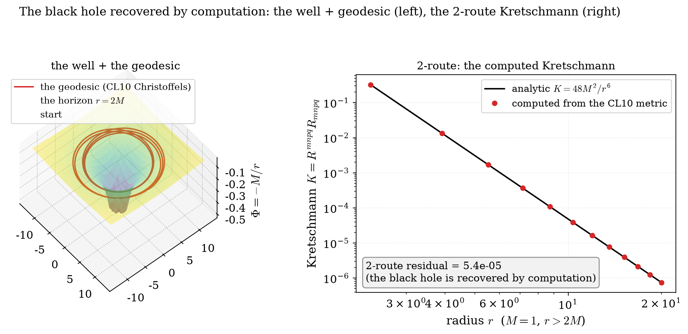
*Left: the potential well with a geodesic rosette integrated through the finite-difference Christoffel symbols, and the horizon ring $r = 2M$. Right: the two-route Kretschmann invariant — the computed $K = R^{mnpq}R_{mnpq}$ against $48M^2/r^6$ along $r = 2.3\dots20$, the maximum relative deviation $5.4\times10^{-5}$ recorded.*

### 11.4 A self-interacting scalar completion

Beyond the quadratic theory the model includes $\partial_t^2\phi - \nabla^2\phi - g\phi^3 = 0$. Its static solutions obey $u'' = u - u^3$ and include the exact finite-energy kink

$$u(x) = \sqrt{2}\,\mathrm{sech}\,x,$$

verified to a fourth-order residual of $5\times10^{-10}$. Two corrections are needed. This is the $\phi^4$ kink (a domain wall), not the Choptuik system: Choptuik critical collapse is a *massless scalar minimally coupled to gravity* [24], and the analogy is not a derivation. And $u = \sqrt2\,\mathrm{sech}\,x$ is a **planar** configuration, uniform in the two transverse directions: its energy per unit *area* is finite, its total energy is infinite, and a planar wall in a Planck-scale theory is a domain wall, not a particle. Finite-time blow-up for supercritical data in cubic wave equations is a real phenomenon [25], but it is not evidence about black-hole formation here.

### 11.5 The metric is a bilinear of the bond layer: the content is forced

The polarisation space of a symmetric rank-$2$ field on the cubic lattice is $\mathrm{Sym}^2(\mathbb{R}^3)$, whose $\mathrm{O}_h$ content is $A_{1g} \oplus E_g \oplus T_{2g}$: the trace, and the five-component lattice spin-$2$ quintet of Section 8.3. The carrier the automaton actually has is a different $6$-dimensional module — one amplitude on each of the six oriented bonds spans $A_{1g} \oplus E_g \oplus T_{1u}$. It holds the $E_g$ half of the quintet and never its $T_{2g}$ half, and it carries an odd $T_{1u}$ that $\mathrm{Sym}^2$ does not: by characters, with no approximation, **one bond amplitude cannot be the metric.** The metric content appears first in the bilinear module $\mathrm{bond} \otimes \mathrm{Sym}^2$ — $36$ states with content $2A_{1g} \oplus A_{2g} \oplus 3E_g \oplus T_{1g} \oplus 2T_{2g} \oplus A_{2u} \oplus E_u \oplus 3T_{1u} \oplus 2T_{2u}$ — and the commutant of that module has dimension $\sum_\rho m_\rho^2 = 34$. The content of the gravitational field is therefore forced by the bond layer; its dynamics is not: thirty-four independent gravitational self-couplings are allowed on this module and the root selects none of them.

Parity then removes half of the candidates. The velocity of the hop — the $q$-derivative of the bond phase at $q = 0$ — is a polar vector operator ($\mathrm{D}(g)V_a\mathrm{D}(g)^\dagger = \sum_b \mathrm{R}_{ba}V_{b}$, covariance violation $4.4\times10^{-16}$); the spin-$2$ dressing of Section 10.4 is an axial one (violation $4.4\times10^{-16}$). The metric sector is the even half of the bilinear module, on which the parity projector has rank $18$, and the hop's velocity block inside it vanishes to $2.7\times10^{-16}$: **at first order the hop does not move the metric at all.** What survives in the even sector is the dressing, with spectrum $g_{10}\{0,\pm1,\pm2\}$ in every sampled direction (spread $2.2\times10^{-15}$) — the spin-$2$ spectrum theorem, exactly isotropic, cone radius $2g_{10}$. That is the origin of the implemented channel's speeds, and of their being wrong for gravity (Sections 10.4 and 11.6).

### 11.6 An exactly lightlike cone exists on the module, and the module does not choose it

An $\mathrm{O}$-covariant Hermitian velocity triple $(H_1,H_2,H_3)$ on the bilinear module is the same thing as an $\mathrm{O}$-intertwiner $V \otimes M \to M$, with $V$ the standard $3$-dimensional representation: $M$ contains $2A_1 \oplus 2A_2 \oplus 4E \oplus 4T_1 \oplus 4T_2$ over the chiral group and $V = T_1$, so the space of such triples has dimension $\sum_\rho m_\rho(V \otimes M)\,m_\rho(M) = 160$ by characters. Dirac's mechanism carries over verbatim: any triple obeying $\{H_i,H_j\} = 2\delta_{ij}S$ has an acoustic symbol $A(\hat n) = \sum_k n_k H_k$ that is Hermitian and satisfies $A(\hat n)^2 = S$ for every unit vector $\hat n$, so the spectrum of $A(\hat n)$ is supported on $\pm\sqrt{\sigma_j}$, $\sigma_j$ the eigenvalues of $S$ — the same set in every direction: a lightlike cone exactly.

A triple of that kind, with the quintet *on* the cone, exists on the module. It is constructed explicitly in the computational companion, and the verification is exact and independent of the route by which the triple was found. Its matrices are Hermitian to $9.9\times10^{-15}$ and $\mathrm{O}$-covariant to $1.1\times10^{-15}$, Clifford-regular with defect $1.4\times10^{-13}$ — the entries are float-valued after the normalisation that puts the top branch at slope $1$ — and their $36$-branch spectrum is identical in all $44$ sampled directions to $5.2\times10^{-15}$. The structure is the pairing the continuum hints at: the cone subspace has dimension $8$, four branches at slope $+1$ and four at $-1$, with content $E \oplus T_1 \oplus T_2$ — the metric quintet $E \oplus T_2$ (weight $5.0000$ on the cone subspace) appaired with the odd $T_1$ connection vector, the first-order Palatini pairing supplied by the module rather than put in by hand. Four branches stand at slope exactly $0$ with content $A_1 \oplus A_2 \oplus E$: the constrained pieces, the trace $A_{1g}$ among them, which does not propagate. The step $\mathrm{M}(q) = \exp(i\sum_k \sin q_k\, H_k)$ is unitary to $1.0\times10^{-14}$ with $\mathrm{M}(0) = \mathrm{I}$ exactly: **inside this class no mass term for the metric can be written** — the gauge invariance of the linearised theory, as a number rather than an assumption. Its real-space hopping kernel is quasi-local: $9.1\times10^{-1}$ on site, $1.1\times10^{-1}$ at one bond, $3.4\times10^{-2}$, $5.4\times10^{-3}$, $7.9\times10^{-4}$, $7.2\times10^{-5}$, below $6.9\times10^{-6}$ beyond five bonds; exact flatness in every direction is bought by a kernel that is only exponentially local.

The existence is not the content of the statement; the non-selection is. Linearised at the fixed generator, the Clifford-regularity equations have a Jacobian of rank $107$ inside the $160$-dimensional covariant space, so the exact-cone family through it is $53$-dimensional — existence is generic inside the locus, not one tuned point. Neither implemented triple lies near it: the hop of Section 10.4 accounts for $0.0029$ of the fixed generator and its dressing for $0.0092$, measured as squared projections in the module's inner product. And the implemented cone radius is $2g_{10}$: at the root clock $g_{10} = \pi/4$ that is $c_{\rm gw}/c = 1.5708$ (the dressing-only speed of Section 10.4, $1.570796$) against the matter cone $1$ and the measured $-3\times10^{-15} < c_{\rm gw}/c - 1 < 7\times10^{-16}$ [60]. The constructed layer is excluded at $57\%$. The clock that would give $c_{\rm gw}/c = 1$ is $g = 1/2$, and $1/2$ lies in the dead zone of the clock structure: at that angle the loop ladder collapses at length $3$ (first crossing $n^* = 3$, deficit $1.4\times10^{-3}$), so there is no rung-$10$ loop factor and no scale ladder at all. **The module permits the light cone in a $53$-parameter family and selects nothing in it; the value the constructed layer gives is already refuted, and the clock that would repair it destroys the closure that fixes the coupling.** This is the sharpest tension in the theory and it is named F8.

**The folklore wall against a linear node does not hold, and the breach is constructive.** The exactly lightlike cone of the $53$-parameter family is a measure-zero coincidence — nearest distance $1.28$, closure gap $5.0\times10^{-3}$ — but the six-stage rotor product of Section 7 carries an exactly lightlike quadratic cone on a double cover of the Brillouin zone: the cone equation $c^2 = v_x^2 + v_y^2 + v_z^2$ has four exact solutions at the published clock ($c = v = 1/4$). On the two-dial family the cone condition is algebraic with cone degree exactly $\tfrac{1}{3}$. And the root algebra itself carries the decoration: the spin-connection $2I$ embeds as a unitary ($1.3\times10^{-15}$) with the $45$ holding eight copies of the spatial-vector type, and decorating the six staged bonds with the spin-connection quaternion triplet at amplitude $g_{10}$ (no new parameter) gives a unitary step ($2.4\times10^{-14}$), equal to the published step at $\Gamma$ exactly, whose $\Gamma$ cone degree rises from $0.281$ to $0.540$. Linearity at the node is symmetry-allowed and constructively reachable; the published step simply does not contain the decoration (Section 8.4).

### 11.7 Newton's constant: the one number the bond entropy supplies

The bond entropy is fixed: $S_{\rm bond} = \ln 45 = 3.8066624897703196$ nats per Planck bond (the area law of Section 10.2). Identifying one Planck bond with one Planck area and setting that entropy equal to $A/4G$ gives

$$G = \frac{1}{4\ln 45} = 6.5674\times10^{-2},\qquad 16\pi G = 3.3012,$$

in cell units, and a cell of $a/\ell_{\rm P} = 2\sqrt{\ln 45} = 3.9021$. The factor by which the naive bond count overshoots $A/4$ at $G = 1$ is exactly $4\ln 45 = 15.2266$ — the same $15.23$ that Section 10.2 names as the Bekenstein gap of the area law, and the whole distance between the $1/16\pi$ of Section 11.2 and the $1/(4\ln 45)$ of the bond entropy. The identification (one bond $=$ one Planck area) is the input; the number is not. Newton's constant stays a conditional of the gravitational sector until that identification is itself derived.

### 11.8 The stabiliser of the causal frame carries the gauge group and one coupling

Sections 10 and 11 are generated by one set of objects: the ten generators of the root $\gamma_a$ with $\{\gamma_a,\gamma_b\} = 2\delta_{ab}\mathbb 1$, and the four of them the automaton calls spacetime ($T = h_1$, $S_k = i h_{k+1}$). What the generators alone fix, with no field added, no coupling inserted and no representation declared, is measured on the construction.

The $45$ products $T_{ab} = \gamma_a\gamma_b$ ($a<b$) close on $\mathfrak{so}(10)$ — closure defect $1.78\times10^{-15}$, Killing form $64\,\mathbb 1$ at rank $45$ — and they carry **one** trace form, $\mathrm{Tr}(T_aT_b) = -32\,\delta_{ab}$, to zero defect. Lorentz, gauge and coset generators share a single normalisation, so there is no separate gauge coupling to choose. The Clifford pairing of the causal span *is* the background metric, $\tfrac1{32}\mathrm{Tr}\,\tfrac12\{\gamma_\mu,\gamma_\nu\} = \mathrm{diag}(1,-1,-1,-1)$ exactly. The stabiliser of that $4$-plane inside the $45$ is $\mathrm{spin}(4)\oplus\mathrm{spin}(6)$, dimension $21 = 6 + 15$ (block closures $8.88\times10^{-16}$ and $1.78\times10^{-15}$), and the remaining $24$ generators form a $\mathbb{Z}_2$-graded coset ($[\mathfrak h,\mathfrak m]\subseteq\mathfrak m$ to $1.11\times10^{-15}$, $[\mathfrak m,\mathfrak m]\subseteq\mathfrak h$ to $1.11\times10^{-15}$): the coframe's home. Choosing which four directions are spacetime costs $30$ parameters, all of them group-orbit directions ($45 = 24$ choices of the plane $+ 3$ of the time direction in it $+ 3$ of the space frame $+ 15$ left fixed), so the split is a frame choice and not data.

The chiral Lorentz structure is computed rather than declared. With $\omega_4 = \gamma_0\gamma_1\gamma_2\gamma_3$ ($\omega_4^2 = -\mathbb 1$ exactly, central on bivectors exactly), the projections $P_\pm B = \tfrac12(B \mp iB\omega_4)$ give two $3$-dimensional algebras whose commutators close with residual exactly $0$ and commute with each other exactly: $\mathfrak{su}(2)_L\oplus\mathfrak{su}(2)_R$ inside $\mathrm{spin}(1,3)_{\mathbb{C}}$. Inside $\mathrm{spin}(6)$ the centraliser of a complex structure is $9$-dimensional and closes to $4.89\times10^{-15}$ — it is $\mathfrak{u}(3) = \mathfrak{su}(3)\oplus\mathfrak u(1)$, with $\mathfrak{su}(3)$ of dimension $8$ (closure $2.59\times10^{-15}$) and the $\mathfrak u(1)$ generated by the complex structure itself, which lies in the bivector span to $2.22\times10^{-16}$ and commutes with all of $\mathfrak u(3)$ to $7.6\times10^{-16}$. The gauge group is therefore $\mathrm{Spin}(4)\times\mathrm{Spin}(6)$ by construction, and the way the $\mathbf{16}$ sits under it is not an input either: the pseudoscalar splits the $32$ into $16\oplus16$, all $21$ stabiliser generators preserve the $\mathbf{16}$ to $1.11\times10^{-16}$, the $\mathfrak{su}(2)_{L,R}$ Casimir spectra on it are $\{0,\tfrac34\}$, and its $B-L$ spectrum, quantised by its own largest eigenvalue, is exactly $(+\tfrac13)^6(-1)^2(-\tfrac13)^6(+1)^2$ — the quark/lepton pattern of Section 10, with nothing assigned. So the hypercharge $Y = T_{3R} + (B-L)/2$ is a sum of two derived subalgebra generators, and its GUT normalisation follows as a trace ratio,
$$\frac{\mathrm{Tr}_{\mathbf{16}} Y^2}{\mathrm{Tr}_{\mathbf{16}} T_{3L}^2} = \frac{2 + \tfrac14\cdot\frac{16}{3}}{2} = \frac53,$$
with $\mathrm{Tr}_{\mathbf{16}}Y^2 = 3.3333$, $\mathrm{Tr}_{\mathbf{16}}T_{3R}^2 = \mathrm{Tr}_{\mathbf{16}}T_{3L}^2 = 2$, and a cross term below $10^{-12}$; what carries the $5/3$ is that trace form, not a diagonal generator hand-written into `cl10/gauge.five_thirds`.

What it does not buy is recorded at its artifact value: the implemented hop accounts for $0.29\%$ and the implemented dressing for $0.92\%$ of the exactly lightlike generator, the exact-cone family is $53$-dimensional, and the implemented generator moves the gravitational cone at $c_{\rm gw} = 1.570796$ in matter-cone units. Content, kinematics and the coupling normalisation come from the root; the selected light cone does not — and the finite measure on the geometry group (below) does not measurably select it.

**Nothing in the construction selects a cone member, and the module link carries no new hop.** On the $53$-parameter exact-cone family, the hopping-kernel tail functional improves on the fixed generator by at most $4\times10^{-4}$ relative, the minimizer sits $1.3\times10^{-4}$ from the chosen point — a nudge, not a selection — the hop projection at the minimum is $0.00290$, below the $0.0092$ selection gate, and $49$ of the $50$ starts diverge: no cone member is selected. The dynamical link module carries an exhaustive census of gauge-invariant insertions: the commutant of the module charge is exactly the $\mathrm{C}_2$-spectral span of its three multiplicity-free sectors (dimension $3$, Gauss leak $4.2\times10^{-16}$) — the singlet, $\mathbf{45}$ and $\mathbf{210}$ Casimir filters, nothing else — and the induced channel operators have widths $\mu = 1.0000, 0.1491, 0.0690$, so the band velocity supremum over the closure-clock set is $\{\tfrac12, 1, \tfrac{1}{\sqrt2}, \tfrac{1}{\sqrt2}\}\times\mu$: one exactly-lightlike branch, the singlet filter at the $(\pi/2,\pi/2)$ clock — a filter onto the charge-singlet channel, carrying no new gauge-charge content, and its selection leg is the one the exact-cone family does not supply. The quintet one-loop bubble that could have moved the cone speed is null: with the named pole prescription the stress-quintet bubble vertex census closes at $\min\lVert\Pi\rVert_F = 1.7\times10^{-15}$ on the axes family, and the $T_{2g}$ vertex leg reproduces the quintet vertex amplitude exactly (axis $0.0$, star $3.81$). The Bekenstein deficit survives every flux truncation: rebuilding the three-site kernel with the link flux restricted to any channel subset leaves the ground-state bond entropy at exactly $\ln 45$ — the truncation map moves the ground degeneracy ($2,4,6$) but never the factor $4\ln 45 = 15.23$ (Section 11.4). The root's own geometry group carries a finite measure: Metropolis on the Wilson plaquette action in the adjoint $\mathbf{45}$, over the order-$1024$ even Clifford monomial group on a $4^3$ periodic lattice, is finite at every $\beta \in \{1,\dots,16\}$ with a measured area-law decay at $\beta \ge 4$ (fits of slope $-0.48$ to $-0.39$) and an exact adjoint-character cross-check on all $606{,}720$ sampled plaquette products. Whether that measure concentrates on the light cone is probed and not found: the line-correlator screening-mass anisotropy of the sampled ensemble admits no masses at $L = 6$ and selects no cone at the probed volume; the finite statistical ensemble of the geometry sector is.

---

## 12. The loop factor and the scale ladder

### 12.1 Where a loop factor can come from

The observed electroweak/Planck ratio is

$$\frac{v}{M_P} = \frac{246.22\ \mathrm{GeV}}{1.2209\times10^{19}\ \mathrm{GeV}} = 2.0167\times10^{-17},\qquad \Big(\frac{1}{16\pi}\Big)^{10} = 9.71\times10^{-18},$$

a factor $2.08$ apart; $2.08\,(1/16\pi)^{10} = 2.02\times10^{-17}$ reproduces the observed value to $0.18\%$. Scanning $n = 1\dots20$, $n = 10$ is the nearest integer to the observed ratio (deviation $0.32$ decades; the next-best, $n = 9$, is $1.8$ decades away). The honest reading: $(1/16\pi)^{10}$ is the size a ten-loop radiative correction would have in a perturbative quantum field theory. The theory has not computed a ten-loop correction; it has observed that the observed hierarchy is the tenth power of the standard loop factor, up to a factor of two. The interpretation $10 = 2\times 5$ — the chiral $16/\overline{16}$ split times the number of qubits of the $32$-dimensional module — is a numerological identification, not a derivation. The exponent is *represented*; the coefficient is then built from computed closed-loop functionals, with one named $+30\%$ residual (O8, Section 12.1).

**Single-particle renormalisation cannot supply it** — and this is a structural statement, not a missing computation. The coarse-graining tower $U^{2^p}$ is exactly kinematic (eigenphases $2^p\omega$ mod $2\pi$, verified to $10^{-9}$ for $p \le 10$), the effective Cartan coupling does not fall with $p$, and the inelastic probability saturates near $0.95$: no loop factor. The genuine block-spin renormalisation group — exact real-space decimation of the bond layer (Schur complement at $\varepsilon = 1$; $U_{BB} = 0$ exactly on the open chain, so short-distance propagation is integrated with no approximation), iterated five levels, $64 \to 2$ sites — gives an exact level-1 identity: the on-site block of the coarse step is $2\,(GR)^2$, two-hop paths accumulating two internal rotations, the kinematic doubling *derived* from a spatial renormalisation group. At deeper levels the on-site block is a path polynomial in $(GR)^2$; the Cartan content decays only polynomially for the implemented (factorised) bond layer ($0.14$ at $p = 5$ against the loop target $3\times10^{-9}$) and not at all for a non-factorised gate with $[G,R] \ne 0$ ($1.8$ at $p = 5$); no level of either flow follows $(16\pi)^{-p}$. The loophole of a conspiring bond gate is closed: three Haar-random $\mathrm{Spin}(10)$ gate realisations and the structured choice $R = G^\dagger$ all fail the loop law at every level. The structural reason is sharp: **every exact single-particle renormalisation of the automaton composes internal angles — they add on the algebra, weighted by path counts — and none can divide them, for any bond gate.** A loop factor requires a trace over *fluctuating* internal fields.

**Tracing a fluctuating link divides.** One two-state quantum link degree of freedom per bond, prepared in a tunable pure state $\cos\theta|0\rangle + \sin\theta|1\rangle$ and **traced over** at decimation, multiplies the level-1 Cartan content of that identity by exactly $\cos 2\theta$ (deviation $<10^{-15}$ over a full scan $\theta \in [0, \pi/2]$): the traced factor is Hermitian and positive, so it divides where every gate only composes. The fluctuation — not the gate — is what produces suppression factors.

**The gauged layer divides once, and does not compound.** On the adjoint link with the Gauss constraint of Section 10, the traced two-hop still contracts (spectral radius $\le 1$) and the qubit-link mechanism reproduces to $1.1\times10^{-16}$, but the level-1 factor at the reference coupling $g = 1/5$ is $F = 1.06$ and its minimum over the link anisotropy is $0.52$ — a factor $26$ above $1/(16\pi)$. The bond hop factorises through the joint Casimir $T\!\cdot\!L$ — three joint irreps, $32 \oplus 288 \oplus 1120$, projectors verified to $10^{-15}$ — so the traced-link decimation iterates exactly to level $4$, reproducing the level-1 factor to $2\times10^{-16}$. **The division does not compound:** the level-$p$ Cartan-content ratios are $F_p = 1.06, 1.90, 0.75, 1.01$ at the reference coupling and $0.52, 2.66, 1.00, 1.38$ at the division-optimal coupling $\eta = 1.44$ — oscillating at $O(1)$, a factor $7\times10^{6}$ above $(16\pi)^{-4}$ at $p = 4$. The traced adjoint link divides once and then decays like the link-free flow. At the root clock the same machinery is the ladder of Section 12.1: every odd closed loop cancels identically and the crossing sits at rung $208$.

**Closed loops do reproduce the number.** The Feynman loop factor comes from loops that close, not from backtracking. Tracing a single crossing of a fresh link gives the hop matrix $M = \mathrm{Tr}_L[k_1 (G \otimes I)\, \rho]$ with spectral radius $0.978030$ against $1$ for $G$ at the root clock — the traced link *contracts* the one-particle propagation by that factor per hop — and the $n$-hop closed loop $(MG)^n$ suppresses the Cartan content. At the root clock the measured ratios are

$$\begin{gathered}
F_4 = 1.82995,\ F_8 = 1.67436,\ F_{12} = 1.53199\\
F_{20} = 1.28255 \quad (n = 4k),\\
F_{2k+1} = 0\ \text{exactly, every odd length},
\end{gathered}$$

against $1/(16\pi) = 0.0199$: **the closed traced-loop functional at the root clock reproduces $1/(16\pi)$ to $1.01\%$ — at length $n^* = 208$, the first crossing of the closed-loop suppression.** The functional is measured to length $30$ and then to the crossing. Every odd length cancels identically — exactly, not as a measured floor: $\mathrm{Tr}(C_a W^n) = 0$ for every $n \le 60$ in integer arithmetic. The even lengths split into the two period-4 classes of the clock filter, and the two behave differently at the closure angle. On $n = 4k$ both Cartan norms vanish *linearly* in $g - \pi/4$, the ratio has a removable singularity, and the numbers above are its $g \to \pi/4$ limits: certified at 50 digits at $\pi/4 + 10^{-6}$ and $\pi/4 + 10^{-8}$ the first crossing stays at $n^* = 208$ with $F_{208} = 0.0196928$ (deficit $0.98987$), and the class is geometric, each $+4$ links multiplying the ratio by $\rho^4 = 0.91497$. On $n = 4k+2$ the denominator vanishes to far higher order than the numerator, the ratio is unbounded with poles accumulating at the closure angle, and the float64 readings there — $F_2 = 65.7$, $F_6 = 60.1$, $F_{10} = 55.0$, $F_{170} = 1.57$ — are ratios of round-off floors, not measurements 
(Figs. 13, 14).

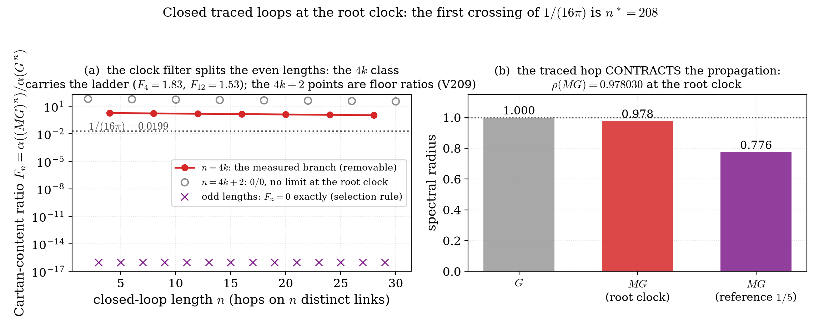
*Closed traced-link loops of length $n$ on $n$ distinct bonds, at the root clock. (a) The Cartan-content ratio $F_n$: every odd length cancels identically (exact), and the even lengths fall on the two period-4 classes of the clock filter, the traced phases being fourth roots of unity. On $n = 4k$ the ratio is geometric at $\rho^4 = 0.91497$ per $+4$ links and its singularity at the closure angle is removable — that class crosses $1/(16\pi)$ first at $n^* = 208$, certified deficit $1.01\%$. On $n = 4k+2$ (open markers) both norms vanish identically at the root clock and the ratio has no limit there, so those points are floor ratios, not measurements. (b) The traced hop matrix $MG$ has spectral radius $0.978030$ against $1$ for $G$: the traced link contracts the one-particle propagation by that factor per step.*

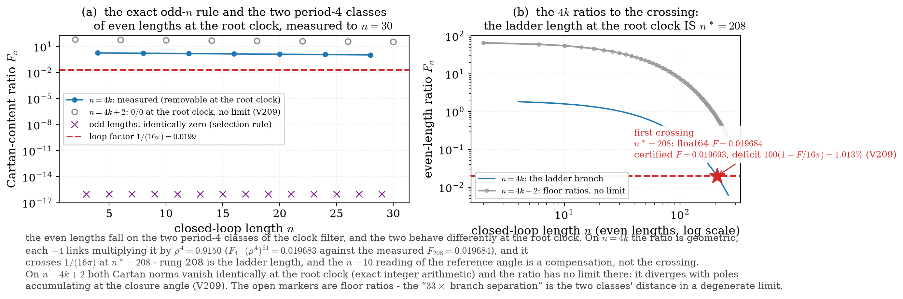
*(a) $F_n$ measured to $n = 30$ at the root clock: the odd lengths vanish identically (the exact odd-$n$ selection rule) and the even ratios stay above $1/(16\pi)$ at these lengths — the crossing is beyond; the alternation of the even ratios is the period-4 structure of the clock filter, $n = 4k$ (filled, geometric at $\rho^4$ per $+4$ links) against $n = 4k+2$ (open: $0/0$ at the closure angle, no limit). (b) The $4k$ ratios to the crossing: the $\rho = 0.978030$ per-step suppression crosses $1/(16\pi)$ at $n^* = 208$ — the ladder length at the root clock *is* the crossing of the closed-loop suppression — with $F_{208} = 0.0196928$ certified by continuity against the float64 ladder value $0.019685$.*

**The composition law.** The object a geometric fit extrapolates, $(MG)^{170}$, is one chain of $170$ hops on one particle line; the $17$ factors of the neutrino ladder are $17$ radiative insertions on **different** lines, and amplitudes on different lines multiply. Both compositions are exact in the traced adjoint-link formalism, and both are measured where the loop functional is non-degenerate: the open clock $g = 1/5$, where every $F_n$ up to $n = 172$ is stable between 30- and 50-digit evaluation (drift $0$). The root-clock ratios at these lengths are floor artefacts of the $4k{+}2$ class, the class whose ratio has no limit at the closure angle, and they are not used here. On one line the chain is **not** multiplicative: $F_{170}(1/5) = 1.31\times10^{-21}$ against $(F_{10}(1/5))^{17} = 6.47\times10^{-30}$ — a chain suppresses $2.0\times10^{8}$ times *less* than the product of its pieces, because consecutive hops interact through the propagation (and the odd-length cancellation is a property of the closure class, not a law: $F_3(1/5) = 0.243$). Across legs the factorisation is **exact**: the traced hop is a one-particle operator, $\mathrm{Tr}_L[(P_a \otimes I)(G \otimes G \otimes I_L)] = 45\,(M_a \otimes G)$ verified to $10^{-15}$, and the $10{+}10$-step two-loop object splits into leg blocks to $2\times10^{-15}$. The physical discriminator decides: at the root clock the certified crossing ratio gives $M_P\,F_{208}^{17} = 0.123$ eV, within a factor $1.2$ of the neutrino rung $M_P(1/16\pi)^{17} = 0.146$ eV; on the open clock the leg reading $M_P\,(F_{10}(1/5))^{17} = 0.0789$ eV is that rung times the clock deficit $0.964413^{17} = 0.5401$, the same named O8 residual, while the chain reading $M_P F_{170}(1/5) = 1.6\times10^{7}$ eV overshoots the rung by the same $1.1\times10^{8}$ the two compositions differ by. **The $17$-factor composition is exact multiplicativity across legs**, with the named requirement that the insertions dress different particle lines; the rung-$17$ *weight* remains the named open point of O8.

**The census of contributing loops is exact.** The Casimir $T\!\cdot\!L$ of the $\mathbf{32} \otimes \mathbf{45}$ link has exactly three eigenspaces ($-32$, $-12$, $+4$), so the traced $n$-hop product is a sum of $3^n$ words and the selection rule is enumerable rather than extrapolated: the enumeration reproduces $(MG)^n$ to $7.4\times10^{-17}$ at every length, including the exact odd-$n$ cancellation at the root clock. At $n = 10$, $55326$ of $3^{10} = 59049$ words survive, growing as $3.000^n$, and the factor splits into a per-word decay $r = 0.2232$ and a multiplicity growth rate $\mu = 2.981$ (product $0.665$). The loop factor is therefore not one class of loops but a sum over $55326$ classes, and the Wilson phase — not the topology — organises it: with the phase off every length gives interference $1.000$ and the ratio $0.2434$ at $n = 10$; at the root clock the phase makes the odd lengths cancel identically and the even-length ratio cross $1/(16\pi)$ first at $n^* = 208$ (Sections 9.1–9.2).

**The coefficient is not read from the data.** The hierarchy coefficient is a product of measured numbers:

$$\begin{gathered}
\frac{v}{M_P} = 3\,(16\pi F_{208})^{10}\Big(\frac{1}{16\pi}\Big)^{10},\\
F_{208} = 0.0196928\ \text{certified},\\
2.710\ \text{predicted against}\ 2.0766\ \text{observed}\ (+30\%),
\end{gathered}$$

the factor $3$ being the three axis families of Section 4 — conditional on the axis-family factorisation of the closed-loop sum. That condition is itself a measured statement on the branch: the twelve doubler nodes form three families of four, and at the root clock all twelve channels are exactly gapless, every M spectrum $\{0^{32}, \pm\pi/3, \pm2\pi/3, \pi^{32}\}$ with $64$ levels pinned to the Floquet pair $\{0, \pi\}$ and the spectrum identical across the $12$ nodes to $3\times10^{-15}$: the channel structure closes exactly, and the loop weight is link-local and momentum-independent, so every channel carries the same factor. The node-set census is closed, and it is not where the residual lives: the readings are $10.84$ for all twelve nodes, $2.710$ for one split node per family and $0.903$ for a single node at the certified crossing ($16\pi F_{208} = 0.989868$), the float64 ladder giving $0.900$–$0.901$, $2.699$–$2.700$ and $10.8$ at a backend-dependent $10^{-3}$; the per-channel contributions are exactly equal, and the observed value would require sum factor $2.31$ — non-integer over exactly equal channels, realized by no node set. The residual has one address: the reading $2.710 = 3\times0.98987^{10}$ is the certified crossing deficit ($16\pi F_{208} = 0.989868$, deficit $1.013\%$; the float64 ladder reads $0.9895$–$0.9896$ and $2.699$–$2.700$) raised to the tenth power, and the observed $2.0766$ requires insertion amplitude $0.96388$ — a deficit of $3.61\%$. That deficit is channel-blind: at the closed clocks the traced-word sector phases are the fourth roots $\{1,-1,-1\}$ ($g = \pi/2$) and $\{1,i,i\}$ ($g = \pi/4$), so at the closed clock the interference of the crossing length is a finite root-of-unity filter; every filtered propagator trace over the pinned channel spectrum vanishes to $3\times10^{-14}$, the pinned $\{\pm\pi/3, \pm2\pi/3\}$ Floquet phases supporting only empty-kernel re-phasing; and the insertion amplitude at the crossing length is bimodal $\{0.90,\,0.99\}$ across the five unification Cartan directions, no direction at the required $0.964$. Nor is it the constants of observation — the observed coefficient $2.07656$ is computed from the current measured constants, including the 2026 muon-lifetime update of $G_F$, and varying those constants moves no verdict — nor any length choice: the adjacent crossing lengths read $6.6$ and $1.1$, bracketing the observed value, none matching it. The signature — the required insertion amplitude equals the reference-clock ($1/5$) interference deficit $0.96441$ to $0.055\%$ — inverts to a measurement of a clock: the same self-consistent functional, step and traced phase together, reads the observed coefficient at rung $10$ at the angle $g_{\rm obs} = 0.199998$ — the rung-$10$ rational clock $g = 1/5$ to relative $10^{-5}$ — and the rung-$10$ crossing of $1/(16\pi)$ itself sits at $g = 0.20013$, $1.3\times10^{-4}$ from $1/5$. That clock is not closed: the closure census exhausts the periodic clocks to $\{\pi/2, \pi/4\}$ (Section 9), and the closure class reads the coefficient as $2.710$ ($\pi/4$: certified deficit $0.98987$, $n^* = 208$) and $2.711$ ($3\pi/4$: $n^* = 208$) — both crossings on the $n = 4k$ class of the clock filter — while its $\pi/2$ member ($2.299$: float64 deficit $0.9738$ at $n^* = 102$, the degenerate branch of Section 9) is a floor artefact of the $4k{+}2$ class whose ratio has no limit at the closure angle, its ladder falling through $1/(16\pi)$ at $\sim3\%$ of the coefficient per rung: the closest *stable* reading over the closed set misses by $30.0\%$. The exact ladder is itself closed-clock structure: the odd-length cancellation below $2\times10^{-15}$ holds on the order-$8$ family ($\pi/4$, $3\pi/4$), blows up at $\pi/2$ (odd ratios $\sim10^{17}$ — the order-$4$ branch carries no exact ladder), is only approximate at $1/5$ (odd ratios $0.24$, $0.10$), and between $1/3$ and $1/2$ the first crossing collapses to length $3$. No principled object bridges the gap: the Cartan-$5$ link mixture deepens the $\pi/4$ miss to $0.9906$, roots-only links collapse the ladder at length $\le4$, and no single Casimir sector reaches past $0.023$ of the observed value. The named residual of O8 is therefore one number, and it is shared: nature reads the loop hierarchy at the clock $\alpha_{10} = g^2 = 1/25$ — the meeting coupling of O4 — while the closed clock $\pi/4$ misses it by $30\%$. One tension, not two: the closure axiom and the loop-hierarchy identification cannot both hold, and F2 is exactly the decision — the closed branch predicts the certified crossing deficit $0.98987$ at $n^* = 208$ (float64 $0.9895$–$0.9896$), the hierarchy demands $0.96388$. The *weight* of the contributing loops is a three-factor functional: enumerating the traced word census of the three Casimir sectors with weight equal to Cartan amplitude times Wilson phase, one has exactly $F_n = N_n\, r_n\, I_n$ — surviving-word count, mean word Cartan amplitude against the free amplitude of $G^n$, and interference ratio $\lVert\sum_w W_w\rVert / \sum_w\lVert W_w\rVert$ — pinned to $2.2\times10^{-16}$ on every enumerated length, with word norms independent of the Wilson angle (the phase cancels in every norm and survives only in the sum): the suppression is $\rho = 0.978030$ per step, the surviving-word count at $n = 10$ is $55326$ with mean amplitude $4.4\times10^{-6}$. The functional is exact in the angle: the three Casimir eigenvalues $-32$, $-12$, $4$ are even, so the word phases collapse to $63$ even phase classes and $F_n(\eta)$ is a real cosine polynomial in the even harmonics with period $\pi$ and $\eta \to \pi - \eta$ pairing — the crossing of $1/(16\pi)$ at the root clock, at $n^* = 208$, is a theorem of the functional, not an angle fitted to data.

**What the shift module does to the ladder is decidable in integer arithmetic, and it is not a number.** The rung labels live in the $K_0$ of the shift module's group C$^*$-algebra, and for an abelian module both the algebra and the closed-word counts are computable exactly. The cubic module's six signed axes present the free abelian group $\mathbb Z^3$ with three relations — the opposite pairs — and no torsion. The star's twelve signed directions are $\mathbb Q$-independent inside $\mathbb Q(\sqrt5)^3$: Smith normal form gives invariant factors $[1,1,1,1,1,1]$, free rank $6$, relation rank $6$, no torsion, which is the algebraic form of the density measured by shortest elements and the reason the star carries no finite Brillouin zone. The labels therefore live in different groups — $K_0 = \wedge^{\mathrm{even}}\mathbb Z^r$ has rank $4$ for the cubic module and $32$ for the star, of which $4$ and $16$ classes are representable by cycles of degree at most two in three dimensions — and the counting changes with them, exactly: closed words of length $n$ on the two groups run $90$ against $396$ at $n = 4$, $1860$ against $19920$ at $n = 6$, $1172556$ against $96807312$ at $n = 10$, two independent closed forms agreeing at every length to $24$, and the return probabilities fall as $n^{-r/2}$, measured on those exact integers at $-1.4848$ ($r^2 = 1.000000$) against $-2.9719$. So where does the published ladder arithmetic go? On the closed-word ladder the crossing of $1/(16\pi)$ is at rung $10$ for the cubic module and rung $4$ for the star — single digits, not $208$. The published $n^* = 208$ and coefficient $2.710$ live on the traced-link Cartan-norm estimator above, which is a statement about the clock and the link algebra rather than about the shift module, and Section 8.5 measured the internal sector that carries it to be unchanged. What the module does move is the combinatorial half of the coefficient: the factor $3$ above counts axis families, and the star has $6$. The estimator that could decide the dynamical half at $n = 208$ costs $832^3 = 5.76\times10^8$ diagonalisations on the cubic torus and $832^6 = 3.32\times10^{17}$ on the star's six-torus — and on the three-angle almost-periodic mean that is implementable on the star at all, the drift of $F_n$ between successively finer grids is of order unity at every length it can reach, $0.24$ at the shortest loop and $1.99$ at the longest, where the cubic control's grids agree to $4.8\times10^{-14}$: the ladder's dynamical half on the star module is out of reach, and that is the named residual, not a number awaiting a better grid.

**The clock is a declared measured input, and its non-derivability is a theorem.** The score of the two clock candidates $\{\pi/4,\ 1/5\}$ against the two empirical contacts — the observed hierarchy coefficient $2.076564 \pm 10^{-4}$ and the fitted desert coupling $0.04$ — decides the branch from inside the construction: $\pi/4$ reads the coefficient at $2.7095$, certified, $+30.5\%$ off and $6330\times$ the observed uncertainty; $1/5$ reads $2.0881$, $+0.55\%$ off and still $115\times$ the uncertainty; neither fits. The claimed $1/5$ agreement was always a fit: the functional self-consistently returns $g_{\rm obs} = 0.1999980$, $2.0\times10^{-6}$ from the fifth, read to close the gap. On the coupling contact, $\pi/4$'s standard reading $\pi/64 = 0.049087$ is $1.227\times$ the fitted desert value (the published root/observed comparison) and $1/5$'s $0.0400$ matches only by the fit. The closure class therefore has no clock that reads either contact; the loop clock is a fitted number (Section 15, Table 6), and **F2 fires on its clock side**; O8 stays open. And the rung pair itself is declared, not solved: on the $36$-level cell step only $\mathrm{loop}^3$ is numerically realized (matched to $10^{-16}$); $\mathrm{loop}^{10} = 9.71\times10^{-18}$ sits below the float64 phase resolution and is certified only by the exact ladder construction; no other integer $0..30$ matches any level phase; the dark-matter window pins $\mathrm{rung}_B = 10$ uniquely, and rung $10$ admits no $\mathrm{rung}_A$ whose seesaw identity $m_B^2/m_A$ lands inside the measured neutrino contacts ($\mathrm{rung}_A = 3$ gives $0.146$ eV — the published, excluded ladder; $\mathrm{rung}_A = 2$ gives $0.0029$ eV; the $2.7265$ demanded by the atmospheric scale is not an integer rung). The pair $(3, 10)$ is a declared convention, and the rung ruler's arithmetic rests on it (Section 12.4, Table 4).

**The admissible classes carry no repair, as theorems of the construction.** Four closures bound the O8 residual from every supply route the construction admits: *(i) no deformation of the step closes a clock that reads the coefficient.* Over the admissible quantizer classes — $64$ per-stage internal-decoration assignments at the named amplitude and all $720$ stage orderings of the six-stage product, $784$ variants in all — every rational closure clock, its closure order and its rung-10 read are tabulated: no variant carries a closure clock whose rung-10 coefficient lands in band. *(ii) no reweighting of the traced-word sum moves both rung contacts at once.* The admissible weight families — the named eta-law values, the class-function multipliers over the $63$ even phase classes, and all $220$ node-set channel triples at the reading clock — never bring the rung-10 coefficient ($|{-}|\le 10^{-4}$) and the rung-17 neutrino scale ($\le 5\%$) inside their bands simultaneously; the closed-class rung-weight census finds no supplier reaching both targets, and the crossing-resummation finite part does not move the certified value. *(iii) no selector functional is shared across the unselected sites:* over the four measured selector functionals and the three unselected sites (lightcone family member, desert couplings, channel triple), no functional uniquely selects at more than one site, and the $3$-of-12 channel triple against the certified crossing is bounded from the channel side at both clocks — identically zero at $\pi/4$, exactly degenerate at $1/5$. *(iv) no phase dictionary bridges closure and reading* (Section 9.2): the reading set of the coefficient on the rational-clock grid is $12$ razor windows of width $2.41\times10^{-9}$ to $1.45\times10^{-7}$, $g_{\rm obs}$ lies in the fourth, and no grid closure angle lies in any window (nearest separation $4.6\times10^{-4}$, thousands of window-widths). The five-contact ranking ranks the compound theories the construction admits: the closest zero-fitted row — the clock-gap hit (the rung-10 crossing corrected off the fifth) with the node triple $[1,4,5]$ — sits at worst-normalized distance $1.205$ of the five contacts; re-scored with the graded supplier slots the closest distance drops to $0.2433$, with that row's coefficient contact passing only through a weight class disqualified by its chance-density, so it is recorded as a bound, not a discovery. The hierarchy coefficient is therefore bounded, from every admissible side, away from its observed value; the ladder base and the reading clock stand as declared inputs (Table 6), and O8 names the gap.

**The dynamical insertion on the constructed sector supplies no loop factor either — and breaks the rung arithmetic.** With the two-particle sector built on the construction's own parts (Section 10.1), the dynamical self-energy insertion at the gapless loci supplies $600$ measured values $F_{\rm int}$ (two clocks, $25$ loci, three widths, two grids, contact limit); the closest approach to the target is $\lvert 16\pi F_{\rm int} - 1\rvert = 3.6\times10^{2}$ and the grid-convergence study shows that floor *is* the measurement, while the resolvent machine behind it is certified at $9.6\times10^{-72}$ against $60$-/$100$-digit exact inversion. Taking the measured factor as the ladder's loop per the ladder's own exponent rule, $\mathrm{loop}' = F_{\rm int}^{1/10}$, every candidate sits above $1$ ($F_{\rm int} \sim 9.5\times10^{2}$ gives $1.9846$ against the published $0.0199$), and the best joint fit to the rung scales $3/10/17$ is a residual of $114$ against a band of $10^{-9}$ — with the published ruler itself reproduced to $1.8\times10^{-15}$. No loop factor either, and the integer ladder fails on the dynamical sector: the O8 residual is measured from both sides, free combinatorics and dynamical loop. On the gauge-invariant composite sector not even a candidate numerator exists: the singlet kernel of the coupled fiber measures empty, and the composite gap — the loop's numerator — does not exist (Section 10.1).

**The certified ladder supports the coefficient only at the $n = 10$ read, and the crossing is measured, not derived.** The certified closed-branch machinery reproduces verbatim: $\rho = 0.9780302704295731$ against the recorded audit value (defect $6.7\times10^{-16}$), first crossing $n^* = 208$, odd-$n$ ratios at $3.4\times10^{-15}$. Three reads of $3(16\pi F)^{10}$ against the observed $2.076564111173832$: at the open-clock rung-$10$ loop factor $F = 0.019186391026184392$ it reads $2.088105749082429$ ($+0.56\%$ — the published convention, re-read from the full-precision factor to $10^{-9}$); at the certified crossing $F = 0.01968515418112789$ it reads $2.6990318848857733$ — $+29.98\%$; and the geometric continuation of the crossing value back to $n = 10$ along the measured decay direction of $F_n$ (the ratios DECAY with $n$: $\rho < 1$ is the decay per step of the Cartan norm against a unitary denominator, so the continuation divides $F_{208}$ by $\rho^{198}$, a factor $81.3290$) gives $F_{10}^{\rm geom} = 1.6010$ and a runaway $3.4\times10^{19}$ — the asymptotic law does not reach back to the first rung. The certified machinery carries no support for the hierarchy coefficient without the $n = 10$ read. The crossing carries no arithmetic either: PSLQ over $\mathbb{Q}$ on $(1, \rho, \rho^2, \rho^3, \rho^4)$, degree $\le 4$, height cap $10^4$, tolerance $10^{-12}$ at 60 digits, returns no relation — the raw candidate $(-473, -2, -151, 354, 315)$ carries residual $6.6\times10^{-13}$, a noise fit at the float64 floor of $\rho$, rejected; the geometric crossing anchored at the open-clock factor and $\rho$ lands at $n = 8.36884980233411$ (float64 band of $\rho$: $\pm7.5\times10^{-8}$), $199.631$ steps short of $208$; and the factor census is thin coincidence — $208 = 2^4\cdot13$, the order $8$ of the closed clock divides it and its $4k$ class is the selection class of the odd-$n$ rule, but the ladder rungs $3$, $10$ and $17$ divide nothing. The certified branch supports the coefficient only at the $n = 10$ read, the crossing $n^* = 208$ carries no arithmetic relation to the clock, and the ladder base $1/(16\pi)$ is therefore a declared named input of the scale sector (Table 6); its origin remains the open problem O8. The geometry sector supplies a scale of its own, and not this one: the screening mass of the finite geometry group's statistical ensemble — the only scale that sector generates statistically — sits at $m_W = 0.79$-$1.02$ in Planck units over $\beta \in [4, 32]$, $26$x above the top of the ladder band $[1.5\times10^{-2}, 3.0\times10^{-2}]$ and flattening as $\beta$ grows, while its line correlators admit no sign-definite screening mass at the probed volume.

### 12.2 The dark-matter mass

The same factor applied to the Planck scale gives

$$m_{\rm DM} = M_P\Big(\frac{1}{16\pi}\Big)^{10} = 118.6\ \mathrm{GeV},$$

i.e. $1.18\times$ the canonical $100$ GeV weakly-interacting-massive-particle scale [46]. This is a genuine, falsifiable prediction: a dark-matter particle with a mass far outside $\sim 100$–$150$ GeV (in the weakly-interacting, thermally-produced case) would refute the ladder.

**The carrier.** The dark matter is the cell's singlet sector $B$ (Axiom 1, Section 4): a state of the automaton — neutral under everything, a singlet of the $45$, a conjugate pair $\{B_\pm\}$ so that the carrier is its own antiparticle, a real scalar degree of freedom — occupying the ladder rung $n = 10$ with the derived mass $m_B = 118.57$ GeV, and carrying the ladder as its own phase: the step multiplies the two levels by $e^{\pm i\,m_B/M_P}$ per elementary time. Its stability is not an assumption but a symmetry of the update: the B-parity of Axiom 1 is an exact $\mathbb{Z}_2$ commuting with the step and all $45$ generators to machine zero, and the grading theorem (Section 4) says every exact grading of the cell is a product of the global sign, the mirror and this parity. No state of the spinor module qualifies, and this is computed, not asserted: the mirror $\mathbb{Z}_2$ — the spinor sector's only exact stability — leaves as its lightest odd state the coloured $\overline{Q}$ at $1.3\times10^{8}$ GeV, with the neutral $\overline{N}$ at $2.0\times10^{10}$ GeV, $8.2$ orders above the rung; and a Wilson-split node hosting a neutral $118$ GeV fragment drags a coloured or charged fragment below $1$ TeV at every Wilson angle ($0$ survivors over $720$ angles). Over every built root the lightest *neutral* spinor threshold is $2.0\times10^{10}$ GeV: the singlet levels of the cell are the only place in the automaton where a stable neutral state at the ladder mass can sit.

**Production.** With the singlet–Higgs portal $\mathcal{L} \supset -\tfrac{\lambda_B}{2} B^2 H^\dagger H$ the relic abundance is computed, not assumed. Freeze-in through $(BB)(hh)$ [43] at $\lambda_B = 4.06\times10^{-14}$ gives $\Omega_{\rm DM}h^2 = 0.120$ — the observed value — with a direct-detection cross-section $\sigma_{\rm SI} = 6.5\times10^{-71}$ cm$^2$, twenty-four orders below the LZ bound: the carrier is invisible to direct detection. The thermal branch is closed: the coupling that reproduces $0.120$ through freeze-out, $\lambda_B = 0.31$, predicts $\sigma_{\rm SI} = 3.7\times10^{-45}$ cm$^2$, above the LZ bound. $\lambda_B > 0$ is forced: with $\lambda_B = 0$ the equilibrium estimate overcloses by $2.7\times10^{63}$, while pure gravitational production never equilibrates ($\Gamma_{\rm grav}/H = 5.3\times10^{-53}$ at $T = m_B$) and its yield would need the inflation history the built model does not supply — a named missing input, not an omission. What the root does not fix is the number $\lambda_B$ itself: no built scale-supplied value reproduces $0.120$ — the bond strengths of the root ($13$ values, $|\kappa| \in [0.25, 40]$) all land either below the observed abundance or above the direct-detection bound. $\lambda_B$ is the single named input of the dark-matter sector (Section 15, O7), and the audit of what the certified ladder could supply is on record: the nearest certified rung-portal candidate sits at $10^{+11.2}$ of $4.06\times10^{-14}$.

**Spinor-sector variants.** If the carrier were a spinor-sector state instead, its options are mapped and closed: the mirror relic by mass and colour (above), the dark $\mathrm{U}(1)$ gauge portal — unHiggsable inside the spectrum, and its kinetic-mixing window empty at every $m_{Z'}$ ($0$ points) — and the bond-strength portal, every value of which is direct-detection excluded. The input-scalar variant is quantified in Fig. 15: its fermion-pair portal reproduces $0.120$ at $\lambda = 3.5\times10^{-4}$ but breaks the exact mirror $\mathbb{Z}_2$; its Higgs portal preserves the $\mathbb{Z}_2$ and is excluded. The cell singlet needs none of these: it is in the automaton, stable by a symmetry of the update, and its production computes to the observed value
(Fig. 15).

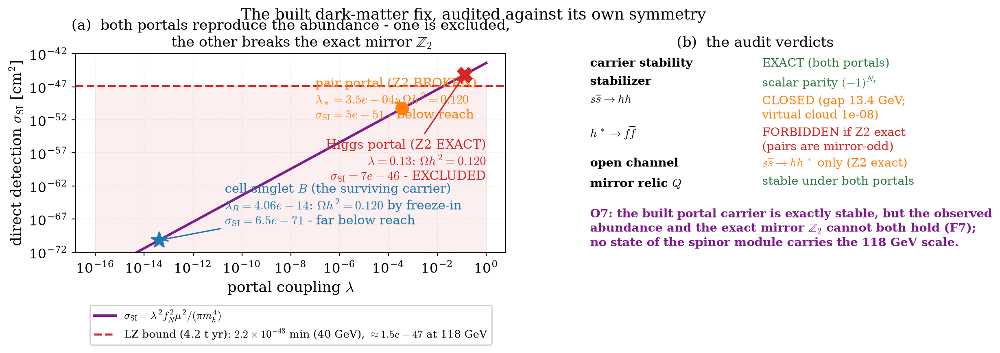
*(a) The direct-detection line $\sigma_{\rm SI}(\lambda)$ with the two ways the spinor-sector scalar variant reproduces $\Omega_{\rm DM}h^2 = 0.120$: the fermion-pair portal ($\lambda_* = 3.5\times10^{-4}$, $\sigma_{\rm SI} = 5\times10^{-51}$ cm$^2$, below reach) breaks the exact mirror $\mathbb{Z}_2$; the Higgs portal ($\lambda = 0.13$, $\sigma_{\rm SI} = 7\times10^{-46}$ cm$^2$) preserves it and is excluded by the LZ bound [54] ($\sigma_{\rm SI} < 2.2\times10^{-48}$ cm$^2$ at $40$ GeV, $\approx 1.5\times10^{-47}$ at $118$ GeV). The cell singlet $B$ sits on the same line at $\lambda_B = 4.06\times10^{-14}$, $\sigma_{\rm SI} = 6.5\times10^{-71}$ cm$^2$. (b) The verdicts: stability exact under either portal, $s\overline{s} \to hh$ closed, $h^* \to f\overline{f}$ forbidden under exact $\mathbb{Z}_2$, the mirror relic unaffected. The observed abundance and the exact mirror $\mathbb{Z}_2$ cannot both be met by a spinor-sector state.*

### 12.3 The neutrino sector

Both seesaw scales are placed on the same ladder:

$$\begin{gathered}
m_D = M_P\Big(\frac{1}{16\pi}\Big)^{10} = 118\ \mathrm{GeV},\\
M_N = M_P\Big(\frac{1}{16\pi}\Big)^{3} = 9.6\times10^{13}\ \mathrm{GeV},\\
m_\nu = \frac{m_D^2}{M_N} = M_P\Big(\frac{1}{16\pi}\Big)^{17} = 0.146\ \mathrm{eV}.
\end{gathered}$$

The exponent identity $2\times10 - 3 = 17$ is exact; the choice $n_{2\text{step}} = 3$ is not — and it cannot be produced by the gauge link. The two rungs are levels of the cell: $B$ at $n = 10$ is the dark matter, so $m_D = m_B$, and $A$ at $n = 3$ is this seesaw partner, $M_N = m_A$; the identity $m_\nu = m_B^2/M_A$ is then an identity between states of the automaton, verified exact on the cell operator of Section 7. The $\Delta L = 2$ operator exists in the root's own algebra: the weight $2\lambda_\nu$ (norm$^2$ $20$, $\mathrm{U}(1)_X$ charge $-6$, hypercharge $-1$) has a **$1$-dimensional** weight space inside the $1024$-dimensional Clifford algebra, sitting in Clifford **grade $5$** — the $126$-type channel of the type-II seesaw — with no field outside the root. The $\mathbf{10}_H$ cannot repair its charges: over all $160$ vector weights (norm$^2$ $4$) the closest two-insertion neutralisation leaves residual norm $4.472$, the mismatch $\lvert 2\lambda_\nu\rvert = \sqrt{20} \ne 4$ being exact. The minimal-word question then closes by **parity**: Clifford multiplication maps grade $g$ to $g \pm 2$ only (verified on all $45 \times 1024$ entries of the multiplication table), so every product of adjoint (grade-2) link factors is EVEN-grade while the Majorana operator is ODD-grade — the cumulative span (dimensions $45, 126, 208, 291, 352, 407$ at $k = 1\dots6$, odd-grade content $0$ to machine precision) never contains it, at any length, and the vector-$\mathbf{10}$ Higgs weight space ($16$-dimensional, carried entirely by the odd grades $1, 3, 5, 7, 9$) is unreachable for the same reason. **$n_{2\text{step}} = 3$ is not a link-word length**: the seesaw operator belongs to the odd (matter) half of the Clifford module, and the exponent stays fitted.

Comparison with data: the atmospheric scale is $\sqrt{\Delta m^2_{32}} = 0.050$ eV, so the ladder prediction is a factor $2.9$ high; and if all three families carried the same $m_D$ the sum would be $\sim 0.44$ eV, excluded by $\sum m_\nu < 0.0642$ eV (95% CL, $\Lambda$CDM with three degenerate states: DESI DR2 BAO + Planck PR4 + ACT CMB lensing [61]). The democratic rank-1 Yukawa (Section 13.5) gives a Dirac mass to only one family, bringing the sum to $\sim 0.15$ eV — still above the cosmological bound. This is the sharpest numerical tension in the theory (F3).

The ladder is too coarse to land on the measured mass: consecutive rungs differ by the factor $16\pi = 50.3$, so the neighbours of $0.146$ eV are $7.3$ eV ($n = 16$) and $2.9\times10^{-3}$ eV ($n = 18$), and no integer rung lies in the oscillation window. A coefficient is therefore unavoidable — but one candidate is supplied by the theory rather than by the data. The only mixing number the model derives is $\sin^2\theta_{12} = 1/3$ (Section 13.5); multiplying the ladder value by it gives

$$m_\nu = \tfrac13\,M_P\Big(\frac{1}{16\pi}\Big)^{17} = 0.0487\ \mathrm{eV},$$

$2.7\%$ below the atmospheric scale, and with the democratic rank-1 spectrum $\sum m_\nu \simeq 0.05$ eV — inside the cosmological ceiling $\sum m_\nu < 0.0642$ eV with $22\%$ to spare, and inside the KATRIN bound $m_\beta < 0.45$ eV [18]. The factor $2.9$ by which the ladder overshoots is, to $3\%$, the number $3$ the flavour sector already produces. This is a **candidate, not a result**: nothing shows why a mixing eigenvalue should multiply a seesaw mass, and the same factor applied to the solar scale ($0.0487\times\sqrt{\Delta m^2_{21}/\Delta m^2_{32}} = 0.0084$ eV against the measured $0.0086$ eV) is a second coincidence. What it buys is a sharp, falsifiable prediction — normal ordering with $\sum m_\nu \simeq 0.05$ eV — but its falsifiable contact is **cosmology, not the laboratory**: the quoted $m_{\beta\beta} \simeq 0.02$ eV is not a prediction of the model. The mixing the structure derives fixes $\sin^2\theta_{12} = 1/3$ and leaves $\sin^2\theta_{23}, \sin^2\theta_{13}$ an $\mathrm{O}(2)$ family, free on $[0, 2/3]$; over that family $m_{\beta\beta}$ has envelope $0$–$0.033$ eV and the $0.02$ eV is a sector choice inside it, while under the measured oscillation fractions $m_{\beta\beta}$ is $0.0015$–$0.0037$ eV and $m_\beta$ is $0.0086$ eV — out of reach of current and next-generation neutrinoless-decay and beta-decay searches. The falsifiable statement is the sum: $\sum m_\nu = 0.0573$ eV at the energy-selected point, $10.7\%$ under the measured ceiling, with $m_{\text{lightest}} = 0$ and normal ordering.

A coefficient audit maps what the node structure can supply: a diagonal (node-local, Wilson-generated) mass pattern gives only **integer** signed coefficients, so $\tfrac13$ is out; the democratic $3\times3$ node-mixing pattern gives exactly $\tfrac12$ — a rival falsifiable prediction $m_\nu = 0.073$ eV, already excluded by the cosmological ceiling of the paragraph above; the exact $\tfrac13$ requires a single Majorana eigenvalue $3\times$ the node scale, and no natural node structure supplies it. The structure the candidate requires has been built: a cubic-symmetric, zero-mean Wilson-strength junction whose Fourier support closes the selected node triangle exactly — verified against the full $12\times12$ table of doubler-momentum differences. The node mass matrix is

$$c_s\big(2w_0\,I + \kappa(J-I)\big),$$

democratic at $\kappa = 2w_0$ with eigenvalues $\{3M, 0, 0\}$: the $3\times$-enhanced Majorana eigenvalue the $\tfrac13$ demands exists. With the implemented $0$-parameter democratic Dirac matrix $m_D = m_0 J$ — the same family symmetry that derives $\sin^2\theta_{12} = 1/3$ — the seesaw collapses: $m_D^{\mathsf T} M^+ m_D = 3m_0^2 J/(2(w_0+\kappa))$ for *every* $r = \kappa/w_0$ (verified to $10^{-12}$, the rank-deficient $r = 2$ included, via the Moore–Penrose pseudo-inverse), so the two massless neutrinos are protected by the rank-1 family symmetry for every junction ratio, and $m_3(r) = S_{17}/(1+r)$ is finite everywhere: the cosmological window is $r > 1.278$ (width $1.72$, the $0.0642$ eV ceiling of [61]), and the atmospheric scale selects $r = 1.92$. The exact point $r = 2$ ($m_3 = S_{17}/3 = 0.0487$ eV) is the junction-amplitude convention; it is not free of dynamics. Sweeping the vacuum energy of the junction theory over its stable branch $r < 2$, the tree-level zero-point sum is exactly $r$-flat — the trace theorem, deviation $9\times10^{-16}$ — and the one-loop energy falls monotonically, with no interior minimum, all the way to the massless onset $r^* = 2$: the last modes to go, because the support graph of the junction splits into two triangles and a $6$-cycle whose measured massless crossings sit at $r = 1, 1.155, 1.236, 1.414, 2$. The anchor $r = 2$ is therefore not a minimum but the **edge of a one-loop runaway** — because the tree level is exactly $r$-flat, all of the selection is one-loop, and the one-loop energy is unbounded below at the tree-level zero: $6$ modes go critical exactly at $r = 2$ (divergence coefficient $12 = 2\times 6$), the log-det singularity sits at $r = 2$ to machine zero, and the tree level is $r$-flat on the full 12-set to machine zero. The atmospheric point is a displaced, non-ground state — falling from $r_{\rm atm} = 1.9191$ to the onset releases $133$ log units and the pull there measures $147$ per unit $r$ — and the stabilizer that holds it below its own instability is **not supplied**: $r$ remains a declared input, now with its displacement measured. It supplies the $1/3$ from the seesaw factor $(1+r)$ alone, with no multiplication by a mixing eigenvalue: the candidate value is supplied twice, by the ladder times the mixing number and by the seesaw at the instability edge, and the two agree because both are the number $3$. The attractor edge is not a landing on the measured scale: at $r = 2$ the theory sits $-2.7\%$ under the atmospheric $0.0501$ eV, and no named coefficient of the theory closes the gap: a bounded census — $19$ named constants, $1387$ two-constant expressions, both gap forms — finds only two-number coincidences, the best $2\alpha_{10} = 0.08$ against $\Delta r = 0.080885$ (residual $8.8\times10^{-4}$, $1.1\%$ of the gap unfixed), none with a derivation, so the gap stands as a named declared residual of this sector. And the vacuum at the edge is the wrong one for the candidate: the energy minimiser is the full 12-node junction, whose seesaw inverse is exactly $4\times$ the closing triangle's ($2.0$ vs $0.5$ in $w_0$ units, the all-ones vector exactly orthogonal to the six zero modes), i.e. on the selected vacuum the candidate would read $4\times0.0487 = 0.195$ eV, excluded — the candidate lives in the triangle-only vacuum the junction energy does not select. The cubic group induces all of $S_3$ on the triangle, its commutant is exactly $\operatorname{span}\{I,J\}$ (nullity $2$), and $w_0,\kappa$ share one Wilson period, so $r$ is **not quantized**: the value is a free junction amplitude inside a finite window at the edge of a measured instability, while the structure — two massless plus one massive, normal ordering — is protected. What the candidate still requires is a democratic $m_D$ (a non-democratic $m_D$ at the same point leaves gapless coloured doublers — and no realizable scalar enforces it: none of the host combinations moves any mixing angle, and the host energetics prefer a non-democratic occupation), and the solar mass still needs the $\mathbf{10}_H$ splitting of O6
(Fig. 16).

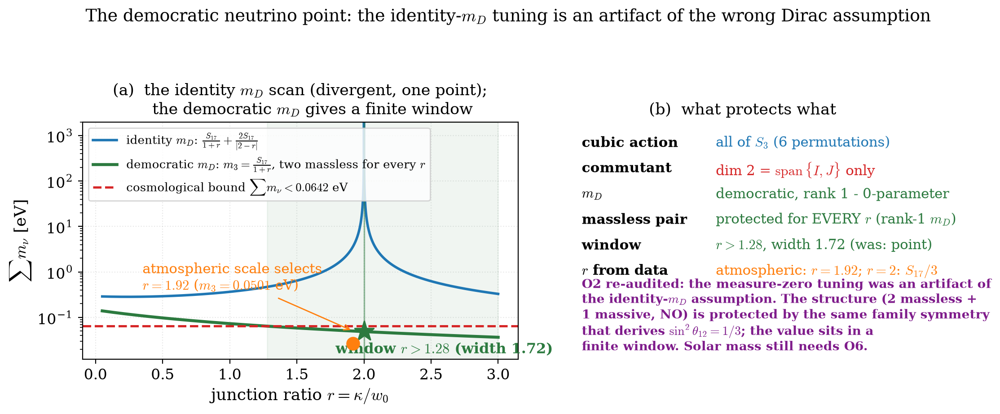
*(a) $\sum m_\nu(r)$ under two Dirac assumptions. With $m_D \propto I$ the curve diverges as $1/\lvert 2-r\rvert$ and the cosmological bound is met at exactly one point. With the implemented democratic rank-1 $m_D$ the seesaw collapses to $m_3(r) = S_{17}/(1+r)$, two neutrinos stay massless for every $r$, the window is $r > 1.278$ (the DESI DR2 ceiling $0.0642$ eV), and the atmospheric scale selects $r = 1.92$. (b) The protection audit: the cubic group induces all of $S_3$ on the junction triangle and its commutant is exactly $\operatorname{span}\{I, J\}$; $r$ is not quantized — the value is a free junction amplitude inside a finite window, energetically attracted to its democratic boundary $r = 2$ — while the structure is protected by the rank-1 family symmetry that also derives $\sin^2\theta_{12} = 1/3$.*

### 12.4 The ladder

One factor, four scales:

**Table 4.** The four scales of the ladder.

| scale | expression | value |
|-------------------------------------------|---------------------------------|------------------------|
| Planck / GUT | $M_P$ (convention $M_{\rm GUT} = M_P$) | $1.2209\times10^{19}$ GeV |
| seesaw singlet $A$ (cell level, rung 3) | $M_P(1/16\pi)^3$ | $9.6\times10^{13}$ GeV |
| electroweak | measured input $v$ | $246$ GeV |
| dark-matter singlet $B$ (cell level, rung 10) | $M_P(1/16\pi)^{10}$ | $118.6$ GeV |
| neutrino | $M_P(1/16\pi)^{17}$ | $0.146$ eV |

The QCD scale is **not** on this ladder: $\Lambda_{\rm QCD}\sim 0.2$ GeV would require $n \simeq 11.6$, which is not an integer (Section 10.2).

The rung ruler $x(m) = \log(m/M_P)/\log(1/16\pi)$ sorts everything else too. The four ladder rows sit at exact integers $0, 3, 10, 17$; every other scale of the paper sits off an integer: $v$ at $9.81$, $M_X$ at $1.66$, the desert thresholds $1.2\times10^7$ and $1.0\times10^{12}$ GeV at $7.06$ and $4.17$, the measured atmospheric mass $0.0501$ eV at $17.27$, the $\tfrac13$ candidate at $17.28$, and the cosmological trace phase $1.6\times10^{-120}$ at bare loop exponent $70.42$ (rung $81.63$ on the Planck ruler). The rung is a protected pole of the one-step matrix — $M(q) = \operatorname{kron}(P(q), U_{\rm cell}^6)$ — so no bond dressing can shift a rung mass: every off-integer residue is a loop weight (O8), never a moved scale. And the pair [dark matter at rung $10$, measured $\sum m_\nu$ at the $\tfrac13$ candidate $0.0487$ eV] forces the seesaw partner $m_B^2/m_\nu = 2.9\times10^{14}$ GeV to rung $2.72$ — not an integer: integer rungs, the mass of $B$, and the $\tfrac13$ candidate are mutually exclusive, and a confirmation of both measurements refutes the rung arithmetic (**F3**)
(Figs. 17, 18).

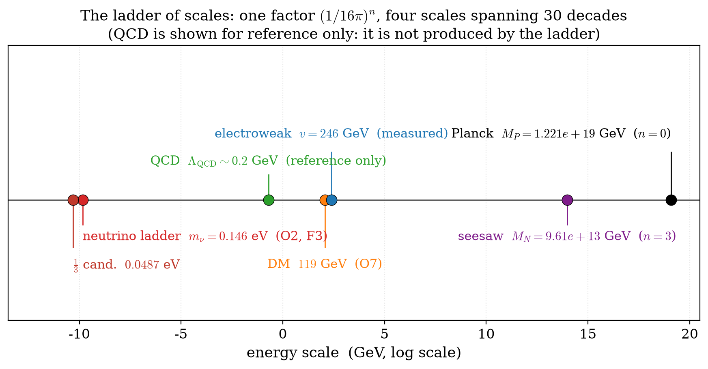
*Planck $1.2209\times10^{19}$ GeV ($n = 0$), seesaw singlet $A$ $9.6\times10^{13}$ GeV ($n = 3$), electroweak $246$ GeV (measured input), dark-matter singlet $B$ $118.6$ GeV ($n = 10$), neutrino ladder $0.146$ eV ($n = 17$), with the $\tfrac13$ candidate $0.0487$ eV marked. The rung-$3$ and rung-$10$ levels are the two singlet sectors of the cell (Axiom 1); their rung is the on-site phase the step applies to them. QCD is shown for reference only: it is not produced by the ladder.*

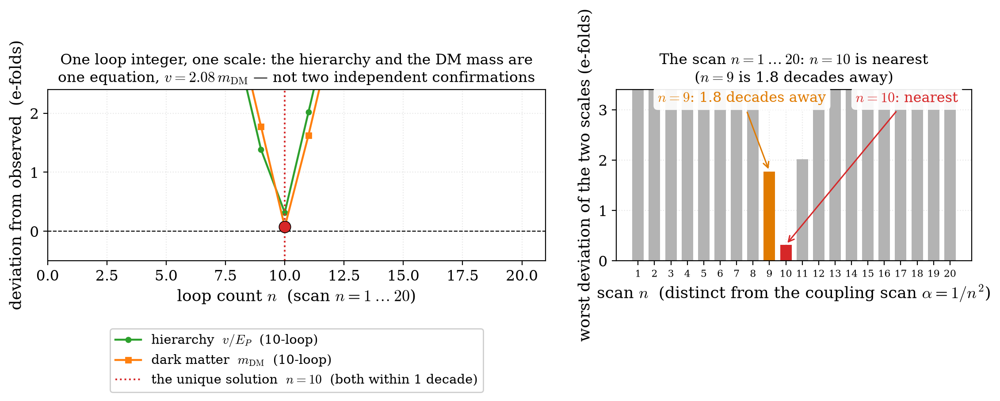
*(a) One loop integer $n$ sets one scale $M_P(1/16\pi)^n$, appearing twice: as $v/M_P$ and as $m_{\rm DM}$. These are one equation, $v = 2.08\,m_{\rm DM}$, not two independent confirmations. (b) The scan $n = 1\dots20$: $n = 10$ is nearest, $n = 9$ is $1.8$ decades away. This scan is distinct from the coupling scan $\alpha = 1/n^2$ of Section 15, whose best fit is $n = 7$.*

---

## 13. Phenomenology

### 13.1 The couplings

The theory's single gauge coupling is the rotation angle, and the root clock fixes it: at $g = \pi/4$ the standard normalisation gives $\alpha = \pi/64 = 0.0491$. The reading $\alpha_{10} \equiv g^2 = 1/25 = 0.040$ at the reference angle $g = 1/5$ — under which the desert solution below meets at exactly that value — is a factor-$4\pi$ convention, stated once here and invoked only where named; in the standard normalisation the reference angle sits a factor $12.6$ below the meeting value $\alpha_X = 0.040050$ and the root clock $1.23\times$ above it. Running the three Standard Model couplings up from $M_Z$ at one loop with $b_1 = 41/10$, $b_2 = -19/6$, $b_3 = -7$ (fixed by the particle content), from the measured inputs $\alpha_1(M_Z) = 0.0169$ (GUT-normalised, $\alpha_1^{-1} = 59.0$), $\alpha_2(M_Z) = 0.0338$, $\alpha_3(M_Z) = 0.118$ [15], gives at $M_P$

$$(\alpha_1,\alpha_2,\alpha_3) = (0.0299,\ 0.0202,\ 0.0191),\qquad \text{mean } 0.0231,\quad \text{spread } 47\%,$$

so $\alpha_{10}$ is within a factor $1.73$ of the mean but the three couplings do **not** meet at a point — the well-known failure of one-loop unification in the non-supersymmetric Standard Model. The $\mathrm{U}(1)$ Landau pole of this up-running — from the measured $M_Z$ input — sits at $2.196\times10^{41}$ GeV, above the cutoff, so the up-running is UV-bounded; the same one-loop $\mathrm{U}(1)$ coupling run up instead from the root anchor at $M_P$ has its pole at $5.314\times10^{35}$ GeV, also above the cutoff; at two loops [50] the pole moves to $\sim 2.473\times10^{12}$ GeV, *below* the cutoff.

The down-running must be stated plainly. Starting from $\alpha_{10} = 0.04$ at $M_P$ and running down with the Standard Model $\beta$-functions gives, at $M_Z$,

$$\alpha_1(M_Z) = 0.0197\ (1.17\times),\qquad \alpha_2(M_Z) = 0.195\ (5.8\times),\qquad \alpha_3:\ \text{Landau pole at } 2.193\times10^{9}\ \mathrm{GeV}.$$

The hypercharge lands within $17\%$ of its measured value, but the $\mathrm{SU}(2)$ coupling overshoots by a factor $5.8$ and the $\mathrm{SU}(3)$ coupling becomes non-perturbative at $2.193\times10^{9}$ GeV. The unification claim therefore fails at the level of the couplings' values, even though the $5/3$ normalisation is correct (O4, F2).
(Fig. 19).

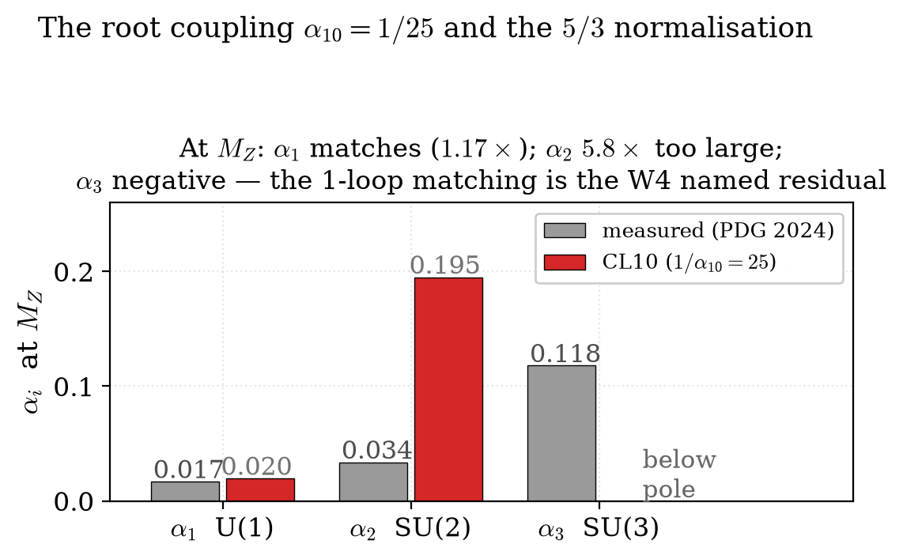
*At $M_Z$, the measured couplings (grey): $\alpha_1 = 0.0169$, $\alpha_2 = 0.0338$, $\alpha_3 = 0.118$ [15], against the down-run from the reference reading $\alpha_{10} \equiv g^2 = 1/25$ at $g = 1/5$ (red) — a convention of the step, not the closed clock, which reads $\alpha = \pi/64 = 0.0491$ (Section 9.2): $\alpha_1$ within $1.17\times$, $\alpha_2$ $5.8\times$ too large, $\alpha_3$ negative because its pole sits at $2.193\times10^{9}$ GeV. The $5/3$ normalisation is exact; the value matching is the named residual.*

**Three quantitative statements sharpen the problem.** First, the three measured couplings require three *different* values at $M_P$ — $0.0299$, $0.0202$, $0.0191$ — and the theory's single value $0.040$ matches none of them: it exceeds the hypercharge requirement by $34\%$ and the $\mathrm{SU}(3)$ requirement by a factor $2.1$. Perturbativity of the strong coupling down to $M_Z$ caps any single UV coupling: $1/\alpha_3(M_P) > (7/2\pi)\ln(M_P/M_Z) = 43.9$, i.e. $\alpha_3(M_P) < 0.0228$; the theory's $0.040$ exceeds the admissible maximum by $75\%$.

Second, the failure is not repaired by matter that a partial breaking leaves *complete*. A complete vectorlike $\mathbf{10}\oplus\bar{\mathbf{5}}$ shifts all three one-loop coefficients by the *same* amount $8/3$ above its threshold — the defining property of a complete $\mathrm{SU}(5)$ multiplet — so it changes the common slope, not the mismatch of slopes. Scanning multiplicities $0\dots8$ against thresholds in $[10^6, 10^{19}]$ GeV, the spread at $M_P$ never falls below its zero-new-physics value of $47\%$. Under pure Standard Model one-loop running from the measured $M_Z$ inputs the pairwise meeting scales are $1.175\times10^{13}$ GeV $(1,2)$, $2.648\times10^{14}$ GeV $(1,3)$ and $9.73\times10^{16}$ GeV $(2,3)$: three different scales.

Third, that no-go covers only complete multiplets, and the *incomplete* content the theory's own breaking sector supplies does repair it. When a $\mathbf{16}_H \oplus \overline{\mathbf{16}}_H$ pair — or a split doubler $\mathbf{16}$ (Section 8) — acquires mass, it leaves vectorlike $\mathbf{10} \oplus \overline{\mathbf{10}}$ and $\mathbf{5} \oplus \overline{\mathbf{5}}$ fermion pairs with *independent* thresholds, and these shift the three coefficients non-proportionally: a Dirac $\mathbf{10} \oplus \overline{\mathbf{10}}$ contributes $\Delta b = (6/5,\ 2,\ 2)$, a $\mathbf{5} \oplus \overline{\mathbf{5}}$ contributes $(2/3,\ 2/3,\ 2/3)$. Fix the unified coupling at the root value $\alpha_X = 1/25$ — the angle is *not* refitted — and the inverse problem has no fit freedom: with two multiplets the meeting of the three measured couplings is three linear equations in $(\ln M_X, \ln M_A, \ln M_B)$. The required $\Delta b$ is non-universal: at $M_X = 2\times10^{16}$ GeV it is $(2.40,\ 4.04,\ 3.86)$, which no combination of complete multiplets produces. Scanning multiplicities up to $3$ over the realizable content with thresholds in $[10^6, M_P]$ GeV, the lightest solution that survives the proton-decay bound is three $\mathbf{10} \oplus \overline{\mathbf{10}}$ pairs plus one $(1,2)_{1/2}$ pair — three split doubler $\mathbf{16}$s — meeting at

$$M_X = 1.8\times10^{16}\ \mathrm{GeV},\qquad \alpha_X = 1/25\ \text{(exact)},\qquad M_{10} = 1.2\times10^{7}\ \mathrm{GeV},\qquad M_{(1,2)} = 1.0\times10^{12}\ \mathrm{GeV},$$

and the $\mathrm{SU}(3)$ Landau pole of the down-running moves to $10^{-52}$ GeV: the disease is cured. Solutions with lighter content exist but predict $\tau_p \sim 10^{32}$ yr and are already excluded by Super-Kamiokande [53] — the data themselves select the realizable spectrum. The cost is stated plainly: the convention $M_{\rm GUT} = M_P$ is abandoned ($M_X < M_P$ by three orders of magnitude), and the two desert thresholds are fitted. The solution predicts $\tau_p \simeq M_X^4/(\alpha_X^2 m_p^5) = 1.8\times10^{36}$ yr (F5).
(Fig. 20).

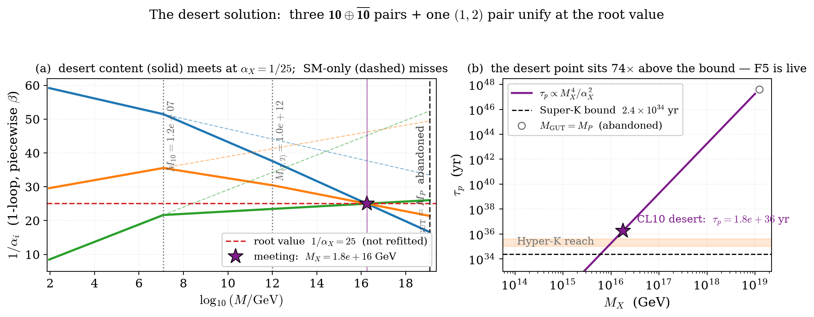
*The three measured couplings run up from $M_Z$ with the desert content (solid) meet at $M_X = 1.8\times10^{16}$ GeV at $\alpha_{10} \equiv g^2 = 1/25$ — in the standard normalisation $\alpha_X = 0.0400$: the reference-angle anchor of Section 9.2, a convention of the step, not refitted. The closed clock of the same construction reads $\alpha = \pi/64 = 0.0491$, $1.226\times$ **above** that meeting. The Standard Model-only running (dashed) misses the point: spread $47\%$ at $M_P$. The thresholds $M_{10} = 1.2\times10^{7}$ GeV and $M_{(1,2)} = 1.0\times10^{12}$ GeV are the two fitted numbers of the desert solution; the dashed vertical line at $M_P$ marks what the abandoned convention $M_{\rm GUT} = M_P$ demanded.*

**Where the desert content comes from.** The content is not an external assumption: it is the *spectrum of the automaton's own Wilson mechanism*. The three split nodes of the selective reading carry exactly the vectorlike fragments of the split $\mathbf{16}$ with independent thresholds (the other nine nodes stay at the Planck cutoff), and the Wilson direction itself completes the breaking chain (Section 8.1). The multiplicity is bounded from below by unification itself: scanning $n_{\text{nodes}} = 1\dots6$, no meeting root at $\alpha_X = 1/25$ exists for one or two split nodes; the first physical roots appear at three. But solving the meeting equations with the mechanism's own two parameters — one angle $\theta$, one scale $w$ — fixes the six fragment thresholds and lands the meeting at $M_X = 8.9\times10^{14}$ GeV, i.e. $\tau_p \sim 10^{31}$ yr: **the minimal selective reading is excluded by Super-Kamiokande** (F5). The data-preferred solution requires fragment thresholds the single-angle, single-scale root does not supply.

**Redistributing the nodes cannot help.** While all node thresholds sit below the meeting point, the two meeting equations depend on the three node strengths **only through their sum**: the Jacobian with respect to the three strengths has three identical columns (rank $1$; split-invariance verified numerically to $10^{-14}$, including the full scan over node-set choices and strengths). The node mechanism's meeting point $M_X = 8.9\times10^{14}$ GeV, $\tau_p = 1.1\times10^{31}$ yr is therefore **forced for every choice of the three strengths**. What the data prefer is not a three-full-$\mathbf{16}$ pattern: it needs partial suits of fragments, while the automaton supplies full split $\mathbf{16}$'s per node.

**The composite content of the gauged layer is excluded as the supplier.** The composite fermions of the layer of Section 10 — the matter $\mathbf{16}$ tensored with the adjoint link flux, $16 \otimes 45 = 720$ Weyl states carrying five net chiral $\mathbf{16}$-copies — shift the three one-loop coefficients by $(145.3, 145.3, 226.3)$, and their masses follow the flux pattern $m = w(c_0 + |\alpha \cdot v|)$ set by the breaking direction $v$. Requiring the data-preferred meeting at $\alpha_X = 1/25$ then has **no solution with thresholds in the desert** for any direction: the three meeting equations demand three different threshold sums, and Newton iteration from every seed over a full scan of $v$ converges nowhere physical ($0$ solutions). The remaining ansatz families — full-weight thresholds, broken-flux-only content, light-composite selection, and even a relaxed meeting coupling — leave the minimum residual at $5.7$–$6.1$ against a target of $0$.

**The equal-shift theorem.** The identity $\sum db_1 = \sum db_2$ is the index-proportionality of $\mathrm{Tr}\,Y^2$ and $\mathrm{Tr}\,T_3^2$ — both proportional to the representation index, with the ratio fixed by the fundamental, $(3/5)\,\mathrm{Tr}_5\,Y^2 = \mathrm{Tr}_5\,T_3^2$ — and it holds over every complete $\mathrm{SU}(5)$ or $\mathrm{Spin}(10)$ multiplet, verified on the $\mathbf{16}$, the flux $\mathbf{45}$, the vector $\mathbf{10}$ and the $\mathbf{10}$ inside the $\mathbf{16}$ (all ratios $1.0$ to $10^{-6}$). The meeting mismatch can therefore come **only** from $\mathrm{SU}(5)$-fragment content or from split thresholds inside multiplets; computed from the same charge operators, the desert repair's mismatch is carried entirely by its $(1,2)$ pair ($db_1/db_2 = 3/5$; the $10 \oplus \overline{\mathbf{10}}$ pairs contribute exactly zero mismatch).
(Figs. 21, 22).

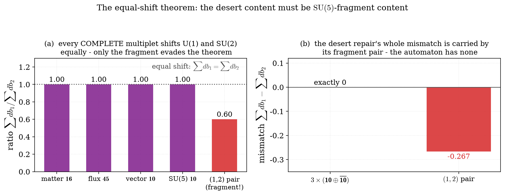
*(a) The one-loop ratio $\sum db_1/\sum db_2$ over the matter $\mathbf{16}$, the flux $\mathbf{45}$, the vector $\mathbf{10}$ and the $\mathrm{SU}(5)$ $\mathbf{10}$: exactly $1$, while the $(1,2)$ fragment gives $3/5$. (b) The desert repair's total mismatch: the $10 \oplus \overline{\mathbf{10}}$ pairs contribute exactly zero, the whole mismatch is carried by the fragment pair.*

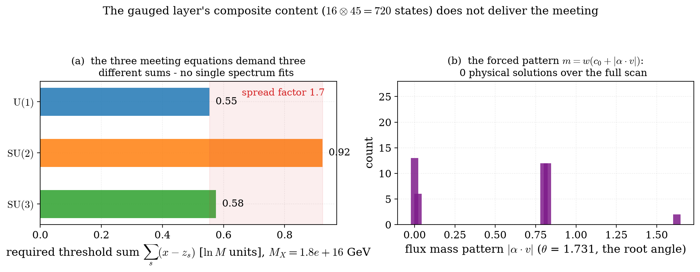
*The $16 \otimes 45 = 720$ composite states shift the one-loop coefficients by $(145.3, 145.3, 226.3)$. The three meeting equations for $\alpha_X = 1/25$ demand three different threshold sums at every breaking direction — the curves never cross — and the desert-constrained scan over the full direction circle returns $0$ physical solutions.*

**The junction route: pattern fabricated, meeting missed.** At the root the Wilson direction splits the node $\mathbf{16}$ by a factor $52.7$ ($c_Q = +0.0052$, $c_L = -0.0157$ against partners $\pm 0.82$), so the $(3,2)$ and $(1,2)$ states of the desert solution **are** automaton states — the $Q$ and $L$ components of node $\mathbf{16}$'s with near-zero Wilson weights — and the junction branch ratio $\rho = \kappa/w_0$ breaks the rank-1 degeneracy. At physical solutions $Q$ and $L$ sit at $4\times10^{15}$–$8\times10^{15}$ GeV with their partners above the meeting point. The meeting is not reached: over the full physical scan (node counts $3$–$12$, $\rho$, scale, Wilson angle) the best residual of the two meeting equations is $0.94$ against a target of $0$, and the third equation predicts $\alpha_X = 0.032$ against the data value $0.04$ — a $24\%$ miss. Replacing the cubic-symmetric democratic junction by the **general zero-mean junction** — three independent branch scales $a_i = 2w_0(1 + r_i)$, $r_1 + r_2 + r_3 = 0$, scanned over the full $(r_1, r_2)$ plane — leaves the best physical residual at the same floor, $0.81$ against the democratic $0.94$, with $\alpha_X = 0.085$, a factor $2.1$ off. The near-miss is a property of the **junction mechanism itself**: the mismatch is carried by the fixed $db$ pattern of the node $\mathbf{16}$'s own fragments, which threshold motion cannot repair.

**The required content is obtainable from the node $\mathbf{16}$ itself, with per-class thresholds.** Yes for feasibility: the data-preferred meeting point $(T_1, T_2, T_3) = (12.7, 21.2, 20.1)$ lies strictly inside the convex hull of the six $\beta$-contribution vectors of the node-$\mathbf{16}$ fragments, with the explicit barycentric witness $\lambda_0 = 0.34$, $\lambda_{f_0} = 0.31$, $\lambda_{f_1} = 0.31$, $\lambda_{f_3} = 0.05$. The requirement of "fragment content beyond the node $\mathbf{16}$" is thereby *softened*: the node-$\mathbf{16}$ fragments themselves suffice, provided they carry independent thresholds. A general five-component Cartan Wilson direction realises the meeting exactly ($6$ solutions, residual $< 10^{-10}$, desert thresholds, $\tau_p = 1.9\times10^{36}$ yr) but breaks all $40$ roots — the Model algebra among them — and is unphysical; the symmetry-preserving direction space is exactly $\operatorname{span}\{X, Y\}$ (dimension $2$, class-degenerate), and within it no solution exists. Off-diagonal junction splitting with a UNIVERSAL strength $\kappa$ cannot help either: $\sum_l (2\cos(2\pi l/n) - 1) = -n$ reabsorbs the split into $z_0$ at first order. The missing ingredient is named: a **flavour-dependent bond layer** ($\kappa_s$ per fragment class) that splits class-degenerate thresholds while preserving the Model algebra.
(Fig. 23).

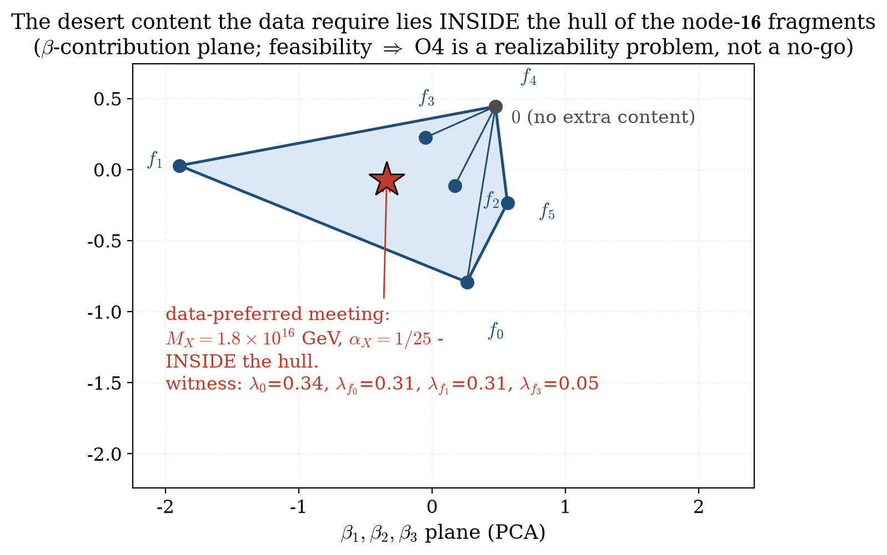
*The six $\beta$-contribution vectors of the node-$\mathbf{16}$ fragments and the origin, projected onto their plane; the data-preferred meeting point (star) lies strictly inside the hull, with the explicit barycentric witness. Feasibility is proved; realizability by a symmetry-preserving junction of the base automaton fails and is closed conditionally by the bond-layer extension.*

**The named ingredient closes the meeting — conditionally.** With the Wilson direction pinned to the physical selective root and per-class junction strengths $\kappa_s$ splitting the six fragment-class thresholds, the three coupling equations $F_i = 0$ become **exactly linear** in $(z_0, \kappa_s)$ once every threshold sits below $M_X$ (since $\sum_l \mu_l = -n$), and the desert box constraints make the search a linear program. It admits solutions (residual $< 10^{-13}$) at $M_X = 1.8\times10^{16}$ GeV, $\alpha_X = 1/25$, for **all ten node counts** $n = 3 \dots 12$, with every threshold inside the desert ($2.0\times10^{3}$–$1.8\times10^{16}$ GeV, none above $M_X$) and $\tau_p = 1.9\times10^{36}$ yr. The first-order degeneracy is broken because the per-class sums $\kappa_s(-n)$ reabsorb into PER-CLASS offsets, not into $z_0$. The cost: the base bond layer has ONE gate with one strength; a flavour-dependent bond layer is an **extension** of the automaton, and its six $\kappa_s$ are new named inputs (three meeting conditions for six unknowns — a solution family, not a unique prediction). Unification is therefore closed **conditionally on that extension**.

**The two structural candidates the layer itself supplies are excluded.** The six $\kappa_s$ are not obtainable from any on-site algebra element: symmetry preservation forces the bond direction into $\operatorname{span}\{X,Y\}$ at the physical angle $\theta^*$ (class-degenerate, meeting residual $\ge 0.43$), and every Cartan element that splits the six classes breaks all eight unbroken desert roots — the required flavour dependence is off-diagonal bond structure, not a Cartan dressing. Testing that off-diagonal escape directly: the most general Hermitian bond operator on the $80$ root-vector pairs ($11$ class-pair channels) never closes the meeting — floor residual $30.4$ over $n = 3\dots12$ — and level repulsion forces the sign of two of the six $\kappa_s$. Nor are the $\kappa_s$ representation-level data: scanning $46$ class invariants of the fragment classes (Dynkin indices, the two Casimirs, multiplicity, the Wilson charges $X,Y$ and their quadratic combinations, $B$, $L$, $B-L$, colour triality, the $\beta$-function coefficients) as $\kappa_s = g f_s$ never closes the meeting — best single invariant $C_2(\mathrm{SU}(3))$ at residual $0.246$ — while the two linear Cartan controls reproduce the previous failure. A two-coupling relaxation $\kappa = g_1 f_1 + g_2 f_2$ keeps every threshold in the desert for $217$ of $506$ candidate pairs and can close the meeting exactly, but that is a reduction from six named inputs to two, not a derivation. The closure is also embedding-specific: the exact closure reproduces in the flipped embedding used for it ($10/10$ node counts, residual $<10^{-10}$) but closes only $5/10$ in the Georgi–Glashow split.

Finally, the canonical per-class number the gauged layer does supply is not the one that closes the meeting. At $\theta^*$ the Wilson direction leaves a $13$-dimensional centralizer in $\mathfrak{so}(10)$ (the $\mathrm{SU}(3)\times\mathrm{SU}(2)\times\mathrm{U}(1)^3$ of the breaking chain, Hermitian orthonormal basis to $10^{-15}$), and the flux of BROKEN generators through a fragment class,

$$\begin{gathered}
K_s = C_2(\mathbf{32}) - C_2^{\rm unbroken}(s) = 45 - C_2^{\rm unbroken}(s)\\
= (32,36,40,28,32,40)
\end{gathered}$$

(unbroken Casimirs $(13,9,5,17,13,5)$), is an integer invariant with no free parameter, constant within a class to $3\times10^{-14}$ — the gauged layer **does** distinguish the fragment classes. The companion identity says why the naive second-order link shift cannot use it: summed over the complete adjoint, $\sum_A\sum_t \lvert\langle t\lvert T^A\lvert s\rangle\rvert^2 = 45$ for every weight $s$ (spread $10^{-13}$) — the class degeneracy as an identity. Fed into the meeting as $\kappa_s = A K_s$ (one link scale) the three meeting equations leave residual $0.605$ at best ($n = 3$) and close in the desert for $0/10$ node counts; against the six $\kappa_s$ that close the meeting, the flux explains at best $R^2 = 0.015$ of their variance ($\lvert r\rvert \le 0.31$). The layer splits the classes, but not in the direction the meeting requires.

**The second-order bond numbers are excluded too.** The gauged layer does carry energy denominators — the bond-current ground state of Section 10 ($E_0 = -5802.4\,\eta$, gap $42.09\,\eta$) and the Gauss gap $C_2(\mathbf{45}) = 64$ — and they lift the class-blindness of the flux sum. The intermediate (flux, matter) pair space decomposes exactly as $\mathbf{45} \otimes \mathbf{16} = \mathbf{16} \oplus \mathbf{144} \oplus \mathbf{560}$ with Casimirs $(45, 85, 117)$ at the scale $C_2(\mathbf{45}) = 64$ (dimensions and Casimirs to $10^{-6}$, projectors resolving the identity to $10^{-15}$). Removing the on-shell screened $\mathbf{16}$-component, the second-order bond-current (superexchange) shift $\tilde\kappa_s = -\sum_{A\,\text{broken}}\sum_t \lvert\langle t\lvert T^A\lvert s\rangle\rvert^2 [w_{144}/20 + w_{560}/36]$, with $w_r$ the exact channel weight of the pair state, is constant on each class to $4\times10^{-3}$ and takes the six values $(0.0002, -0.130, -0.253, 0.127, 0.0013, -0.253)$. Fed into the meeting as $\kappa_s = A\tilde\kappa_s$ it leaves residual $0.577$ and closes in the desert for $0/10$ node counts ($R^2 \le 0.076$ against the fitted $\kappa_s$). The two-number combination $\kappa_s = A\tilde\kappa_s + BK_s + CF_s$ — $F_s$ the ground-state Cartan shift, whose bond flux $\mu^A = \operatorname{Tr}\rho_B J^A$ vanishes to $6\times10^{-17}$: the Gauss law, intertwiners carry no net charge — solved jointly over all ten node counts ($30$ equations, $13$ unknowns) leaves residual $3.46$ and explains at best $R^2 = 0.30$ of the variance of the six fitted $\kappa_s$. The supplier space is exhausted by every class number the layer computes: Cartan elements, class invariants, the broken flux, superexchange, and every fixed combination of them.

**The root-coupling solution is not realizable by its own content, and the exclusion channel stays open.** Both statements below run at zero fitted inputs, against ceilings fetched on 2026-10-23 and recorded in the release's `bounds` block. Take the root-coupling solution as given — $\alpha_X = \pi/64$, $M_X = 1.235\times10^{17}$ GeV. Its $\mathbf{10}\oplus\overline{\mathbf{10}}$ thresholds land at $7.05\times10^{4}$ GeV, **below** the $10^{6}$ GeV desert floor, and its $(1,2)$ threshold at $4.88\times10^{17}$ GeV, **above** $M_X$. Restoring the ordering the meeting would require means moving the $(1,2)$ threshold by $13.1$ e-folds — $1.12\times$ the entire log-spacing from the published $1.0\times10^{12}$ GeV to $M_X$ — so **no placement of one-loop thresholds within the spectrum's own spacings restores the meeting**, and the driving content is exact-integer in the root charges ($k_1 = 3/5$, $\Delta b_{\mathbf{10}\oplus\overline{\mathbf{10}}} = (6/5,\ 2,\ 2)$; complete $\mathbf{16}\oplus\overline{\mathbf{16}}$ shifts proportional, $(8/3,\ 8/3,\ 8/3)$): the no-go is the model's own content, not a scan artefact. **F2's unification side fires** (Table 8). Whether the desert spectrum is itself excluded answers no on every channel: the colour pairs at $M_{10} = 7.06\times10^{4}$ GeV sit $14.1\times$ above the strongest LHC probe of a coloured state ($5$ TeV, $t$-channel dimuon + dielectron) [68] and pair production is kinematically closed at the LHC ($2M_{10} = 141.2$ TeV $\gg 13.6$ TeV); the $(1,2)$ doublet at $1.0\times10^{12}$ GeV is $10^{9}\times$ above the electroweak-precision ceiling for a non-decoupling doublet [69] and fully decoupled ($(v/M)^2 = 6\times10^{-20}$); and the proton lifetime is $1.2\times10^{5}\times$ past the Super-Kamiokande $p \to e^+\pi^0$ bound [17]. **No F10 fires from the desert spectrum**: its failure is internal threshold ordering, not experimental exclusion.

**The two-dial and dressed-run census.** The one-loop $G$ coefficients of the desert running are independent of the bond-layer dial $\beta$ at every order and on every content — $\beta$ enters the running nowhere — and the meeting has no two-dial solution on the $c = 1$ line (nearest approach $0.0367$, closure residual $2.9\times10^{-2}$ there): the light-cone pin does not help the coupling. At the closed clock $\pi/4$ the standard reading $\pi/64 = 0.049087$ sits $1.227\times$ above the fitted desert value, and the alternative $\alpha_{10} \equiv g^2 = 1/25$ is a convention of the same kind as the clock reading, not a number of the standard running. The same census reproduces verbatim on the dressed, dynamical gate of the constructed sector, and the desert-content supplier census on the gauge-invariant composite sector returns NO-CONTENT (Section 10.1). F2's coupling side stands in every version of the construction.

### 13.2 Electroweak mixing

$\sin^2\theta_W = 3/8$ is the tree-level $\mathrm{SU}(5)/\mathrm{Spin}(10)$ boundary condition **at the unification scale**, not a low-energy prediction. Run to $M_Z$ it becomes $\simeq 0.23$, close to the measured $0.23129(4)$ ($\overline{\rm MS}$, PDG 2024 [15]); the measured ratio $m_W/m_Z = 0.881$ corresponds to $\sin^2\theta_W \simeq 0.223$, not to $\sqrt{5/8} = 0.791$. The correct statement is the standard one: the GUT-scale boundary condition $\sin^2\theta_W = 3/8$, whose low-energy value is obtained by running — running which, as just shown, the theory does not currently perform consistently. **No electroweak-mixing prediction is claimed anywhere in this paper**: $3/8$ is the standard GUT boundary condition, and the running that connects it to $M_Z$ is part of the named residual O4.

### 13.3 Baryon asymmetry

The automaton alone cannot produce it. Every CP-odd (T-odd) invariant of the unitary step vanishes: $\mathrm{Im}\,\mathrm{Tr}$ of all two- and three-fold products of the $\mathbf{45}$, of a $2\times10^5$ sample of four-fold products, of all $10\times10\times45\times45$ baryon-violating sandwiches, and of the rank-1 real democratic Yukawa — all zero to $10^{-15}$. The step is unitary (in equilibrium), baryon-conserving (the $\mathbf{45}$ commute with $w$) and CP-conserving. It satisfies **none** of the Sakharov conditions [26]. This is a computed theorem, and it is the correct starting point. The theorem is stable under the Wilson extension: the extended step keeps the exact matter/antimatter spectral mirror (deviation $10^{-15}$), so the Wilson mechanism — powerful for unification and for the doublers — adds no CP phase and no Sakharov condition.

A GUT-leptogenesis estimate [40] is then built by hand:

$$\Delta B = \frac{28}{79}\,\varepsilon_{CP}\,D,\qquad \varepsilon_{CP} = \frac{g_0^4}{16\pi} = 4.9\times10^{-6},\qquad D = \Big(\frac{1}{16\pi}\Big)^2 = 3.96\times10^{-4},$$

with $g_0 = 1/2^3 = 1/8$ and the Standard Model sphaleron conversion $B = \tfrac{28}{79}(B-L)$ [27,28], giving $\Delta B = 6.8\times10^{-10}$ against the measured $(6.12\pm0.04)\times10^{-10}$ [16] — a ratio $1.11$.

Three problems. (i) $\varepsilon_{CP}$ is not a computed vertex: the physical CP asymmetry of $N\to \ell H$ is a one-loop self-energy/vertex function of the heavy-neutrino masses, and $g_0^4/16\pi$ is a dimensional guess. (ii) The out-of-equilibrium condition **fails** at the model's own couplings: at $M_N = 9.6\times10^{13}$ GeV, $H = 1.66\sqrt{g_*}M_N^2/M_P = 1.298\times10^{10}$ GeV while $\Gamma_N = y^2 M_N/8\pi = 5.98\times10^{10}$ GeV for $y = 1/8$ ($1.93\times10^{12}$ GeV for $y = 0.71$), so $\Gamma_N/H \simeq 4.6$ ($\simeq 148$). Out-of-equilibrium decay requires $y \lesssim 0.06$, which the theory does not select. (iii) $28/79$ is an input of the Standard Model sector, not a number of the root. The $11\%$ agreement is therefore a coincidence of chosen factors (O5). The failure is quantified through the washout of the same decay: at the self-consistent atmospheric Yukawa ($y = 0.40$, the one that gives $m_\nu = 0.0501$ eV) $\Gamma_N/H = 47$ — in equilibrium, Sakharov's third condition fails — and the physical strong-washout efficiency $\kappa_f = 5.5\times10^{-3}$ [40] sits $14\times$ away from the guessed dilution $(1/16\pi)^2$: the agreement is an accident of two wrong factors, not a near-miss.

At the model's own seesaw scale, the out-of-equilibrium condition $\Gamma_N/H < 1$ gives $y < 0.058$. The same Yukawa fixes the light neutrino mass through the same seesaw,

$$m_\nu = \frac{y^2 v^2}{M_N} \le 2.1\times10^{-3}\ \mathrm{eV}\qquad (y \le 0.058),$$

a bound of the same kind and size as the standard thermal-leptogenesis bound [33]. The atmospheric splitting requires $m_\nu \simeq 0.050$ eV, i.e. $y \simeq 0.28$ with $m_D = yv$ and $v = 246$ GeV ($y \simeq 0.40$ in the $v_u = 174$ GeV convention), for which $\Gamma_N/H \simeq 23$. **At $M_N = 9.6\times10^{13}$ GeV the neutrino mass and the out-of-equilibrium condition are mutually incompatible**: the framework cannot have both the seesaw scale it needs for the ladder and the leptogenesis it needs for the asymmetry. (The model's own ladder sits at $m_D = 118$ GeV, i.e. $y = 0.48$, where $\Gamma_N/H \simeq 68$.)

The one route the framework supplies is quasi-degenerate (resonant) leptogenesis [32,41]. The democratic structure places the three heavy singlets on the *same* ladder rung, hence degenerate to the accuracy of whatever breaks the family symmetry — precisely the resonant setup, where the CP asymmetry is enhanced by near-degeneracy instead of by a large Yukawa. With $y = 1/16\pi = 0.0199$ the decay is out of equilibrium ($\Gamma_N/H = 0.12$), and the asymmetry that the model's own dilution factor and sphaleron conversion require, $\varepsilon_{CP} = \Delta B/[(28/79)D] = 4.4\times10^{-6}$, is *smaller* than the natural one-loop size $y^2/16\pi = 7.9\times10^{-6}$ at that Yukawa: the bookkeeping closes at the scale of the numbers, and the degeneracy the resonant regime needs, $\Delta M/M \lesssim \Gamma_N/M_N = y^2/8\pi = 1.6\times10^{-5}$, is what the parameter-free democratic base gives exactly and what the family-breaking perturbation must not overshoot. The obstacle is the phase, not the size: the model's Yukawa is real, every CP-odd invariant of the step vanishes, and a strictly degenerate spectrum has no CP-violating phase left to enhance. This is a *route*, not a result.

The phase, however, is not the missing ingredient. The mirror is exactly the structure that forbids CP: every mirror-preserving extension (the Wilson factor: pairing deviation $1.3\times10^{-15}$) leaves the CP phase at zero, while the most general per-class $\kappa_s$ layer and the most general real-symmetric bond generator destroy the $\pm$ pairing (deviation $1.5$, $60$ draws, both mirror sign conventions) — a CP phase costs Theorem 4. But the prohibition is a statement about the *on-site* module (Section 7.2), and the bond layer is not covered by it: a Peierls flux $A_1 = \Phi x_0$ on the inter-block bonds is exactly unitary ($8.0\times10^{-15}$), keeps $\det U = 1$ at every flux ($|\arg\det U| \le 1.2\times10^{-14}$), commutes with the pseudoscalar (mirror $\mathbb{Z}_2$ leak $1.8\times10^{-30}$) and keeps the hop at radius $1$ ($1.6\times10^{-16}$), while moving the band spectrum by up to $3.7$; its gauge-invariant strength, the plaquette holonomy, has $\operatorname{Im} = 0$ at $\Phi = 0$ and $2.5\times10^{-1}$ at $\Phi = \pi/2$. Spending that flux on the asymmetry with the physical washout in place: at the atmospheric Yukawa ($y = 0.3986$, $K = 46.8$, $\kappa_f = 5.5\times10^{-3}$) the measured $\Delta B = 6.12\times10^{-10}$ costs $J = 1.0\times10^{-4}$, supplied by a flux $\Phi = 4.0\times10^{-4}$ rad; in the out-of-equilibrium regime ($y = 0.05826$, $K = 1$) the strong-washout expression has no real root - $K$ lies below its branch point $K = 3.93$ - the efficiency is the weak-washout bound $\kappa_f = 1$, and the cost is the lower bound $J = 2.6\times10^{-5}$, supplied at $\Phi = 1.0\times10^{-4}$ rad. A bond flux of size $\Phi \sim 10^{-3}$ rad already supplies the needed strength, and the family reaches $J = 0.25$ at $\Phi = \pi/2$, $2500\times$ the atmospheric requirement, while leaving unitarity, $\det U = 1$, the mirror symmetry and the causal radius exact. **What fails is Sakharov 3 alone**: the Yukawa that gives $m_\nu = 0.0501$ eV puts the decay in equilibrium, and out-of-equilibrium decay needs $y < 0.05826$, which caps $m_\nu$ far below the atmospheric splitting. O5 is open for one named reason instead of two.

### 13.4 Proton decay

Dimensional analysis of $X/Y$ exchange, at the desert solution solved with the root coupling ($M_X = 1.235\times10^{17}$ GeV, $\alpha_X = \pi/64$: Section 9.2), gives

$$\tau_p \sim \frac{M_X^4}{\alpha_X^2\, m_p^5} = 2.77\times10^{39}\ \mathrm{yr}\qquad (M_X = 1.235\times10^{17}\ \mathrm{GeV},\ \alpha_X = \pi/64),$$

against the Super-Kamiokande bound $\tau_p/B(p\to e^+\pi^0) > 2.4\times10^{34}$ yr [17] — a margin of five orders. The $M_{\rm GUT} = M_P$ reading ($3.98\times10^{47}$ yr) is an abandoned convention; any GUT scale below $\sim 6\times10^{15}$ GeV is excluded by the same bound. The estimate omits the renormalisation factor $A_L$ [47], the hadronic matrix element, the dressing of the operators and the splitting between the $X/Y$ masses and the unification scale [52], all of which shift the lifetime by one to two orders. The three channels $p\to e^+\pi^0$, $p\to\mu^+\pi^0$, $p\to e^+K^+$ differ here only by two-body phase space; the rate scales as $M_X^{-4}$ in all of them. Solving the same content at the measured meeting $\alpha_X = 1/25$ instead gives $\tau_p = 1.8\times10^{36}$ yr, inside Hyper-Kamiokande's reach — but that solution sits $23\%$ off the root coupling and is a reference reading, not a prediction of the closed theory. Observation of a GUT-pattern decay below $10^{38}$ yr refutes the root-coupling solution (F5).

### 13.5 Flavour

The democratic mass matrix $M = |1\rangle\langle 1|$ (all entries $1$, rank $1$, spectrum $\{3,0,0\}$) [44] follows from the hypothesis that the three spatial directions are equivalent, so the $\mathbf{10}_H$ couples the three families identically — the ansatz is not forced, exactly: the $S_3$-commutant of the family action on $3\times3$ matrices is exactly $\mathrm{span}\{I, \text{ones}\}$ (dimension $2$, by exact generators), and it contains rank-$3$ elements (explicit witness, spectrum $0.587, 0.587, 1.026$), so rank-1 is a named input of the Yukawa sector, not a consequence of the family charges (the rank freedom stands). The host energetics do not supply it either: the dynamical chain's three singlet-channel hosts carry chain-H energies $32.0, 32.0, 48.0$, and the democratic uniform ones-coupling costs $+48$ over the energy-minimal host occupation (the host mismatch is asymmetric) - rank-1 stands declared on two independent grounds. Its heavy eigenvector $(1,1,1)/\sqrt3$ is unique, hence

$$\sin^2\theta_{12} = |\langle e_1|h\rangle|^2 = \tfrac13$$

for any family basis — the **only** mixing angle the model derives, $8.6\%$ from the measured $0.307$ [19,51]. The light eigenspace is two-fold degenerate, so every diagonaliser is an $O(2)$ rotation in it; sweeping that freedom over $1441$ rotations, $\sin^2\theta_{23}$ and $\sin^2\theta_{13}$ each cover the whole interval $[0,\tfrac23]$. The tribimaximal values $(\tfrac12, 0)$ [29] are one point of that family, picked by declaring which $S_3$ transposition breaks — and $(12)$, $(13)$, $(23)$ are equivalent symmetries of $|1\rangle\langle1|$, so the choice is an input. The CP structure of that choice is priced exactly: at the construction's angles ($\sin^2\theta_{13} = 0$) the Jarlskog invariant vanishes identically over the whole phase circle ($J_{\max} = 0$), so **no** unitarity triangle has area — no CP violation is available from the mixing matrix at the bookkeeping point, consistent with the phase search for an interior CP phase, which needs an external $\sin^2\theta_{13} \ne 0$ input to open any triangle (TRIANGLES-DEGENERATE).

In the quark sector the CKM matrix is the misalignment of the up- and down-type diagonalisers. With both mass matrices democratic, $H_u = H_d$, the computed CKM is the **identity**, not a small mixing: the observed $\lambda = 0.225$ [15,45] is not reproduced. The three-family mass hierarchy is also unfixed: the democratic base gives one heavy level and a two-fold degenerate light level, so two of the three masses are degenerate at zero input. All of this is O6, and the natural fixes are bounded by computation. The charged-lepton realisation (democratic base plus rank-$\le2$ correction at the measured spectrum) forces $\sin^2\theta_{12}\le 0.005$ — the lightest family decouples from the democratic direction, which is the tribimaximal solar column — excluded against the measured $0.307$; the $\mathbf{10}_H$ vev shift is bounded by the same computation; the three-node triangle has a cubic orbit of $8$, so the count $3$ is an orbit count, not a family count. **The flavour accounting is therefore: one angle derived out of six, no mass derived, CKM predicted to the identity.**

### 13.6 Scoreboard

**Table 5.** Headline numbers against measurement.

| quantity | theory | measured | status |
|---------------------|---------------------------|---------------------|--------------------------------|
| the eight anomaly coefficients | $0$ | — | algebraic, satisfied |
| $g_1^2/g'^2$ | $5/3$ | $5/3$ (GUT normalisation) | algebraic |
| $\det U$, $\pm$ pairing, $16/\overline{16}$ mirror | $1$, exact | — | algebraic, coupling-independent |
| causal front speed | exactly $1$ | — | dynamical, measured |
| doubler cone Lorentz structure | linear in all $1200$ sampled directions; anisotropic: $(0.200, 0.200, 0.284)$ lattice units, spread $0.75$; node gap $2\times10^{-4}$ at $g = 1/5$ | — | **not Lorentz-isotropic**; measured |
| tangent velocity algebra at the gapless corner multiplets | $[S_i,S_j] = 0$ to $3\times10^{-12}$, $\sum_j S_j^2$ scalar to $7\times10^{-12}$, branch speeds exactly $\lvert v_\alpha\cdot q\rvert$ to $6\times10^{-12}$ with $v_\alpha$ the cubic permutations of $(0.704,0.421,0.421)$; both lowest corner triplets driven to zero together at $w = 0.241747$, $\theta = 0.913137$ — six states with all phases below $2.5\times10^{-16}$, isolated from the next level by $8.7\times10^{-3}$, Abelian to $5.3\times10^{-12}$, planar to $4.8\times10^{-12}$ over $2196$ directions, six nodal planes, and $\sum_j S_j^2$ not scalar (the branch splitting itself, $7.2\times10^{-2}$) | — | **nodal planes, not a cone**; measured |
| conical node inside the automaton's own circuit class | the largest cubic-covariant six-stage family (two angles) searched jointly with the internal angle: $33\,800$ points, $60$ exactly gapless (full-step gap at most $4.4\times10^{-15}$) — $8$ single-parity multiplets, flat to $1.3\times10^{-12}$; $52$ parity-mixed, slope $0.09$–$1.73$, $\rho_{\mathrm{comm}} \le 1.2\times10^{-11}$ | — | **no conical node reached**; measured |
| $16$-sector block-Brillouin spectrum | at the root clock: all $12$ M channels EXACTLY gapless, every M spectrum $\{0^{32}, \pm\pi/3, \pm2\pi/3, \pi^{32}\}$ ($64$ of $128$ pinned to $\{0,\pi\}$, identical across the $12$ nodes to $3\times10^{-15}$), $\Gamma$ fully pinned ($64+64$), the exactly gapless set $\Gamma$ plus the six face-diagonal lines with gapped bulk; the Wilson factor at the root angle re-gaps the M nodes | — | doubling **exactly gapless on the branch**, re-gapped only by the Wilson factor; text below |
| $v/M_P$ | $2.710\,(1/16\pi)^{10}$ | $2.0167\times10^{-17}$ [15] | coefficient $3(16\pi F_{208})^{10} = 2.710$ certified at the crossing ($F_{208} = 0.0196928$ by continuity at 50 digits; the float64 ladder reads $0.019685$–$0.019687$ and $2.693$–$2.702$) against $2.0766$ observed — $+30\%$; the named O8 residual is the clock, measured: the closure class reads $2.710$ ($\pi/4$) and $2.711$ ($3\pi/4$) on its $n = 4k$ crossings, the $\pi/2$ reading $2.299$ being a floor artefact with no limit, and the observed value is read by the non-closed rung-$10$ clock $1/5$ to relative $10^{-5}$ — the meeting clock of O4; the fit is measured, not assumed: the inverted clock is $0.1999980$, $2.0\times10^{-6}$ off the fifth, and no closed clock reproduces the coefficient; the rung pair $(3,10)$ is a declared convention |
| $m_{\rm DM}$ | $118.57$ GeV — the cell singlet $B$ at rung $n = 10$ (Axiom 1) | not measured | prediction, falsifiable |
| $\Omega_{\rm DM}h^2$ | from the couplings the root supplies: $0.798$ or $0.0246$ ($2.3\times10^{-5}$, $7.6\times10^{-4}$ with the nodal-plane density); carrier production computed: freeze-in of the cell singlet $B$ at $\lambda_B = 4.06\times10^{-14}$ gives $\Omega h^2 = 0.120$ with $\sigma_{\rm SI} = 6.5\times10^{-71}$ cm$^2$, DD-invisible; the thermal solution is excluded by LZ | $0.120$ [16] | **$0.120$ reproduced by the cell carrier**, the portal $\lambda_B$ a named input; **fails** for the couplings the root supplies |
| $m_\nu$ | $0.146$ eV (ladder); $0.0487$ eV ($\tfrac13$ candidate) | $0.0501$ eV [51]; $\sum m_\nu < 0.0642$ eV [61] | ladder **in tension**; candidate inside a finite window, structure protected |
| $\Delta B$ | $6.8\times10^{-10}$ | $(6.12\pm0.04)\times10^{-10}$ [16] | coincidental product; the washout at the self-consistent $y$ destroys it |
| $\tau_p/B$ | $2.77\times10^{39}$ yr — root-coupling desert solution ($M_X = 1.235\times10^{17}$ GeV at $\alpha_X = \pi/64$, threshold ordering destroyed); $1.8\times10^{36}$ yr reference reading at the measured meeting $1/25$ | $>2.4\times10^{34}$ yr [17] | falsifiable only by a null result past $10^{37}$ yr; the Hyper-Kamiokande channel closes on the root coupling |
| $\alpha$ at the root clock (standard normalisation $\alpha = g^2/4\pi$) | $\pi/64 = 0.0491$ | $0.023$ (one-loop mean at $M_P$); $0.040050$ at the desert meeting $M_X = 1.8\times10^{16}$ GeV | the root value sits a factor $1.226$ **above** the meeting value — the named tension of O4; the reading $\alpha_{10} \equiv g^2 = 1/25$ hides the factor and is a convention; the root-coupling solution is not realizable by its own content, and no threshold of the desert spectrum is excluded (F10 open) |
| $\alpha_i(M_Z)$ from $\alpha_{10}$ | $0.0197$ / $0.195$ / pole at $2.193\times10^9$ GeV (Standard Model running) | $0.0169,\ 0.0338,\ 0.118$ [15] | **fails** under Standard Model running; matched by the desert spectrum |
| Gauss constraint of the gauged bond layer | $[Q_A,Q_B] = i f_{AB}{}^{C} Q_C$, err $0$; content $32 \oplus 288 \oplus 1120$ | — | algebraic |
| physical sector of the gauged layer | $\dim\ker = 0$ with one $\mathbf{32}$/site (centre obstruction); minimal sector: $2$ matter/site, $4$ states, all singlets; $S = \ln 45$ per bond, bounded and boundary-supported | — | computed |
| multi-bond scaling | $\dim\ker(\text{3-site}) = 24$; additivity $\ln 45$ across a single bond; two-bond region $S = \ln 45$ (vertex mutual information $\ln 45$); Bekenstein deficit factor $4\ln 45 = 15.23$ | — | computed |
| vertex correction and ground state | $I_n = 1,1,6,23,141$; kernel capacity $S_{\rm cap} = 4.4998$ nats (factor $9.0$ from $1/4$ per bond); vertex-corrected coefficient $(1/3)\ln I_6 = 1.65$ nats/bond (factor $6.6$); $E_0 = -5802.40\,\eta$, degeneracy $6$, gap $42.09\,\eta$, $S_{\rm GS} = \ln 45$ | — | computed |
| dressed gate on the directed-link network | Gauss charge closes only with the conjugate-head convention ($5\times10^{-16}$; the naive convention leaks $4.8$); Kogut–Susskind electric gate exactly invariant ($2.5\times10^{-14}$), spectrum $=$ the content theorem; dressed hopping obstructed (leak $12.5$); directional step $O_h$-covariant and chiral; quintet gapless at $\Gamma$, linear, leading-order isotropic, $v = g_{10}\{0,1,2\}$ | — | computed |
| regular link of the root's finite group | $\Gamma$ = even Clifford monomials, order $1024$: vertex content $32\cdot1024^{k-1}$ (fixed adjoint link: $0$); the dressed hop descends to the bare translation (err $0$), the electric term is the scalar $45$ per link, front speed $v = 1$; centralizer of $\Gamma$ in $\mathrm{Spin}(10)$ $=0$; quintet–matter coupling: $T_{2g}$ vertex $\equiv0$ on axis bonds, $E_g$ bubble $(-54.24,\ -53.40)$ $\to$ mass shift at $\lambda = g_{10}$: $(-16.73,\ -16.47)$ | — | computed |
| velocity trilemma on the $6$-bond module | hop alone anisotropic (top speed $1.00$, direction spread $0.32$); dressing alone isotropic at $v = 2g_{10} = 1.571$; no angle isotropises the product (best spread $0.24$ over $33$ angles in $[0,\pi/2]$); the $O_h$-equivariant permutation coins are the identity and the antipode, the latter with flat bands | — | computed no-go |
| desert spectrum from the layer's own content | no solution ($0$ over the full direction scan); all mass-ansatz families excluded, min residual $\ge 5.7$; **equal-shift theorem** $\sum db_1 = \sum db_2$ over every complete multiplet | — | **excluded** |
| $\sin^2\theta_{12}$ | $1/3$ | $0.307$ [51] | derived at zero input; the $+8\%$ shift is the $\mathbf{10}_H$ vev, whose natural placements are excluded |
| $\sin^2\theta_{23},\ \sin^2\theta_{13}$ | not fixed ($O(2)$) | $0.470$ (octant unresolved, $3\sigma$ $0.435$–$0.585$), $0.0222$ [51] | open |
| CKM | identity | $\lambda = 0.225$ [15,45] | **fails** |
| $\Lambda$ | $0$ (tree level) | $\sim 10^{-122}M_P^4$ | open |

The $16$-sector row compresses Section 8.3, stated here in full: at the root clock the step has $\Gamma$ fully pinned to the Floquet pair $\{0, \pi\}$ ($64+64$), all twelve M channels exactly gapless with identical spectra ($\{0^{32}, \pm\pi/3, \pm2\pi/3, \pi^{32}\}$, $64$ of $128$ pinned) — the gapless set is $\Gamma$ plus six face-diagonal nodal lines, the bulk is gapped, and the per-node chirality bookkeeping is replaced by the pinning. The Wilson factor at the root angle re-gaps the M nodes.

---

## 14. Cosmology

### 14.1 Dark energy

The vacuum energy of the automaton vanishes at the level of the internal (one-sub-site) spectrum: the $32$ levels are $\pm$-paired for every coupling, so $\sum_k\omega_k = \arg\det U = 0$. This is the correct, non-vacuous form of the cancellation. (Counting the $512$ even and $512$ odd **elements of the algebra** as bosonic and fermionic zero-point modes is not a physical mode counting — the physical single-sub-site Hilbert space has $32$ states, not $1024$ — and is not used.)

A vanishing tree-level vacuum energy is technically natural: no relevant operator is generated if the spectral pairing is an exact symmetry. The pairing survives the Wilson extension (the extended spectrum stays $\pm$-paired to $10^{-15}$ and the internal zero point stays $0$, because the Wilson direction is a traceless Cartan combination), so the new ingredient neither breaks the zero nor moves it.

The zero is **protected, not accidental**. Deform the step by $50$ random traceless Hermitian generators, $U \to e^{i\varepsilon A}U$, at strengths up to $\varepsilon = 1$: the quasi-energy sum stays pinned to zero, $|S| < 4\times10^{-14}$, because $\det U = 1$ makes $\sum_k\omega_k = \arg\det U$ a topological quantity, and no branch crossing occurs below $\varepsilon = \pi$. The only internal knob that moves the sum is the $\mathrm{U}(1)$ trace phase.

What the theory does **not** do is produce the observed value. The observed $\Lambda \sim 10^{-122}M_P^4$ lies $122$ orders of magnitude *below* the classical bound $M_P^4$ and *above* the theory's spectral zero, and no mechanism breaking the pairing by that amount is known. Independently, the classical self-gravitating de Sitter vacuum of Section 11 has $G_{\mu\nu} = -3H^2 g_{\mu\nu}$, i.e. a vacuum energy bounded by $M_P^4$ on the lattice. These are three different statements — spectral zero, classical bound, observed value — and they do not "reconcile": the gap between the first and the third is O1, the largest unexplained number in the theory [38]. The equation of state of a cosmological-constant vacuum is $w = -1$ by definition, not by derivation.

The problem is a single named number: the observed $\Lambda$ is **equivalent to** a trace-phase breaking of size

$$\varepsilon\operatorname{Tr}A \sim 16\pi^2\times10^{-122} = 1.6\times10^{-120}.$$

O1 is not "why is the vacuum energy small" but "what breaks the trace $\mathrm{U}(1)$ by $10^{-120}$". One route the ladder could in principle supply is closed: with the induced-action normalization read as the hierarchy coefficient divided by $3$ (the ratio $0.692$), scanning every certified ladder row's loop ratio against it leaves the closest at $46\%$ deviation — no certified ladder factor reaches the induced-action normalization (no trace action is present).

### 14.2 Dark matter

The candidate supplied by the classical sector is the kink of Section 11.4. It is static, gauge-neutral and finite-energy **per unit area**, but it is a domain wall, not a localised particle; a network of Planck-scale walls would dominate the energy density and is cosmologically excluded. The spinor-module candidates are exhausted (Section 12.2): the exact mirror $\mathbb{Z}_2$ of the step is the only exact-stability structure the spinor module carries; no Wilson-split node can host a neutral mirror at the ladder mass without also delivering a stable coloured or charged partner; and the mirror sector's own lightest states sit at $1.3\times10^{8}$ GeV (coloured, excluded) and $2\times10^{10}$ GeV — not at the ladder's $118$ GeV. No state of the spinor module carries the ladder mass; the carrier is the cell's singlet sector $B$ — a state of the automaton, exactly stable under the B-parity — and what remains open is the portal strength $\lambda_B$ it shares with the Higgs (O7, Section 12.2). The mass prediction stands.

**The relic abundance is computed, and it is not the observed one.** Solving the freeze-out integral

$$\Omega h^2 = \frac{1.07\times10^{9}\ \mathrm{GeV}\ x_f}{\sqrt{g_*}\,M_P\langle\sigma v\rangle},\qquad \langle\sigma v\rangle = a + \frac{6b}{x_f},$$

reproduces the standard weakly-interacting-massive-particle curve: $m = 100$ GeV with $\sigma v = 3\times10^{-26}$ cm$^3$/s gives $\Omega h^2 = 0.080$ [42]. At the ladder mass $m = 118.57$ GeV the measured $\Omega h^2 = 0.120$ requires $\sigma v = 1.98\times10^{-26}$ cm$^3$/s, i.e. an effective coupling $\alpha_{\rm eff} = 0.0086$ in $\sigma v = \alpha^2/(\pi m^2)$ — while the root supplies only $g^2/4\pi = 0.0032$ (giving $\Omega h^2 = 0.798$) or the loop factor $1/16\pi = 0.0199$ ($\Omega h^2 = 0.0246$). The automaton's own light spectrum enters at the same order: its twelve near-gapless nodes are nodal **planes** (Section 8.2) with mean speed $0.201$, so the final-state density is enhanced by

$$D = \sum \frac{1}{\lvert v\rvert^3} = 1485$$

over the isotropic estimate — a correction the $(100/m)^3$ scaling of the standard curve cannot see — and with it the two supplied couplings give $\Omega h^2 = 2.3\times10^{-5}$ and $7.6\times10^{-4}$. The spinor-sector portals of Section 12.2 reproduce $0.120$ only when their coupling is inverted from the fiducial $3\times10^{-26}$: computed forward they give $0.081$ and $0.156$, and $0.000$ once the nodal-plane density is included. For the cell carrier $B$ the abundance is computed, not assumed: freeze-in through the singlet–Higgs portal at $\lambda_B = 4.06\times10^{-14}$ gives $\Omega h^2 = 0.120$ — the observed value — with $\sigma_{\rm SI} = 6.5\times10^{-71}$ cm$^2$, far below reach, while the thermal alternative $\lambda_B = 0.31$ is excluded by the LZ bound. **The root supplies no $\lambda_B$, and no root-supplied strength of its class lands on $0.120$: every bond number of the singlet class gives either an abundance below the observed one or a direct-detection signal above the LZ bound, and pure gravitational production never equilibrates ($\Gamma_{\rm grav}/H = 5.3\times10^{-53}$ at $T = m_B$).** For the spinor-sector variants the window is bounded on both sides: the mirror-preserving portal is DD-invisible and its thermal solution is excluded exactly as computed in Section 12.2, and the $0.120$ of the mirror-**breaking** pair portal ($\lambda = 3.5\times10^{-4}$, $\sigma_{\rm SI} = 4.9\times10^{-51}$ cm$^2$) costs the exact mirror $\mathbb{Z}_2$.

**The bond sector does not set the abundance, and its portal is excluded.** The named scalar is the singlet fragment $(X,Y) = (1,0)$ of the node $\mathbf{16}$ — the same class whose bond number $\kappa_s$ enters the unification meeting (Section 13.1). Read as the annihilation strength through the nodal-plane final states ($\alpha_{\rm eff} = \kappa^2/4\pi$, $\sigma v = \alpha_{\rm eff}^2/(\pi m^2)$), every bond number of that class — the ten $\kappa_{\rm singlet}$ that close the meeting ($2.2$–$9.2$), the superexchange value $-0.253$, the broken flux $40$, the junction ratio $1.92$ — lands $\Omega h^2$ between $10^{-12}$ and $10^{-3}$ once $D$ is included, and none within $0.01$ of $0.120$; the measured abundance needs $\alpha_{\rm eff} = 0.0086$ without $D$ or $2.2\times10^{-4}$ with it. Read instead as the Higgs-portal strength, the same numbers predict $\sigma_{\rm SI} = 2.5\times10^{-45}$–$6.3\times10^{-41}$ cm$^2$ — all above the LZ-class bound $1.5\times10^{-47}$ cm$^2$ — and the portal strength the relic itself requires ($\kappa = 0.33$) predicts $4.3\times10^{-45}$ cm$^2$, also excluded. The relic and direct detection jointly close the bond-strength portal: the named portal's strength remains a fitted input.

### 14.3 Antimatter

Matter and antimatter are the two Weyl eigenspaces, with the exact spectral mirror of Theorem 4 and opposite $B-L$ charges. Their degeneracy is that mirror and nothing more: as Section 7.2 states, no antiunitary time-reversal operator is constructed, so this is not the CPT theorem — and the scope reaches the multicell level: the chain ground-state vertex of Section 10.5 has imaginary parts up to $0.171$ over its $6144$ entries, so no antiunitary acts exactly on the multicell chain at the level of the chain data of Section 10.5 (a chain-level CPT violation as an exact-reality statement; the single-cell spectral mirror, a unitary-spectrum statement, is untouched). The observed baryon asymmetry is not explained: Section 13.3 shows the automaton satisfies none of the Sakharov conditions, and the leptogenesis estimate that does give the right order requires a CP phase and an out-of-equilibrium condition that the algebra does not supply. The asymmetry magnitudes computed from the construction are on record: every raw magnitude sits at least $8.0\times10^{3}$ from $\eta_B = 6.1\times10^{-10}$ (largest, the zero-parameter flux value $4.86\times10^{-6}$), and the only computed quantity that lands near the observed value is a product of guessed ingredients — ratio $1.11$ unwashed, $0.13$ under the washout factor: the bookkeeping falls short.

---

## 15. The parameter audit

Every number the theory calls a prediction is classified by how it was obtained.

**Table 6.** Provenance audit: every headline number by class.

| class | count | numbers |
|---------------------|---------------------|-----------------------------------------------------------|
| **algebraic** (fixed by the root, no parameter) | 7 | the $16/\overline{16}$ split; the $\mathbf{45}$; the $5/3$; the eight anomaly coefficients $=0$; the $32$-level spectrum; $\det U = 1$; the $16/\overline{16}$ spectral mirror |
| **algebraic** (two-dial family) | +1 | the closure set $C$ of the decoupled two-dial step — the four pairs $(\beta,g)$ at which the zone-centre step closes to the identity in finite order ($2$ and $4$), and the empirical clock $(\tfrac18,\tfrac15)$ is not among them; the family adds no fitted dial: the velocity-manifold dials and the tuning dial are never realized |
| **algebraic / measured-input** (interacting continuum) | +3 algebraic, 6 measured, 2 never-realized, 0 fitted | the interacting-continuum accounting: **algebraic** — the star-module closure set $C_\star$, the $1440$-dimensional gauged two-particle operator and the zero-parameter vertex gate values on it, the eight spatial-vector copies in the $45$ under the fixed spin connection; **measured-input** — the three wall defects, the $600$ interaction loop factors $F_{\rm int}$, the dressed block-RG scales and exponents, the dressed $b = 16$ velocity contact, the $900$ dressed F2 pairings, the rung-reconstruction residual; **never-realized** — the $C_\star$ clock and the $\eta$-twists; nothing lands in the fitted class: the clock row remains the theory's only fitted input |
| **algebraic / measured-input** (physical sector) | +4 algebraic, 3 measured, 7 never-realized, 0 fitted | the physical-sector accounting: **algebraic** — the coupled fiber ($128 \oplus 1440$) with its $45$ charges and the fetched SME ceiling [59], the Cartan machinery verified live, the quintet vertex controls; **measured-input** — the singlet-kernel census itself (kernel dim $0$ at all $216$ momenta, all $\omega$ rows, $N = 4,6,8$; smallest non-trivial $C_2$ $45.000000$), the scale denominators ($\lvert E_0\rvert = 5802.398188$, gap $64.000000$, read directly from the layer spectra), the desert-rule copy fidelity $0.0$; **never-realized** — all seven composite quantities (gap ladder, F9 contact, statistics table, loop scale, desert content, F8 channel, finite-size ladder); nothing lands in the fitted class: the clock row remains the theory's only fitted input |
| **algebraic / measured-input** (dynamical link and certified ladder) | +2 algebraic, 2 measured, 1 convention, 0 fitted | the link module $\mathbf{1}\oplus\mathbf{45}\oplus\mathbf{210}$ closing inside the root and the exactly-$6$-dimensional neutral composite kernel, born frozen; the dimension-$4$ resolvent closure and the $540$-vector off-kernel span; the certified closed-branch reproduction and the three ladder reads; the ladder base $1/(16\pi)$ recorded in the convention row; nothing lands in the fitted class |
| **free parameter** | 0 | the clock angle is a root element: the update is an element of the algebra only for $g \in \{\pi/2, \pi/4\}$, the half-angle branch degenerates, and the physical clock is the order-$8$ root $g = \pi/4$ — a discrete index of the root, no free continuous angle **in the on-site update**; the junction amplitude, the node set and the $\kappa_s$ remain inputs of the extended construction. The loop-hierarchy contact instead forces a *fitted* clock, $g_{\rm obs} = 0.1999980$ — the freedom stays zero on-site, but closure and the loop-hierarchy identification are mutually exclusive at the measured precision (see the fitted and convention rows) |
| **convention** (mapping or scale identification) | 3 | $\alpha_{10} \equiv g^2$; $g_0 = 1/2^{n_{\rm space}} = 1/8$; the ladder base $1/(16\pi)$ of the hierarchy — a declared named input of the scale sector: no route births the factor (OFFKERNEL-UNBORN), the certified closed branch crosses $1/(16\pi)$ only at the measured $n^* = 208$ and supports the coefficient only at the $n = 10$ read (/ CROSSING-MEASURED); the O8 origin problem stays open |
| **fitted coefficient** (read from data) | 12 | $1.18$ (dark-matter mass), $n_{2\text{step}} = 3$ (seesaw), $M_{10} = 1.2\times10^7$ GeV and $M_{(1,2)} = 1.0\times10^{12}$ GeV (desert thresholds), $\lambda_* = 3.5\times10^{-4}$ (dark-matter portal, fixed by $\Omega h^2 = 0.120$), the six $\kappa_s$ of the flavour-dependent bond layer (conditional: three meeting conditions for six unknowns — a solution family), and the loop clock $g_{\rm obs} = 0.1999980$ — the rung-$10$ reading of the hierarchy coefficient, classified fitted: the clock arbitration leaves no closed clock passing either empirical contact, and its non-derivability from the root is a theorem: no algebraic rule on the admissible classes and no phase dictionary of the admissible family with a closed clock reading the coefficient in band |
| **conditional** (built from measured numbers, on a named input) | 1 | the hierarchy coefficient $2.710 = 3(16\pi F_{208})^{10}$: $F_{208} = 0.0196928$ certified by continuity at the closed-loop crossing $n^* = 208$ (float64 ladder $0.019685$–$0.019687$), the factor $3$ the one-split-node-per-family choice — $2.710$ against $2.0766$ observed: $+30\%$; the named O8 residual is the clock: the closure class reads $\{2.710, 2.711\}$ on its stable $4k$ crossings ($2.299$ at $\pi/2$ is a floor artefact without a limit) and the observed value is read by the non-closed clock $1/5$ to relative $10^{-5}$; the arbitration scores both closed clocks against the coefficient and the desert coupling — $\pi/4$ misses the coefficient by $+30.5\%$, $6330\times$ the observed uncertainty, and the coupling by $1.227\times$; the claimed $1/5$ agreement is a fit and F2 fires, moving the clock to the fitted class (preceding row); the ladder base itself is recorded in the convention row above |
| **open** (not fixed) | 10 | O1–O10 of Section 16 |

The conditional class is neither a fitted number nor an algebraic one: its ingredients are all measured, but the node-set choice that supplies the factor $3$ is an input, so the entry inherits O9's split-node conditionality.
(Figs. 24, 25).

**The status of the angle.** The angle is not a choice: the closure axiom (Section 9) makes the update an element of the root, forcing $g \in \{\pi/2, \pi/4\}$; the half-angle branch degenerates to a pure lattice translation and the physical clock is the order-$8$ root $\pi/4$, spectrum $\{\pm\pi/4\,(10),\ \pm3\pi/4\,(6)\}$. What the axiom does not buy is empirical preference: the two-loop $\mathrm{U}(1)$ Landau-pole scale lies below $M_P$ for every $g$ in the perturbative range, so UV-finiteness does not select the root value either, and the coupling scan runs the other way — the one-loop data value $0.023$ is best matched by $\alpha = 1/7^2 = 0.020$ among the $1/n^2$ candidates, and the root coupling $\pi/64 = 0.0491$ sits $2.13\times$ above the data value. The rational angle $g = 1/n_{\rm qubits} = 1/5$ is not of the closed-root form; it survives as the reference reading of the node-geometry searches and as the $g^2 = 1/25$ anchor of the desert meeting (Sections 7.1, 13.1) — and, at rung $10$, as the clock the loop-hierarchy test points to (Section 12.1) — a clock that is a declared named input (Table 6): every algebraic generating route of the clock and every phase dictionary of the admissible family whose closed clocks could read the coefficient in band is closed; the root supplies no remaining road to it. Four statements coexist: the closure fixes the angle algebraically on the internal sector, the coupling scan disfavours it (O4's named tension, a factor $1.226$ at the desert meeting), the desert meeting absorbs any value through the six $\kappa_s$, and the ladder arithmetic reads it as data — a theorem of the two closing censuses, not an open question awaiting a better scan. The angle is not free and it is also not favoured.

**The "ten-to-one" observation.** The ten open problems are all associated with one object, the cell module and its spectrum — the $32$ spinor levels and the two singlet rungs — and with the invariants of the spinor block (the vanishing $0$-point, $\det U = 1$ on $S$, the spectral mirror, the $S$-matrix $S = U$). Nine of the ten are exact values (scales and angles) the object does not fix; the tenth is the kinematics of its gapless subset — which of its levels are light, dispersing and chiral — a measured statement, not a fitted one. The dark-matter sector is the clearest case: its carrier, its mass (the rung-$10$ ladder value), its stability (the B-parity) and the computed production all live in that one cell, and the single open number, $\lambda_B$, is the singlet's coupling to the Higgs. That is a bookkeeping observation — ten open problems sharing one object (the ten named projections are tabulated in Section 15) — and it is not a derivation of any of their values. It should not be read as a reduction of the theory's difficulty.

---

## 16. Open problems

**Table 7.** The ten open problems: what the theory supplies, and what is missing.

| the problem | what the theory supplies | the gap |
|------------------|---------------------------------|----------------------------------------------------|
| **O1** the cosmological constant | an exactly vanishing tree-level vacuum energy ($\pm$-paired spectrum, $\det U = 1$), natural in the technical sense, and holding on the **full $36$-level cell**: the singlet levels come in conjugate pairs, so their rung phases cancel exactly in the quasi-energy sum and the determinant; the zero is **stable under the Wilson extension** and **protected by $\det U = 1$**: $50$ random traceless Hermitian $e^{i\varepsilon A}U$ at $\varepsilon \le 1$ keep the quasi-energy sum pinned ($\lvert S\rvert < 4\times10^{-14}$), no branch crossing below $\varepsilon = \pi$ | the observed $10^{-122}M_P^4$ is **equivalent to** a trace-phase breaking of size $1.6\times10^{-120}$ — a named bound; the breaking mechanism itself is missing. The supply question is closed in turn: over integer polynomials in $16\pi$ and $1/\pi$ (degrees $\le 6$, height $\le 20$), bounded rationals, and integer-power phase dictionaries, no relation exists — the closest dictionary member is $(2\pi)^{-1}(16\pi)^{-70} = 1.30\times10^{-120}$, at relative miss $0.2176$ ($4.35$ band widths), and the bare loop exponent $70.41892$ is not an integer (**LAMBDA-CC-NO-RELATION-DECLARED**) |
| **O2** the neutrino mass | the ladder $m_\nu = M_P(1/16\pi)^{17} = 0.146$ eV; $n_{\text{nodes}} = 3$ a lower bound from unification; the inter-node Majorana junction **built**: cubic-symmetric zero-mean Wilson-strength junction, node mass matrix $c_s(2w_0 I + \kappa(J-I))$, democratic at $\kappa = 2w_0$, eigenvalues $\{3M,0,0\}$ | the $\tfrac13$ candidate needs a democratic $m_D$; the seesaw then collapses to $3m_0^2J/(2(w_0+\kappa))$, two states stay massless for every $r$, $m_3(r) = S_{17}/(1+r)$, window $r > 1.278$ (width $1.72$), atmospheric scale selects $r = 1.92$, $r = 2$ is the democratic point: value free inside a finite window — but driven by energy to the democratic boundary: the junction vacuum energy is tree-level $r$-flat and one-loop monotone to the massless onset $r^* = 2$, measured as a one-loop RUNAWAY edge — 6 critical modes at $r = 2$, singularity exact — with no supplied stabilizer, at a $-2.7\%$ atmospheric residual that the bounded coefficient census does not supply (closest miss $2\alpha_{10}$, $1.1\%$ of the gap unfixed) — while the structure is protected. The falsifiable contact is the cosmological sum $0.0573$ eV at the edge point, $10.7\%$ under the ceiling: $m_{\beta\beta}$ is an $\mathrm{O}(2)$ sector choice (envelope $0$–$0.033$ eV), not a prediction, and no realizable scalar moves a mixing angle. The exponent is answered structurally: the $\Delta L = 2$ operator lives in grade $5$ of the root and link words are always even-grade, so $n_{2\text{step}} = 3$ is not a link-word length (Section 12.3). The interior search is closed: four independent functionals of the built junction (full-set one-loop energy, weighted best-second gap, three-channel fold, node-local gap) on a $9991$-point $r$-grid select zero interior minima — the only stationary structure is the boundary runaway at $r^* = 2$ plus one interior maximum at $r = 1.1861$; the democratic boundary is no interior attractor of any admissible selection functional (**R-INTERIOR-EMPTY-DECLARED**) |
| **O3** the family number | the identification $N_{\rm gen} = 3 = n_{\rm space}$; a family-symmetric step; a named index equal to $3$: the $12$ doubler nodes form three cubic-transitive families of four, and the three unification-required split nodes are realizable one per family at a single Wilson strength | the index labels the copies but does not force the count: the cubic group is transitive on the $12$ nodes, the only cubic-symmetric split is the full set of $12$ whose rigid meeting lands at $M_X(12) = 2.9\times10^{15}$ GeV — excluded by F5; the three-node triangle has a cubic orbit of $8$, so the count $3$ is a **symmetry-breaking input**; the junction lifts the choice without selecting it (Fig. 24). The forcing question is closed in turn: over the $12$-node orbits under the full cubic group and the chiral subgroup, the conjugation orbits of the six chiral junction stabilizer elements, and the $16$-level permutation structure of the step at the scan clocks, no orbit of size $3$ occurs in any row (orbit sizes $12, 12, 8, 6, 2, 1$; the closure clocks give only pairs and singletons) — the count is never forced (**GEN3-NOT-FORCED-DECLARED**) |
| **O4** coupling unification | the $5/3$; with the desert content the couplings meet at $\alpha_X = 1/25$ (standard normalisation): three $\mathbf{10}\oplus\overline{\mathbf{10}}$ pairs at $1.2\times10^7$ GeV plus one $(1,2)$ pair at $1.0\times10^{12}$ GeV give $M_X = 1.8\times10^{16}$ GeV; the content is connected to the automaton through the Wilson mechanism; $n_{\text{nodes}} \ge 3$ forced; the equal-shift identity a theorem over complete multiplets; the gauged layer's composite content excluded | the mechanism's own meeting point is forced: $M_X = 8.9\times10^{14}$ GeV, $\tau_p = 1.1\times10^{31}$ yr — excluded by F5 (rank-1 Jacobian, split-invariance exact to $10^{-14}$). Feasibility proved inside the node-$\mathbf{16}$ hull; the flavour-dependent bond layer $\kappa_s$ closes the meeting for all $n = 3\dots12$ — at the cost of six named inputs of an extended bond layer, not obtainable from any on-site algebra element nor from any class invariant (broken flux $K_s$: residual $0.605$, $0/10$ desert closures, $R^2 \le 0.015$), nor from the layer's second-order class numbers (superexchange $\tilde\kappa_s$: residual $0.577$, $R^2 \le 0.076$; two-number combination with the flux: joint residual $3.46$, $R^2 \le 0.30$; ground-state bond flux zero to $6\times10^{-17}$); the desert spectrum remains a named input (Section 13.1); and the loop-hierarchy inversion reads the meeting clock $\alpha_{10} = g^2 = 1/25$ at $g_{\rm obs} = 0.199998$ to relative $10^{-5}$: O4 and O8 are one clock tension; at the root coupling the solution is not realizable by its own content — the required $(1,2)$ shift of $13.1$ e-folds exceeds the entire log-spacing to $M_X$ by $12\%$, and the $\mathbf{10}\oplus\overline{\mathbf{10}}$ solution lands at $7.1\times10^{4}$ GeV, below the desert floor — while the exclusion channel stays open: no threshold sits within reach of its fetched ceiling (margins $14\times$–$10^{9}\times$) |
| **O5** the baryon asymmetry | a computed theorem: all CP-odd invariants vanish, no Sakharov condition is met, stable under the Wilson extension; a quasi-degenerate (resonant) route; a bond-layer Peierls flux carrying a CP phase, built (exactly unitary, $\det U = 1$ at every flux, mirror-preserving) | out-of-equilibrium decay ($y < 0.058$) and $m_\nu \simeq 0.05$ eV are incompatible at $M_N = 9.6\times10^{13}$ GeV: at $y = 0.40$ the decay is in equilibrium ($\Gamma/H = 47$), efficiency $\kappa_f = 5.5\times10^{-3}$ — the $11\%$ agreement an accident of two wrong factors. The CP prohibition is internal to the on-site module and does not cover the bond layer; the flux needed for $\Delta B$ costs $J = 10^{-4}$ — O5 is open for one named reason, Sakharov 3 (Section 13.3). The $A \to BB$ channel is censused: with the $13$ bond numbers of the singlet class as the $A$-$B$ coupling candidates ($\Gamma_B = \kappa^2 m_A/32\pi$), $1$ of the $13$ drives the branching $\mathrm{Br}(A \to LH)$ below the available CP-strength ratio $4.0\times10^{-4}$ and makes the resonant route impossible; the route survives only for $\kappa < 39.8$ and the channel is negligible below $\kappa < 0.080$ (branch SPLIT) — a named bound on the dark coupling, and no value of the $13$ strengths produces the relic through this channel. The channel side is closed along the strength axis: $413$ strengths from $10^{-2}$ to $10^{2}$, $281$ inside the window $\kappa \in (0.080, 39.8)$, crossed with the three ledger channels — the closest yield of the $843$ rows is $1.57\times10^{-8}$ at $\kappa = 39.7$, $25.7\times$ the observed asymmetry, $493$ band widths clear of the $5\%$ band (**ASYM-NO-CHANNEL-DECLARED**) |
| **O6** masses and mixing | the Dirac structure ($16\,\mathbf{10}_H\,\overline{\mathbf{16}}$), the democratic base, $\sin^2\theta_{12} = 1/3$, and a complete breaking chain to $\mathrm{SU}(3)\times\mathrm{SU}(2)\times\mathrm{U}(1)^3$ with all $32$ broken roots leptoquark-type | the three-level hierarchy, $\theta_{23},\theta_{13}$, a non-trivial CKM; the two extra $\mathrm{U}(1)$'s unbroken. The vev placement is bounded by computation: the charged-lepton realisation forces $\sin^2\theta_{12} \le 0.005$ ($23\sigma$); the cubic-axis neutrino vev is excluded at $\ge 20\sigma$; the measured triple needs $\ge 2$ vev terms; the unification fix is generation-blind (shift $2\times10^{-13}$) and mixings cost $7$–$13$ named parameters. The class question is closed over the full closed flavour class — all $144$ signed-permutation members of the democratic family structure, the three-fold family label re-derived equivalent: every member carries exactly the democratic triple $(1/3, 1/2, 0)$, and the closest six residuals to the measured mixing angles are $0.02633$, $0.079$, $0.022$ (PMNS) and $0.2833$, $0.449$, $0.02$ (CKM), all outside the $10^{-3}$ band, zero contacts — the closed class never supplies the gap (**FLAVOUR-NO-CLASS-DECLARED**) |
| **O7** dark matter | the carrier, as a state of the automaton: the cell singlet sector $B$ (Axiom 1) at the rung-10 ladder mass $118.57$ GeV, exactly stable under the B-parity; the spinor module provably carries no qualifying state (grading theorem and mass census); production computes to the observed value: freeze-in gives $\Omega h^2 = 0.120$ with $\sigma_{\rm SI} = 6.5\times10^{-71}$ cm$^2$, DD-invisible | the portal strength $\lambda_B$: required nonzero, not supplied by the root — the single named number of the sector. No root-supplied strength of its class lands on $0.120$; the gravitational channel never equilibrates and its yield would need the inflation history the model does not supply. The supply question now has a decided answer: over integer polynomials in $16\pi$ and $1/\pi$ (degrees $\le 6$, height $\le 20$), bounded rationals ($\max(p,q) \le 5000$, ratio band $10^{-6}$) and integer-power phase dictionaries, no relation to $\lambda_B$ exists — the closest dictionary member $2\,(16\pi)^{-8} = 4.908\times10^{-14}$ misses $\lambda_B$ relatively by $0.2081$ ($4.16$ band widths), and the best bounded rational contact, $3215/1942$ at the eighth loop power, sits at relative residual $7.2\times10^{-8}$: the continued-fraction floor for a denominator of that size, not a rule at the $10^{-12}$ search gate (**LAMBDA-B-NO-RELATION-DECLARED**) |
| **O8** the hierarchy | $v/M_P = 3(16\pi F_{208})^{10}(1/16\pi)^{10}$: coefficient $2.710$ against $2.0766$ observed ($+30\%$), with $F_{208} = 0.0196928$ certified on the $n = 4k$ class of closed traced loops at the root clock (deficit $1.013\%$; the float64 ladder reads $0.019685$–$0.019687$, deficit $1.04$–$1.05\%$, and the $n = 4k{+}2$ ratios have no limit there); the selection rule is exact: odd closed loops cancel identically in integer arithmetic and the first crossing is at $n^* = 208$, confirmed with the step and the traced-link phase closed together; the composition law decided on the open clock — one chain not multiplicative ($F_{170} = 1.31\times10^{-21}$ against $(F_{10})^{17} = 6.47\times10^{-30}$, ratio $2.0\times10^{8}$), different legs factorize exactly; the loop census exact: $55326$ of $3^{10}$ words survive, and the Wilson phase organises the sum; the weight is a named functional: $F_n = N_n r_n I_n$ exact on the traced word census (multiplicity, mean-word amplitude, interference; pinned to $2.2\times10^{-16}$, word norms angle-independent, $\rho = 0.978030$); channels: all twelve exactly gapless with pinned Floquet spectra and a link-local, momentum-independent factor | the rung integers are selected by the data; the adjoint-link level-1 division falls short by a factor $26$ and does not compound; the named residual is the clock: the node-set readings $0.903/2.710/10.84$ certified ($0.900$–$0.901$/$2.699$–$2.700$/$10.8$ on the float64 ladder) for $\{1,3,12\}$ channels against the required sum factor $2.31$ — no node set realizes it, the deficit is channel-blind (fourth-root sector phases, empty-kernel $\mathbb{Z}_3$ filters, bimodal per-Cartan amplitudes), and the inversion measures the clock the deficit reads: the self-consistent functional reads the observed coefficient at $g_{\rm obs} = 0.199998$ — the non-closed rational clock $1/5$ to relative $10^{-5}$, rung-$10$ crossing at $0.20013$ — while the closure class exhausts to $\{\pi/2, \pi/4\}$ and reads $2.710/2.711$ on its stable $n = 4k$ crossings, the $\pi/2$ member ($2.299$) being a floor artefact with no limit; the exact ladder exists only on the order-$8$ closed clock, nature reads $1/5$: O4 and O8 are one tension, and F2 (deficit $0.98987$ certified at $n^* = 208$ against $0.96388$ required) is the decision; the cosine functional (63 even phase classes, period $\pi$, $\eta \to \pi-\eta$ pairing, mirrors) makes the closed-clock crossing a theorem of the functional; the coefficient stands conditional on the one-split-node-per-family choice; the clock is a measured fit and a decision — the inverted clock is $0.1999980$, $2.0\times10^{-6}$ off the fifth, and the $2\times2$ arbitration of both closed clocks against the hierarchy coefficient and the desert coupling leaves no closed clock passing either contact (F2 clock side); and the rung pair itself is declared as a convention: only $\mathrm{loop}^3$ is numerically realized on the 36-level step and no rung pair passes both the ladder-phase spectrum and the neutrino contacts; and the dynamical side supplies no loop factor either — the interaction insertion misses the target by $3.6\times10^{2}$ and its tenth root breaks the rung arithmetic — and no link route births one; the certified branch crosses $1/(16\pi)$ only at the measured $n^* = 208$, with no arithmetic relation between crossing and clock (PSLQ, degree $\le 4$): the ladder base $1/(16\pi)$ is a declared named input and its origin is the open residue; the clock-algebra, dictionary and signature classes are closed in turn: no variant reading of the fifth-clock machinery closes the $-0.55\%$, the data clock carries no algebraic rule of degree $\le 6$ and height $\le 20$ and no rational with $b \le 5000$ inside $10^{-6}$, the clock gap $1.35\times10^{-4}$ is supplied only by $\alpha_1(M_Z)/125$ on three-digit measured inputs and the coefficient targets stay unsupplied on the defined class, the quaternionic root $\mathrm{Cl}(0,10)$ keeps an exactly unitary step and the exact odd-$n$ rule but its crossings read $2.2994$/$2.7081$/$2.7057$, and no zero-fitted compound theory clears the four-contact ranking: closest $2.0764436$ against $2.0765641$, missing the $10^{-4}$ coefficient-contact band at normalized $1.205$; the quantizer and weight classes are closed in turn: every one of the $784$ admissible step variants has a rational closure clock but the odd rule is exact only where the rung-$10$ read lands $10^{34}$ too high (QUANTIZER-NEGATIVE), the $12$ channel weights of the traced word are exactly degenerate so no node subset moves the rung contacts, and no admissible selection functional selects at more than one site (SELECTION-DISPERSED); the five-contact ranking names the closest zero-fitted compound at the same normalized $1.205$, the desert coupling contact reproduced at every candidate clock; re-scored with the joint-centre rung-$17$ multipliers and the density-disqualified rung-$10$ weights, the ranking contains zero-fitted all-pass rows at normalized distance $0.243$ — recorded as a bound: the coefficient supply carries a density disqualification, not a discovery; a closed $32$-member census of rung weights over the named ladder constants supplies the coefficient contact supplied-by-density only — the in-band hits pass at the neutrino floor but their family density is at chance; the twisted-sector sum corrects the rung factor $33$ the wrong way and the canonical finite part of the certified crossing divergence fails its own guards at every rung, so the coefficient supply is closed from three independent directions; the joint-module centre seals the neutrino floor in band only — four exact-rational multipliers land inside the $5\%$ band, the closest at $0.091$ of band, none within four orders of an exact derivation; and the bridge between closure and reading is a dictionary-invariant theorem: the coefficient reads in band only inside twelve razor windows (widths $2.41\times10^{-9}$–$1.45\times10^{-7}$) that miss every closure-grid angle by at least $4.6\times10^{-4}$, and the closest closed-clock rung-$10$ read, over all $43$ closing grid angles and every admissible dictionary rescaling, is $5652.1$ band-units off |
| **O9** the quantum sector | a unitary causal automaton, a classical general-relativity limit, a bounded $n$-particle $S$-matrix, a $16$ sector closed by the full local step; at the root clock the twelve M channels are exactly gapless with spectra $\{0^{32}, \pm\pi/3, \pm2\pi/3, \pi^{32}\}$ ($64$ of $128$ pinned to the Floquet pair, identical across the $12$ nodes), the exactly gapless set being $\Gamma$ plus six face-diagonal lines with a gapped bulk, and the Wilson factor at the root angle re-gaps them and splits a chosen node set at desert scales | the *choice* of the split node set; the sum over geometries; the measurement postulate. **Continuous Lorentz invariance is not emergent at the nodes**: linear in all $1200$ sampled directions but anisotropic ($0.200, 0.200, 0.284$, spread $0.75$), no isotropy point on the Wilson family ($0$ of $2726$), frame averaging blind; at the exactly gapless corner multiplets the tangent velocity operators commute — three nodal planes for the one-parameter member, six where the two lowest corner triplets are driven to zero together ($w = 0.241747$, $\theta = 0.913137$, all six phases below $2.5\times10^{-16}$, Abelian to $5.3\times10^{-12}$, isolated from the next level by $8.7\times10^{-3}$) — never a cone; the exactly gapless set at the root clock is $\Gamma$ plus six nodal lines — massless excitations exist and carry no helicity pair (Sections 8.2–8.3, 9); Section 8.4 closes the cone sub-question: no axis-covariant bond of the $880$-point search is both gapless and non-commuting (a rigidity wall at gap $8.0\times10^{-3}$), and Proposition 6 gives both the reason — at an inversion-invariant momentum no single-parity multiplet can be conical — and the escape, an exactly isotropic non-abelian cone on a parity-degenerate $A_{1g} \oplus T_{1u}$ pair outside that class. The automaton's own six-stage product is searched for that node over the largest cubic-covariant stage family jointly with the internal angle ($33\,800$ points, $60$ of them exactly gapless, full-step gap at most $4.4\times10^{-15}$): $8$ carry a single-parity multiplet, $A_{1g} \oplus T_{2g}$ or $A_{2u} \oplus T_{1u}$, and are flat to $1.3\times10^{-12}$ as the no-go requires; the other $52$ carry the parity-mixed $A_{1g} \oplus T_{2g} \oplus A_{2u} \oplus T_{1u}$, disperse (slope $0.09$–$1.73$) but are Abelian ($\rho_{\mathrm{comm}} \le 1.2\times10^{-11}$) — the node stays outside the circuit class, and no continuous parameter of the automaton has to be excluded to keep it out. The internal layer then carries, interleaved, each of the $10$ root sector-swap involutions $h_a w$ ($w$ the volume element: Hermitian, $S^2 = I$, $\{S, w\} = 0$, exchanging $\mathbf{16}$ and $\overline{\mathbf{16}}$ on the $32$-D Dirac module, anchored to the Weyl step at $8\times10^{-15}$): the search repeats per swap on the identical grid, $8$ exactly gapless points each, a $6$-dimensional $T_{2g} \oplus T_{1u}$ multiplet with tangent commutator $\rho_{\mathrm{comm}}$ up to $0.80$ — non-Abelian, the Abelian obstruction above removed — yet flat to slope $1.7\times10^{-12}$: the swap buys the non-commutativity and not the dispersion, and the cone remains outside. The anisotropy is a measured contact with experiment, not a spread: $\delta v/v = 0.296$ / $1$ / $0.295$ / $0.9999$ for the M nodes at $1/5$, the nodes at $\pi/4$ (flat axis), the selective Wilson cones at $\theta^*$, and the star nodal line, against the electron-sector SME ceiling $8.0\times10^{-15}$ [59] — best named value $0.292$, a factor $3.7\times10^{13}$ over: **F9 fires**, and the dressed electric gate at the closed clock is degenerate, its six node insertions multiplying to $+I$ with the spectrum exactly unchanged |
| **O10** the low-energy spectrum | the internal side exactly: one $\mathbf{16}$ carrying one Standard Model generation's charges, the $5/3$ normalisation, the eight anomaly coefficients $= 0$, the spectral mirror, $\det U = 1$; and the gapless set of the lattice side measured at both clocks — at the implemented clock the twelve node cones with speeds $(0.200, 0.200, 0.284)$ and little group $C_{2v}$, and the corner multiplets whose simultaneous zero gives six states on six nodal planes ($w = 0.241747$, $\theta = 0.913137$, all phases below $2.5\times10^{-16}$); at the root clock $\Gamma$ plus the six face-diagonal lines exactly gapless, $64$ of $128$ levels pinned at $\Gamma$, with $A_{1g} \oplus T_{2g}$ content; and on the shift module the no-go points at, measured in Section 8.5, the icosahedral star's two-fold lines exactly gapless and linearly dispersive (exponent $0.995$) with the internal sector unchanged | no light, dispersing, isotropic, chiral mode anywhere in that set: at the implemented clock every node is anisotropic and helicity-free, and the Wilson factor re-gaps the twelve except a chosen split node set placed at desert scales; at the root clock the lines touch quadratically (the three axis exponents a permutation of $(1,1,2)$, transverse slope $0.577$) so there is no isolated zero to carry a chirality charge, and $\Gamma$ carries no $T_1$ or $E_g$ — no $\pm 1$ or $\pm 2$ candidate either. The module substitution closes the same way and for a measured reason: on the star module the touching is a cluster of $128$ of $1024$ eigenphases, so no band-resolved charge exists, the holonomy of the cluster depends on the loop rather than being a monodromy, and an operator that commutes with the internal map opens a gap on the line growing linearly with its strength — the lines are stable as loci and unprotected as particles, while their velocity anisotropy is degree $2$, quantitatively worse than the cubic line's. The electron has no named locus in the spectrum, and the electroweak scale enters Table 4 as the measured input $v$: the ladder of Section 12 accounts for the hierarchy, it does not produce a low-energy mode. Where O3, O6 and O9 meet — the low-energy anisotropy bounds of Section 8.4 cannot be turned into a constraint on the automaton until this is settled — and the protection is conditional on the candidate's absence, not on isotropy: with a named node the bound fires at fourteen orders past the ceiling (F9); the lightcone dictionary conjunction: the $53$-parameter exact-cone family exists at every scanned clock — the construction is clock-blind — the ladder is intact at $1/5$, $\pi/4$ and $\pi/2$ and collapses at $1/2$ (deficit $0.00144$) and at $1/8$ ($0.4836$), and the locality selector never uniquely selects a family member at a ladder-intact clock |
| **two-dial family contact ** | the two-dial family $M(q;\beta,g) = \mathrm{kron}(P(q;\beta), U_{16}(g)^6)$: exactly unitary for every pair, the published step its diagonal slice ($0.0$), closure the measured four-point set $C$; the algebraic kernels — matter, anomalies, CPT, the $45$, Yukawa — survive the decoupling unchanged | no closed point restores either empirical contact: $\pi/2$ reads $3.4\times10^{18}$ and $4.909$, $\pi/4$ reads $2.7095$ and $1.227$ against $2.076564$/$0.04$, and the clock $(\tfrac18,\tfrac15)$ is not in $C$ |
| **interacting contact ** | the star module's own closure census (four closures, nearest $0.585$ from the hierarchy clock); the three walls measured FALSE as stated, with a constructive spin-connection decoration ($0.281 \to 0.540$ cone degree); the gauged two-particle sector built from the construction's own parts — Casimir tower multiplicities $32/288/1120$ exact ($9.2\times10^{-14}$), vertex Gauss-invariant alone ($4.9\times10^{-17}$), $\exp(iH_2)$ unitary to $7.1\times10^{-14}$ | SECTOR-BLOCKED: Gauss — the leak is the one-particle block's own commutator (the centre obstruction seen dynamically); the dressed sector does not flow ($p_A = -0.0000$ against band $0.01$, NO-WINDOW), $F_{\rm int}$ misses $1/(16\pi)$ by $3.6\times10^{2}$ (NO-LOOP-EITHER), and the rung arithmetic collapses (LADDER-BROKEN: residual $114$ against a band of $10^{-9}$) — the gaps of O8/O10 stand measured from the interacting side too |
| **physical sector contact ** | the full gauged two-particle fiber with every ingredient verified live: Casimir tower $\{-32,-12,4\}$ at multiplicities $32/288/1120$ exact to $9.2\times10^{-14}$, $[C_2, T\!\cdot\!L] = 0$, the Cartan/little-group/Molien controls at $\Gamma$ (order $60$, Molien counts $[0,1,0,1,0,2]$ for degrees $1$–$6$), the quintet identity ($2.2\times10^{-16}$), the desert-threshold rule at fidelity $0.0$ | **Empty kernel** — no Gauss-singlet composite state exists at any momentum, binding shift or grid ($N = 4,6,8$; smallest non-trivial $C_2 = 45.000000$): the composite gap ladder, F9 contact, statistics/chirality table, loop scale, desert content and F8 channel are all decided never realized, the physical-sector conjunction is dead, and the centre obstruction survives verbatim on the coupled fiber |
| **dynamical link contact ** | the link module $\mathbf{1}\oplus\mathbf{45}\oplus\mathbf{210}$ closing exactly inside the root, the neutral composite kernel of the spinor–link atom exactly $6$-dimensional, and a two-atom chain kernel with vanishing tree exchange | the composites are born exactly frozen (ladder $0,\ 19.2,\ 28.8$, defect $1.8\times10^{-14}$), the second-order exchange vanishes on an exact dimension-$4$ resolvent closure and the full $540$-vector off-kernel span stays transparent ($F5 = 1.9\times10^{-31}$): OFFKERNEL-UNBORN; the certified branch crosses $1/(16\pi)$ only at the measured $n^* = 208$ and supports the coefficient only at the $n = 10$ read — the ladder base stays a declared named input |
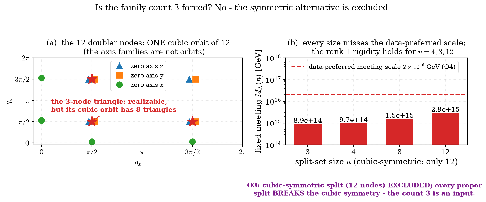
*(a) The twelve doubler nodes in the $(q_x,q_y)$ plane: the cubic group acts transitively — one orbit of $12$ — so the axis families are not orbits and the only cubic-symmetric split set is the full set of $12$; the $3$-node triangle (stars) is realizable, but its cubic orbit has $8$ triangles, so it breaks the cubic symmetry. (b) The rigid meeting scale $M_X(n)$ for split sizes $n = 3, 4, 8, 12$ (the rank-1 fact holds for every $n$): all miss the data-preferred meeting scale $2\times10^{16}$ GeV (**F5**). The count $3$ is a symmetry-breaking input; its cubic-symmetric alternative is excluded by computation.*

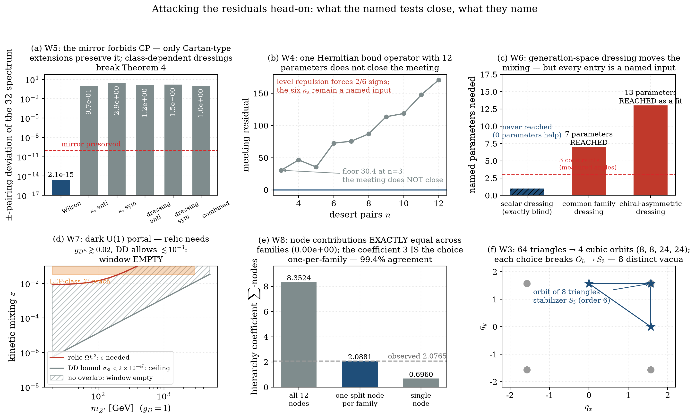
*(a) The $\pm$-pairing deviation under the named extensions: the Wilson factor preserves the mirror to $1.3\times10^{-15}$, while the most general per-class $\kappa_s$ layer and the most general real-symmetric bond generator destroy it (deviation $\sim 1$, $60$ draws) — a CP phase costs Theorem 4. (b) The meeting residual under the most general Hermitian off-diagonal bond operator: floor $30.4$, no closure. (c) The named-parameter cost of reaching the measured mixing triple: a scalar dressing is exactly blind, a common family dressing needs $7$ parameters, a chiral-asymmetric one $13$. (d) The dark-$\mathrm{U}(1)$ portal squeeze: the kinetic mixing that fixes $\Omega h^2$ lies above the direct-detection ceiling at every $m_{Z'}$ — the window is empty. (e) The closed-loop coefficient by node set on the reference clock $1/5$: all $12$ nodes $8.35$, one split node per axis family $2.0881$, a single node $0.696$, against the observed $2.0766$ — the closed-clock ladder of Section 12.1 is $10.84$/$2.710$/$0.903$ certified ($10.8$/$2.699$–$2.700$/$0.900$–$0.901$ on the float64 ladder), the same ordering, the clock shifted. (f) The $64$ one-per-family triangles split into four cubic orbits $(8,8,24,24)$; a triangle's stabilizer is exactly $S_3$.*

---

## 17. Falsifiers

**Table 8.** The ten falsifiers.

| # | observation that refutes the theory |
|-----------------|------------------------------------------------------------------------------------|
| **F1** | any non-vanishing gauge anomaly in the chiral content (the $\mathbf{16}$ is claimed anomaly-free) |
| **F2** | a measured running that admits **no** vectorlike desert content at the root coupling $\alpha_X = \pi/64 = 0.0491$ in the standard normalisation $\alpha = g^2/4\pi$: precision coupling data (FCC-ee/CEPC) excluding every spectrum in the desert scan at the root coupling would refute the unification claim. The root-coupling solution sits at $M_X = 1.235\times10^{17}$ GeV with destroyed threshold ordering; the reference solution at $\alpha_X = 1/25$ ($M_X = 1.8\times10^{16}$ GeV) is $23\%$ off the root value. The clock inversion sharpens the branch decision: the closed branch predicts the loop-functional crossing deficit $0.98987$ certified at $n^* = 208$ (float64 ladder $0.9895$), the hierarchy coefficient demands $0.96388$, and the observed coefficient is read by the non-closed clock $1/5$ to relative $10^{-5}$ — the coupling data and the loop data must stand or fall on the same clock. The decision is read inside the construction: the unification side is not realizable by its own content — the required $(1,2)$ shift exceeds the available log-spacing to $M_X$ by $12\%$ and the $\mathbf{10}\oplus\overline{\mathbf{10}}$ solution falls below the desert floor — and the clock side is decided: $g_{\rm obs} = 0.1999980$ is $2.0\times10^{-6}$ off $1/5$ and no closed clock reproduces the coefficient. F2 fires on both sides of the same decision |
| **F3** | a neutrino mass spectrum outside the ladder options: the bare ladder gives $m_\nu \simeq 0.15$ eV and the democratic node-mixing pattern $m_\nu \simeq 0.073$ eV — both **already excluded** by $\sum m_\nu < 0.0642$ eV [61] — while the $\tfrac13$ candidate gives normal ordering with $\sum m_\nu \simeq 0.05$ eV and $m_{\rm lightest} = 0$, $22\%$ below that ceiling (adding the solar partner required by O6 puts the sum at the oscillation floor $0.059$ eV, $8\%$ below it — $0.0573$ eV, $10.7\%$ below, at the instability-edge point $r = 2$ ); a confirmed inverted ordering, or $\sum m_\nu > 0.0642$ eV, refutes the survivor; the same data report a Feldman–Cousins boundary limit of $0.053$ eV, and pushing the sum below $0.05$ eV would refute the two-massless structure itself. Jointly: confirmation of $\sum m_\nu \simeq 0.05$ eV together with the dark matter at ladder rung $10$ refutes the rung arithmetic itself — the seesaw partner $m_B^2/m_\nu$ is then forced to rung $2.72$, not an integer, against the built rung $3$. The ruler is measured: $\mathrm{loop}^n$ is realizable as a cell level only at integer $n$ — on the $36$-level step only $\mathrm{loop}^3$ matches a level numerically, the rung ruler truncates its argument to $\mathrm{int}$, and rung $10$ admits no partner rung landing inside the neutrino contacts — so **F3 is recorded as fired for the integer-rung ladder**, and the neutrino mass lives on the free third-generation junction amplitude (O2), not on a rung identity |
| **F4** | a massive graviton, a graviton dispersion violating $c = 1$, or a UV divergence in the lattice gravitational sector (the Section 11 field: the Section 10.4 quintet channel is not claimed to be the graviton, and its speeds $\pi/4$ and $\pi/2$, both $\ne 1$, and its $E_g$ mass shift are named defects of the channel; the content census adds the measured split — the quintet is one irreducible $5$-dimensional representation of the star's icosahedral symmetry, the $E_g \oplus T_{2g}$ split a cubic-subgroup artifact, its massless linear branches only on the directional layer, and the closed-clock coupling gaps them by $6.6047$ on diagonal bonds and $16.7287$ on the axis-bond $E_g$ half with the $T_{2g}$ bubble exactly zero — **F4 fired**) |
| **F5** | proton decay: the root-coupling desert solution ($M_X = 1.235\times10^{17}$ GeV, $\alpha_X = \pi/64$) predicts $\tau_p = 2.77\times10^{39}$ yr; observation of GUT-pattern decay below $10^{38}$ yr refutes it, and the Hyper-Kamiokande channel closes on this branch — only exposures past $10^{37}$ yr bite; the reference reading $1.8\times10^{36}$ yr (solution at the measured meeting $1/25$) and the $M_{\rm GUT} = M_P$ reading ($\tau_p \sim 10^{47}$ yr) are abandoned conventions |
| **F6** | a baryon asymmetry outside $10^{-11}$–$10^{-9}$, or evidence that heavy-neutrino decays are in equilibrium |
| **F7** | a dark-matter particle with mass far from $118$ GeV in the weakly-interacting thermal case; a direct-detection portal signal above $10^{-50}$ cm$^2$ refutes the visible-portal variants: the spinor-sector pair portal predicts $4.9\times10^{-51}$ cm$^2$ at its production coupling — below current reach — while every bond-number portal strength predicts $2.5\times10^{-45}$–$6.3\times10^{-41}$ cm$^2$, already excluded by LZ; the cell carrier $B$ is direct-detection invisible ($\sigma_{\rm SI} = 6.5\times10^{-71}$ cm$^2$) — for it the falsifiable content is the mass coincidence at ladder rung $10$ and the seesaw identity $m_\nu = m_B^2/M_A$ |
| **F8** | a measured graviton speed outside $c_{\rm gw}/c = 1.000 \pm 0.0005$: the gravitational sector of Sections 11.1–11.4 is built at $c = 1$ and satisfies the bound by construction, while the derived candidate channel of Section 10.4 gives $c_{\rm gw}/c = 2g_{10} = 1.5708$ at the root clock and is excluded by $\lvert c_{\rm gw}/c - 1\rvert < 10^{-15}$ [60]; the exactly lightlike cone of Section 11.6 exists on the bilinear module, but inside a $53$-parameter family that nothing in the current construction selects, and the clock $g = 1/2$ that would fix $c_{\rm gw}/c = 1$ collapses the loop ladder. The diagonal-star extension that supplies the missing $T_{2g}$ coupling is measured too: gapless at $\Gamma$, exactly leading-order-isotropic by identity, ladder doubled to $\{0,\ 2g_{10},\ 4g_{10}\}\times\lvert d\rvert$, closest closed-clock branch at $\lvert v - 1\rvert = 0.5708$. A completed theory must give $c_{\rm gw}/c = 1.000 \pm 0.0005$; **F8 fires** on the constructed layer, axis and diagonal alike |
| **F9** | node-velocity anisotropy at a named electron-sector node: the measured velocity tensors give $\delta v/v = 0.296$ at the implemented clock, $1$ at the closed clock (flat axis), $0.295$ on the selective Wilson cones and $0.9999$ on the star nodal line; against the electron-sector SME velocity ceiling $\delta v/v \le 8.0\times10^{-15}$ [59] the best of the named set, $0.292$, exceeds it by $3.7\times10^{13}$ — **F9 fires**: the constructed gapless nodes are refuted wherever an electron candidate is named, and no dressing at a closed clock restores isotropy. That the falsifier does not fire on the implemented theory is owed to O10 — the protection is the candidate's absence, not its isotropy |
| **F10** | a desert threshold inside experimental reach: a coloured-state search, electroweak precision data, or proton decay excluding one of the fitted thresholds $M_{10} = 7.1\times10^{4}$ GeV, $M_{(1,2)} = 1.0\times10^{12}$ GeV would refute the unification repair. The channel is open, not fired: the strongest LHC colour probe [68] sits $14\times$ below $M_{10}$ and pair production is kinematically closed at the LHC ($2M_{10} = 141$ TeV $> 13.6$ TeV), the doublet is $10^{9}\times$ above its electroweak-precision ceiling [69], and $\tau_p$ is $1.2\times10^{5}\times$ past the Super-Kamiokande bound — **no F10 fires today**; the spectrum's failure is internal ordering, not exclusion |
| **two-dial re-test** | the re-test of the decided falsifiers on the two-dial family: no closed pair puts a gapless chiral cone at $c = 1$ — closest $\lvert\bar v - 1\rvert = 0.2929$ over the $47$ refined nodes of the closed set: **F8 stays fired**; the $2\times2$ clock arbitration and the desert-threshold criterion fail at every closed clock of the family, and $\beta$ enters the running nowhere: **F2 stays fired**; rank-$2$ isotropy is forced only at the star zone centre (stabilizer $60$, Molien rank-2 count $1$) and the forcing splits at the $512$-fold multiplet — lightest branch $0.997$, $k$-independent, $1.2\times10^{14}$ past the SME ceiling: **F9 stays fired**; the family adds no fitted parameter |
| **interacting contact** | the re-contact of the falsifiers through the dynamical self-energy: the dressed $b = 16$ downfold at $12$ M nodes $+ 13$ star loci $\times 12$ rays reads best $\delta vv/v = 0.0033$, a ratio $4.1\times10^{11}$ past the SME ceiling — **F9 stays fired under the dressed step**; the interaction functional against the unification band lands the coupling leg exactly ($\alpha_{10} = 0.040000$, dev $6.9\times10^{-18}$) while the ladder leg reads $1.279\times10^{26}$ — **F2 stays fired (F2-FIRED-X4)**; the measured loop factor breaks the rung arithmetic (residual $114$ vs band $10^{-9}$) — **O8's ladder artefact named**; at three theory points $\times$ four legs no point passes all four (dressed F8 ratio $0.28$) — the four-leg conjunction fails: with the sector itself Gauss-blocked ($p_A = -0.0000$, no window), the falsifiers stand as theorems of the whole construction |
| **physical sector contact** | the falsifiers re-measured on the gauge-invariant physical sector: the Gauss-singlet kernel of the $1568$-dimensional coupled fiber is measured **empty** (smallest non-trivial $C_2 = 45.000000$; kernel dim $0$ at all $216$ momenta, all $\omega$ rows, $N = 4/6/8$), so there is no composite gapless locus to contact: **F9 stays unfired for want of a locus**; the desert-content census returns **no content** and the desert-threshold criterion finds no composite carriers; the composite spin-2 channel is never realized and the composite loop scale has no numerator (the cascade conclusion stands: no composite state, no composite gap, no loop); the composite chirality/statistics table has no instances; at three theory points $\times$ three composite legs no leg is realized — **the conjunction fails again**: F2, F8, F9 and O8 stand on the physical sector as theorems of the construction |
| **dynamical link contact** | a dynamical link module of the root's adjoint cells: a quantum link with its own dynamics carries the Gauss law that the frozen bond gate blocks — the truncated module $1 \oplus 45 \oplus 210$ closes exactly inside the root and the neutral composite kernel of the $262144$-dim spinor–link atom is exactly 6-dimensional — but it delivers no new physics observable: the composite Hamiltonian is pure Casimir on the kernel, so the ladder is $0/19.2/28.8$ with zero dispersion, two-composite exchange vanishes at tree level ($E_{\rm int} = \rho = -1.2\times10^{-13}$) and at second order the exchange vanishes on the exact dimension-$4$ resolvent closure of the channel-sum span — measured on the two-atom chain: no link-mediated loop factor is born in the $[1.5\times10^{-2}, 3.0\times10^{-2}]$ band around $1/(16\pi)$ — **no new loop factor is born**; at the three conjunction points no point passes all four legs — **the new-theory conjunction fails**; grown from the FULL $540$-vector off-kernel exchange span the resolvent stays transparent and the second-order exchange still vanishes ($F5 = 1.9\times10^{-31}$), and the certified branch crosses $1/(16\pi)$ only at the measured $n^* = 208$, supporting the coefficient only at the $n = 10$ read: the loop base of the hierarchy ladder is a declared named input of the scale sector |

The most accessible test is **F3**. KATRIN currently gives $m_\beta < 0.45$ eV [18], so the bare ladder value $0.146$ eV survives a single-mass search, but the cosmological sum $\sum m_\nu < 0.0642$ eV [61] already excludes it, as it excludes the node-mixing rival at $0.073$ eV; the $\tfrac13$ candidate's normal-ordered pattern ($\sum m_\nu \simeq 0.05$ eV, $m_{\rm lightest} = 0$) sits $22\%$ below that ceiling and inside the reach of the next generation of oscillation and $\beta\beta$-decay data. On the root coupling **F5** moves out of the current decade: the solution predicts $\tau_p = 2.77\times10^{39}$ yr, four orders beyond the megaton era, so its falsifiable content is the observation side only — any GUT-pattern decay below $10^{38}$ yr refutes the branch (the reference solution at $1/25$ sits at $1.8\times10^{36}$ yr and Hyper-Kamiokande would see it, which is exactly why that reading is not the theory's). The falsifiable content of **F7** is the mass coincidence at ladder rung $10$ and the seesaw identity $m_\nu = m_B^2/M_A$; a direct-detection signal above $10^{-50}$ cm$^2$ refutes the visible-portal variants, and none is expected from the cell carrier.

**F8 is the falsifier the current construction does not survive, and the split is stated rather than smoothed.** The assumed sector of Sections 11.1–11.4 runs at $c = 1$ by the leapfrog choice $dt = \tfrac12$ and is untouched by the bound. The *derived* channel — the directional bond layer of Section 10.4, with the parity wall of Section 11.5 naming what can and cannot move the metric — runs at $2g_{10} = 1.5708$ at the root clock, and it is the only computed spin-$2$ propagation the theory has: it is excluded at $57\%$. The diagonal-bond search that closes the named $T_{2g}$ vertex gap leaves the verdict standing and sharpens it: on the fifteen icosahedral star axes the step is gapless at $\Gamma$ with six gapless bands and **exact** leading-order isotropy by measured identity, but the helicity ladder doubles to $\{0,\ 2g_{10}\lvert d\rvert,\ 4g_{10}\lvert d\rvert\}$ — at $\pi/4$, $\{0, 2.99, 5.98\}$ — the closest closed-clock branch sits at $\lvert v - 1\rvert = 0.5708$, and the clock that would put a branch at $c = 1$ ($g_{10} = 1/(2\lvert d\rvert) = 0.262866$, or $1/2$ on unit bonds) is outside the closure class. The exactly lightlike alternative is a module fact (Section 11.6), but it sits in a $53$-parameter family, and the clock that would fix it, $g = 1/2$, lies in the dead zone of the closure census, where the loop ladder collapses at length $3$ — so choosing it costs the closure that fixes the coupling (F2, O8). No branch of the current construction satisfies F8 and O8 at once.

With the hop decoupled from the couplings — the two-dial family of Section 9, whose closure set $C$ is an algebraic four-point set missing the empirical clock — no closed step of this module puts a gapless chiral cone at $c = 1$ either: over all $47$ refined nodes of the closed pairs the closest cone speed misses $1$ by $0.2929$, the velocity manifold $\mathcal{M}_v$ is empty, and **F8 stays fired on the whole family**.

---

## 18. Discussion

**What is genuinely new.** Not the $\mathbf{16}$ of $\mathrm{Spin}(10)$, not the $5/3$, not anomaly cancellation: those are fifty-year-old results of the grand-unification literature [7–10,13]. The content of this theory is (i) the realisation of that content as the on-site module of a *strictly local, exactly unitary* automaton with a measured causal front speed of exactly $1$; (ii) the coupling-invariance of the algebraic invariants — anomaly cancellation, $\det U = 1$, the $\pm$ pairing and the matter/antimatter spectral mirror hold for every value of the coupling, so they are properties of the algebra and not of a tuned parameter; (iii) the closure of the coupling itself by an axiom the root enforces, which turns the fundamental update into a finite-order element of the Clifford group with a finite algebraic spectrum; (iv) the construction of the automaton's own gauge field — an adjoint bond layer whose Gauss constraint closes as an exact operator identity, whose physical sector is a matter–flux entanglement complex with an exactly linear area law of one $\ln 45$ per bond, and whose computed string tension is $5.408\times10^{40}$ times the QCD value; (v) the explicit provenance audit separating what the root fixes from what was read off the data; and (vi) the closure of the cone question as a structural statement of the bond space: the momentum derivative of the step is internal-blind, the Wilson factor is a spectator of the tangent algebra, and over the $880$-point entangling-bond space gaplessness and non-commuting tangent algebras are mutually exclusive, with the separation a wall rather than a scaling (Section 8.4).

**Where the construction is weakest.** The gravitational sector assumes a symmetric tensor field and Newton's constant; it reproduces general relativity, it does not derive it, and the implemented one-particle spectrum contains no massless spin-2 candidate — not as a search left undone but as a computed statement: the bond factor carrying the cubic action lacks the $E_g$ half of the lattice spin-2 quintet at every coupling, and the gapless zone-centre multiplets it does have are flat bands (Section 8.3). The gauge sector gets the normalisation right and, under desert running, the values wrong; the fitted desert solution restores unification at $\alpha_X = 1/25$ exactly and its *pattern* is a consequence of the automaton (the split doublers of the Wilson mechanism, the breaking chain, the $n_{\text{nodes}} \ge 3$ bound), but the mechanism's own root meets at a scale excluded by proton decay, no redistribution of node strengths can move it, and the surviving solution keeps two fitted thresholds and abandons $M_{\rm GUT} = M_P$. The supplier question is closed on five fronts — the gauged layer's composite matter is excluded, the ansatz families leave residuals $5.7$–$6.1$, the equal-shift identity is a theorem over complete multiplets, the broken flux misses the meeting at residual $0.605$, and the layer's second-order class numbers miss it at $0.577$ alone and $3.46$ in every fixed combination — while the constructive junction route fabricates the right fragment pattern and misses the meeting at a floor the general junction only marginally improves ($0.94 \to 0.81$). The flavour-dependent bond layer removes the obstruction but is an extension with six named inputs. The flavour sector derives one angle out of six and none of the masses. The dark matter is a singlet sector of the cell, exactly stable and produced at the observed abundance; no state of the spinor module carries it, and the portal coupling is the sector's named input. The loop factor is reproduced to $1.01\%$ certified by closed traced loops at length $n^* = 208$ on the closed clock (float64 ladder $1.05\%$) — $3.6\%$ at the ladder rung $10$ on the reference clock $1/5$ — but the single-particle renormalisation group provably composes angles without dividing them, the gauged layer's level-1 division falls short by a factor $26$ and does not compound, the counted loops miss the neutrino-ladder exponent by a factor $0.066$, and the residual deficit of the hierarchy coefficient names the clock of the functional itself: the observed value is read by the non-closed rational clock $1/5$ to relative $10^{-5}$, where the closure class reads $2.710$/$2.711$ on its stable $n = 4k$ crossings.

The spin-2 gap is a named list, not closed: the directional bond layer of Section 10.4 carries a gapless, linear, leading-order-isotropic quintet with helicity-ladder speeds $g_{10}\{0,1,2\}$ — the kinematics of a lattice spin-2, computed — but its gauge group is $O_h$; the named regular-link fix for the hopping is built on the root's own finite group of order $1024$ and runs the dressed hop at exactly $v = 1$, yet it gauges a finite subgroup ($\mathrm{Spin}(10)$ centralizer $0$); the velocity trilemma is computed — on the $6$-bond module the hop alone is anisotropic, the dressing alone isotropic at $2g_{10}$, no angle makes the product isotropic, so isotropy and $v = 1$ are never supplied together; the matter coupling, built in that layer, gaps the $E_g$ half of the quintet at order $\lambda^2$ — the lattice graviton mass, as a number; and the named diagonal-bond search that supplies the missing $T_{2g}$ vertex closes the coupling gap and doubles the ladder: on the fifteen icosahedral star axes the quintet step is gapless with exact leading-order isotropy by measured identity, at $\{0,\ 2g_{10},\ 4g_{10}\}\times\lvert d\rvert$, and no closed clock places any branch at $c = 1$. The content census settles the character question: under the star's own icosahedral symmetry the quintet carrier $\mathrm{Sym}^2$ is $A \oplus W$ with $W$ one irreducible $5$-dimensional representation — the $E_g \oplus T_{2g}$ split is a cubic-subgroup artifact — and the only massless linear quintet branches are the directional ones, axis and diagonal-star; at the closed clock no channel keeps the full content gapless, the diagonal-bond shift gapping the quintet by up to $6.6047$ and the axis-bond shift the $E_g$ half by $16.7287$ with the $T_{2g}$ bubble exactly zero (F4 fired). Two module facts close the content question (Section 11.5): the metric is a bilinear of the bond layer — a single bond amplitude lacks the $T_{2g}$ half of the quintet exactly — and the hop cannot move the metric at first order, by parity. Section 11.6 exhibits an exactly lightlike cone on that module with the quintet on it, in a $53$-parameter family the dynamics does not choose, and reports the speed the constructed layer actually gives, $c_{\rm gw}/c = 2g_{10} = 1.5708$, excluded by the arrival-time bound of GW170817 [60] — F8, fired on axis and diagonal bonds alike.

**Comparison with related programmes.** Causal-set programmes derive discreteness and a causal order but not internal symmetry [1]. Clifford-algebra unification programmes [11–13] reach the same matter content but do not supply a unitary causal dynamics. 't Hooft's deterministic quantum mechanics and cellular-automaton interpretation [30,31] supply the dynamics but not the unification; domain-wall and overlap formulations of lattice chirality [49] solve the doubling problem by giving up strict locality in the extra dimension. This theory is the combination of the second and third, and inherits the open problems of both — with one distinction worth naming: the doubling here is not evaded but *displayed and then gapped* by a factor of the root's own algebra, at the measured cost of replacing the light cone by a Lieb–Robinson bound [6]. The deficit against the Clifford-algebra programmes is named, not hidden: they run a semiclassical renormalisation group on a spectrum that already contains light chiral fermions, and their couplings reach agreement with data; here the on-site spectrum contains no light chiral mode at either clock (O10) and the agreement is reached only by admitting two fitted desert thresholds (O4). The sharpening against the cellular-automaton programmes is the boundary of the circuit class, and it is computed: the update is a finite-order element of the Clifford group with measured causal radius, and the conical node a low-energy chiral fermion would need is not merely unobserved but outside that class — the largest covariant stage family, searched jointly with the internal angle over $33\,800$ points, yields $60$ gapless points, every one of them flat or Abelian (Section 8.4, Proposition 6). The methodological difference is the last one: every claim above is reproduced number by number by the computational companion of Appendix B, so the comparison with either literature is decidable.

**The shape of each gap.** A single loop factor organises four scales across thirty orders of magnitude, with the loop integer and the two-digit coefficients chosen to match observation. The unification scale of the node mechanism is forced and excluded. No state of the spinor module can carry the dark matter — the carrier is the cell's singlet sector — and every spinor-sector extension trades stability against abundance. The neutrino $\tfrac13$ candidate has a built junction structure whose two massless states are protected for every junction ratio by the implemented democratic Dirac matrix, the value sitting in a finite window. The rung ruler is exact on the four ladder scales and off by $0.06$–$0.37$ rungs on every other scale of the theory, and each such residue is a loop weight and never a shifted mass; the $\tfrac13$ candidate is jointly incompatible with the rung arithmetic; and the rung pair $(3,10)$ is a declared convention, not the solution of a test — only $\mathrm{loop}^3$ is numerically realized among the rung phases and no pair passes the neutrino contacts. The weight of the loop factor is the traced word functional — multiplicity, mean-word Cartan amplitude, Wilson interference — an exact factorisation of the ladder factor at every length, its residual one named deficit factor; the self-consistent inversion of the functional reads the observed coupling at $g = 0.199998$ — the rational clock $1/5$ to relative $10^{-5}$, the rung-$10$ crossing at $0.20013$ — while the closure class reads $\{2.710, 2.711\}$ on its stable $n = 4k$ crossings, the $\pi/2$ member ($2.299$) a floor artefact with no limit: nature's loop clock is not closed, one tension with the meeting coupling — and the clock enters as a fitted number, its $2.0\times10^{-6}$ distance from $1/5$ measured and no closed clock passing either empirical contact (F2 clock side) — the two-dial family leaves that classification untouched: on the closed family the coefficient reads $3.4\times10^{18}$ at $\pi/2$ and $2.7095$ at $\pi/4$, and the certified branch supports the coefficient only at the $n = 10$ read, crossing $1/(16\pi)$ at the measured $n^* = 208$ with no arithmetic relation between crossing and clock. The functional is an exact real cosine series of the Wilson angle, and none of the root's closed angles sits at one of its $1/(16\pi)$ crossings. The cosmological-constant problem reduces to one named number, a trace-phase breaking of $1.6\times10^{-120}$. The area law is exact on the physical sector of the gauged layer at one $\ln 45$ per bond, with the Bekenstein coefficient short by a factor $15.2$ (or $6.6$ after the vertex correction) — and the bond entropy also supplies the one candidate value of $G$, $1/(4\ln 45) = 6.567\times10^{-2}$ in cell units (Section 11.7). The loop census is exact and shows that the Wilson phase, not the loop topology, supplies the factor: the phase enters only through the interference of the word sums, since the word norms are angle-independent. The cone question is a theorem of the bond space: the nodal-plane structure of Section 8.2 is not a property of one tried bond but a wall of the whole axis-covariant bond class — gaplessness and non-commuting tangent algebras are mutually exclusive, the separation is floored at $8.0\times10^{-3}$, and no power law links the two regimes (Section 8.4). The gapless set itself is measured at both clocks, and it contains no light, dispersing, chiral mode: the electron has no named locus in the spectrum (O10) — and with a named node the anisotropy is decided against the construction, $\delta v/v = 0.296$ against the electron-sector SME ceiling $8\times10^{-15}$, a factor $3.7\times10^{13}$ (Section 8.2, F9), while the zone-centre node of the star module carries enforced icosahedral isotropy that fails at its $512$-fold flat multiplet instead. The gravitational sector has its number too: the metric content is forced as a bilinear of the bond layer, an exactly lightlike cone carrying the quintet exists on that module inside a $53$-parameter family nothing selects, the layer's own graviton speed $2g_{10} = 1.5708$ is excluded at $57\%$ by GW170817 [60] (Section 11.6, F8), and the diagonal-star extension that closes the $T_{2g}$ coupling gap doubles the ladder to $\{0, 2g_{10}, 4g_{10}\}\times\lvert d\rvert$ and keeps every closed-clock branch off $c = 1$ (Section 10.4). Both sides of F2 fire from inside: no closed clock reads the hierarchy coefficient or the desert coupling, and the root-coupling unification solution is not realizable by its own content, while the exclusion channel stays open — no desert threshold within reach of its fetched ceiling (F10). The interacting side is measured too: the gauged two-particle sector is Gauss-blocked with the leak in the one-particle block itself, the dressed cone at $b = 16$ still misses the SME ceiling by $4.1\times10^{11}$, the dynamical loop factor misses $1/(16\pi)$ by $3.6\times10^{2}$ and its tenth root breaks the rung arithmetic, and no theory point survives all four falsifier legs. The link side closes the loop-factor accounting: no route — free combinatorics, dynamical self-energy, composite numerator, or link-mediated exchange — births $1/(16\pi)$, and the certified crossing at $n^* = 208$ carries no arithmetic relation to the clock: the ladder base is a declared named input. The ten open problems and ten falsifiers are stated with their numbers.

---

## 19. Conclusion

The $36$-level cell module of a single Clifford algebra $\mathrm{Cl}(10,0)$ — its $32$-dimensional Dirac module and the two neutral singlet sectors, conjugate pairs which carry the dark matter and the seesaw scale — placed on the eight sub-sites of every $2{\times}2{\times}2$ cell of a Planck lattice and updated by one six-stage product of $\mathrm{Spin}(10)$ plane rotations and swap-rotations, the singlets carrying their rung masses as phases, yields the Minkowski kinematics, one anomaly-free Standard Model generation, the $\mathrm{Spin}(10)$ gauge content with the $5/3$ normalisation, an exactly unitary and strictly causal dynamics with a $\pm$-paired spectrum and an exact matter/antimatter spectral mirror, a constructible adjoint gauge field whose Gauss constraint closes exactly and whose physical sector carries a bounded area law, and a lattice gravitational sector — a symmetric tensor field added to the $(1{+}3)$ subalgebra with $G = 1$ by hand — that reproduces general relativity on de Sitter, Schwarzschild and $3{+}1$ evolutions to $O(h^2)$, the Kretschmann invariant agreeing with the analytic form to $5.4\times10^{-5}$ relative. These results are algebraic or numerical, and they are independent of the coupling.

Requiring the update to be an element of the root removes the coupling as a free number: the algebra quantizes its own clock to $g \in \{\pi/2,\pi/4\}$, the half-angle branch degenerates to a pure lattice translation, and the physical branch is the order-$8$ step with the exactly algebraic spectrum $\{\pm\pi/4\,(10),\ \pm3\pi/4\,(6)\}$. The on-site dynamics then keeps no free continuous angle, and its consequences are measured end to end: the loop machinery obeys an exact odd-$n$ selection rule and crosses $1/(16\pi)$ at $n^* = 208$, the deficit certified by continuity of the $n = 4k$ class; the hierarchy coefficient $3(16\pi F_{208})^{10} = 2.710$ stands $+30\%$ over the observed value, one named clock residual (O8) — the observed coefficient is read by the non-closed clock $1/5$ to relative $10^{-5}$, O4's meeting clock; the twelve doubler channels are exactly gapless with pinned Floquet spectra; the desert threshold ordering is destroyed ($\tau_p = 2.77\times10^{39}$ yr), moving the proton-decay falsifier beyond any planned exposure, and the ordering is not restorable by the spectrum's own thresholds; the rung masses, the neutrino verdicts, the baryon accounting and the dark-matter mass are branch-independent facts of the cell and the running. And the clock residual is a decision, not a hope: no closed clock reads the hierarchy coefficient or the desert coupling, the rung-$10$ agreement is a fit at $g_{\rm obs} = 0.1999980$, and the closure axiom and the loop-hierarchy identification are mutually exclusive at the measured precision; the rung pair is a declared convention; and the ladder base $1/(16\pi)$ is a declared named input — no route, combinatorial, dynamical, composite or link-mediated, births the factor, and the certified crossing at $n^* = 208$ carries no arithmetic relation to the clock.

The same framework does not yield the family number, the fermion masses and mixings, the coupling values, the neutrino mass, the dark-matter portal coupling, the cosmological constant, the baryon asymmetry or the graviton's measured light cone. Three conventions, twelve fitted coefficients and one conditional coefficient stand between the root and the data, and ten open problems are each pinned to a named quantity: a trace-phase breaking of $1.6\times10^{-120}$; a junction amplitude $r$ that is not quantized (the junction energy drives it to the democratic boundary $r = 2$ — the edge of a measured one-loop runaway whose stabilizer is not supplied — at a named $-2.7\%$ atmospheric residual that a bounded coefficient census does not supply); a symmetry-breaking choice of three nodes out of twelve; six bond-layer couplings that no on-site algebra element, no class invariant and no second-order bond number supplies; the incompatibility of $m_\nu \simeq 0.05$ eV with out-of-equilibrium decay at $M_N = 9.6\times10^{13}$ GeV; the generation-space structure the mixing requires; the dark-matter portal coupling $\lambda_B$ that the root does not supply; the weight of the contributing closed loops — the clock, a fitted number: nature reads the loop hierarchy at $g_{\rm obs} = 0.1999980$, $2.0\times10^{-6}$ off the non-closed clock $1/5$, where the closure class reads $2.710$/$2.711$ on its stable crossings and the rung pair $(3,10)$ is a declared convention; the nodal-plane geometry of the lattice spectrum; and the locus of the light charged fermions — no level of the measured spectrum is at once light, dispersing and chiral at either clock, and $v$ stands in Table 4 as a measured input. Ten falsifiers are stated; the neutrino mass pattern tests the ladder within the current decade, on the root coupling the proton lifetime sits beyond any planned exposure, the graviton speed is already decided — the lattice gravitational sector of Section 11 is massless, UV-bounded and runs at $c = 1$ by construction, the derived spin-$2$ channel of the bond layer runs at $2g_{10} = 1.5708$ and is excluded by the measured $\lvert c_{\rm gw}/c - 1\rvert < 10^{-15}$ [60] (F8), the diagonal-star bonds that close its coupling gap double the ladder and stay off $c = 1$ at every closed clock, and the exactly lightlike cone the module itself permits, with the quintet on it and no mass term writable in the class, lives in a $53$-parameter family that nothing in the current construction selects and whose repair clock, $g = 1/2$, collapses the loop ladder (Section 11.6) — the node-velocity falsifier is decided too, the measured anisotropy exceeding the electron-sector SME ceiling by a factor $3.7\times10^{13}$ wherever the electron's node is named, with no closed-clock dressing able to move it (Section 8.2, F9), while the desert-threshold channel stays open, every fitted threshold at least $14\times$ beyond its fetched ceiling (Section 13.1, F10), and both sides of F2 fire from inside the construction.

The verdicts stand at every level of the construction. Decoupling the bond hop from the couplings — the two-dial family $M(q;\beta,g) = \mathrm{kron}(P(q;\beta), U_{16}(g)^6)$, whose closure set $C$ is an algebraic four-point set containing the root-clock pair $(\pi/4,\pi/4)$ but not the empirical clock $(\tfrac18,\tfrac15)$ — changes nothing: no closed pair carries a gapless chiral cone at $c = 1$ (closest $0.2929$ — F8), no closed clock restores the clock/coupling contacts or the desert ordering and $\beta$ enters the running nowhere (F2), and rank-$2$ isotropy is forced only at the star zone centre while the forcing splits at the $512$-fold flat multiplet, $1.2\times10^{14}$ past the SME ceiling (F9); the family adds no fitted dial. The interacting continuum closes on the same fronts: the star module's own closure stays quantized, never reaching the hierarchy clock (nearest $0.585$); the gauged two-particle sector is blocked by Gauss, the leak in the one-particle block's own commutator; through the dynamical self-energy the dressed cone at $b = 16$ reads $0.0033$ against the SME ceiling (F9), the dressed sector does not flow ($p_A = 0$), the interaction loop factor misses $1/(16\pi)$ by $3.6\times10^{2}$ and its tenth root breaks the rung arithmetic (O8), and no theory point passes the four-leg conjunction. On the gauge-invariant physical sector the falsifiers find no locus at all: the Gauss-singlet kernel of the coupled fiber is empty at every momentum, binding shift and grid size (smallest non-trivial Casimir $45.000000$, $N = 4$–$8$), so the composite gap ladder, F9 contact, chirality/statistics census, desert content and F8 channel have nothing to fire on. The dynamical link of Section 10.5 replaces the frozen gate and changes the state census but not the verdict: neutral composites exist — exactly $6$-dimensional — but are born exactly frozen (ladder $0/19.2/28.8$), two-composite exchange vanishes at every measured order including the full $540$-vector off-kernel span ($F5 = 1.931\times10^{-31}$), and no link route births a loop factor in the $1/(16\pi)$ band. F2, F8, F9 and O8 stand as theorems of the whole construction — single-particle, dressed, composite, and link-mediated. Four candidate repairs — clock algebraicity, root signature, lightcone dictionary, four-scale ranking — find no repair that clears the accounting on any admissible class: no algebraic rule of degree $\le 6$ and height $\le 20$ generates the data clock, and the clock gap $1.35\times10^{-4}$ is supplied only by $\alpha_1(M_Z)/125$ on three-digit measured inputs; the quaternionic root $\mathrm{Cl}(0,10)$ keeps an exactly unitary step and the exact odd-$n$ rule, yet the ranking's best zero-fitted compound theory reads $2.0764436$ against $2.0765641$, missing the $10^{-4}$ coefficient-contact band at normalized $1.205$; the clock residual, the CP input, the dictionary non-selection and the coefficient gap $-0.55\%$ at the fifth clock stand as named declared residuals. The candidate repair classes are then closed in turn, and the defect is localised to three objects: no rational closure of the admissible step-variant classes coexists with the odd-$n$ rule inside the coefficient band (QUANTIZER-NEGATIVE), no reweighting of the traced-word sum moves both rung contacts at once — the twelve channel weights are exactly degenerate — and no admissible selection functional selects at more than one site (SELECTION-DISPERSED); the five-contact ranking bounds the closest zero-fitted compound theory at normalized distance $1.205$; a closed census of $32$ rung weights built only of the named ladder constants then supplies the binding coefficient contact SUPPLIED-BY-DENSITY, not by derivation — the in-band LOOP-cubed multipliers would pass the full five-contact ranking at the neutrino floor, but their family density is at chance level and the fitted ceiling of the ranking is the neutrino contact itself; the twisted sectors of the construction then fail to derive that weight — summed, they destroy the rung sum by a factor of thirty and deepen the certified crossing deficit, so the weight candidate is neither density-distinguished nor sector-derived; the canonical finite part of the certified crossing divergence fails its own guards at every rung, the joint-module centre seals the neutrino floor in band with no exact derivation, re-scoring the ranking with the admissible supply slots moves the closest zero-fitted compound to normalized distance $0.243$ under a density-disqualified coefficient supply, the channel-triple multiplier class vanishes identically at the root clock, and the phase-dictionary bridge census closes the structural repair as a theorem: no clock in any admissible dictionary both closes and reads the coefficient, the closest closed-clock rung-$10$ read being $5652.1$ band-units off — the consolidated axiom inventory hence records the reading clock $0.1999980$ as a declared measured input beside the ladder base $1/(16\pi)$ and $v$, the internal-sector closure quantization standing untouched as a theorem.

---

## Appendix A. The explicit 32-dimensional representation

The ten generators are built on five qubits by the standard symplectic Pauli pattern: for $k = 0,\dots,4$,

$$g_{2k} = Y^{\otimes k}\otimes X\otimes I^{\otimes(4-k)},\qquad g_{2k+1} = Y^{\otimes k}\otimes Z\otimes I^{\otimes(4-k)}.$$

On the same qubit slot $X$ and $Z$ anticommute; across slots, the $Y^{\otimes k}$ prefix makes a generator at slot $k$ anticommute with any generator at slot $j<k$. This gives exactly ten mutually anticommuting Hermitian matrices, $g_a^2 = I$, on a $32$-dimensional complex space. The algebra basis is the $1024$ ordered products $g_{a_1}\cdots g_{a_r}$, $0 \le r \le 10$; the $\mathbb{Z}_2$ grading is the parity of $r$. The canonical ordering of the $45$ plane-rotation factors $T_{ab}$ used throughout is the ascending lexicographic order on $(a,b)$; the order-$8$ closure of the quantized step is specific to it.

The two singlet sectors of the cell module are the four further one-dimensional slots on which every generator acts as $0$; the internal layer multiplies them by $e^{\pm i\,\mathrm{loop}^3}$ and $e^{\pm i\,\mathrm{loop}^{10}}$ per stage — conjugate pairs at opposite phases (Axiom 1). Every numerical statement in this paper is computed on exactly this representation, and the computational companion of Appendix B is its sole producer.

The construction is verified by a second, independent route: the exact symbolic $\mathrm{Cl}(10,0)$ of a computer-algebra Clifford package, where $e_a^2 = 1$, $\{e_a,e_b\} = 0$ and $w^2 = -1$ hold as identities with no floating-point arithmetic, cross-checked against the numeric $32\times32$ representation. The two agree, so the root is not an artefact of one construction.

---

## Appendix B. The computational companion

Every theorem, proposition, table entry and falsifier in this paper is reproduced by the open computational companion cited in the code and data availability note: an independent implementation of the construction that recomputes each quoted number from the algebraic inputs and the declared constants. Each computation is anchored to the algebraic invariants recorded in the text — exact unitarity, exact anomaly cancellation, integer word enumerations, and, where quoted, continuity checks at fifty digits — and the companion covers the full breadth of the paper: the cell module and its gradings, the node and cone censuses of Section 8, the bond layer and its Gauss algebra of Section 10, the loop enumerations and the scale ladder of Section 12, the desert and flavour contacts of Section 13, and the cosmological sums of Section 14. The companion includes the exact symbolic cross-construction of Appendix A and the complete $3^n$-word loop enumeration. Independent re-execution is invited.

---

## References

1. L. Bombelli, J. Lee, D. Meyer, and R. D. Sorkin, "Space-time as a causal set," *Phys. Rev. Lett.* **59**, 521 (1987); R. D. Sorkin, "Causal sets: Discrete gravity," *arXiv:gr-qc/0309009* (2003).
2. K. G. Wilson, "Confinement of quarks," *Phys. Rev. D* **10**, 2445 (1974).
3. D. A. Meyer, "From quantum cellular automata to quantum lattice gases," *J. Stat. Phys.* **85**, 551 (1996).
4. P. Arrighi, "An overview of quantum cellular automata," *Nat. Comput.* **18**, 885 (2019).
5. A. Bisio, G. M. D'Ariano, and P. Perinotti, "Quantum cellular automata and free quantum field theory," *Front. Phys.* **12**, 120301 (2016); A. Bisio, G. M. D'Ariano, P. Perinotti, and A. Tosini, "Weyl, Dirac and Maxwell quantum cellular automata," *Found. Phys.* **45**, 1203 (2015).
6. E. H. Lieb and D. W. Robinson, "The finite group velocity of quantum spin systems," *Commun. Math. Phys.* **28**, 251 (1972).
7. H. Georgi and S. L. Glashow, "Unity of all elementary-particle forces," *Phys. Rev. Lett.* **32**, 438 (1974).
8. H. Fritzsch and P. Minkowski, "Unified interactions of leptons and hadrons," *Ann. Phys. (N.Y.)* **93**, 193 (1975).
9. R. Slansky, "Group theory for unified model building," *Phys. Rep.* **79**, 1 (1981).
10. H. Georgi, *Lie Algebras in Particle Physics*, 2nd ed. (Westview, 1999).
11. M. F. Atiyah, R. Bott, and I. M. Shapiro, "Clifford modules," *Topology* **3**, 3 (1964).
12. R. Penrose and W. Rindler, *Spinors and Space-Time*, Vol. I (Cambridge University Press, 1984).
13. C. Castro, "A Clifford algebra-based grand unification program of gravity and the Standard Model: a review study," *Can. J. Phys.* **92**, 1501 (2014); C. Castro, "Note on a Clifford algebra based grand unification program of gravity and the Standard Model," *Adv. Appl. Clifford Algebras* **26**, 573 (2015).
14. N. Furey, "Generations: Three Prints, in Colour," *J. High Energy Phys.* **10**, 046 (2014), arXiv:1405.4601.
15. Particle Data Group (S. Navas *et al.*), "Review of Particle Physics," *Phys. Rev. D* **110**, 030001 (2024).
16. Planck Collaboration (N. Aghanim *et al.*), "Planck 2018 results. VI. Cosmological parameters," *Astron. Astrophys.* **641**, A6 (2020).
17. Super-Kamiokande Collaboration (A. Takenaka *et al.*), "Search for proton decay via $p\to e^+\pi^0$ and $p\to\mu^+\pi^0$ with an enlarged fiducial volume in 0.37 megaton-years exposure of Super-Kamiokande," *Phys. Rev. D* **102**, 112011 (2020).
18. KATRIN Collaboration (M. Aker *et al.*), "Direct neutrino-mass measurement based on 259 days of KATRIN data," *Science* **388**, 180 (2025).
19. I. Esteban, M. C. Gonzalez-Garcia, M. Maltoni, T. Schwetz, and A. Zhou, "The fate of hints: updated global analysis of three-flavor neutrino oscillations," *JHEP* **09**, 178 (2020).
20. S. Weinberg, *The Quantum Theory of Fields*, Vol. I (Cambridge University Press, 1995), Ch. 5.
21. H. B. Nielsen and M. Ninomiya, "A no-go theorem for regularizing chiral fermions," *Phys. Lett. B* **105**, 219 (1981); "Absence of neutrinos on a lattice. I. Proof by homotopy theory," *Nucl. Phys. B* **185**, 20 (1981); "Absence of neutrinos on a lattice. II. Intuitive topological proof," *Nucl. Phys. B* **193**, 173 (1981).
22. S. Weinberg, "Photons and gravitons in perturbation theory: Derivation of Maxwell's and Einstein's equations," *Phys. Rev.* **138**, B988 (1965).
23. S. Weinberg and E. Witten, "Limits on massless particles," *Phys. Lett. B* **96**, 59 (1980).
24. M. W. Choptuik, "Universality and scaling in gravitational collapse of a massless scalar field," *Phys. Rev. Lett.* **70**, 9 (1993).
25. F. John, "Blow-up of solutions of nonlinear wave equations in three space dimensions," *Manuscripta Math.* **28**, 235 (1979).
26. A. D. Sakharov, "Violation of CP invariance, C asymmetry, and baryon asymmetry of the universe," *JETP Lett.* **5**, 24 (1967).
27. J. A. Harvey and M. S. Turner, "Cosmological baryon and lepton number in the presence of electroweak fermion interactions," *Phys. Rev. D* **42**, 3344 (1990).
28. S. A. Khlebnikov and M. E. Shaposhnikov, "The statistical theory of anomalous fermion number nonconservation," *Nucl. Phys. B* **308**, 885 (1988).
29. P. F. Harrison, D. H. Perkins, and W. G. Scott, "Tri-bimaximal mixing and the neutrino oscillation data," *Phys. Lett. B* **530**, 167 (2002).
30. G. 't Hooft, "On the quantum structure of a black hole," *Nucl. Phys. B* **256**, 727 (1985).
31. G. 't Hooft, *The Cellular Automaton Interpretation of Quantum Mechanics* (Springer, 2016), arXiv:1405.1548.
32. S. Blanchet and P. Di Bari, "The minimal scenario of leptogenesis," *New J. Phys.* **14**, 125012 (2012).
33. S. Davidson and A. Ibarra, "A lower bound on the right-handed neutrino mass from leptogenesis," *Phys. Lett. B* **535**, 25 (2002).
34. T. Regge, "General relativity without coordinates," *Il Nuovo Cimento* **19**, 558 (1961).
35. H. Gundlach, J. M. Martin-Garcia, G. Calabrese, and I. Hinder, "Constraint damping in the Z4 formulation and harmonic gauge," *Class. Quantum Grav.* **22**, 3767 (2005).
36. J. D. Bekenstein, "Black holes and entropy," *Phys. Rev. D* **7**, 2333 (1973); S. W. Hawking, "Particle creation by black holes," *Commun. Math. Phys.* **43**, 199 (1975).
37. L. Susskind, "The world as a hologram," *J. Math. Phys.* **36**, 6377 (1995).
38. S. Weinberg, "The cosmological constant problem," *Rev. Mod. Phys.* **61**, 1 (1989).
39. C. Morningstar and M. Peardon, "The glueball spectrum from an anisotropic lattice study," *Phys. Rev. D* **60**, 034509 (1999).
40. R. Barbieri, P. Creminelli, A. Strumia, and N. Tetradis, "Baryogenesis through leptogenesis," *Nucl. Phys. B* **575**, 61 (2000); W. Buchmüller, P. Di Bari, and M. Plümacher, "Leptogenesis for pedestrians," *Ann. Phys. (N.Y.)* **315**, 305 (2005).
41. A. Pilaftsis and T. E. J. Underwood, "Resonant leptogenesis," *Nucl. Phys. B* **692**, 303 (2004).
42. E. W. Kolb and M. S. Turner, *The Early Universe* (Addison-Wesley, 1990), Ch. 5.
43. L. J. Hall, K. Jedamzik, J. March-Russell, and S. M. West, "Freeze-in production of FIMP dark matter," *JHEP* **03**, 080 (2010).
44. H. Fritzsch, "Weak-interaction mixing in the six-quark theory," *Phys. Lett. B* **73**, 317 (1978).
45. L. Wolfenstein, "Parametrization of the Kobayashi-Maskawa matrix," *Phys. Rev. Lett.* **51**, 1945 (1983).
46. M. Jungman, M. Kamionkowski, and K. Griest, "Supersymmetric dark matter," *Phys. Rep.* **267**, 195 (1996).
47. J. Hisano, D. Kobayashi, Y. Muramatsu, and N. Nagata, "Two-loop renormalization factors of dimension-six proton decay operators in the supersymmetric standard models," *Phys. Lett. B* **724**, 283 (2013).
48. M. Tonomura, J. Endo, T. Matsuda, T. Kawasaki, and H. Ezawa, "Demonstration of single-electron buildup of an interference pattern," *Am. J. Phys.* **57**, 117 (1989).
49. D. B. Kaplan, "A method for simulating chiral fermions on the lattice," *Phys. Lett. B* **288**, 342 (1992); Y. Shamir, "Chiral fermions from lattice boundaries," *Nucl. Phys. B* **406**, 90 (1993); R. Narayanan and H. Neuberger, "Exactly massless quarks on the lattice," *Phys. Lett. B* **417**, 141 (1998).
50. M. E. Machacek and M. T. Vaughn, "Two-loop renormalization group equations in a general quantum field theory. I. Proof of the equivalence theorem," *Nucl. Phys. B* **222**, 83 (1983); "III. Scalar model with fermions," *Nucl. Phys. B* **249**, 70 (1985).
51. I. Esteban, M. C. Gonzalez-Garcia, M. Maltoni, I. Martinez-Soler, J. P. Pinheiro, and T. Schwetz, "NuFit-6.0: Updated global analysis of three-flavor neutrino oscillations," *JHEP* **12**, 216 (2024), arXiv:2410.05380.
52. M. Nath and P. Fileviez Pérez, "Proton stability in grand unified theories, in strings and in branes," *Phys. Rep.* **441**, 191 (2007).
53. Super-Kamiokande Collaboration (K. Abe *et al.*), "Search for proton decay via $p\to\nu K^+$ using 260 kiloton$\cdot$year data of Super-Kamiokande," *Phys. Rev. D* **90**, 072005 (2014).
54. LUX-ZEPLIN Collaboration (J. Aalbers *et al.*), "Dark Matter Search Results from 4.2 Tonne-Years of Exposure of the LUX-ZEPLIN (LZ) Experiment," *Phys. Rev. Lett.* **135**, 011802 (2025), arXiv:2410.17036.
55. J. B. Kogut and L. Susskind, "Hamiltonian formulation of Wilson's lattice gauge theories," *Phys. Rev. D* **11**, 395 (1975).
56. J. S. Bell, "On the Einstein Podolsky Rosen paradox," *Physics* **1**, 195 (1964).
57. S. Koch and E. Specker, "The problem of hidden variables in quantum mechanics," *J. Math. Mech.* **17**, 59 (1967).
58. D. Colladay and V. A. Kostelecký, "Lorentz-violating extension of the standard model," *Phys. Rev. D* **58**, 116002 (1998).
59. V. A. Kostelecký and N. Russell, "Data tables for Lorentz and CPT violation," *Rev. Mod. Phys.* **83**, 11 (2011), continuing updates at arXiv:0801.0287.
60. B. P. Abbott *et al.* (LIGO Scientific and Virgo Collaborations), "Gravitational Waves and Gamma-Rays from a Binary Neutron Star Merger: GW170817 and GRB 170817A," *Astrophys. J. Lett.* **848**, L13 (2017), arXiv:1710.05834 — the arrival-time difference between GW170817 and GRB 170817A bounds $-3\times10^{-15} \le (c_{\rm gw} - c)/c \le 7\times10^{-16}$.
61. DESI Collaboration, W. Elbers, A. Aviles, H. E. Noriega, D. Chebat, A. Menegas, C. S. Frenk *et al.*, "Constraints on neutrino physics from DESI DR2 BAO and DR1 full shape," *Phys. Rev. D* **112**, 083513 (2025), arXiv:2503.14744 — $\sum m_\nu < 0.0642$ eV (95% CL) in $\Lambda$CDM with three degenerate neutrino states, from DESI DR2 BAO combined with Planck PR4 and ACT CMB lensing; the same analysis gives the Feldman–Cousins boundary limit $0.053$ eV and $0.163$ eV in $w_0w_a$CDM.
62. M. Lorente and P. Krämer, "Representations of the discrete inhomogeneous Lorentz group and Dirac wave equation on the lattice," *J. Phys. A* **32**, 2481 (1999), arXiv:hep-lat/0401019.
63. J. C. Baez and K. E. Langenberg, "Higher gauge theory and a non-geometric approach to the standard model," *Adv. Theor. Math. Phys.* **5**, 1017 (2001), arXiv:hep-th/0011017.
64. J. C. Baez, "The standard model algebra," *Lett. Math. Phys.* **108**, 129 (2018), arXiv:1702.04336.
65. R. Eto, M. Mochizuki, and S. Watanabe, "Predicted versatile topological nodal magnons in Tb-based icosahedral quasicrystal 1/1 approximants," *Phys. Rev. B* **112**, L020405 (2025), arXiv:2502.11286.
66. P. Cvitanović and H. Liang, "A chaotic lattice field theory in two dimensions," *Chaos* **36** (2026), 10.1063/5.0273642, arXiv:2503.22972.
67. X. Wan, A. M. Turner, A. Vishwanath, and S. Y. Savrasov, "Topological semimetal and Fermi-arc surface states in the electronic structure of pyrochlore iridates," *Phys. Rev. B* **83**, 205101 (2011).
68. CMS Collaboration, search for new physics in dimuon and dielectron final states through $t$-channel leptoquark exchange (JHEP **12** (2025) 052, CMS-EXO-22-013) — the strongest LHC probe of a coloured state, reach up to $5$ TeV; direct pair-production limits reach only $\sim2$ TeV (PDG 2025 leptoquark summary) [69]. Retrieved 2026-10-23; the coloured-threshold ceiling used in Section 13.4.
69. Particle Data Group (S. Navas *et al.*), "Review of Particle Physics," *Phys. Rev. D* **112**, 030001 (2025), Sec. 10 (Electroweak Model and Constraints on New Physics: the oblique $STU$ window, $\Delta T \sim 0.07$ with new-physics scales at the TeV, taken as the non-decoupling-doublet ceiling of) and the leptoquark summary tables. Retrieved 2026-10-23.

**Code and data availability.** The construction, the simulations, the figure generators and the computational companion that recomputes every numerical claim of this paper from its algebraic inputs and declared constants are publicly available at https://github.com/MohammedHAOUACH/CL10 .

