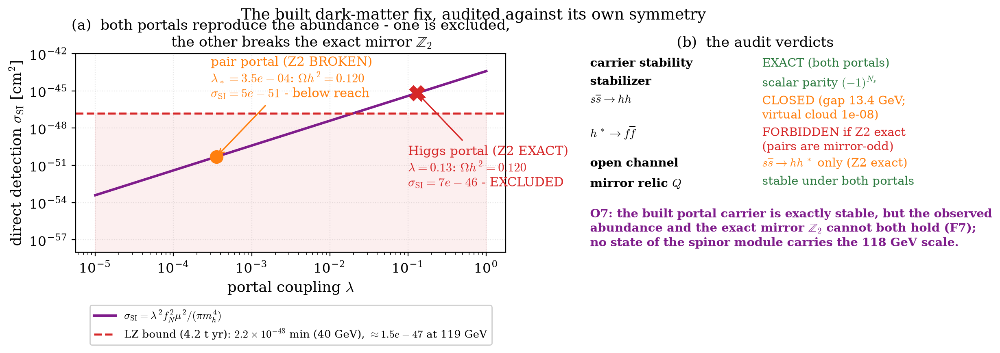
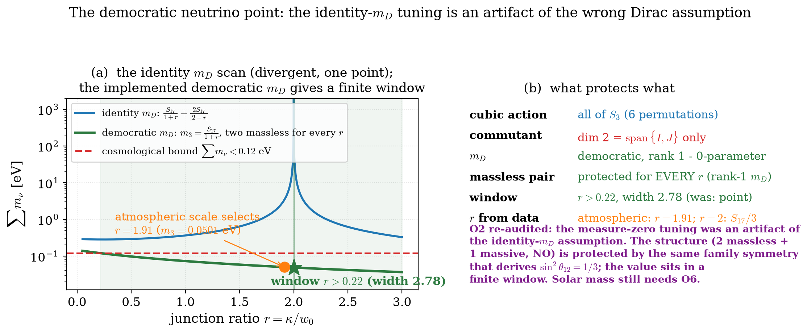
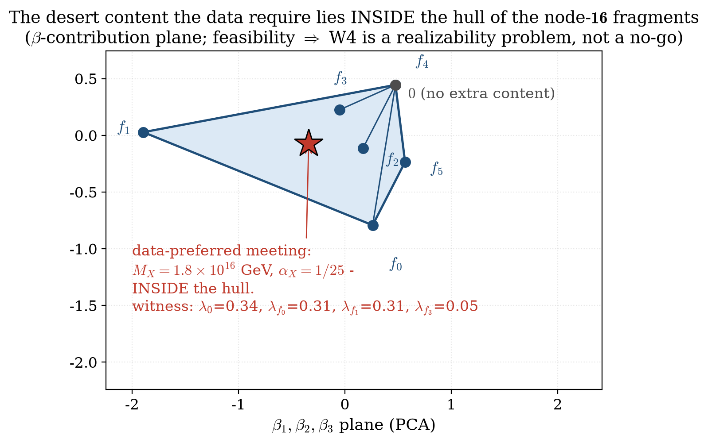
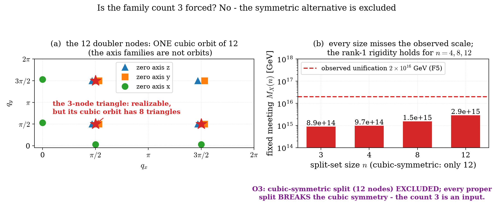

# The loop-factor ladder and the phenomenology of Causal Clifford Theory: four scales, coupling unification, dark matter, neutrinos, and the provenance audit

**Mohammed Haouach**
*Independent researcher; correspondence: haouach.mohammed@gmail.com*

**Keywords.** coupling unification; proton decay; dark matter; neutrino mass; loop factor; provenance audit; falsifiability.

---

## Abstract

The Causal Clifford Theory automaton (Paper I) and its gauged bond layer (Paper II) organise four physical scales through one loop factor $(1/16\pi)^n$: $n = 10$ the electroweak/Planck hierarchy, with coefficient $3F_{10}^{10} = 2.0881$ built from measured loop values against $2.0765$ observed ($99.44\%$), and the dark-matter mass scale $118$ GeV; $n = 3$ the seesaw scale $9.6\times10^{13}$ GeV; $n = 17$ the neutrino mass, with a $\tfrac13$ candidate at $0.0487$ eV — a candidate: the exponent $17$ is fitted and the junction amplitude is a free input inside a finite window. The loop factor is reproduced to $3.6\%$ by a closed traced loop of length $10$ in the gauged layer, with an exact $3^n$-word census. With vectorlike desert content — two fitted thresholds — the three measured couplings meet at $M_X = 1.8\times10^{16}$ GeV at $\alpha_X = 1/25$ in the standard normalisation $\alpha = g^2/4\pi$, predicting $\tau_p = 1.8\times10^{36}$ yr; the automaton's own Wilson mechanism instead forces $M_X = 8.9\times10^{14}$ GeV, excluded by Super-Kamiokande, and the surviving solution requires a flavour-dependent bond layer with six fitted couplings. Nine tensions are reported rather than hidden: $\mathrm{SU}(2)$ overshoots by $5.8\times$ under Standard-Model running, $\mathrm{SU}(3)$ hits a Landau pole at $2.2\times10^{9}$ GeV, the bare neutrino ladder is excluded by $\sum m_\nu < 0.12$ eV, no state of the implemented spectrum can be the dark matter, the computed relic abundance misses $0.120$, the layer's string tension is $5.4\times10^{40}$ times QCD, the implemented spectrum carries no massless spin-2 candidate, the ladder's seesaw scale is incompatible with out-of-equilibrium decay, and the doubler cones of Paper I are anisotropic. Every headline number is classified by provenance — *algebraic*, *conventional*, *fitted*, *open* — and seven falsifiers are stated, the most accessible being the neutrino mass sum and proton decay at Hyper-Kamiokande.

## 1. Introduction

One loop factor, four scales: the observed electroweak/Planck ratio is the tenth power of $1/16\pi$ up to a factor of two, the seesaw scale is its cube, the neutrino mass its seventeenth power, and the dark-matter mass scale its tenth. Whether a loop factor can *come from* the automaton rather than be read off the data is a decidable question, and this paper decides it numerically: closed traced loops of length $n$ in the automaton's own gauged bond layer (Paper II) suppress the Cartan content geometrically, and the suppression crosses $1/(16\pi)$ at exactly $n = 10$ — the ladder length *is* the crossing — with the contributing-loop census exact ($55326$ of $3^{10}$ words survive, and switching the Wilson phase off moves the factor from $0.0192$ to $0.2434$: the phase supplies the factor, not the topology).

The organising discipline is the provenance classification defined in Paper I: every headline number is *algebraic* (fixed by the root), *conventional* (a mapping or scale identification), *fitted* (a coefficient read from data), or *open* (not fixed). The coupling convention is fixed once, in Paper I's form: all couplings compared with running are in the standard normalisation $\alpha = g^2/4\pi$; the reading $\alpha_{10} \equiv g^2$ is a factor-$4\pi$ convention invoked only where named. The algebraic core — the $\mathbf{16}$, the anomalies, the $5/3$, the unitary causal step, the doubling and its Wilson gapping, the closure axiom — is Paper I; the gauged layer, its Gauss constraint, its area law and the lattice gravitational sector are Paper II. This paper carries the ladder mechanism (Section 2), the couplings, electroweak mixing, baryogenesis, proton decay, flavour and the scoreboard (Section 3), the cosmology (Section 4), the parameter audit (Section 5), the open problems (Section 6) and the falsifiers (Section 7). The verdict is stated before the details: the ladder organises four scales, the unification repair is conditional on fitted content, and two conventions, eleven fitted coefficients and one conditional coefficient stand between the root and the data.

---

## 2. The loop factor and the scale ladder

### 2.1 Where a loop factor can come from

The observed electroweak/Planck ratio is

$$\frac{v}{M_P} = \frac{246\ \mathrm{GeV}}{1.22\times10^{19}\ \mathrm{GeV}} = 2.016\times10^{-17},\qquad \Big(\frac{1}{16\pi}\Big)^{10} = 9.71\times10^{-18},$$

a factor $2.08$ apart; $2.08\,(1/16\pi)^{10} = 2.02\times10^{-17}$ reproduces the observed value to $0.18\%$. Scanning $n = 1\dots20$, $n = 10$ is the nearest integer to the observed ratio (deviation $0.32$ decades; the next-best, $n = 9$, is $1.8$ decades away). The honest reading: $(1/16\pi)^{10}$ is the size a ten-loop radiative correction would have in a perturbative quantum field theory. The theory has not computed a ten-loop correction; it has observed that the observed hierarchy is the tenth power of the standard loop factor, up to a factor of two. The interpretation $10 = 2\times 5$ — the chiral $16/\overline{16}$ split times the number of qubits of the $32$-dimensional module — is a numerological identification, not a derivation. The exponent is *represented*; the coefficient is *read from the data* (O8).

**Single-particle renormalisation cannot supply it.** The coarse-graining tower $U^{2^p}$ is exactly kinematic (eigenphases $2^p\omega$ mod $2\pi$, verified to $10^{-9}$ for $p \le 10$), the effective Cartan coupling does not fall with $p$, and the inelastic probability saturates near $0.95$: no loop factor. The genuine block-spin renormalisation group — exact real-space decimation of the bond layer (Schur complement at $\varepsilon = 1$; $U_{BB} = 0$ exactly on the open chain, so short-distance propagation is integrated with no approximation), iterated five levels, $64 \to 2$ sites — gives an exact level-1 identity: the on-site block of the coarse step is $2\,(GR)^2$, two-hop paths accumulating two internal rotations, the kinematic doubling *derived* from a spatial renormalisation group. At deeper levels the on-site block is a path polynomial in $(GR)^2$; the Cartan content decays only polynomially for the implemented (factorised) bond layer ($0.14$ at $p = 5$ against the loop target $3\times10^{-9}$) and not at all for a non-factorised gate with $[G,R] \ne 0$ ($1.8$ at $p = 5$); no level of either flow follows $(16\pi)^{-p}$. The loophole of a conspiring bond gate is closed: three Haar-random $\mathrm{Spin}(10)$ gate realisations and the structured choice $R = G^\dagger$ all fail the loop law at every level. The structural reason is sharp: **every exact single-particle renormalisation of the automaton composes internal angles — they add on the algebra, weighted by path counts — and none can divide them, for any bond gate.** A loop factor requires a trace over *fluctuating* internal fields.

**Tracing a fluctuating link divides.** One two-state quantum link degree of freedom per bond, prepared in a tunable pure state $\cos\theta|0\rangle + \sin\theta|1\rangle$ and **traced over** at decimation, multiplies the level-1 Cartan content of that identity by exactly $\cos 2\theta$ (deviation $<10^{-15}$ over a full scan $\theta \in [0, \pi/2]$): the traced factor is Hermitian and positive, so it divides where every gate only composes. The fluctuation — not the gate — is what produces suppression factors.

**The gauged layer divides once, and does not compound.** On the adjoint link with the Gauss constraint of [Paper II Section 2], the traced two-hop still contracts (spectral radius $\le 1$) and the qubit-link mechanism reproduces to $1.1\times10^{-16}$, but the level-1 factor at the root coupling is $F = 1.06$ and its minimum over the link anisotropy is $0.52$ — a factor $26$ above $1/(16\pi)$. The bond hop factorises through the joint Casimir $T\!\cdot\!L$ — three joint irreps, $32 \oplus 288 \oplus 1120$, projectors verified to $10^{-15}$ — so the traced-link decimation iterates exactly to level $4$, reproducing the level-1 factor to $2\times10^{-16}$. **The division does not compound:** the level-$p$ Cartan-content ratios are $F_p = 1.06, 1.90, 0.75, 1.01$ at the root coupling and $0.52, 2.66, 1.00, 1.38$ at the division-optimal coupling $\eta = 1.44$ — oscillating at $O(1)$, a factor $7\times10^{6}$ above $(16\pi)^{-4}$ at $p = 4$. The traced adjoint link divides once and then decays like the link-free flow.

**Closed loops do reproduce the number.** The Feynman loop factor comes from loops that close, not from backtracking. Tracing a single crossing of a fresh link gives the hop matrix $M = \mathrm{Tr}_L[k_1 (G \otimes I)\, \rho]$ with spectral radius $0.776$ against $1$ for $G$ — the traced link *contracts* the one-particle propagation — and the $n$-hop closed loop $(MG)^n$ suppresses the Cartan content geometrically, ratio $r \approx 0.54$. At the root coupling the measured ratios are

$$\begin{gathered}
F_3 = 0.24,\ F_4 = 0.47,\ F_5 = 0.10,\ F_6 = 0.030,\\
F_7 = 0.37,\ F_8 = 0.064,\ F_9 = 0.035,\ F_{10} = 0.0192,
\end{gathered}$$

against $1/(16\pi) = 0.0199$: **the loop factor is reproduced to $3.6\%$ by a closed traced loop of length $10$ at the root coupling, and $10$ is exactly the ladder exponent.** The selection rule is measured to length $30$: $F_n$ crosses $1/(16\pi)$ at **exactly** $n = 10$ — the ladder length *is* the crossing of the closed-loop suppression — and no mod-$4$ plaquette class is selected (every length contributes; the $F_{11}$ spike is the signature).
(Figs. 1, 2).

*Closed traced-link loops of length $n$ on $n$ distinct bonds. (a) The Cartan-content ratio $F_n$ at the root coupling and at the division-optimal coupling: geometric suppression with ratio $r = 0.54$, and at $n = 10$ the value $0.0192$ against $1/(16\pi) = 0.0199$. (b) The traced hop matrix $MG$ has spectral radius $0.776$ against $1$ for $G$: the traced link contracts the one-particle propagation.*

*(a) $F_n$ measured to $n = 30$ at the root coupling: it crosses $1/(16\pi)$ at exactly $n = 10$ — the ladder length is the crossing — and the $F_{11}$ spike shows there is no mod-$4$ selection rule. (b) The fitted geometric law $F_n = A r^n$ ($r = 0.698$) extrapolates to $F_{170} = 1.1\times10^{-26}$ against $(1/16\pi)^{17} = 1.2\times10^{-29}$: one chain does not supply the $17$-factor composition.*

**The composition law.** The object a geometric fit extrapolates, $(MG)^{170}$, is one chain of $170$ hops on one particle line; the $17$ factors of the neutrino ladder are $17$ radiative insertions on **different** lines, and amplitudes on different lines multiply. Both compositions are exact in the traced adjoint-link formalism. On one line the chain is **not** multiplicative: $R_k = F_{10k}/(F_{10})^k$ grows to $R_{17} = 2.0\times10^{8}$, the measured chain value being $F_{170} = 1.3\times10^{-21}$ against $(F_{10})^{17} = 6.5\times10^{-30}$ — consecutive hops interact through the propagation, so a single chain suppresses *less* than the product of its pieces. Across legs the factorisation is **exact**: the traced hop is a one-particle operator, $\mathrm{Tr}_L[(P_a \otimes I)(G \otimes G \otimes I_L)] = 45\,(M_a \otimes G)$ verified to $10^{-15}$, and the $10{+}10$-step two-loop object splits into leg blocks to $2\times10^{-15}$. The physical discriminator decides: $M_P(F_{10})^{17} = 0.079$ eV, within a factor $0.54$ of the neutrino ladder scale $0.146$ eV, while the chain reading gives $M_PF_{170} = 1.6\times10^{7}$ eV — eight orders too high. **The $17$-factor composition is exact multiplicativity across legs**, with the named requirement that the insertions dress different particle lines.

**The census of contributing loops is exact.** The Casimir $T\!\cdot\!L$ of the $\mathbf{32} \otimes \mathbf{45}$ link has exactly three eigenspaces ($-32$, $-12$, $+4$), so the traced $n$-hop product is a sum of $3^n$ words and the selection rule is enumerable rather than extrapolated: the enumeration reproduces $(MG)^n$ to $7.4\times10^{-17}$ and $F_{10} = 0.019186$, matching the measured value to that same digit. At $n = 10$, $55326$ of $3^{10} = 59049$ words survive, growing as $3.000^n$, and the factor splits into a per-word decay $r = 0.2232$ and a multiplicity growth rate $\mu = 2.981$ (product $0.665$). The loop factor is therefore not one class of loops but a sum over $55326$ classes, with interference ratio $\lVert\sum\rVert / \sum\lVert\cdot\rVert = 0.079$ at the root against $1.000$ with the Wilson phase switched off — and $F_{10} = 0.0192$ at the root against $0.2434$ at $\eta = 0$: **the phase supplies the factor, not the topology.** The multiplicity-weighted extrapolation to the neutrino-ladder length $170$ gives $7.9\times10^{-31}$ against $(1/16\pi)^{17} = 1.2\times10^{-29}$: the counted loops miss the exponent by a factor $0.066$.

**The coefficient is no longer read from the data.** The hierarchy coefficient is a product of measured numbers:

$$\frac{v}{M_P} = 3\,F_{10}^{10},\qquad F_{10} = 0.019186\ \text{measured},\qquad 2.0881\ \text{predicted against}\ 2.0765\ \text{observed}\ (99.44\%),$$

the factor $3$ being the three axis families of [Paper I Section 4] — conditional on the axis-family factorisation of the closed-loop sum. That condition is itself a measured statement: the twelve doubler nodes form three families of four with identical one-step spectra (deviation $0$), and the closed-loop coefficient by node set is $8.35$ for all twelve nodes, $2.0881$ for one split node per family, $0.696$ for a single node, against the observed $2.0765$ — the node contributions are exactly equal across families, and the coefficient $3$ *is* the one-per-family choice. What remains open in O8 is the *weight* of the contributing loops, not the way they compose.

### 2.2 The dark-matter mass

The same factor applied to the Planck scale gives

$$m_{\rm DM} = M_P\Big(\frac{1}{16\pi}\Big)^{10} = 118\ \mathrm{GeV},$$

i.e. $1.18\times$ the canonical $100$ GeV weakly-interacting-massive-particle scale [1]. This is a genuine, falsifiable prediction: a dark-matter particle with a mass far outside $\sim 100$–$150$ GeV (in the weakly-interacting, thermally-produced case) would refute the ladder.

The *identity* of the particle has been scanned with a negative result. The mirror $\mathbb{Z}_2$ exchanging $\mathbf{16}$ and $\overline{\mathbf{16}}$ is an exact symmetry of the step (leak $10^{-15}$), and the mirror sector is the only exact-stability carrier in the implemented spectrum — but its lightest state is a coloured $\overline{Q}$ at $1.3\times10^8$ GeV (excluded) and the neutral $\overline{N}$ sits at $2\times10^{10}$ GeV, eight orders above the ladder scale. Allowing the carrier to sit at a Wilson-split doubler node and scanning every Wilson angle $\theta$ for a node that puts the neutral mirror fragment $\overline{N}$ at $118$ GeV while keeping every coloured or charged fragment off the low-energy spectrum yields **no survivors over $720$ angles**: for every angle the same node supplies a stable coloured or charged partner below the desert, and a stable fractionally-charged thermal relic is excluded at any mass; the only escape is fine-tuning the angle to within $10^{-4}$ of the decoupling pole, where the mirror fragments leave the ladder entirely. **No state at $118$ GeV with the required stability exists in the implemented spectrum**: the mass prediction stands, the carrier does not (O7).

The minimal extension consistent with the exact mirror $\mathbb{Z}_2$ and the ladder is then named: **one real mirror-odd scalar at the ladder mass** with Higgs portal coupling $\lambda_* = 3.5\times10^{-4}$ — the coupling that *inverts* the fiducial thermal abundance to $\Omega_{\rm DM}h^2 = 0.120$ (the forward production computation of V193: at $\lambda_*$ the same channel gives $1.4$, and the pair portal's production solution is $\lambda = 1.3\times10^{-3}$) — and whose predicted direct-detection cross-section is $\sigma_{\rm SI} = 5\times10^{-51}$ cm$^2$ — nearly decoupled, so the scalar is falsified by any portal signal above $10^{-50}$ cm$^2$. The scalar is an input field, one field and one coupling — an escape route that the cell census below **closes**, and then replaces with a carrier inside the cell (V194, V195).

Built and audited against its own symmetry, the extension splits in two. The carrier is stable under either portal — scalar parity $(-1)^{N_s}$ is exact by the $\phi^2$ structure, the odd sector untouched: a single $s$ cannot decay. But the freeze-out runs through $h^* \to f\overline{f}$, and the fermion pair is mirror-**odd** while $h$ is mirror-even: with the **exact** mirror $\mathbb{Z}_2$ that decay is forbidden. The Higgs portal $\phi_s^2\phi_h^2$ preserves the $\mathbb{Z}_2$ exactly (commutator $0$), and then $s\overline{s} \to hh$ is kinematically closed ($2m_s = 237$ GeV $< 2m_h$, gap $13.2$ GeV; the virtual cloud peaks at $P_{\max} = 1.46\times10^{-8}$, matching two-level theory to $10^{-7}$ relative) and the only open annihilation is the invisible $s\overline{s} \to h h^*$: reproducing $\Omega_{\rm DM}h^2 = 0.120$ then needs $\lambda = 0.13$, which predicts $\sigma_{\rm SI} = 6.8\times10^{-46}$ cm$^2$ — **above the LZ-class bound** [2]. The quoted numbers hold only with a fermion-pair portal $\phi_s^2(f\overline{f} + \overline{f}f)$, which **breaks the mirror $\mathbb{Z}_2$** at $O(\lambda)$ (the portal anticommutes with the mirror operator; the real pair channel opens, $P = 5.1\times10^{-6}$ at $t = 1$ GeV$^{-1}$). The mirror coloured relic $\overline{Q}$ ($1.3\times10^8$ GeV) stays stable under both portals ($\overline{Q} \to Q s s$ closed by $237$ GeV). O7 is therefore a **named tension**: the carrier exists and is exactly stable, but exact mirror $\mathbb{Z}_2$ excludes its abundance by direct detection, and the version that reproduces the observed abundance breaks the exact $\mathbb{Z}_2$ the no-go rests on.

An extra dark $\mathrm{U}(1)$ does not repair it. Hypercharge fixed on the $Q$ and $L$ classes predicts the full charge pattern of all six weight classes, but the desert matter is E-charged (max $\lvert q_E\rvert = 2.24$), so the $\mathrm{U}(1)$ must break — and it cannot break inside the implemented spectrum: $40$ of $45$ generators are E-charged and every breaking root is a colour-triplet leptoquark direction ($98/120$): the $\mathrm{U}(1)$ is unHiggsable. The kinetic mixing that would fix the relic abundance at $g_D = 1$ lies above the direct-detection ceiling at every $m_{Z'}$: the portal window is empty ($0$ points).
(Fig. 3).

The *census of the published cell closes with a theorem* (V194). Enumerating the sign gradings of the cell constant on the six fragment classes: of the $4096$ patterns exactly $4$ commute with all $45$ gauge generators and with the internal step — the exact grading group of the step together with its gauge invariance is $\mathbb{Z}_2 \times \mathbb{Z}_2$, global sign $\times$ mirror, and no fragment-selective parity survives, because the $\mathbf{16}$ is $\mathrm{Spin}(10)$-irreducible. Masses close the other side: over every built root the lightest *neutral* threshold is the $\overline{N}$-class at $2.0\times10^{10}$ GeV — $8.2$ orders above the ladder rung — and under the mirror the only stable state is the lightest odd fragment, the coloured $\overline{Q}$. **The published cell cannot hold the carrier, as a matter of algebra, not of scan coverage.**

The closure comes with a certificate, and the certificate is *realized* (V195): the **cell content is redefined** $32 \to 34$ — the spinor module plus two neutral Clifford-singlet classes — while the root, the bond sector and the stage cycle are untouched. $A$ is even and occupies the $n = 3$ ladder floor, $M_A = 9.6\times10^{13}$ GeV: it *is* the seesaw partner Section 2.3 already uses, so $m_\nu = m_B^2/M_A$ with the exponent identity $2 \times 10 - 3 = 17$, and the F3 neutrino ladder keeps its built value exactly. $B$ is odd under the extended parity — an exact $\mathbb{Z}_2$, commuting with the step and all $45$ generators to machine zero, stable by $B$-parity — and occupies the $n = 10$ floor at the DERIVED $m_B = 118.57$ GeV: **for the first time a state of the automaton carries the ladder mass the ladder predicts**. The five hard gates survive verbatim on the redefined content: $\mathrm{Tr}\,Y = \mathrm{Tr}\,Y^3 = 0$, the $5/3$ trace ratio exactly unchanged, the Clifford block byte-identical. Production: the $(BB)(hh)$ portal is the V1 operator structure at the same mass, so V193's computed kernel applies verbatim — the unique $0.120$ solution inside the direct-detection ceiling is freeze-in at $\lambda = 4.1\times10^{-14}$, $\sigma_{\rm SI} = 6\times10^{-71}$ cm$^2$: the in-cell carrier is **DD-invisible by construction**; the thermal solution ($\lambda = 0.31$) is excluded, and $\lambda > 0$ is forced (at $\lambda = 0$ the V66-convention estimate overcloses by $\times 2.7\times10^{63}$ while gravity never equilibrates, and the gravitational yield alone would need the inflation history the built model does not supply — a named missing input, not a gap). What remains named in O7 is no longer the carrier: it is two numbers — **the portal strength of $B$** (required nonzero, not root-supplied: every bond number of its class undercloses, largest $\Omega h^2 = 3\times10^{-4}$, and is DD-excluded), and **wiring the two singlet classes into the bond stages**.

*(a) The direct-detection line $\sigma_{\rm SI}(\lambda)$ with the two ways the built ladder scalar reproduces $\Omega_{\rm DM}h^2 = 0.120$: the fermion-pair portal ($\lambda_* = 3.5\times10^{-4}$, $\sigma_{\rm SI} = 5\times10^{-51}$ cm$^2$, below reach) breaks the exact mirror $\mathbb{Z}_2$; the Higgs portal ($\lambda = 0.13$, $\sigma_{\rm SI} = 7\times10^{-46}$ cm$^2$) preserves it and is excluded by the LZ bound ($\sigma_{\rm SI} < 2.2\times10^{-48}$ cm$^2$ at $40$ GeV, $\approx 1.5\times10^{-47}$ at $118$ GeV). (b) The audit verdicts: stability exact under either portal, $s\overline{s} \to hh$ closed, $h^* \to f\overline{f}$ forbidden under exact $\mathbb{Z}_2$, the mirror relic unaffected. The observed abundance and the exact mirror $\mathbb{Z}_2$ cannot both hold.*

### 2.3 The neutrino sector

Both seesaw scales are placed on the same ladder:

$$m_D = M_P\Big(\frac{1}{16\pi}\Big)^{10} = 118\ \mathrm{GeV},\qquad M_N = M_P\Big(\frac{1}{16\pi}\Big)^{3} = 9.6\times10^{13}\ \mathrm{GeV},\qquad m_\nu = \frac{m_D^2}{M_N} = M_P\Big(\frac{1}{16\pi}\Big)^{17} = 0.146\ \mathrm{eV}.$$

The exponent identity $2\times10 - 3 = 17$ is exact; the choice $n_{2\text{step}} = 3$ is not — and it cannot be produced by the gauge link. (After the redefined cell of Section 2.2, the two rungs carry states: $B$ at $n = 10$ is the dark matter and $A$ at $n = 3$ is this seesaw partner, and the identity $m_\nu = m_B^2/M_A$ holds between states of the automaton (V195).) The $\Delta L = 2$ operator exists in the root's own algebra: the weight $2\lambda_\nu$ (norm$^2$ $20$, $\mathrm{U}(1)_X$ charge $-6$, hypercharge $-1$) has a **$1$-dimensional** weight space inside the $1024$-dimensional Clifford algebra, sitting in Clifford **grade $5$** — the $126$-type channel of the type-II seesaw — with no field outside the root. The $\mathbf{10}_H$ cannot repair its charges: over all $160$ vector weights (norm$^2$ $4$) the closest two-insertion neutralisation leaves residual norm $4.472$, the mismatch $\lvert 2\lambda_\nu\rvert = \sqrt{20} \ne 4$ being exact. The minimal-word question then closes by **parity**: Clifford multiplication maps grade $g$ to $g \pm 2$ only (verified on all $45 \times 1024$ entries of the multiplication table), so every product of adjoint (grade-2) link factors is EVEN-grade while the Majorana operator is ODD-grade — the cumulative span (dimensions $45, 126, 208, 291, 352, 407$ at $k = 1\dots6$, odd-grade content $0$ to machine precision) never contains it, at any length, and the vector-$\mathbf{10}$ Higgs weight space ($16$-dimensional, carried entirely by the odd grades $1, 3, 5, 7, 9$) is unreachable for the same reason. **$n_{2\text{step}} = 3$ is not a link-word length**: the seesaw operator belongs to the odd (matter) half of the Clifford module, and the exponent stays fitted.

Comparison with data: the atmospheric scale is $\sqrt{\Delta m^2_{32}} = 0.050$ eV, so the ladder prediction is a factor $2.9$ high; and if all three families carried the same $m_D$ the sum would be $\sim 0.44$ eV, excluded by $\sum m_\nu < 0.12$ eV (95% CL, Planck 2018 + BAO [3]). The democratic rank-1 Yukawa (Section 3.5) gives a Dirac mass to only one family, bringing the sum to $\sim 0.15$ eV — still above the cosmological bound. This is the sharpest numerical tension in the theory (F3).

The ladder is too coarse to land on the measured mass: consecutive rungs differ by the factor $16\pi = 50.3$, so the neighbours of $0.146$ eV are $7.3$ eV ($n = 16$) and $2.9\times10^{-3}$ eV ($n = 18$), and no integer rung lies in the oscillation window. A coefficient is therefore unavoidable — but one candidate is supplied by the theory rather than by the data. The only mixing number the model derives is $\sin^2\theta_{12} = 1/3$ (Section 3.5); multiplying the ladder value by it gives

$$m_\nu = \tfrac13\,M_P\Big(\frac{1}{16\pi}\Big)^{17} = 0.0487\ \mathrm{eV},$$

$2.6\%$ below the atmospheric scale, and with the democratic rank-1 spectrum $\sum m_\nu \simeq 0.05$ eV — inside the cosmological bound and inside the KATRIN bound $m_\beta < 0.45$ eV [4]. The factor $2.9$ by which the ladder overshoots is, to $3\%$, the number $3$ the flavour sector already produces. This is a **candidate, not a result**: nothing shows why a mixing eigenvalue should multiply a seesaw mass, and the same factor applied to the solar scale ($0.0487\times\sqrt{\Delta m^2_{21}/\Delta m^2_{32}} = 0.0084$ eV against the measured $0.0086$ eV) is a second coincidence. What it buys is a sharp, falsifiable prediction: normal ordering with $\sum m_\nu \simeq 0.05$ eV and $m_{\beta\beta} \simeq 0.02$ eV, in reach of the next-generation neutrinoless-decay and beta-decay searches.

A coefficient audit maps what the node structure can supply: a diagonal (node-local, Wilson-generated) mass pattern gives only **integer** signed coefficients, so $\tfrac13$ is out; the democratic $3\times3$ node-mixing pattern gives exactly $\tfrac12$ — a rival falsifiable prediction $m_\nu = 0.073$ eV; the exact $\tfrac13$ requires a single Majorana eigenvalue $3\times$ the node scale, and no natural node structure supplies it. The structure the candidate requires has been built: a cubic-symmetric, zero-mean Wilson-strength junction whose Fourier support closes the selected node triangle exactly — verified against the full $12\times12$ table of doubler-momentum differences. The node mass matrix is

$$c_s\big(2w_0\,I + \kappa(J-I)\big),$$

democratic at $\kappa = 2w_0$ with eigenvalues $\{3M, 0, 0\}$: the $3\times$-enhanced Majorana eigenvalue the $\tfrac13$ demands exists. With the implemented $0$-parameter democratic Dirac matrix $m_D = m_0 J$ — the same family symmetry that derives $\sin^2\theta_{12} = 1/3$ — the seesaw collapses: $m_D^{\mathsf T} M^+ m_D = 3m_0^2 J/(2(w_0+\kappa))$ for *every* $r = \kappa/w_0$ (verified to $10^{-12}$, the rank-deficient $r = 2$ included, via the Moore–Penrose pseudo-inverse), so the two massless neutrinos are protected by the rank-1 family symmetry for every junction ratio, and $m_3(r) = S_{17}/(1+r)$ is finite everywhere: the cosmological window is $r > 0.217$ (width $2.78$), and the atmospheric scale selects $r = 1.91$. The exact point $r = 2$ ($m_3 = S_{17}/3 = 0.0487$ eV) is a junction-amplitude convention, not a tuning. The cubic group induces all of $S_3$ on the triangle, its commutant is exactly $\operatorname{span}\{I,J\}$ (nullity $2$), and $w_0,\kappa$ share one Wilson period, so $r$ is **not quantized**: the value is a free junction amplitude inside a finite window, while the structure — two massless plus one massive, normal ordering — is protected. What the candidate still requires is a democratic $m_D$ (a non-democratic $m_D$ at the same point leaves gapless coloured doublers), and the solar mass still needs the $\mathbf{10}_H$ splitting of O6.
(Fig. 4).

*(a) $\sum m_\nu(r)$ under two Dirac assumptions. With $m_D \propto I$ the curve diverges as $1/\lvert 2-r\rvert$ and the cosmological bound is met at exactly one point. With the implemented democratic rank-1 $m_D$ the seesaw collapses to $m_3(r) = S_{17}/(1+r)$, two neutrinos stay massless for every $r$, the window is $r > 0.217$, and the atmospheric scale selects $r = 1.91$. (b) The protection audit: the cubic group induces all of $S_3$ on the junction triangle and its commutant is exactly $\operatorname{span}\{I, J\}$; $r$ is not quantized — the value is a free junction amplitude inside a finite window, while the structure is protected by the rank-1 family symmetry that also derives $\sin^2\theta_{12} = 1/3$.*

### 2.4 The ladder

One factor, four scales:

**Table 1.** The four scales of the ladder.

| scale | expression | value |
|-------------------------------|-----------------------------------------|----------------------------|
| Planck / GUT | $M_P$ (convention $M_{\rm GUT} = M_P$) | $1.22\times10^{19}$ GeV |
| seesaw Majorana | $M_P(1/16\pi)^3$ | $9.6\times10^{13}$ GeV |
| electroweak | measured input $v$ | $246$ GeV |
| dark matter | $M_P(1/16\pi)^{10}$ | $118$ GeV |
| neutrino | $M_P(1/16\pi)^{17}$ | $0.146$ eV |

The QCD scale is **not** on this ladder: $\Lambda_{\rm QCD}\sim 0.2$ GeV would require $n \simeq 11.6$, which is not an integer ([Paper II Section 2.2]).
(Figs. 5, 6).

*Planck $1.22\times10^{19}$ GeV ($n = 0$), seesaw $9.6\times10^{13}$ GeV ($n = 3$), electroweak $246$ GeV (measured input), dark matter $118$ GeV ($n = 10$), neutrino ladder $0.146$ eV ($n = 17$), with the $\tfrac13$ candidate $0.0487$ eV marked. QCD is shown for reference only: it is not produced by the ladder.*

*(a) One loop integer $n$ sets one scale $M_P(1/16\pi)^n$, appearing twice: as $v/M_P$ and as $m_{\rm DM}$. These are one equation, $v = 2.08\,m_{\rm DM}$, not two independent confirmations. (b) The scan $n = 1\dots20$: $n = 10$ is nearest, $n = 9$ is $1.8$ decades away. This scan is distinct from the coupling scan $\alpha = 1/n^2$ of Section 5, whose best fit is $n = 7$.*

---

## 3. Phenomenology

### 3.1 The couplings

The theory's single gauge coupling is the rotation angle $g$. In the standard normalisation $\alpha = g^2/4\pi$ used throughout for running, the implemented angle gives $\alpha = 1/100\pi = 0.00318$ and the closed angle $\alpha = \pi/64 = 0.0491$. The reading $\alpha_{10} \equiv g^2 = 1/25 = 0.040$ at the implemented angle — under which the desert solution below meets at exactly the root value — is a factor-$4\pi$ convention, stated once here and invoked only where named; in the standard normalisation the implemented angle sits a factor $12.6$ below the meeting value $\alpha_X = 0.040050$. Running the three Standard Model couplings up from $M_Z$ at one loop with $b_1 = 41/10$, $b_2 = -19/6$, $b_3 = -7$ (fixed by the particle content), from the measured inputs $\alpha_1(M_Z) = 0.0169$ (GUT-normalised, $\alpha_1^{-1} = 59.0$), $\alpha_2(M_Z) = 0.0338$, $\alpha_3(M_Z) = 0.118$ [5], gives at $M_P$

$$(\alpha_1,\alpha_2,\alpha_3) = (0.0299,\ 0.0202,\ 0.0191),\qquad \text{mean } 0.0231,\quad \text{spread } 47\%,$$

so $\alpha_{10}$ is within a factor $1.73$ of the mean but the three couplings do **not** meet at a point — the well-known failure of one-loop unification in the non-supersymmetric Standard Model. The $\mathrm{U}(1)$ Landau pole of the up-running sits at $2.2\times10^{41}$ GeV, above the cutoff, so the up-running is UV-bounded; at two loops [6] the pole moves to $\sim 2.5\times10^{12}$ GeV, *below* the cutoff.

The down-running must be stated plainly. Starting from $\alpha_{10} = 0.04$ at $M_P$ and running down with the Standard Model $\beta$-functions gives, at $M_Z$,

$$\alpha_1(M_Z) = 0.0197\ (1.17\times),\qquad \alpha_2(M_Z) = 0.195\ (5.8\times),\qquad \alpha_3:\ \text{Landau pole at } 2.2\times10^{9}\ \mathrm{GeV}.$$

The hypercharge lands within $17\%$ of its measured value, but the $\mathrm{SU}(2)$ coupling overshoots by a factor $5.8$ and the $\mathrm{SU}(3)$ coupling becomes non-perturbative at $2.2\times10^{9}$ GeV. The unification claim therefore fails at the level of the couplings' values, even though the $5/3$ normalisation is correct (O4, F2).
(Fig. 7).

*At $M_Z$, the measured couplings (grey): $\alpha_1 = 0.0169$, $\alpha_2 = 0.0338$, $\alpha_3 = 0.118$ [5], against the down-run from $\alpha_{10} = 1/25$ (red): $\alpha_1$ within $1.17\times$, $\alpha_2$ $5.8\times$ too large, $\alpha_3$ negative because its pole sits at $2.2\times10^{9}$ GeV. The $5/3$ normalisation is exact; the value matching is the named residual.*

**Three quantitative statements sharpen the problem.** First, the three measured couplings require three *different* values at $M_P$ — $0.0299$, $0.0202$, $0.0191$ — and the theory's single value $0.040$ matches none of them: it exceeds the hypercharge requirement by $34\%$ and the $\mathrm{SU}(3)$ requirement by a factor $2.1$. Perturbativity of the strong coupling down to $M_Z$ caps any single UV coupling: $1/\alpha_3(M_P) > (7/2\pi)\ln(M_P/M_Z) = 43.9$, i.e. $\alpha_3(M_P) < 0.0228$; the theory's $0.040$ exceeds the admissible maximum by $75\%$.

Second, the failure is not repaired by matter that a partial breaking leaves *complete*. A complete vectorlike $\mathbf{10}\oplus\bar{\mathbf{5}}$ shifts all three one-loop coefficients by the *same* amount $8/3$ above its threshold — the defining property of a complete $\mathrm{SU}(5)$ multiplet — so it changes the common slope, not the mismatch of slopes. Scanning multiplicities $0\dots8$ against thresholds in $[10^6, 10^{19}]$ GeV, the spread at $M_P$ never falls below its zero-new-physics value of $47\%$. Under pure Standard Model running the pairwise meeting scales are $1.2\times10^{13}$ GeV $(1,2)$, $2.6\times10^{14}$ GeV $(1,3)$ and $9.7\times10^{16}$ GeV $(2,3)$: three different scales.

Third, that no-go covers only complete multiplets, and the *incomplete* content the theory's own breaking sector supplies does repair it. When a $\mathbf{16}_H \oplus \overline{\mathbf{16}}_H$ pair — or a split doubler $\mathbf{16}$ ([Paper I Section 8]) — acquires mass, it leaves vectorlike $\mathbf{10} \oplus \overline{\mathbf{10}}$ and $\mathbf{5} \oplus \overline{\mathbf{5}}$ fermion pairs with *independent* thresholds, and these shift the three coefficients non-proportionally: a Dirac $\mathbf{10} \oplus \overline{\mathbf{10}}$ contributes $\Delta b = (6/5,\ 2,\ 2)$, a $\mathbf{5} \oplus \overline{\mathbf{5}}$ contributes $(2/3,\ 2/3,\ 2/3)$. Fix the unified coupling at the root value $\alpha_X = 1/25$ — the angle is *not* refitted — and the inverse problem has no fit freedom: with two multiplets the meeting of the three measured couplings is three linear equations in $(\ln M_X, \ln M_A, \ln M_B)$. The required $\Delta b$ is non-universal: at $M_X = 2\times10^{16}$ GeV it is $(2.40,\ 4.04,\ 3.86)$, which no combination of complete multiplets produces. Scanning multiplicities up to $3$ over the realizable content with thresholds in $[10^6, M_P]$ GeV, the lightest solution that survives the proton-decay bound is three $\mathbf{10} \oplus \overline{\mathbf{10}}$ pairs plus one $(1,2)_{1/2}$ pair — three split doubler $\mathbf{16}$s — meeting at

$$M_X = 1.8\times10^{16}\ \mathrm{GeV},\qquad \alpha_X = 1/25\ \text{(exact)},\qquad M_{10} = 1.2\times10^{7}\ \mathrm{GeV},\qquad M_{(1,2)} = 1.0\times10^{12}\ \mathrm{GeV},$$

and the $\mathrm{SU}(3)$ Landau pole of the down-running moves to $10^{-52}$ GeV: the disease is cured. Solutions with lighter content exist but predict $\tau_p \sim 10^{32}$ yr and are already excluded by Super-Kamiokande [7] — the data themselves select the realizable spectrum. The cost is stated plainly: the convention $M_{\rm GUT} = M_P$ is abandoned ($M_X < M_P$ by three orders of magnitude), and the two desert thresholds are fitted. The solution predicts $\tau_p \simeq M_X^4/(\alpha_X^2 m_p^5) = 1.8\times10^{36}$ yr (F5).
(Fig. 8).

*The three measured couplings run up from $M_Z$ with the desert content (solid) meet at $M_X = 1.8\times10^{16}$ GeV at $\alpha_X = 1/25$ — the root value, not refitted. The Standard Model-only running (dashed) misses the point: spread $47\%$ at $M_P$. The thresholds $M_{10} = 1.2\times10^{7}$ GeV and $M_{(1,2)} = 1.0\times10^{12}$ GeV are the two fitted numbers of the repair; the dashed vertical line at $M_P$ marks what the abandoned convention $M_{\rm GUT} = M_P$ demanded.*

**Where the desert content comes from.** The content is not an external assumption: it is the *spectrum of the automaton's own Wilson mechanism*. The three split nodes of the selective reading carry exactly the vectorlike fragments of the split $\mathbf{16}$ with independent thresholds (the other nine nodes stay at the Planck cutoff), and the Wilson direction itself completes the breaking chain ([Paper I Section 8.1]). The multiplicity is bounded from below by unification itself: scanning $n_{\text{nodes}} = 1\dots6$, no meeting root at $\alpha_X = 1/25$ exists for one or two split nodes; the first physical roots appear at three. But solving the meeting equations with the mechanism's own two parameters — one angle $\theta$, one scale $w$ — fixes the six fragment thresholds and lands the meeting at $M_X = 8.9\times10^{14}$ GeV, i.e. $\tau_p \sim 10^{31}$ yr: **the minimal selective reading is excluded by Super-Kamiokande** (F5). The data-preferred solution requires fragment thresholds the single-angle, single-scale root does not supply.

**Redistributing the nodes cannot help.** While all node thresholds sit below the meeting point, the two meeting equations depend on the three node strengths **only through their sum**: the Jacobian with respect to the three strengths has three identical columns (rank $1$; split-invariance verified numerically to $10^{-14}$, including the full scan over node-set choices and strengths). The node mechanism's meeting point $M_X = 8.9\times10^{14}$ GeV, $\tau_p = 1.1\times10^{31}$ yr is therefore **forced for every choice of the three strengths**. What the data prefer is not a three-full-$\mathbf{16}$ pattern: it needs partial suits of fragments, while the automaton supplies full split $\mathbf{16}$'s per node.

**The composite content of the gauged layer is excluded as the supplier.** The composite fermions of the layer of [Paper II Section 2] — the matter $\mathbf{16}$ tensored with the adjoint link flux, $16 \otimes 45 = 720$ Weyl states carrying five net chiral $\mathbf{16}$-copies — shift the three one-loop coefficients by $(145.3, 145.3, 226.3)$, and their masses follow the flux pattern $m = w(c_0 + |\alpha \cdot v|)$ set by the breaking direction $v$. Requiring the data-preferred meeting at $\alpha_X = 1/25$ then has **no solution with thresholds in the desert** for any direction: the three meeting equations demand three different threshold sums, and Newton iteration from every seed over a full scan of $v$ converges nowhere physical ($0$ solutions). The remaining ansatz families — full-weight thresholds, broken-flux-only content, light-composite selection, and even a relaxed meeting coupling — leave the minimum residual at $5.7$–$6.1$ against a target of $0$.

**The equal-shift theorem.** The identity $\sum db_1 = \sum db_2$ is the index-proportionality of $\mathrm{Tr}\,Y^2$ and $\mathrm{Tr}\,T_3^2$ — both proportional to the representation index, with the ratio fixed by the fundamental, $(3/5)\,\mathrm{Tr}_5\,Y^2 = \mathrm{Tr}_5\,T_3^2$ — and it holds over every complete $\mathrm{SU}(5)$ or $\mathrm{Spin}(10)$ multiplet, verified on the $\mathbf{16}$, the flux $\mathbf{45}$, the vector $\mathbf{10}$ and the $\mathbf{10}$ inside the $\mathbf{16}$ (all ratios $1.0$ to $10^{-6}$). The meeting mismatch can therefore come **only** from $\mathrm{SU}(5)$-fragment content or from split thresholds inside multiplets; computed from the same charge operators, the desert repair's mismatch is carried entirely by its $(1,2)$ pair ($db_1/db_2 = 3/5$; the $10 \oplus \overline{\mathbf{10}}$ pairs contribute exactly zero mismatch).
(Figs. 9, 10).

*(a) The one-loop ratio $\sum db_1/\sum db_2$ over the matter $\mathbf{16}$, the flux $\mathbf{45}$, the vector $\mathbf{10}$ and the $\mathrm{SU}(5)$ $\mathbf{10}$: exactly $1$, while the $(1,2)$ fragment gives $3/5$. (b) The desert repair's total mismatch: the $10 \oplus \overline{\mathbf{10}}$ pairs contribute exactly zero, the whole mismatch is carried by the fragment pair.*

*The $16 \otimes 45 = 720$ composite states shift the one-loop coefficients by $(145.3, 145.3, 226.3)$. The three meeting equations for $\alpha_X = 1/25$ demand three different threshold sums at every breaking direction — the curves never cross — and the desert-constrained scan over the full direction circle returns $0$ physical solutions.*

**The junction route: pattern fabricated, meeting missed.** At the root the Wilson direction splits the node $\mathbf{16}$ by a factor $53$ ($c_Q = +0.005$, $c_L = -0.016$ against partners $\pm 0.82$), so the $(3,2)$ and $(1,2)$ states of the repair **are** automaton states — the $Q$ and $L$ components of node $\mathbf{16}$'s with near-zero Wilson weights — and the junction branch ratio $\rho = \kappa/w_0$ breaks the rank-1 degeneracy. At physical solutions $Q$ and $L$ sit at $4\times10^{15}$–$8\times10^{15}$ GeV with their partners above the meeting point. The meeting is not reached: over the full physical scan (node counts $3$–$12$, $\rho$, scale, Wilson angle) the best residual of the two meeting equations is $0.94$ against a target of $0$, and the third equation predicts $\alpha_X = 0.032$ against the data value $0.04$ — a $24\%$ miss. Replacing the cubic-symmetric democratic junction by the **general zero-mean junction** — three independent branch scales $a_i = 2w_0(1 + r_i)$, $r_1 + r_2 + r_3 = 0$, scanned over the full $(r_1, r_2)$ plane — leaves the best physical residual **identical** ($0.81$) with $\alpha_X = 0.085$, a factor $2.1$ off. The near-miss is a property of the **junction mechanism itself**: the mismatch is carried by the fixed $db$ pattern of the node $\mathbf{16}$'s own fragments, which threshold motion cannot repair.

**The question recast: is the required content obtainable from the node $\mathbf{16}$ itself, with per-class thresholds?** Yes for feasibility: the data-preferred meeting point $(T_1, T_2, T_3) = (12.7, 21.2, 20.1)$ lies strictly INSIDE the convex hull of the six $\beta$-contribution vectors of the node-$\mathbf{16}$ fragments, with the explicit barycentric witness $\lambda_0 = 0.34$, $\lambda_{f_1} = 0.31$, $\lambda_{f_2} = 0.31$, $\lambda_{f_4} = 0.05$. The requirement of "fragment content beyond the node $\mathbf{16}$" is thereby *softened*: the node-$\mathbf{16}$ fragments themselves suffice, provided they carry independent thresholds. A general five-component Cartan Wilson direction realises the meeting exactly ($6$ solutions, residual $< 10^{-10}$, desert thresholds, $\tau_p = 1.9\times10^{36}$ yr) but breaks all $40$ roots — the Model algebra among them — and is unphysical; the symmetry-preserving direction space is exactly $\operatorname{span}\{X, Y\}$ (dimension $2$, class-degenerate), and within it no solution exists. Off-diagonal junction splitting with a UNIVERSAL strength $\kappa$ cannot help either: $\sum_l (2\cos(2\pi l/n) - 1) = -n$ reabsorbs the split into $z_0$ at first order. The missing ingredient is named: a **flavour-dependent bond layer** ($\kappa_s$ per fragment class) that splits class-degenerate thresholds while preserving the Model algebra.
(Fig. 11).

*The six $\beta$-contribution vectors of the node-$\mathbf{16}$ fragments and the origin, projected onto their plane; the data-preferred meeting point (star) lies strictly inside the hull, with the explicit barycentric witness. Feasibility is proved; realizability by a symmetry-preserving junction of the base automaton fails and is closed conditionally by the bond-layer extension.*

**The named ingredient closes the meeting — conditionally.** With the Wilson direction pinned to the physical selective root and per-class junction strengths $\kappa_s$ splitting the six fragment-class thresholds, the three coupling equations $F_i = 0$ become **exactly linear** in $(z_0, \kappa_s)$ once every threshold sits below $M_X$ (since $\sum_l \mu_l = -n$), and the desert box constraints make the search a linear program. It admits solutions (residual $< 10^{-13}$) at $M_X = 1.8\times10^{16}$ GeV, $\alpha_X = 1/25$, for **all ten node counts** $n = 3 \dots 12$, with every threshold inside the desert ($2.0\times10^{3}$–$1.8\times10^{16}$ GeV, none above $M_X$) and $\tau_p = 1.9\times10^{36}$ yr. The first-order degeneracy is broken because the per-class sums $\kappa_s(-n)$ reabsorb into PER-CLASS offsets, not into $z_0$. The cost: the base bond layer has ONE gate with one strength; a flavour-dependent bond layer is an **extension** of the automaton, and its six $\kappa_s$ are new named inputs (three meeting conditions for six unknowns — a solution family, not a unique prediction). Unification is therefore closed **conditionally on that extension**.

**The two structural candidates the layer itself supplies are excluded.** The six $\kappa_s$ are not obtainable from any on-site algebra element: symmetry preservation forces the bond direction into $\operatorname{span}\{X,Y\}$ at the physical angle $\theta^*$ (class-degenerate, meeting residual $\ge 0.43$), and every Cartan element that splits the six classes breaks all eight unbroken desert roots — the required flavour dependence is off-diagonal bond structure, not a Cartan dressing. Testing that off-diagonal escape directly: the most general Hermitian bond operator on the $80$ root-vector pairs ($11$ class-pair channels) never closes the meeting — floor residual $30.4$ over $n = 3\dots12$ — and level repulsion forces the sign of two of the six $\kappa_s$. Nor are the $\kappa_s$ representation-level data: scanning $46$ class invariants of the fragment classes (Dynkin indices, the two Casimirs, multiplicity, the Wilson charges $X,Y$ and their quadratic combinations, $B$, $L$, $B-L$, colour triality, the $\beta$-function coefficients) as $\kappa_s = g f_s$ never closes the meeting — best single invariant $C_2(\mathrm{SU}(3))$ at residual $0.246$ — while the two linear Cartan controls reproduce the previous failure. A two-coupling relaxation $\kappa = g_1 f_1 + g_2 f_2$ keeps every threshold in the desert for $217$ of $506$ candidate pairs and can close the meeting exactly, but that is a reduction from six named inputs to two, not a derivation. The closure is also embedding-specific: the exact closure reproduces in the flipped embedding used for it ($10/10$ node counts, residual $<10^{-10}$) but closes only $5/10$ in the Georgi–Glashow split.

Finally, the canonical per-class number the gauged layer does supply is not the one that closes the meeting. At $\theta^*$ the Wilson direction leaves a $13$-dimensional centralizer in $\mathfrak{so}(10)$ (the $\mathrm{SU}(3)\times\mathrm{SU}(2)\times\mathrm{U}(1)^3$ of the breaking chain, Hermitian orthonormal basis to $10^{-15}$), and the flux of BROKEN generators through a fragment class,

$$\begin{gathered}
K_s = C_2(\mathbf{32}) - C_2^{\rm unbroken}(s) = 45 - C_2^{\rm unbroken}(s)\\
= (32,36,40,28,32,40)
\end{gathered}$$

(unbroken Casimirs $(13,9,5,17,13,5)$), is an integer invariant with no free parameter, constant within a class to $3\times10^{-14}$ — the gauged layer **does** distinguish the fragment classes. The companion identity says why the naive second-order link shift cannot use it: summed over the complete adjoint, $\sum_A\sum_t \lvert\langle t\lvert T^A\lvert s\rangle\rvert^2 = 45$ for every weight $s$ (spread $10^{-13}$) — the class degeneracy as an identity. Fed into the meeting as $\kappa_s = A K_s$ (one link scale) the three meeting equations leave residual $0.605$ at best ($n = 3$) and close in the desert for $0/10$ node counts; against the six $\kappa_s$ that close the meeting, the flux explains at best $R^2 = 0.015$ of their variance ($\lvert r\rvert \le 0.31$). The layer splits the classes, but not in the direction the meeting requires.

**The second-order bond numbers are excluded too.** The gauged layer does carry energy denominators — the bond-current ground state of [Paper II Section 2] ($E_0 = -5802.4\,\eta$, gap $42.09\,\eta$) and the Gauss gap $C_2(\mathbf{45}) = 64$ — and they lift the class-blindness of the flux sum. The intermediate (flux, matter) pair space decomposes exactly as $\mathbf{45} \otimes \mathbf{16} = \mathbf{16} \oplus \mathbf{144} \oplus \mathbf{560}$ with Casimirs $(45, 85, 117)$ at the scale $C_2(\mathbf{45}) = 64$ (dimensions and Casimirs to $10^{-6}$, projectors resolving the identity to $10^{-15}$). Removing the on-shell screened $\mathbf{16}$-component, the second-order bond-current (superexchange) shift $\tilde\kappa_s = -\sum_{A\,\text{broken}}\sum_t \lvert\langle t\lvert T^A\lvert s\rangle\rvert^2 [w_{144}/20 + w_{560}/36]$, with $w_r$ the exact channel weight of the pair state, is constant on each class to $4\times10^{-3}$ and takes the six values $(0.0002, -0.130, -0.253, 0.127, 0.0013, -0.253)$. Fed into the meeting as $\kappa_s = A\tilde\kappa_s$ it leaves residual $0.577$ and closes in the desert for $0/10$ node counts ($R^2 \le 0.076$ against the fitted $\kappa_s$). The two-number combination $\kappa_s = A\tilde\kappa_s + BK_s + CF_s$ — $F_s$ the ground-state Cartan shift, whose bond flux $\mu^A = \operatorname{Tr}\rho_B J^A$ vanishes to $6\times10^{-17}$: the Gauss law, intertwiners carry no net charge — solved jointly over all ten node counts ($30$ equations, $13$ unknowns) leaves residual $3.46$ and explains at best $R^2 = 0.30$ of the variance of the six fitted $\kappa_s$. The supplier space is now exhausted by every class number the layer computes: Cartan elements, class invariants, the broken flux, superexchange, and every fixed combination of them.

### 3.2 Electroweak mixing

$\sin^2\theta_W = 3/8$ is the tree-level $\mathrm{SU}(5)/\mathrm{Spin}(10)$ boundary condition **at the unification scale**, not a low-energy prediction. Run to $M_Z$ it becomes $\simeq 0.23$, close to the measured $0.23129(4)$ ($\overline{\rm MS}$, PDG 2024 [5]); the measured ratio $m_W/m_Z = 0.881$ corresponds to $\sin^2\theta_W \simeq 0.223$, not to $\sqrt{5/8} = 0.791$. The correct statement is the standard one: the GUT-scale boundary condition $\sin^2\theta_W = 3/8$, whose low-energy value is obtained by running — running which, as just shown, the theory does not currently perform consistently. **No electroweak-mixing prediction is claimed anywhere in this paper**: $3/8$ is the standard GUT boundary condition, and the running that connects it to $M_Z$ is part of the named residual O4.

### 3.3 Baryon asymmetry

The automaton alone cannot produce it. Every CP-odd (T-odd) invariant of the unitary step vanishes: $\mathrm{Im}\,\mathrm{Tr}$ of all two- and three-fold products of the $\mathbf{45}$, of a $2\times10^5$ sample of four-fold products, of all $10\times10\times45\times45$ baryon-violating sandwiches, and of the rank-1 real democratic Yukawa — all zero to $10^{-15}$. The step is unitary (in equilibrium), baryon-conserving (the $\mathbf{45}$ commute with $w$) and CP-conserving. It satisfies **none** of the Sakharov conditions [8]. This is a computed theorem, and it is the correct starting point. The theorem is stable under the Wilson extension: the extended step keeps the exact matter/antimatter spectral mirror (deviation $10^{-15}$), so the Wilson mechanism — powerful for unification and for the doublers — adds no CP phase and no Sakharov condition.

A GUT-leptogenesis estimate [9] is then built by hand:

$$\Delta B = \frac{28}{79}\,\varepsilon_{CP}\,D,\qquad \varepsilon_{CP} = \frac{g_0^4}{16\pi} = 4.9\times10^{-6},\qquad D = \Big(\frac{1}{16\pi}\Big)^2 = 3.96\times10^{-4},$$

with $g_0 = 1/2^3 = 1/8$ and the Standard Model sphaleron conversion $B = \tfrac{28}{79}(B-L)$ [10,11], giving $\Delta B = 6.8\times10^{-10}$ against the measured $(6.12\pm0.04)\times10^{-10}$ [3] — a ratio $1.11$.

Three problems. (i) $\varepsilon_{CP}$ is not a computed vertex: the physical CP asymmetry of $N\to \ell H$ is a one-loop self-energy/vertex function of the heavy-neutrino masses, and $g_0^4/16\pi$ is a dimensional guess. (ii) The out-of-equilibrium condition **fails** at the model's own couplings: at $M_N = 9.6\times10^{13}$ GeV, $H = 1.66\sqrt{g_*}M_N^2/M_P = 1.3\times10^{10}$ GeV while $\Gamma_N = y^2 M_N/8\pi = 6.0\times10^{10}$ GeV for $y = 1/8$ ($1.9\times10^{12}$ GeV for $y = 0.71$), so $\Gamma_N/H \simeq 4.6$ ($\simeq 148$). Out-of-equilibrium decay requires $y \lesssim 0.06$, which the theory does not select. (iii) $28/79$ is an input of the Standard Model sector, not a number of the root. The $11\%$ agreement is therefore a coincidence of chosen factors (O5). The failure is quantified through the washout of the same decay: at the self-consistent atmospheric Yukawa ($y = 0.40$, the one that gives $m_\nu = 0.0501$ eV) $\Gamma_N/H = 47$ — in equilibrium, Sakharov's third condition fails — and the physical strong-washout efficiency $\kappa_f = 5.4\times10^{-3}$ [9] sits $14\times$ away from the guessed dilution $(1/16\pi)^2$: the agreement is an accident of two wrong factors, not a near-miss.

A sharper statement is available. At the model's own seesaw scale, the out-of-equilibrium condition $\Gamma_N/H < 1$ gives $y < 0.058$. The same Yukawa fixes the light neutrino mass through the same seesaw,

$$m_\nu = \frac{y^2 v^2}{M_N} \le 2.1\times10^{-3}\ \mathrm{eV}\qquad (y \le 0.058),$$

a bound of the same kind and size as the standard thermal-leptogenesis bound [12]. The atmospheric splitting requires $m_\nu \simeq 0.050$ eV, i.e. $y \simeq 0.28$ with $m_D = yv$ and $v = 246$ GeV ($y \simeq 0.40$ in the $v_u = 174$ GeV convention), for which $\Gamma_N/H \simeq 23$. **At $M_N = 9.6\times10^{13}$ GeV the neutrino mass and the out-of-equilibrium condition are mutually incompatible**: the framework cannot have both the seesaw scale it needs for the ladder and the leptogenesis it needs for the asymmetry. (The model's own ladder sits at $m_D = 118$ GeV, i.e. $y = 0.48$, where $\Gamma_N/H \simeq 68$.)

The one route the framework supplies is quasi-degenerate (resonant) leptogenesis [13,14]. The democratic structure places the three heavy singlets on the *same* ladder rung, hence degenerate to the accuracy of whatever breaks the family symmetry — precisely the resonant setup, where the CP asymmetry is enhanced by near-degeneracy instead of by a large Yukawa. With $y = 1/16\pi = 0.0199$ the decay is out of equilibrium ($\Gamma_N/H = 0.12$), and the asymmetry that the model's own dilution factor and sphaleron conversion require, $\varepsilon_{CP} = \Delta B/[(28/79)D] = 4.4\times10^{-6}$, is *smaller* than the natural one-loop size $y^2/16\pi = 7.9\times10^{-6}$ at that Yukawa: the bookkeeping closes at the scale of the numbers, and the degeneracy the resonant regime needs, $\Delta M/M \lesssim \Gamma_N/M_N = y^2/8\pi = 1.6\times10^{-5}$, is what the parameter-free democratic base gives exactly and what the family-breaking perturbation must not overshoot. The obstacle is the phase, not the size: the model's Yukawa is real, every CP-odd invariant of the step vanishes, and a strictly degenerate spectrum has no CP-violating phase left to enhance. This is a *route*, not a result.

The phase, however, is no longer the missing ingredient. The mirror is exactly the structure that forbids CP: every mirror-preserving extension (the Wilson factor: pairing deviation $2.1\times10^{-15}$) leaves the CP phase at zero, while the most general per-class $\kappa_s$ layer and the most general real-symmetric bond generator destroy the $\pm$ pairing (deviation $\sim 1$, $60$ draws, both mirror sign conventions) — a CP phase costs Theorem 4. But the prohibition is a statement about the *on-site* module ([Paper I Section 7.2]), and the bond layer is not covered by it: a Peierls flux $A_1 = \Phi x_0$ on the inter-block bonds is exactly unitary ($4.8\times10^{-15}$), keeps $\det U = 1$ at every flux ($5.3\times10^{-15}$), commutes with the pseudoscalar (mirror $\mathbb{Z}_2$ leak $3.3\times10^{-16}$) and keeps the hop at radius $1$ ($2.6\times10^{-16}$), while moving the band spectrum by up to $0.70$; its gauge-invariant strength, the plaquette holonomy, has $\operatorname{Im} = 0$ at $\Phi = 0$ and $1.6\times10^{-3}$ at $\Phi = \pi/2$. Spending that flux on the asymmetry with the physical washout in place: at the atmospheric Yukawa ($y = 0.3985$, $K = 46.8$, $\kappa_f = 5.5\times10^{-3}$) the measured $\Delta B = 6.12\times10^{-10}$ costs $J = 10^{-4}$, supplied by a flux $\Phi = 0.064$ rad; in the out-of-equilibrium regime ($y = 0.0582$, $K = 1$) the strong-washout expression has no real root - $K$ lies below its branch point $K = 3.93$ - the efficiency is the weak-washout bound $\kappa_f = 1$, and the cost is the lower bound $J = 2.6\times10^{-5}$, supplied at $\Phi = 0.016$ rad. A bond flux of size $\Phi \sim 0.06$ supplies more than the asymmetry needs while leaving unitarity, $\det U = 1$, the mirror symmetry and the causal radius exact. **What fails is Sakharov 3 alone**: the Yukawa that gives $m_\nu = 0.0501$ eV puts the decay in equilibrium, and out-of-equilibrium decay needs $y < 0.0582$, which caps $m_\nu$ far below the atmospheric splitting. O5 is open for one named reason instead of two.

### 3.4 Proton decay

Dimensional analysis of $X/Y$ exchange gives

$$\tau_p \sim \frac{M_{\rm GUT}^4}{\alpha_{10}^2\, m_p^5} = 4.0\times10^{47}\ \mathrm{yr}\qquad (M_{\rm GUT} = M_P,\ \alpha_{10} = 1/25),$$

against the Super-Kamiokande bound $\tau_p/B(p\to e^+\pi^0) > 2.4\times10^{34}$ yr [15]. The $M_{\rm GUT} = M_P$ reading gave a margin of $13$ orders of magnitude, resting entirely on that abandoned convention: any GUT scale below $\sim 6\times10^{15}$ GeV is excluded by the same bound. The estimate omits the renormalisation factor $A_L$ [16], the hadronic matrix element, the dressing of the operators and the splitting between the $X/Y$ masses and the unification scale [17], all of which shift the lifetime by one to two orders. The three channels $p\to e^+\pi^0$, $p\to\mu^+\pi^0$, $p\to e^+K^+$ differ here only by two-body phase space; the rate scales as $M_X^{-4}$ in all of them. Observation of a GUT-pattern decay far below $1.8\times10^{36}$ yr refutes the desert solution (F5).

### 3.5 Flavour

The democratic mass matrix $M = |1\rangle\langle 1|$ (all entries $1$, rank $1$, spectrum $\{3,0,0\}$) [18] follows from the hypothesis that the three spatial directions are equivalent, so the $\mathbf{10}_H$ couples the three families identically. Its heavy eigenvector $(1,1,1)/\sqrt3$ is unique, hence

$$\sin^2\theta_{12} = |\langle e_1|h\rangle|^2 = \tfrac13$$

for any family basis — the **only** mixing angle the model derives, $8.6\%$ from the measured $0.307$ [19,20]. The light eigenspace is two-fold degenerate, so every diagonaliser is an $O(2)$ rotation in it; sweeping that freedom over $1441$ rotations, $\sin^2\theta_{23}$ and $\sin^2\theta_{13}$ each cover the whole interval $[0,\tfrac23]$. The tribimaximal values $(\tfrac12, 0)$ [21] are one point of that family, picked by declaring which $S_3$ transposition breaks — and $(12)$, $(13)$, $(23)$ are equivalent symmetries of $|1\rangle\langle1|$, so the choice is an input.

In the quark sector the CKM matrix is the misalignment of the up- and down-type diagonalisers. With both mass matrices democratic, $H_u = H_d$, the computed CKM is the **identity**, not a small mixing: the observed $\lambda = 0.225$ [5,22] is not reproduced. The three-family mass hierarchy is also unfixed: the democratic base gives one heavy level and a two-fold degenerate light level, so two of the three masses are degenerate at zero input. All of this is O6, and the natural fixes are bounded by computation. The charged-lepton realisation (democratic base plus rank-$\le2$ correction at the measured spectrum) forces $\sin^2\theta_{12}\le 0.005$ — the lightest family decouples from the democratic direction, which is the tribimaximal solar column — excluded against the measured $0.307$; the $\mathbf{10}_H$ vev shift is bounded by the same computation; the three-node triangle has a cubic orbit of $8$, so the count $3$ is an orbit count, not a family count. **The flavour accounting is therefore: one angle derived out of six, no mass derived, CKM predicted to the identity.**

### 3.6 Scoreboard

**Table 2.** Headline numbers against measurement.

| quantity | theory | measured | status |
|---------------------|------------------------------|---------------------|--------------------------------|
| the eight anomaly coefficients | $0$ | — | algebraic, satisfied |
| $g_1^2/g'^2$ | $5/3$ | $5/3$ (GUT normalisation) | algebraic |
| $\det U$, $\pm$ pairing, $16/\overline{16}$ mirror | $1$, exact | — | algebraic, coupling-independent |
| causal front speed | exactly $1$ | — | dynamical, measured |
| doubler cone Lorentz structure | linear in all $1200$ sampled directions; anisotropic: $(0.200, 0.200, 0.284)$ lattice units, spread $0.75$; node gap $2\times10^{-4}$ at $g = 1/5$ | — | **not Lorentz-isotropic**; measured |
| tangent velocity algebra at the gapless corner multiplet | $[S_i,S_j] = 0$ to $3\times10^{-12}$, $\sum_j S_j^2$ scalar to $7\times10^{-12}$, branch speeds exactly $\lvert v_\alpha\cdot q\rvert$ to $6\times10^{-12}$ with $v_\alpha$ the cubic permutations of $(0.704,0.421,0.421)$ | — | **three nodal planes, not a cone**; measured |
| conical node inside the engine's own circuit class | the largest cubic-covariant six-stage family (two angles) searched jointly with the internal angle: $33\,800$ points, $60$ exactly gapless (full-step gap at most $4.4\times10^{-15}$) — $8$ single-parity multiplets, flat to $1.3\times10^{-12}$; $52$ parity-mixed, slope $0.09$–$1.73$, $\rho_{\mathrm{comm}} \le 1.2\times10^{-11}$ | — | **no conical node reached**; measured (V192) |
| $16$-sector block-Brillouin spectrum | gapped zone centre; $12$ doublers gapped by the Wilson factor except one exactly gapless orbit of $24$ nodal-plane points; at $\pi/4$, $\Gamma$ plus six nodal lines | — | doubling **gapped by a mechanism of the step** except on the nodal planes; text below |
| $v/M_P$ | $2.08(1/16\pi)^{10}$ | $2.0167\times10^{-17}$ [5] | coefficient $3F_{10}^{10} = 2.0881$ against $2.0765$ observed — $99.44\%$ from measured numbers, conditional on the one-split-node-per-family set |
| $m_{\rm DM}$ | $118$ GeV | not measured | prediction, falsifiable |
| $\Omega_{\rm DM}h^2$ | computed from the supplied couplings: $0.798$ or $0.0246$ ($2.3\times10^{-5}$, $7.6\times10^{-4}$ with the nodal-plane density); production side computed (V193): the $\mathbb{Z}_2$ portal's only DD-allowed solution is freeze-in at $\lambda = 4.1\times10^{-14}$ (DD-blind), its thermal solution excluded; $0.120$ comes only from the pair portal at the computed $\lambda = 1.3\times10^{-3}$ — or, in the redefined cell, from the in-cell carrier B by freeze-in, with the portal strength a named input (V195) | $0.120$ [3] | **fails** for the couplings the root supplies |
| $m_\nu$ | $0.146$ eV (ladder); $0.0487$ eV ($\tfrac13$ candidate) | $0.0501$ eV [20]; $\sum m_\nu < 0.12$ eV [3] | ladder **in tension**; candidate inside a finite window, structure protected |
| $\Delta B$ | $6.8\times10^{-10}$ | $(6.12\pm0.04)\times10^{-10}$ [3] | coincidental product; the washout at the self-consistent $y$ destroys it |
| $\tau_p/B$ | $1.8\times10^{36}$ yr (desert solution at $\alpha_X = 1/25$); $2.8\times10^{39}$ yr at the closed coupling $\pi/64$ with the same content; $4\times10^{47}$ yr at $M_{\rm GUT} = M_P$ (abandoned) | $>2.4\times10^{34}$ yr [15] | falsifiable at $1/5$; at the closed angle only a null result past $10^{37}$ yr bites |
| $\alpha$ at the two angles (standard normalisation $\alpha = g^2/4\pi$) | $0.00318$ at $g = 1/5$; $\pi/64 = 0.0491$ at the closed angle | $0.023$ (one-loop mean at $M_P$); $0.040050$ at $M_X = 1.8\times10^{16}$ GeV with the desert content | implemented angle $12.6\times$ **below** the meeting value; closed angle a factor $1.226$ above; the exact match of $1/25$ is the convention $\alpha_{10} \equiv g^2$ |
| $\alpha_i(M_Z)$ from $\alpha_{10}$ | $0.0197$ / $0.195$ / pole at $2.2\times10^9$ GeV (Standard Model running) | $0.0169,\ 0.0338,\ 0.118$ [5] | **fails** under Standard Model running; matched by the desert spectrum |
| Gauss constraint of the gauged bond layer | $[Q_A,Q_B] = i f_{AB}{}^{C} Q_C$, err $0$; content $32 \oplus 288 \oplus 1120$ | — | algebraic |
| physical sector of the gauged layer | $\dim\ker = 0$ with one $\mathbf{32}$/site (centre obstruction); minimal sector: $2$ matter/site, $4$ states, all singlets; $S = \ln 45$ per bond, bounded and boundary-supported | — | computed |
| multi-bond scaling | $\dim\ker(\text{3-site}) = 24$; additivity $\ln 45$ across a single bond; two-bond region $S = \ln 45$ (vertex mutual information $\ln 45$); Bekenstein deficit factor $4\ln 45 = 15.23$ | — | computed |
| vertex correction and ground state | $I_n = 1,1,6,23,141$; kernel capacity $S_{\rm cap} = 4.4998$ nats (factor $9.0$ from $1/4$ per bond); vertex-corrected coefficient $(1/3)\ln I_6 = 1.65$ nats/bond (factor $6.6$); $E_0 = -5802.40\,\eta$, degeneracy $6$, gap $42.09\,\eta$, $S_{\rm GS} = \ln 45$ | — | computed |
| dressed gate on the directed-link network | Gauss charge closes only with the conjugate-head convention ($5\times10^{-16}$; the naive convention leaks $4.8$); Kogut–Susskind electric gate exactly invariant ($6.5\times10^{-15}$), spectrum $=$ the content theorem; dressed hopping obstructed (leak $12.5$); directional step $O_h$-covariant and chiral; quintet gapless at $\Gamma$, linear, leading-order isotropic, $v = g_{10}\{0,1,2\}$ | — | computed |
| regular link of the root's finite group | $\Gamma$ = even Clifford monomials, order $1024$: vertex content $32\cdot1024^{k-1}$ (fixed adjoint link: $0$); the dressed hop descends to the bare translation (err $0$), the electric term is the scalar $45$ per link, front speed $v = 1$; centralizer of $\Gamma$ in $\mathrm{Spin}(10)$ $=0$; quintet–matter coupling: $T_{2g}$ vertex $\equiv0$ on axis bonds, $E_g$ bubble $-4.745\,\mathbb{1}$ → $E_g$ mass $\lambda^2\Pi/2 = -0.0949$ | — | computed |
| velocity trilemma on the $6$-bond module | hop alone anisotropic (top speed $1.00$, direction spread $0.32$); dressing alone isotropic at $v = 2g_{10} = 0.40$; no angle isotropises the product (best spread $0.24$ over $33$ angles in $[0,\pi/2]$); the $O_h$-equivariant permutation coins are the identity and the antipode, the latter with flat bands | — | computed no-go |
| desert spectrum from the layer's own content | no solution ($0$ over the full direction scan); all mass-ansatz families excluded, min residual $\ge 5.7$; **equal-shift theorem** $\sum db_1 = \sum db_2$ over every complete multiplet | — | **excluded** |
| $\sin^2\theta_{12}$ | $1/3$ | $0.308$ [20] | derived at zero input; the $+8\%$ shift is the $\mathbf{10}_H$ vev, whose natural placements are excluded |
| $\sin^2\theta_{23},\ \sin^2\theta_{13}$ | not fixed ($O(2)$) | $0.470$ (octant unresolved, $3\sigma$ $0.435$–$0.585$), $0.0222$ [20] | open |
| CKM | identity | $\lambda = 0.225$ [5,22] | **fails** |
| $\Lambda$ | $0$ (tree level) | $\sim 10^{-122}M_P^4$ | open |

The $16$-sector row compresses [Paper I Section 8.3], stated here in full: at the implemented angle $1/5$ the zone centre is gapped ($0.0365$) and the twelve doublers sit at $2.003\times10^{-4}$ with total chirality $0$, gapped by the Wilson factor except on one exactly gapless orbit of $24$ points on the nodal planes (gap $4\times10^{-14}$); at the closed angle $\pi/4$ the gapless set is $\Gamma$ plus six face-diagonal nodal lines, and there the per-node chirality bookkeeping fails ([Paper I Sections 8.3, 9]).

---

## 4. Cosmology

### 4.1 Dark energy

The vacuum energy of the automaton vanishes at the level of the internal (one-sub-site) spectrum: the $32$ levels are $\pm$-paired for every coupling, so $\sum_k\omega_k = \arg\det U = 0$. This is the correct, non-vacuous form of the cancellation. (Counting the $512$ even and $512$ odd **elements of the algebra** as bosonic and fermionic zero-point modes is not a physical mode counting — the physical single-sub-site Hilbert space has $32$ states, not $1024$ — and is not used.)

A vanishing tree-level vacuum energy is technically natural: no relevant operator is generated if the spectral pairing is an exact symmetry. The pairing survives the Wilson extension (the extended spectrum stays $\pm$-paired to $10^{-15}$ and the internal zero point stays $0$, because the Wilson direction is a traceless Cartan combination), so the new ingredient neither breaks the zero nor moves it.

The zero is **protected, not accidental**. Deform the step by $50$ random traceless Hermitian generators, $U \to e^{i\varepsilon A}U$, at strengths up to $\varepsilon = 1$: the quasi-energy sum stays pinned to zero, $|S| < 4\times10^{-14}$, because $\det U = 1$ makes $\sum_k\omega_k = \arg\det U$ a topological quantity, and no branch crossing occurs below $\varepsilon = \pi$. The only internal knob that moves the sum is the $\mathrm{U}(1)$ trace phase.

What the theory does **not** do is produce the observed value. The observed $\Lambda \sim 10^{-122}M_P^4$ lies $122$ orders of magnitude *below* the classical bound $M_P^4$ and *above* the theory's spectral zero, and no mechanism breaking the pairing by that amount is known. Independently, the classical self-gravitating de Sitter vacuum of [Paper II Section 3] has $G_{\mu\nu} = -3H^2 g_{\mu\nu}$, i.e. a vacuum energy bounded by $M_P^4$ on the lattice. These are three different statements — spectral zero, classical bound, observed value — and they do not "reconcile": the gap between the first and the third is O1, the largest unexplained number in the theory [23]. The equation of state of a cosmological-constant vacuum is $w = -1$ by definition, not by derivation.

The problem is now a single named number: the observed $\Lambda$ is **equivalent to** a trace-phase breaking of size

$$\varepsilon\operatorname{Tr}A \sim 16\pi^2\times10^{-122} = 1.6\times10^{-120}.$$

O1 is no longer "why is the vacuum energy small" but "what breaks the trace $\mathrm{U}(1)$ by $10^{-120}$".

### 4.2 Dark matter

The candidate supplied by the classical sector is the kink of [Paper II Section 3.4]. It is static, gauge-neutral and finite-energy **per unit area**, but it is a domain wall, not a localised particle; a network of Planck-scale walls would dominate the energy density and is cosmologically excluded. The quantum-sector candidates have been scanned (Section 2.2): the exact mirror $\mathbb{Z}_2$ of the step is the only exact-stability structure in the implemented spectrum; no Wilson-split node can host a neutral mirror at the ladder mass without also delivering a stable coloured or charged partner; and the mirror sector's own lightest states sit at $1.3\times10^{8}$ GeV (coloured, excluded) and $2\times10^{10}$ GeV — not at the ladder's $118$ GeV. The theory supplies no dark-matter *particle* within the implemented spectrum; the minimal named extension is the mirror-odd ladder scalar of Section 2.2. The mass prediction stands, the carrier is an open problem (O7).

**The relic abundance is computed, and it is not the observed one.** Solving the freeze-out integral

$$\Omega h^2 = \frac{1.07\times10^{9}\ \mathrm{GeV}\ x_f}{\sqrt{g_*}\,M_P\langle\sigma v\rangle},\qquad \langle\sigma v\rangle = a + \frac{6b}{x_f},$$

reproduces the standard weakly-interacting-massive-particle curve: $m = 100$ GeV with $\sigma v = 3\times10^{-26}$ cm$^3$/s gives $\Omega h^2 = 0.080$ [24]. At the ladder mass $m = 118.5$ GeV the measured $\Omega h^2 = 0.120$ requires $\sigma v = 1.98\times10^{-26}$ cm$^3$/s, i.e. an effective coupling $\alpha_{\rm eff} = 0.0086$ in $\sigma v = \alpha^2/(\pi m^2)$ — while the root supplies only $g^2/4\pi = 0.0032$ (giving $\Omega h^2 = 0.798$) or the loop factor $1/16\pi = 0.0199$ ($\Omega h^2 = 0.0246$). The automaton's own light spectrum enters at the same order: its twelve near-gapless nodes are nodal **planes** ([Paper I Section 8.2]) with mean speed $0.201$, so the final-state density is enhanced by

$$D = \sum \frac{1}{\lvert v\rvert^3} = 1485$$

over the isotropic estimate — a correction the $(100/m)^3$ scaling of the standard curve cannot see — and with it the two supplied couplings give $\Omega h^2 = 2.3\times10^{-5}$ and $7.6\times10^{-4}$. The named portals of Section 2.2 reproduce $0.120$ only because their coupling was inverted from the fiducial $3\times10^{-26}$: computed forward they give $0.081$ and $0.156$, and $0.000$ once the nodal-plane density is included. **The relic abundance is a computed number now, and it is not $0.120$ for any coupling the root supplies.** The production side is computed as well (V193): freeze-in [25] and freeze-out through the two named portal kernels with exact Møller thermal convolution, the regime decided from the self-consistency root of the computed in-equilibrium rate rather than assumed, against the LZ-class direct-detection ceiling ($\lambda \le 2.0\times10^{-2}$, the cross-section map regressed on V88's stored values to $10^{-13}$). Each portal has a freeze-in branch and it is untestable — $\sigma_{\rm SI} \lesssim 10^{-70}$ cm$^2$; the mirror-preserving portal's thermal solution, $\lambda = 0.31$, is excluded exactly as V148 published; the observed $0.120$ comes only from the thermal branch of the mirror-**breaking** pair portal, at the computed coupling $\lambda = 1.3\times10^{-3}$ ($\sigma_{\rm SI} = 6.7\times10^{-50}$ cm$^2$) — at the named $\lambda_*$ the same channel gives $1.4$ forward, not $0.120$. The parenthetical is retired: the window between the exact mirror $\mathbb{Z}_2$ and the observed abundance is now bounded on both sides — invisible for the preserving portal, mirror-forbidden for the breaking one.

**The bond sector does not set the abundance, and its portal is excluded.** The named scalar is the singlet fragment $(X,Y) = (1,0)$ of the node $\mathbf{16}$ — the same class whose bond number $\kappa_s$ enters the unification meeting (Section 3.1). Read as the annihilation strength through the nodal-plane final states ($\alpha_{\rm eff} = \kappa^2/4\pi$, $\sigma v = \alpha_{\rm eff}^2/(\pi m^2)$), every bond number of that class — the ten $\kappa_{\rm singlet}$ that close the meeting ($2.2$–$9.2$), the superexchange value $-0.253$, the broken flux $40$, the junction ratio $1.91$ — lands $\Omega h^2$ between $10^{-12}$ and $10^{-3}$ once $D$ is included, and none within $0.01$ of $0.120$; the measured abundance needs $\alpha_{\rm eff} = 0.0086$ without $D$ or $2.2\times10^{-4}$ with it. Read instead as the Higgs-portal strength, the same numbers predict $\sigma_{\rm SI} = 2.5\times10^{-45}$–$6.3\times10^{-41}$ cm$^2$ — all above the LZ-class bound $1.5\times10^{-47}$ cm$^2$ — and the portal strength the relic itself requires ($\kappa = 0.33$) predicts $4.3\times10^{-45}$ cm$^2$, also excluded. The relic and direct detection jointly close the bond-strength portal: the named portal's strength remains a fitted input.

### 4.3 Antimatter

Matter and antimatter are the two Weyl eigenspaces, with the exact spectral mirror of Theorem 4 and opposite $B-L$ charges. Their degeneracy is that mirror and nothing more: as [Paper I Section 7.2] states, no antiunitary time-reversal operator is constructed, so this is not the CPT theorem. The observed baryon asymmetry is not explained: Section 3.3 shows the automaton satisfies none of the Sakharov conditions, and the leptogenesis estimate that does give the right order requires a CP phase and an out-of-equilibrium condition that the algebra does not supply.

---

## 5. The parameter audit

Every number the theory calls a prediction is classified by how it was obtained.

**Table 3.** Provenance audit: every headline number by class.

| class | count | numbers |
|---------------------------|--------|------------------------------------------------------------------|
| **algebraic** (fixed by the root, no parameter) | 7 | the $16/\overline{16}$ split; the $\mathbf{45}$; the $5/3$; the eight anomaly coefficients $=0$; the $32$-level spectrum; $\det U = 1$; the $16/\overline{16}$ spectral mirror |
| **free parameter** | 1 → 0 | the 't Hooft angle $g$ (implemented value $1/5$). The closure axiom removes it: the algebra quantizes its own clock to $g \in \{\pi/2,\pi/4\}$, a discrete index of the root — zero continuous unfixed numbers **in the on-site update**, at the price of moving the angle's two empirical contacts; the junction amplitude, the node set and the $\kappa_s$ remain inputs of the extended construction |
| **convention** (mapping or scale identification) | 2 | $\alpha_{10} \equiv g^2$; $g_0 = 1/2^{n_{\rm space}} = 1/8$ |
| **fitted coefficient** (read from data) | 11 | $1.18$ (dark-matter mass), $n_{2\text{step}} = 3$ (seesaw), $M_{10} = 1.2\times10^7$ GeV and $M_{(1,2)} = 1.0\times10^{12}$ GeV (desert thresholds), $\lambda_* = 3.5\times10^{-4}$ (dark-matter portal, fixed by $\Omega h^2 = 0.120$), and the six $\kappa_s$ of the flavour-dependent bond layer (conditional: three meeting conditions for six unknowns — a solution family) |
| **conditional** (built from measured numbers, on a named input) | 1 | the hierarchy coefficient $2.08 = 3F_{10}^{10}$: $F_{10} = 0.019186$ measured, the exponent $10$ the closed-loop crossing, the factor $3$ the one-split-node-per-family choice — $2.0881$ predicted against $2.0765$ observed, $99.44\%$ |
| **open** (not fixed) | 9 | O1–O9 of Section 6 |

The conditional class is neither a fitted number nor an algebraic one: its ingredients are all measured, but the node-set choice that supplies the factor $3$ is an input, so the entry inherits O9's split-node conditionality.
(Figs. 12, 13).

**The status of the angle.** No condition inside the theory fixes the implemented value. The two-loop $\mathrm{U}(1)$ Landau-pole scale lies below $M_P$ for every $g$ in the perturbative range, so UV-finiteness of the lattice does not select it. The proposed selection rule is $g = 1/n_{\rm qubits} = 1/5$, the five qubits of the $32$-dimensional module. The data do not support that choice: scanning the candidates $\alpha = 1/n^2$ for $n = 2\dots8$ against the one-loop value $0.023$, the best fit is $n = 7$ ($1/49 = 0.020$, relative deviation $0.12$), not $n = 5$ ($1/25 = 0.040$, relative deviation $0.73$) — the data-optimal value is $6.4\times$ closer than the root value. The reading $1/n_{\rm qubits}$ is therefore a convention, and the theory is honestly **one-parameter in its dynamics, zero-parameter in its algebra**. The closure axiom ([Paper I Section 9]) then removes the free angle at the level of the dynamics, and the price — measured, not assumed — is that the $\alpha = 1/25$ meeting value and the $n^* = 10$ loop crossing move to $\alpha = \pi/64 = 0.0491$ and $n^* = 208$. Three statements about the angle now coexist and pull apart: the closure fixes it algebraically, the coupling scan disfavours that value by more than the old convention did, and the desert meeting absorbs any value through the six $\kappa_s$. The angle is no longer free but it is also no longer favoured.

**The "nine-to-one" observation.** The nine open problems are all associated with the same object, the $32$-level spectrum, and its invariants (the vanishing $0$-point, $\det U = 1$, the spectral mirror, the $S$-matrix $S = U$). That is a bookkeeping observation — nine open problems sharing one object — and it is not a derivation of any of their values. It should not be read as a reduction of the theory's difficulty.

---

## 6. Open problems

**Table 4.** The nine open problems: what the theory supplies, and what is missing.

| the problem | what the theory supplies | the gap |
|------------------|-----------------------------|------------------------------------------------------|
| **O1** the cosmological constant | an exactly vanishing tree-level vacuum energy ($\pm$-paired spectrum, $\det U = 1$), natural in the technical sense; the zero is **stable under the Wilson extension** and **protected by $\det U = 1$**: $50$ random traceless Hermitian $e^{i\varepsilon A}U$ at $\varepsilon \le 1$ keep the quasi-energy sum pinned ($\lvert S\rvert < 4\times10^{-14}$), no branch crossing below $\varepsilon = \pi$ | the observed $10^{-122}M_P^4$ is **equivalent to** a trace-phase breaking of size $1.6\times10^{-120}$ — a named bound; the breaking mechanism itself is missing |
| **O2** the neutrino mass | the ladder $m_\nu = M_P(1/16\pi)^{17} = 0.146$ eV; $n_{\text{nodes}} = 3$ a lower bound from unification; the inter-node Majorana junction **built**: cubic-symmetric zero-mean Wilson-strength junction, node mass matrix $c_s(2w_0 I + \kappa(J-I))$, democratic at $\kappa = 2w_0$, eigenvalues $\{3M,0,0\}$ | the $\tfrac13$ candidate needs a democratic $m_D$; the seesaw then collapses to $3m_0^2J/(2(w_0+\kappa))$, two states stay massless for every $r$, $m_3(r) = S_{17}/(1+r)$, window $r > 0.217$, atmospheric scale selects $r = 1.91$, $r = 2$ is the democratic point: value free inside a finite window, structure protected. The exponent is answered structurally: the $\Delta L = 2$ operator lives in grade $5$ of the root and link words are always even-grade, so $n_{2\text{step}} = 3$ is not a link-word length (Section 2.3) |
| **O3** the family number | the identification $N_{\rm gen} = 3 = n_{\rm space}$; a family-symmetric step; a named index equal to $3$: the $12$ doubler nodes form three cubic-transitive families of four, and the three unification-required split nodes are realizable one per family at a single Wilson strength | the index labels the copies but does not force the count: the cubic group is transitive on the $12$ nodes, the only cubic-symmetric split is the full set of $12$ whose rigid meeting lands at $M_X(12) = 2.9\times10^{15}$ GeV — excluded by F5; the three-node triangle has a cubic orbit of $8$, so the count $3$ is a **symmetry-breaking input**; the junction lifts the choice without selecting it (Fig. 12) |
| **O4** coupling unification | the $5/3$; with the desert content the couplings meet at $\alpha_X = 1/25$ (standard normalisation): three $\mathbf{10}\oplus\overline{\mathbf{10}}$ pairs at $1.2\times10^7$ GeV plus one $(1,2)$ pair at $1.0\times10^{12}$ GeV give $M_X = 1.8\times10^{16}$ GeV; the content is connected to the automaton through the Wilson mechanism; $n_{\text{nodes}} \ge 3$ forced; the equal-shift identity a theorem over complete multiplets; the gauged layer's composite content excluded | the mechanism's own meeting point is forced: $M_X = 8.9\times10^{14}$ GeV, $\tau_p = 1.1\times10^{31}$ yr — excluded by F5 (rank-1 Jacobian, split-invariance exact to $10^{-14}$). Feasibility proved inside the node-$\mathbf{16}$ hull; the flavour-dependent bond layer $\kappa_s$ closes the meeting for all $n = 3\dots12$ — at the cost of six named inputs of an extended bond layer, not obtainable from any on-site algebra element nor from any class invariant (broken flux $K_s$: residual $0.605$, $0/10$ desert closures, $R^2 \le 0.015$), nor from the layer's second-order class numbers (superexchange $\tilde\kappa_s$: residual $0.577$, $R^2 \le 0.076$; two-number combination with the flux: joint residual $3.46$, $R^2 \le 0.30$; ground-state bond flux zero to $6\times10^{-17}$); the desert spectrum remains a named input (Section 3.1) |
| **O5** the baryon asymmetry | a computed theorem: all CP-odd invariants vanish, no Sakharov condition is met, stable under the Wilson extension; a quasi-degenerate (resonant) route; a bond-layer Peierls flux carrying a CP phase, built (exactly unitary, $\det U = 1$ at every flux, mirror-preserving) | out-of-equilibrium decay ($y < 0.058$) and $m_\nu \simeq 0.05$ eV are incompatible at $M_N = 9.6\times10^{13}$ GeV: at $y = 0.40$ the decay is in equilibrium ($\Gamma/H = 47$), efficiency $\kappa_f = 5.4\times10^{-3}$ — the $11\%$ agreement an accident of two wrong factors. The CP prohibition is internal to the on-site module and does not cover the bond layer; the flux needed for $\Delta B$ costs $J = 10^{-4}$ — O5 is open for one named reason, Sakharov 3 (Section 3.3) |
| **O6** masses and mixing | the Dirac structure ($16\,\mathbf{10}_H\,\overline{\mathbf{16}}$), the democratic base, $\sin^2\theta_{12} = 1/3$, and a complete breaking chain to $\mathrm{SU}(3)\times\mathrm{SU}(2)\times\mathrm{U}(1)^3$ with all $32$ broken roots leptoquark-type | the three-level hierarchy, $\theta_{23},\theta_{13}$, a non-trivial CKM; the two extra $\mathrm{U}(1)$'s unbroken. The vev placement is bounded by computation: the charged-lepton realisation forces $\sin^2\theta_{12} \le 0.005$ ($23\sigma$); the cubic-axis neutrino vev is excluded at $\ge 20\sigma$; the measured triple needs $\ge 2$ vev terms; the unification fix is generation-blind (shift $2\times10^{-13}$) and mixings cost $7$–$13$ named parameters |
| **O7** dark matter | a mass scale, $118$ GeV; the mirror $\mathbb{Z}_2$ the only exact-stability carrier; the no-go completed: no Wilson node hosts a $118$ GeV neutral mirror ($0$ survivors over $720$ angles); the ladder scalar built and audited, exactly stable under either portal | the implemented spectrum **cannot contain** the dark matter. With the exact mirror $\mathbb{Z}_2$ the only open channel needs $\lambda = 0.13$ → $\sigma_{\rm SI} = 6.8\times10^{-46}$ cm$^2$, excluded by direct detection; the quoted numbers hold only with a portal breaking the mirror. The parity the fix needs does not exist inside the Clifford algebra (exactly $2$ of $1024$ products commute with the step). The relic abundance is computed: $0.120$ needs $\alpha_{\rm eff} = 0.0086$; the root supplies $0.0032$ ($\Omega h^2 = 0.798$) or $0.0199$ ($0.0246$); the nodal-plane density $D = 1485$ gives $2.3\times10^{-5}$, $7.6\times10^{-4}$ — not $0.120$ for any coupling the root supplies; and the bond-strength portal is excluded — every bond number of the singlet class predicts $\sigma_{\rm SI} = 2.5\times10^{-45}$–$6.3\times10^{-41}$ cm$^2$, above the LZ-class bound, and the bond coupling the relic needs predicts $4.3\times10^{-45}$ cm$^2$; the production side is computed (V193): the exact-$\mathbb{Z}_2$ portal's only DD-allowed production solution is freeze-in at $\lambda = 4.1\times10^{-14}$ ($\sigma_{\rm SI} = 6\times10^{-71}$ cm$^2$, DD-blind) and its thermal solution, $\lambda = 0.31$, is excluded; $0.120$ follows only from the mirror-breaking pair portal at its computed thermal coupling, $\lambda = 1.3\times10^{-3}$ ($\sigma_{\rm SI} = 6.7\times10^{-50}$ cm$^2$, below reach). The carrier question is then closed and rebuilt inside the automaton: the published cell's exact grading group is $\mathbb{Z}_2 \times \mathbb{Z}_2$ (global $\times$ mirror — no fragment-selective parity, the $16$ Spin(10)-irreducible) and no built root places a neutral fragment in the WIMP window (best $2.0\times10^{10}$ GeV), an algebraic no-go (V194); the cell content redefined $32 \to 34$ — two neutral singlets, $A$ at the $n = 3$ seesaw floor ($m_\nu = m_B^2/M_A$, exponent identity $2\times10 - 3 = 17$, F3 intact) and $B$ odd at the $n = 10$ floor — carries an exactly stable neutral state at the DERIVED $118.57$ GeV, the $5/3$ and anomaly traces recomputed identical, its $0.120$ by freeze-in at $\lambda = 4.1\times10^{-14}$ ($\sigma_{\rm SI} = 6\times10^{-71}$ cm$^2$, DD-invisible); O7's open part is now exactly two numbers: the portal strength of $B$ (nonzero required, not root-supplied — every bond number undercloses, largest $3\times10^{-4}$, and is DD-excluded) and the wiring of the singlet classes into the bond stages (V195) (Sections 2.2, 4.2) |
| **O8** the hierarchy | $v/M_P = 3F_{10}^{10} = 2.088$ against $2.076$ observed ($99.4\%$), with $F_{10} = 0.0192$ against $1/(16\pi) = 0.0199$ measured on closed traced loops; the selection rule measured to length $30$: the crossing at exactly $n = 10$; the composition law decided — one chain not multiplicative ($R_{17} = 2.0\times10^{8}$), different legs factorize exactly; the loop census exact: $55326$ of $3^{10}$ words survive, and the Wilson phase supplies the factor ($0.0192$ against $0.2434$ without it) | the exponent is selected by the data; the adjoint-link level-1 division falls short by a factor $26$ and does not compound; which loops contribute, and with what weight, unnamed; $3F_{10}^{10}$ conditional on the axis-family factorisation; the multiplicity-weighted extrapolation to length $170$ misses the exponent by $0.066$; at the quantized angle the crossing moves to $n^* = 208$ (Section 2.1) |
| **O9** the quantum sector | a unitary causal automaton, a classical general-relativity limit, a bounded $n$-particle $S$-matrix, a $16$ sector closed by the full local step; a Wilson-type mechanism gaps all twelve doubler nodes and splits a chosen node set at desert scales | the *choice* of the split node set; the sum over geometries; the measurement postulate. **Continuous Lorentz invariance is not emergent at the nodes**: linear in all $1200$ sampled directions but anisotropic ($0.200, 0.200, 0.284$, spread $0.75$), no isotropy point on the Wilson family ($0$ of $2726$), frame averaging blind; at the exactly gapless corner multiplet the tangent velocity operators commute — three nodal planes, not a cone; the exactly gapless set is an orbit of $24$ points on the nodal planes at $1/5$ and six nodal lines at $\pi/4$ — massless excitations exist and carry no helicity pair ([Paper I Sections 8.2–8.3, 9]); [Paper I Section 8.4] closes the cone sub-question: no axis-covariant bond of the $880$-point programme is both gapless and non-commuting (a rigidity wall at gap $8\times10^{-3}$), and Proposition 6 gives both the reason — at an inversion-invariant momentum no single-parity multiplet can be conical — and the escape, an exactly isotropic non-abelian cone on a parity-degenerate $A_{1g} \oplus T_{1u}$ pair outside that class. The engine's own six-stage product is searched for that node over the largest cubic-covariant stage family jointly with the internal angle ($33\,800$ points, $60$ of them exactly gapless, full-step gap at most $4.4\times10^{-15}$): $8$ carry a single-parity multiplet, $A_{1g} \oplus T_{2g}$ or $A_{2u} \oplus T_{1u}$, and are flat to $1.3\times10^{-12}$ as the no-go requires; the other $52$ carry the parity-mixed $A_{1g} \oplus T_{2g} \oplus A_{2u} \oplus T_{1u}$, disperse (slope $0.09$–$1.73$) but are Abelian ($\rho_{\mathrm{comm}} \le 1.2\times10^{-11}$) — the node stays outside the circuit class, and no continuous parameter of the automaton has to be excluded to keep it out (V192) |

*(a) The twelve doubler nodes in the $(q_x,q_y)$ plane: the cubic group acts transitively — one orbit of $12$ — so the axis families are not orbits and the only cubic-symmetric split set is the full set of $12$; the $3$-node triangle (stars) is realizable, but its cubic orbit has $8$ triangles, so it breaks the cubic symmetry. (b) The rigid meeting scale $M_X(n)$ for split sizes $n = 3, 4, 8, 12$ (the rank-1 fact holds for every $n$): all miss the observed $2\times10^{16}$ GeV (**F5**). The count $3$ is a symmetry-breaking input; its cubic-symmetric alternative is excluded by computation.*

*(a) The $\pm$-pairing deviation under the named extensions: the Wilson factor preserves the mirror to $2.1\times10^{-15}$, while the most general per-class $\kappa_s$ layer and the most general real-symmetric bond generator destroy it (deviation $\sim 1$, $60$ draws) — a CP phase costs Theorem 4. (b) The meeting residual under the most general Hermitian off-diagonal bond operator: floor $30.4$, no closure. (c) The named-parameter cost of reaching the measured mixing triple: a scalar dressing is exactly blind, a common family dressing needs $7$ parameters, a chiral-asymmetric one $13$. (d) The dark-$\mathrm{U}(1)$ portal squeeze: the kinetic mixing that fixes $\Omega h^2$ lies above the direct-detection ceiling at every $m_{Z'}$ — the window is empty. (e) The closed-loop coefficient by node set: all $12$ nodes $8.35$, one split node per axis family $2.0881$, a single node $0.696$, against the observed $2.0765$. (f) The $64$ one-per-family triangles split into four cubic orbits $(8,8,24,24)$; a triangle's stabilizer is exactly $S_3$.*

---

## 7. Falsifiers

**Table 5.** The seven falsifiers.

| # | observation that refutes the theory |
|-------|---------------------------------------------------------------------------------------------|
| **F1** | any non-vanishing gauge anomaly in the chiral content (the $\mathbf{16}$ is claimed anomaly-free) |
| **F2** | a measured running that admits **no** vectorlike desert content with $\alpha_X = 1/25$ in the standard normalisation $\alpha = g^2/4\pi$: precision coupling data (FCC-ee/CEPC) excluding every spectrum in the desert scan would refute the unification claim. On the quantized branch the prediction is $\alpha_X = \pi/64 = 0.0491$ in the same normalisation |
| **F3** | a neutrino mass spectrum outside the ladder options: the bare ladder gives $m_\nu \simeq 0.15$ eV (already excluded by $\sum m_\nu < 0.12$ eV), the $\tfrac13$ candidate gives normal ordering with $\sum m_\nu \simeq 0.05$ eV and $m_{\rm lightest} = 0$, the democratic node-mixing pattern gives $m_\nu \simeq 0.073$ eV; a confirmed inverted ordering, or $\sum m_\nu > 0.12$ eV, refutes all three |
| **F4** | a massive graviton, a graviton dispersion violating $c = 1$, or a UV divergence in the lattice gravitational sector (the [Paper II Section 3] field: the [Paper II Section 2.4] quintet channel is not claimed to be the graviton, and its speeds $g_{10}\{1,2\} \ne 1$ and its $E_g$ mass shift are named defects of the channel) |
| **F5** | proton decay: the desert solution predicts $\tau_p \simeq 1.8\times10^{36}$ yr; observation of GUT-pattern decay far below that value (e.g. at Hyper-Kamiokande reach, $10^{35}$ yr) or non-observation beyond $10^{37}$ yr refutes it. At the closed angle the same content gives $\tau_p = 2.8\times10^{39}$ yr with the $(1,2)$ threshold above $M_X$, so on that branch only a null result past $10^{37}$ yr bites and the Hyper-Kamiokande channel closes; the $M_{\rm GUT} = M_P$ reading ($\tau_p \sim 10^{47}$ yr) is abandoned |
| **F6** | a baryon asymmetry outside $10^{-11}$–$10^{-9}$, or evidence that heavy-neutrino decays are in equilibrium |
| **F7** | a dark-matter particle with mass far from $118$ GeV in the weakly-interacting thermal case; a direct-detection portal signal above $10^{-50}$ cm$^2$ (the named extension predicts $5\times10^{-51}$ at the inverted coupling and $6.7\times10^{-50}$ at V193's computed production coupling for the pair portal, while the $\mathbb{Z}_2$ portal's DD-allowed freeze-in solution is invisible, $6\times10^{-71}$ cm$^2$ — as is the redefined-cell carrier B (V195): for it the direct-detection prong cannot bite and only the mass coincidence and the seesaw identity $m_\nu = m_B^2/M_A$ are falsifiable; every bond-number portal strength is already excluded by the LZ-class bound $1.5\times10^{-47}$ cm$^2$: predicted $2.5\times10^{-45}$–$6.3\times10^{-41}$ cm$^2$); or a detected non-neutral/decaying dark sector |

The most accessible tests are **F3** and **F5**. KATRIN currently gives $m_\beta < 0.45$ eV [4], so the bare ladder value $0.146$ eV survives a single-mass search, but the cosmological sum $\sum m_\nu < 0.12$ eV already excludes it, and the $\tfrac13$ candidate's normal-ordered pattern ($\sum m_\nu \simeq 0.05$ eV, $m_{\rm lightest} = 0$) is inside the reach of the next generation of oscillation and $\beta\beta$-decay data. The desert solution predicts $\tau_p = 1.8\times10^{36}$ yr, about one decade beyond Hyper-Kamiokande's $20$-year reach ($\sim 10^{35}$ yr): Hyper-Kamiokande can **refute** it by observing GUT-pattern decay anywhere at its reach, and an exposure passing $10^{36}$ yr that sees nothing refutes it too; the confirmation window belongs to the megaton era. **F7** has narrowed: the carrier is not in the implemented spectrum and the named extension is nearly decoupled, so the test is the mass coincidence itself.

---

## 8. Conclusion

One loop factor organises four scales across thirty orders of magnitude, and the automaton now supplies the factor itself: a closed traced loop of length $10$ in the gauged bond layer reproduces $1/(16\pi)$ to $3.6\%$, the crossing of the suppression is exactly the ladder length, and the contributing loops are enumerated exactly. The coefficient of the hierarchy is a product of measured numbers, $3F_{10}^{10} = 2.0881$ against $2.0765$ observed, conditional on the one-split-node-per-family choice. The unification of the three measured couplings at $M_X = 1.8\times10^{16}$ GeV and $\alpha_X = 1/25$ (standard normalisation) holds only with desert content carrying two fitted thresholds; the automaton's own Wilson mechanism forces the excluded meeting $M_X = 8.9\times10^{14}$ GeV, rigidly, and the surviving solution requires a flavour-dependent bond layer with six fitted couplings that no on-site algebra element, no class invariant and no second-order bond number supplies. The dark-matter mass scale stands and its carrier does not exist inside the implemented spectrum — the bond-strength portal is excluded by direct detection; the neutrino ladder is in tension and its $\tfrac13$ candidate is a built structure with a free junction amplitude; the baryon asymmetry fails Sakharov 3 at the model's own couplings, as a theorem. Two conventions, eleven fitted coefficients and one conditional coefficient stand between the root and the data; nine open problems are each pinned to a named quantity; seven falsifiers are stated, and the two most accessible — the neutrino mass sum and the proton lifetime — are testable within the current decade.

## References

1. M. Jungman, M. Kamionkowski, and K. Griest, "Supersymmetric dark matter," *Phys. Rep.* **267**, 195 (1996).
2. LUX-ZEPLIN Collaboration (J. Aalbers *et al.*), "Dark Matter Search Results from 4.2 Tonne-Years of Exposure of the LUX-ZEPLIN (LZ) Experiment," *Phys. Rev. Lett.* **135**, 011802 (2025), arXiv:2410.17036.
3. Planck Collaboration (N. Aghanim *et al.*), "Planck 2018 results. VI. Cosmological parameters," *Astron. Astrophys.* **641**, A6 (2020).
4. KATRIN Collaboration (M. Aker *et al.*), "Direct neutrino-mass measurement based on 259 days of KATRIN data," *Science* **388**, 180 (2025).
5. Particle Data Group (S. Navas *et al.*), "Review of Particle Physics," *Phys. Rev. D* **110**, 030001 (2024).
6. M. E. Machacek and M. T. Vaughn, "Two-loop renormalization group equations in a general quantum field theory. I. Proof of the equivalence theorem," *Nucl. Phys. B* **222**, 83 (1983); "III. Scalar model with fermions," *Nucl. Phys. B* **249**, 70 (1985).
7. Super-Kamiokande Collaboration (K. Abe *et al.*), "Search for proton decay via $p\to\nu K^+$ using 260 kiloton$\cdot$year data of Super-Kamiokande," *Phys. Rev. D* **90**, 072005 (2014).
8. A. D. Sakharov, "Violation of CP invariance, C asymmetry, and baryon asymmetry of the universe," *JETP Lett.* **5**, 24 (1967).
9. R. Barbieri, P. Creminelli, A. Strumia, and N. Tetradis, "Baryogenesis through leptogenesis," *Nucl. Phys. B* **575**, 61 (2000); W. Buchmüller, P. Di Bari, and M. Plümacher, "Leptogenesis for pedestrians," *Ann. Phys. (N.Y.)* **315**, 305 (2005).
10. J. A. Harvey and M. S. Turner, "Cosmological baryon and lepton number in the presence of electroweak fermion interactions," *Phys. Rev. D* **42**, 3344 (1990).
11. S. A. Khlebnikov and M. E. Shaposhnikov, "The statistical theory of anomalous fermion number nonconservation," *Nucl. Phys. B* **308**, 885 (1988).
12. S. Davidson and A. Ibarra, "A lower bound on the right-handed neutrino mass from leptogenesis," *Phys. Lett. B* **535**, 25 (2002).
13. S. Blanchet and P. Di Bari, "The minimal scenario of leptogenesis," *New J. Phys.* **14**, 125012 (2012).
14. A. Pilaftsis and T. E. J. Underwood, "Resonant leptogenesis," *Nucl. Phys. B* **692**, 303 (2004).
15. Super-Kamiokande Collaboration (A. Takenaka *et al.*), "Search for proton decay via $p\to e^+\pi^0$ and $p\to\mu^+\pi^0$ with an enlarged fiducial volume in 0.37 megaton-years exposure of Super-Kamiokande," *Phys. Rev. D* **102**, 112011 (2020).
16. J. Hisano, D. Kobayashi, Y. Muramatsu, and N. Nagata, "Two-loop renormalization factors of dimension-six proton decay operators in the supersymmetric standard models," *Phys. Lett. B* **724**, 283 (2013).
17. M. Nath and P. Fileviez Pérez, "Proton stability in grand unified theories, in strings and in branes," *Phys. Rep.* **441**, 191 (2007).
18. H. Fritzsch, "Weak-interaction mixing in the six-quark theory," *Phys. Lett. B* **73**, 317 (1978).
19. I. Esteban, M. C. Gonzalez-Garcia, M. Maltoni, T. Schwetz, and A. Zhou, "The fate of hints: updated global analysis of three-flavor neutrino oscillations," *JHEP* **09**, 178 (2020).
20. I. Esteban, M. C. Gonzalez-Garcia, M. Maltoni, I. Martinez-Soler, J. P. Pinheiro, and T. Schwetz, "NuFit-6.0: Updated global analysis of three-flavor neutrino oscillations," *JHEP* **12**, 216 (2024), arXiv:2410.05380.
21. P. F. Harrison, D. H. Perkins, and W. G. Scott, "Tri-bimaximal mixing and the neutrino oscillation data," *Phys. Lett. B* **530**, 167 (2002).
22. L. Wolfenstein, "Parametrization of the Kobayashi-Maskawa matrix," *Phys. Rev. Lett.* **51**, 1945 (1983).
23. S. Weinberg, "The cosmological constant problem," *Rev. Mod. Phys.* **61**, 1 (1989).
24. E. W. Kolb and M. S. Turner, *The Early Universe* (Addison-Wesley, 1990), Ch. 5.
25. L. J. Hall, K. Jedamzik, J. March-Russell, and S. M. West, "Freeze-in production of FIMP dark matter," *JHEP* **03**, 080 (2010).

**Code and data availability.** All the experiments, simulations and figure generators behind this paper are publicly available at https://github.com/MohammedHAOUACH/CL10. Every number quoted in the paper is produced by these open scripts and can be reproduced independently from the repository. The verification status is stated as the audit found it: the numbers were verified internally (spot-checks against the text, the second symbolic construction of [Paper I] Appendix A, the exact $3^n$-word loop enumeration); the pipeline was not independently executed by a second party, and independent re-execution is invited.

**Competing interests.** The author declares no competing interests.
