# Causal Clifford Theory (CL10): the Standard Model and gravity from a single Clifford root on a Planck-lattice quantum cellular automaton

**Mohammed Haouach**
*Independent researcher; correspondence: haouach.mohammed@gmail.com*

---

## Abstract

We present **Causal Clifford Theory (CL10)**: a unitary quantum cellular automaton (QCA) on a cubic lattice of Planck spacing whose on-site internal space is the 32-dimensional complex module of the Clifford algebra $\mathrm{Cl}(10,0)$. Ten mutually anticommuting Hermitian generators $h_a^2 = I$ supply the kinematics. From this single algebraic object follow a $(1{+}3)$ Minkowski subalgebra; a 16-component Weyl module whose charge assignment is exactly one Standard Model (SM) generation, with all eight gauge and mixed anomalies cancelling; a 45-dimensional $\mathrm{Spin}(10)$ adjoint containing the twelve SM gauge bosons; the $5/3$ hypercharge normalisation; an exactly unitary, strictly causal update with $\det U = 1$ and an exact matter--antimatter spectral mirror; and a lattice theory of a massless spin-2 field whose discrete Einstein--Hilbert action reproduces general relativity to machine precision.

We also state **what does not follow**. Every number is classified by provenance — *algebraic*, *conventional*, *fitted*, or *open*. The family number, the Yukawa structure, quark mixing, the cosmological constant, the dark-matter identity and abundance, the exact neutrino mass, the baryon asymmetry and one-loop coupling unification remain open. A single loop factor $(1/16\pi)^{10}$ reproduces the electroweak/Planck hierarchy to a factor $2.08$ and gives a $118$ GeV dark-matter scale, but the exponent $10$ is selected by the data it is meant to explain.

Five tensions with observation are reported rather than hidden: the GUT coupling $\alpha_{10} = 1/25$ run down from the Planck scale with the SM $\beta$-functions produces a $U(1)$ Landau pole at $\sim 280$ GeV; the seesaw value $m_\nu = 0.146$ eV exceeds the oscillation scale and the bound $\sum m_\nu < 0.12$ eV; the relic abundance is normalised, not computed; the heavy-neutrino decay is *in* equilibrium ($\Gamma/H \simeq 4.6$); and the computed Brillouin-zone spectrum is gapless at twelve doubler momenta. The seven criteria, the nine open residuals and the seven falsifiers are stated explicitly.

**Keywords.** Clifford algebra; quantum cellular automaton; $\mathrm{Spin}(10)$ grand unification; anomaly cancellation; lattice gravity; dark matter; cosmological constant; baryogenesis; falsifiability.

---

## 1. Introduction

### 1.1 Two literatures, one construction

Discrete models of quantum dynamics and grand unification have developed independently. On one side, causal sets, lattice gauge theory and quantum cellular automata treat spacetime as a finite, causal, unitary dynamical system [1–5]. On the other, the observation that one generation of quarks and leptons fits exactly into the 16-dimensional spinor of $\mathrm{Spin}(10)$, with the $5/3$ hypercharge normalisation and the anomaly cancellation following from the embedding, has been standard since 1974 [6–9]. Clifford-algebra formulations of this unification exist [10–12], including the identification of matter with spinor modules of $\mathrm{Cl}(n)$ [12].

CL10 puts these on a single footing: the internal space of every lattice cell **is** the spinor module of $\mathrm{Cl}(10,0)$, and the update **is** a product of $\mathrm{Spin}(10)$ plane rotations. Nothing else is added by hand: no extra scalar, no extra gauge factor, no second algebra.

### 1.2 What this paper claims, and what it does not

The claim is deliberately narrow, because a discrete unification is easy to overstate.

**Claimed and demonstrated.** The kinematics of one SM generation, its anomaly freedom, the GUT gauge content and the $5/3$, and a unitary causal automaton whose gravitational sector reproduces general relativity on the lattice to machine precision. These are theorems or numerical verifications, collected in Sections 3–9.

**Claimed as an order-of-magnitude statement.** The electroweak/Planck hierarchy, the dark-matter mass scale, the neutrino mass and the baryon asymmetry, all expressed through the loop factor $(1/16\pi)^{n}$ with $n$ a small integer (Section 10). The integers are chosen to land near the measured values; the two-digit coefficients are read from the data.

**Not claimed.** A derivation of the family number, of the fermion masses and mixings, of the cosmological constant, of the dark-matter particle, of the baryon asymmetry, of the spin-2 character of the graviton, of diffeomorphism invariance, or of the Born rule. Each is listed as an open residual in Section 15 with the size of the gap quantified.

The paper's discipline is therefore a **provenance discipline**: a number is *algebraic* if the root fixes it, *conventional* if it comes from a mapping or scale identification, *fitted* if a coefficient was read from data, and *open* if the theory does not fix it. Section 14 tabulates every headline number under this classification. This is the main methodological content of the paper.

**The seven criteria.** A unification claim has to be checkable, so the paper states the criteria it is judging itself against, with its own verdict on each.

| criterion | requirement | verdict here |
|---|---|---|
| **one object** | a single algebraic object, no added fields or structure | met for the internal space; the gravitational sector adds a symmetric tensor field $g_{\mu\nu}(x)$ and the value $G = 1$ (Section 9) |
| **kinematics** | spacetime, matter content, gauge group and statistics follow by representation theory | met (Sections 3–6) |
| **dynamics** | the object yields a unitary, causal evolution | met (Section 8: exactly unitary, $\det U = 1$, measured front speed $= 1$) |
| **unification** | matter, gauge and gravity live in the same object, not glued from separate pieces | partial: matter and gauge are the same module and the same 45; gravity is the metric dynamics of a subalgebra of that module, with an added field |
| **consistency** | anomaly-free, unitary, causal, UV-bounded | met (Theorem 2, Theorem 5, the bounded 32-level spectrum, the bounded $S^{(n)}$); the doubler spectrum of Proposition 2 is a separate, named failure (W9) |
| **parameters** | every physical number fixed by the object, no fit | **not met**: one free 't Hooft angle, three conventions, three fitted coefficients (Table 5) |
| **falsifiability** | testable predictions, and the open problems named rather than hidden | met (Tables 4, 6, 7) |

The paper passes the structural criteria and fails the parameter one. The chirality check of Section 8.4 shows that even the structural pass is partial: the automaton is unitary, causal and anomaly-free, but its 16 sector is not a single chirally propagating lattice fermion. That is the honest summary of the whole exercise.

### 1.3 Conventions

Planck units $\hbar = c = \ell_P = t_P = 1$ unless stated; $G = 1$. The metric signature is $(+,-,-,-)$ and $Q = T_3 + Y$. $\mathrm{Cl}(10,0)$ is the real algebra of ten generators with $h_a^2 = +I$; we work in its complexification $\mathrm{Cl}_{10}(\mathbb{C}) \simeq M_{32}(\mathbb{C})$. "Generation" means one set of left-handed Weyl fields. Numerical tolerances are $\varepsilon = 10^{-12}$ (machine-precision checks $10^{-14}$). Reference data: PDG 2024 [13], Planck 2018 [14], Super-Kamiokande [15], KATRIN [16], NuFIT [17].

---

## 2. The axiom

**Axiom 1 (the root).** *The universe is a $(1{+}3)$-dimensional causal quantum cellular automaton on a cubic lattice of spacing $\ell_P$ and time step $t_P$. Each cell carries a copy of the Clifford algebra $\mathrm{Cl}(10,0)$: ten mutually anticommuting Hermitian generators*

$$h_a^\dagger = h_a,\qquad h_a^2 = I,\qquad \{h_a,h_b\} = 0 \quad (a\ne b),\qquad a,b = 1,\dots,10.$$

*The state of the universe is a tensor product of the 32-dimensional complex modules of these algebras, and the dynamics is a unitary, causal update built from the algebra.*

Three structural facts about the root, all standard [10,18]:

1. $\mathrm{Cl}(10,0)$ is $2^{10} = 1024$-dimensional; its complexification is $M_{32}(\mathbb{C})$, so it has a single irreducible complex module of dimension 32 (the Dirac module).
2. The volume element (pseudoscalar) $w = h_1 h_2 \cdots h_{10}$ satisfies
   $$w^2 = (-1)^{10\cdot 9/2}\prod_a h_a^2 = (-1)^{45} = -I,\qquad w^\dagger = -w,$$
   so $w$ is anti-Hermitian with eigenvalues $\pm i$, each of multiplicity 16 (the trace of $w$ vanishes). The projectors $P_{16} = \tfrac12(I - i w)$ and $P_{\overline{16}} = \tfrac12(I + i w)$ split the Dirac module into two inequivalent 16-dimensional Weyl modules.
3. The algebra is $\mathbb{Z}_2$-graded by the parity of the number of generators in a product: 512 even and 512 odd elements.

Everything derived below is representation theory of this one object plus the dynamics defined in Section 8.

**Why 10.** The number 10 is the smallest $n$ for which a single complex Clifford algebra simultaneously provides (i) a pseudoscalar that splits a Dirac module into two *inequivalent* Weyl modules of dimension 16 — the value $n = 8$ gives only 8-dimensional Weyl modules ($\mathrm{Spin}(8)$ triality: $8_v, 8_s, 8_c$; its 16-dimensional representations are reducible), and (ii) an adjoint of dimension $\binom{10}{2} = 45$ large enough to contain $\mathfrak{su}(5)$ and hence the SM algebra. For $n = 9$ the algebra $\mathrm{Cl}_9(\mathbb{C}) \simeq M_{16}\oplus M_{16}$ does have 16-dimensional irreducibles, but they are the two simple factors of the algebra rather than a pseudoscalar split, and $\dim\mathrm{Spin}(9) = 36 < 24 + 12$ does not contain the $\mathrm{SU}(5)$ adjoint together with the leptoquark bosons. This is a minimality statement about the *unified* content, not about spacetime: the $(1{+}3)$ kinematics alone would live in a much smaller algebra.

---

## 3. Spacetime as a subalgebra

**Theorem 1.** *Let $T = h_1$ and $S_a = i h_{a+1}$ for $a = 1,2,3$. Then*
$$T^2 = +I,\qquad S_a^2 = -I,\qquad \{T,S_a\} = 0,\qquad \{S_a,S_b\} = 0 .$$
*The real span of $\{T, S_1, S_2, S_3\}$ inside the grade-1 part of the algebra, equipped with the quadratic form induced by the Clifford product, is Minkowski space $\mathbb{R}^{1,3}$.*

*Proof.* The four generators $h_1,\dots,h_4$ anticommute by Axiom 1. Multiplication by $i$ turns $h_a^2 = I$ into $(i h_a)^2 = -I$ and preserves anticommutation. For $v = v_0 T + \sum_a v_a S_a$ with real coefficients, the Clifford product gives $v^2 = (v_0^2 - \sum_a v_a^2)I$, which is the Minkowski quadratic form. $\blacksquare$

**Corollary 1 (the light cone).** *A vector $v$ in that real span is null, $v^2 = 0$, if and only if $v_0^2 = \sum_a v_a^2$. The null cone of this quadratic form is the light cone of the lattice.*

Two qualifications that a previous version of this work omitted. First, the null cone is a **cone in the grade-1 part**, not a subalgebra: it is not closed under the Clifford product ($(T+S_1)(T-S_1) = 2I$). Second, the choice of *which* four of the ten generators play the role of spacetime is a choice of frame in the 10-dimensional generator space, not a prediction; the algebra supplies a family of equivalent $(1{+}3)$ subalgebras related by the orthogonal transformations of the generator space. The remaining six generators are inert under the Lorentz generators $\Sigma_{\mu\nu} = \tfrac14[\Gamma_\mu,\Gamma_\nu]$ built from $\Gamma_\mu \in \{T,S_a\}$, because they commute with every $\Sigma_{\mu\nu}$; they are the internal (gauge) directions.

**Causality is a postulate with a dynamical content.** The light cone by itself does not bound signal propagation: a unitary on-site rotation alone has infinite propagation speed. The bound is supplied by the update of Section 8, where the causal radius is *implemented* by a swap layer and *measured* to be exactly one cell per step (Theorem 5). The light cone and the causal radius are therefore distinct statements, and only the second is a property of the dynamics.

---

## 4. Matter: the 16 Weyl spinor

**Proposition 1.** *Under $\mathrm{SU}(3)_c\times\mathrm{SU}(2)_L\times\mathrm{U}(1)_Y$ the 16-dimensional Weyl module is the six left-handed fields of one SM generation:*

$$16 = Q(\mathbf{3},\mathbf{2},+\tfrac16) \oplus u^c(\bar{\mathbf{3}},\mathbf{1},-\tfrac23) \oplus d^c(\bar{\mathbf{3}},\mathbf{1},+\tfrac13) \oplus L(\mathbf{1},\mathbf{2},-\tfrac12) \oplus e^c(\mathbf{1},\mathbf{1},+1) \oplus \nu^c(\mathbf{1},\mathbf{1},0),$$

*with $6+3+3+2+1+1 = 16$. Under $\mathrm{SU}(5)$ this is $\mathbf{10}\oplus\bar{\mathbf{5}}\oplus\mathbf{1}$, the $\mathbf{1}$ being the sterile $\nu^c$.*

This identification is not new to CL10: it is the standard $\mathrm{Spin}(10)$ assignment [6–9,12]. What CL10 adds is that the 16 is not put in by hand but is the Weyl eigenspace of the pseudoscalar of the same algebra that carries the gauge group and the spacetime.

**B–L.** $B-L$ is a generator of $\mathfrak{so}(10)$, so it is *not* a single number on the 16. Its values on the six fields are $Q: \tfrac13$, $u^c: -\tfrac13$, $d^c: -\tfrac13$, $L: -1$, $e^c: +1$, $\nu^c: +1$. The module-level statement — the one that matters for matter/antimatter — is that the $\overline{16}$ carries the negatives of all of them. The chain $\mathrm{Spin}(10) \supset \mathrm{SU}(5)\times \mathrm{U}(1)_\chi$ decomposes $16 \to \mathbf{10}_{-1}\oplus\bar{\mathbf{5}}_{+2}\oplus\mathbf{1}_{+3}$; $B-L$ is a linear combination of $\chi$ and the diagonal $\mathrm{SU}(5)$ generator, not $\chi$ itself.

**Theorem 2 (anomaly cancellation).** *All eight gauge and mixed anomaly coefficients of the 16 vanish.*

**Table 1. The anomaly coefficients of the 16.**

| coefficient | contribution of the 16 | value |
|---|---|---|
| $[\mathrm{SU}(3)]^3$ | $2A(\mathbf 3) + A(\bar{\mathbf 3}) + A(\bar{\mathbf 3}) = 1 - \tfrac12 - \tfrac12$ | $0$ |
| $[\mathrm{SU}(2)]^3$ | $A(\mathbf 2) = 0$ identically ($d^{abc}=0$; the fundamental is pseudo-real) | $0$ |
| $[\mathrm{U}(1)]^3$ | $6(\tfrac16)^3 + 3(-\tfrac23)^3 + 3(\tfrac13)^3 + 2(-\tfrac12)^3 + 1(1)^3 = \tfrac1{36}-\tfrac89+\tfrac19-\tfrac14+1$ | $0$ |
| $\mathrm{U}(1)[\mathrm{SU}(3)]^2$ | $\tfrac16\cdot\tfrac12\cdot 2 + (-\tfrac23)\cdot\tfrac12 + \tfrac13\cdot\tfrac12 = \tfrac16-\tfrac13+\tfrac16$ | $0$ |
| $\mathrm{U}(1)[\mathrm{SU}(2)]^2$ | $\tfrac16\cdot\tfrac12\cdot 3 - \tfrac12\cdot\tfrac12 = \tfrac14-\tfrac14$ | $0$ |
| $[\mathrm{grav}]^2\mathrm{U}(1)$ | $\sum Y = 1 - 2 + 1 - 1 + 1$ | $0$ |
| $[\mathrm{grav}]^2\mathrm{SU}(3)$, $[\mathrm{grav}]^2\mathrm{SU}(2)$ | traceless generators | $0$ |

*Proof.* Each coefficient is a cubic trace over the left-handed Weyl fields; the multiplicities in the table are the dimensions of the *other* group factors (the factor 2 on $Q$ in $[\mathrm{SU}(3)]^3$ is its $\mathrm{SU}(2)$ doublet nature, the factor 3 in $\mathrm{U}(1)[\mathrm{SU}(2)]^2$ is its colour triplet nature), and $A(\mathbf 3) = T(\mathbf 3) = \tfrac12$. The charges are those of Proposition 1, fixed by the $\mathrm{SU}(5)$ embedding. $\blacksquare$

This is the hardest consistency condition a chiral gauge theory has, and it is satisfied identically by the module content. It is the strongest single result in the paper (Fig. 9, Fig. 15).

**The mass term.** A grade-1 element of the algebra anticommutes with $w$, so it is off-diagonal in the $16/\overline{16}$ split: it maps $16 \to \overline{16}$ and $\overline{16}\to 16$, while both diagonal blocks vanish. A scalar in the $\mathbf{10}$ of $\mathrm{Spin}(10)$ therefore produces a Dirac mass term $16\,\mathbf{10}_H\,\overline{16}$ and no Majorana mass for the charged fermions. The singlet $\nu^c$ is the built-in source of a seesaw (Section 10.3).

Two honest caveats. (i) A vev in the $\mathbf{10}$ of $\mathrm{Spin}(10)$ has stabiliser $\mathrm{SO}(9)$: it breaks $\mathrm{Spin}(10)\to\mathrm{SO}(9)$, and $\mathrm{SO}(9)$ is not the SM group. Completing the breaking chain to $\mathrm{SU}(3)\times\mathrm{SU}(2)\times\mathrm{U}(1)$ requires additional scalars ($\mathbf{45}$, $\mathbf{126}$ or $\overline{\mathbf{16}}$), which the theory does not supply. (ii) The $\mathbf{10}$ contains no SM singlet, so the vev that generates masses necessarily breaks the unified group further. Both are open (residual W6).

**The three families.** The 16 is *one* generation. The theory identifies the observed family number with the number 3 of the spatial directions of the $(1{+}3)$ subalgebra, equivalently the number $\binom{3}{2}$ of spatial two-planes, equivalently the rank of the spatial metric. These are one number stated three ways, not three derivations. That the family count *equals* the spatial dimension is a hypothesis; no mechanism is known that would make it 1, 2 or 4 impossible. It is residual W3.

---

## 5. Gauge: the 45 and the $5/3$

The 45 generators $h_a h_b$ ($a<b$) close on the $\mathrm{Spin}(10)$ adjoint. They are even in the $\mathbb{Z}_2$ grading, hence they commute with $w$ and preserve the $16/\overline{16}$ split. Under $\mathrm{Spin}(10)\supset\mathrm{SU}(3)\times\mathrm{SU}(2)\times\mathrm{U}(1)$ the 45 decomposes as $12$ SM gauge bosons $+$ $12$ leptoquark $X/Y$ bosons $+$ $20$ bosons in the $\mathbf{10}\oplus\overline{\mathbf{10}}$ of $\mathrm{SU}(5)$ $+$ the $\mathrm{U}(1)_{B-L}$ generator; the 33 broken generators are the mediators of proton decay (Section 11.4).

**Theorem 3 (the $5/3$).** *In the $\mathbf 5$ of $\mathrm{SU}(5)$ the hypercharge is $Y = \mathrm{diag}(-\tfrac13,-\tfrac13,-\tfrac13,+\tfrac12,+\tfrac12)$ with $\mathrm{Tr}\,Y^2 = \tfrac56$, while the non-Abelian generators obey $\mathrm{Tr}\,T_aT_b = \tfrac12\delta_{ab}$. Requiring a single unified coupling $g_5$ for all generators gives $g_1^2/g'^2 = 5/3$, where $g'$ is the SM hypercharge coupling and $g_1 \equiv g_5$.*

*Proof.* $\mathrm{Tr}\,Y^2 = 3\cdot\tfrac19 + 2\cdot\tfrac14 = \tfrac56$. Rescaling $Y \to \sqrt{3/5}\,Y$ normalises it to $\tfrac12$; the covariant derivative $g_5 (\sqrt{3/5}Y) = g' Y$ then gives $g' = g_5\sqrt{3/5}$, i.e. $g_1^2/g'^2 = 5/3$. The result depends only on the $\mathrm{SU}(5)$ embedding [6,9]. $\blacksquare$

This is an algebraic fact of the root: no parameter enters. It is the anchor of the coupling-unification discussion in Section 11.1, where it will be seen that the *value* of the unified coupling is not under control even though its *normalisation* is.

---

## 6. Statistics

The $\mathbb{Z}_2$ grading splits the algebra into 512 even and 512 odd elements. CL10 identifies the even sector with bosons and the odd sector with fermions. This is a *kinematic* grading of the operator algebra; it is a postulate of the interpretation, not a derivation of the spin–statistics theorem, and it is not a claim of dynamical supersymmetry. No supercharge exists in the construction, and no superpartner is predicted.

---

## 7. Measurement

Between measurements the automaton is exactly unitary (Section 8). A detection is modelled as the standard projection: a state $\sum_x \psi(x)|x\rangle$ is reduced to $|x_0\rangle$ with probability $|\psi(x_0)|^2$. The probability rule used throughout is the field intensity $|\psi|^2$ of the propagating lattice field, and the single-electron double-slit simulation (Fig. 25) samples detections from the time-integrated on-screen $|\psi|^2$; the accumulated clicks reconstruct the fringe pattern, one electron at a time.

This is quantum mechanics as usual. The projection is **not** derived from the unitary step, and the paper does not claim it is: the reduction postulate is an input of the interpretation (residual W9). What the QCA adds is only that the wave being sampled is a strictly causal, unitary, lattice field.

---

## 8. The dynamics: an exactly unitary, strictly causal automaton

### 8.1 The step

Define $T_{ab} = i\,h_a h_b$ for $a<b$. Each $T_{ab}$ is Hermitian, squares to $I$, is traceless (sixteen $+1$ and sixteen $-1$ eigenvalues), and the $T_{ab}$ are the $\mathrm{Spin}(10)$ plane-rotation generators in the 32-D module. The one-cell step is

$$U(g_{10}) \;=\; \prod_{a<b}\Big(\cos g_{10}\, I - i \sin g_{10}\, T_{ab}\Big),\qquad g_{10} = \tfrac15 .$$

Each factor is a special unitary: $\det(\cos g\, I - i\sin g\, T_{ab}) = \exp(-i g\,\mathrm{Tr}\,T_{ab}) = 1$. Hence

$$U U^\dagger = I \quad\text{and}\quad \det U = 1 \qquad\text{for every } g_{10},$$

verified numerically to $1.7\times10^{-15}$ (unitarity) and $5.3\times10^{-15}$ ($\det U - 1$). Two qualifications: the 45 factors do not commute, so $U$ depends on the *ordering* of the product; the ordering used is fixed once and is an additional structural input that the algebra does not select. And $g_{10}$ itself is not derived: Section 14 classifies it as the one free parameter of the dynamics, with a proposed but unproven selection rule.

### 8.2 The single-particle spectrum

The 32 eigenphases $\omega_k$ of $U$ (the spectrum of $H = -i\log U$) are the single-cell energies in units of $1/t_P$. At $g_{10} = 1/5$ they are

$$\omega \in \{\pm 0.01147,\ \pm 0.05447,\ \pm 0.15819,\ \dots,\ \pm 1.48638\},$$

exactly $\pm$-paired to $1.7\times10^{-15}$, so the one-cell vacuum energy $\sum_k \omega_k = \arg\det U$ vanishes. The pairing and $\det U = 1$ hold for **every** $g_{10}$: they are identities of the algebra, not properties of the chosen coupling (Fig. 1, Fig. 13).

**Theorem 4 (the matter/antimatter spectral mirror).** *Because every $T_{ab}$ is even, $[U,w] = 0$ ($7\times10^{-16}$), so $U$ preserves the 16 and $\overline{16}$ eigenspaces. The antimatter spectrum is the exact mirror of the matter spectrum,*

$$\omega_{\overline{16}} = -\omega_{16},\qquad \mathrm{spec}\big(U\big|_{\overline{16}}\big) = \mathrm{spec}\big(U\big|_{16}^\dagger\big),$$

*verified to $1.8\times10^{-15}$ over the grid $g_{10} \in \{0.05,\dots,0.5\}$.*

This is the honest content of "CPT" in this theory. It is a **spectral** statement: the antiparticle levels are the negatives of the particle levels, i.e. the antimatter evolution has the same spectrum as the time-reversed matter evolution. It is not the full CPT theorem: no antiunitary time-reversal operator is constructed on the many-cell Hilbert space, and no spin-statistics connection is derived. A unitary involution $C = h_1$ does map the 16 onto the $\overline{16}$ (it anticommutes with $w$), but calling the composition $C\cdot T$ "CPT" overstates what has been built.

### 8.3 Locality and the causal radius

**Theorem 5 (the causal radius is implemented).** *On an $(L,L,L)$ lattice the local step is*

$$U_{\rm local} = \prod_x U_{\rm GUT}(x)\ \prod_{\langle x,x'\rangle} P_{xx'},$$

*the internal $\mathrm{Spin}(10)$ rotation per cell times a permutation (swap-rotation) gate $P_{xx'}$ on each bond, which carries no angle. The step is unitary to $1.6\times10^{-15}$, and a single-cell excitation after $n$ steps is supported only inside the $n$-cell light cone: the measured front speed is exactly $1.0$ over 1000 lattice steps, while a purely internal (non-local) step keeps the excitation on one cell forever.*

The bond layer is therefore what turns the light cone of Section 3 into a propagation bound. This is the cleanest dynamical result in the paper (Fig. 23 shows the causal front of a pulse in a 2-D reduction of the same scheme, where the CFL speed of that particular solver is $c = 0.5$ lattice units — a property of the solver, not of the axiom).

### 8.4 Lattice chirality and the doubling theorem

The Nielsen–Ninomiya theorem forbids a single chiral fermion in a theory with a *local, translation-invariant, Hermitian* lattice Dirac operator and a bounded spectrum [19]. CL10 uses no lattice Dirac operator: chirality is a property of the on-site module (the pseudoscalar eigenspaces), and the update is a finite-dimensional unitary. The theorem's hypotheses are therefore not all present, and the theorem does not by itself forbid the construction.

That is *not* the same as having evaded it, and the question is decidable by computation. The step alternates its bond parity with the time step and cycles its axis with period 3, so the 6-step Floquet operator is translation invariant with period 2 in each direction: the true unit cell is the $2\times2\times2$ cell and the good quantum number is the **supercell momentum** $q \in [-\pi,\pi]^3$. The 16-sector Bloch Floquet $U_{\rm F}(q)$ — internal layer times bond layer, a bond crossing the cell carrying the phase $e^{\pm i q_j}$ — has now been computed exactly and cross-checked against the real-space Floquet on a $4^3$ torus (agreement $5\times10^{-15}$).

**Proposition 2 (lattice chirality: what the computation gives).** *(i) The 16 sector is closed by the full local dynamics, not only by the internal layer:* the bond layer acts on the cell index and commutes with $w$, so a state initialized in the 16 leaves it by $10^{-15}$ after six steps. Chirality is a dynamical symmetry of the automaton. *(ii) The zone centre is gapped:* $\min_a|\omega_a(q=0)| = 0.0365$ per 6-step cycle, so the would-be massless matter is **not** at $q = 0$. *(iii) The gapless points are the doublers:* the 16-sector spectrum is gapless at the 12 momenta $(\pm\tfrac\pi2,\pm\tfrac\pi2,0)$ and their permutations — the classic doubler momenta — with linear dispersion $|v| = 0.142$ and node chiralities summing to $0$, as Nielsen–Ninomiya requires. The gap at $q = 0$ is not protected: it moves from $0.036$ at $g_{10} = 0.2$ to $0.072$ at $g_{10} = 0.15$ and to $2.35$ at $g_{10} = 0.1$.

The doubling therefore **survives** the automaton. There is no Wilson term, no overlap operator and no domain-wall mechanism in the construction that removes it, and the gaplessness at the doubler momenta is not symmetry-protected. "The 16 is a single chiral generation" is a property of the *internal module*; the *lattice spectrum*, which is what couples to low-energy physics, contains twelve doublers. This is now a computed statement, and it counts against the theory (part of W9).

---

## 9. Gravity on the lattice

### 9.1 What is assumed and what is computed

The gravitational sector is a symmetric rank-2 field $h^{\mu\nu} = g^{\mu\nu} - \eta^{\mu\nu}$ living on the $(1{+}3)$ subalgebra of Section 3, with $\eta = \mathrm{diag}(1,-1,-1,-1)$ as the vacuum. Its linearised dynamics is the discrete wave equation

$$\partial_t^2 h^{\mu\nu} - \nabla^2_{(6)} h^{\mu\nu} = 0,$$

with the 6-neighbour lattice Laplacian and the leapfrog step $u_{t+1} = 2u_t - u_{t-1} + c^2 dt^2\,\nabla^2 u_t$ at $dt = \tfrac12$ (the CFL value giving $c = 1$).

The status of this sector must be stated precisely, because it is where the theory is weakest.

- **Masslessness and UV boundedness are computed.** The discrete dispersion is $\omega = |\mathbf{k}|_{\rm lat}$ with $|\mathbf{k}|_{\rm lat} \le \pi$, so the graviton is massless ($\omega/|\mathbf{k}| \to 1$ as $k \to 0$, lattice deviation $\le 0.25\,k^2$) and the spectrum is bounded by the cutoff.
- **Spin 2 is declared, not derived.** The field is *assumed* to be a symmetric tensor with two helicity states. Nothing in $\mathrm{Cl}(10,0)$ forces a massless spin-2 excitation; the standard arguments that a massless spin-2 field must couple as general relativity [20] apply to a field whose existence and representation content are already granted. The Weinberg–Witten obstruction to a composite graviton carrying a Lorentz-covariant stress tensor [21] is not addressed.
- **Diffeomorphism invariance is not derived.** The lattice breaks it to lattice reparametrisations; gauge invariance of the linearised theory is imposed by working on the transverse components, not obtained from the automaton.

### 9.2 The discrete Einstein–Hilbert action

The quadratic action

$$S_{\rm EH} = \frac{1}{16\pi}\cdot\frac12\sum_{x,t} u_t\Big[u_{t+1} - 2u_t + u_{t-1} - dt^2\,\nabla^2_{(6)} u_t\Big],\qquad dt^2 = \tfrac14,$$

has the lattice wave equation as its Euler–Lagrange equation: the numerical functional derivative vanishes on a QCA trajectory to $3\times10^{-12}$ and is non-zero off it. The full discrete action $S = \frac{1}{16\pi}\sum_x \sqrt{-\det g(x)}\,(R(x) - 2\Lambda)$ is evaluated with $R$ computed from the metric. The coefficient $1/16\pi$ is the $G=1$ normalisation, i.e. Newton's constant is an input of the gravitational sector, not a number of the root.

### 9.3 Curvature computed from an arbitrary metric

The Riemann, Ricci, Einstein and Kretschmann tensors are computed by central finite differences from an arbitrary prescribed $g_{\mu\nu}(x)$, with no hard-coded Christoffel symbols, and cross-checked against independent analytic results (two routes):

**Table 2. The lattice-curvature cross-checks (two independent routes).**

| test | computed | analytic | residual |
|---|---|---|---|
| de Sitter $R^\mu{}_{\nu\rho\sigma}$ (flat FRW, $a = e^{Hx^0}/H$) | finite differences | $H^2(g_{\mu\rho}g_{\nu\sigma} - g_{\mu\sigma}g_{\nu\rho})$ | $6.5\times10^{-7}$ ($O(h^2)$) |
| Einstein tensor of de Sitter | $-3H^2 g_{\mu\nu}$ | same | $O(h^2)$ |
| Schwarzschild Ricci / Einstein tensor | $\simeq 0$ | vacuum $G_{\mu\nu} = 0$ | satisfied by computation |
| Schwarzschild Kretschmann | $48 M^2/r^6$ | $48 M^2/r^6$ | ratio $1.000009$; max relative deviation $5.5\times10^{-5}$ |
| flat metric | $R = G = K = 0$ | $0$ | exact |
| 2-sphere of radius $r$ | $R = 2/r^2$ | $2/r^2$ | $10^{-5}$ |

The 3+1 formulation closes the classical evolution: the constraint row $(R_{00}, R_{0i})$ of the 4-D Einstein tensor agrees, computed by the 4-D curvature and by the 3+1 $(\gamma_{ij}, K_{ij})$ decomposition with $K_{ij} = -\tfrac12\partial_0\gamma_{ij}$, to $O(h^2)$ (residual $\sim 10^{-13}$); a Z4-damped evolution drives a constraint violation to zero while the undamped one does not; the 0-row is quadratic in $K$, so superposition fails; all 3+1 quantities are bounded by the lattice cutoff (Fig. 5, Fig. 24).

**What this does and does not establish.** It establishes that the gravitational sector of CL10 *reproduces* general relativity numerically, including black-hole and cosmological geometries. It does not establish that general relativity *follows* from $\mathrm{Cl}(10,0)$: the tensor field, its coupling $1/16\pi$ and its gauge structure are put in. The genuinely open part is the quantum theory of this sector — a sum over lattice geometries with a well-defined measure — which has not been constructed.

### 9.4 A self-interacting scalar completion

Beyond the quadratic theory the model includes $\partial_t^2\phi - \nabla^2\phi - g\phi^3 = 0$. Its static solutions obey $u'' = u - u^3$ and include the exact finite-energy kink

$$u(x) = \sqrt{2}\,\mathrm{sech}\,x,$$

verified to a fourth-order residual of $5\times10^{-10}$. Two corrections to earlier statements of this model are needed. First, this is the $\phi^4$ kink (a domain wall), not the Choptuik system: Choptuik critical collapse is a *massless scalar minimally coupled to gravity* [22], and the analogy is not a derivation. Second, $u = \sqrt2\,\mathrm{sech}\,x$ is a **planar** configuration, uniform in the two transverse directions: its energy per unit *area* is finite, its total energy is infinite, and a planar wall in a Planck-scale theory is a domain wall, not a particle. Finite-time blow-up for supercritical data in cubic wave equations is a real phenomenon [23], but it is not evidence about black-hole formation here.

---

## 10. The scale ladder

### 10.1 The loop factor and the hierarchy

The observed electroweak/Planck ratio is

$$\frac{v}{M_P} = \frac{246\ \mathrm{GeV}}{1.22\times10^{19}\ \mathrm{GeV}} = 2.016\times10^{-17}.$$

The pure loop factor with $n = 10$ is

$$\Big(\frac{1}{16\pi}\Big)^{10} = 9.71\times10^{-18},$$

a factor $2.08$ below the observed value; $2.08\,(1/16\pi)^{10} = 2.02\times10^{-17}$ reproduces it to $0.18\%$. Scanning $n = 1\dots20$, $n = 10$ is the nearest integer to the observed ratio (deviation $0.32$ decades; the next-best, $n = 9$, is $1.4$ decades away).

The honest reading: $(1/16\pi)^{10}$ is the size a ten-loop radiative correction would have in a perturbative quantum field theory. CL10 has not computed a ten-loop correction; it has observed that the observed hierarchy is the tenth power of the standard loop factor, up to a factor of two. The interpretation $10 = 2\times 5$ — the chiral $16/\overline{16}$ split times the number of qubits of the 32-D module ($2^5 = 32$) — is a numerological identification, not a derivation. The exponent is *represented*, the coefficient $2.08$ is *read from the data* (residual W8).

### 10.2 The dark-matter mass

The same factor applied to the Planck scale gives

$$m_{\rm DM} = M_P\Big(\frac{1}{16\pi}\Big)^{10} = 118\ \mathrm{GeV},$$

i.e. $1.18\times$ the canonical $100$ GeV WIMP scale. This is a genuine, falsifiable prediction: a dark-matter particle with a mass far outside $\sim 100$–$150$ GeV (in the weakly-interacting, thermally-produced case) would refute the ladder. The *identity* of the particle is not predicted (W7).

### 10.3 The neutrino sector

Both seesaw scales are placed on the same ladder:

$$m_D = M_P\Big(\frac{1}{16\pi}\Big)^{10} = 118\ \mathrm{GeV},\qquad M_N = M_P\Big(\frac{1}{16\pi}\Big)^{3} = 9.6\times10^{13}\ \mathrm{GeV},$$

so the type-I seesaw gives

$$m_\nu = \frac{m_D^2}{M_N} = M_P\Big(\frac{1}{16\pi}\Big)^{17} = 0.146\ \mathrm{eV}.$$

The exponent identity $2\times10 - 3 = 17$ is exact; the choice $n_{2\text{step}} = 3$ is not. Comparison with data: the atmospheric scale is $\sqrt{\Delta m^2_{32}} = 0.050$ eV, so the prediction is a factor $2.9$ high; and if all three families carried the same $m_D$ the sum would be $\sim 0.44$ eV, excluded by $\sum m_\nu < 0.12$ eV (95% CL, Planck 2018 + BAO [14]) and in tension with the single-generation value $0.146$ eV as well. The democratic rank-1 Yukawa (Section 11.5) gives a Dirac mass to only one family, which brings the sum to $\sim 0.15$ eV — still above the cosmological bound. This is the sharpest numerical tension in the theory and is listed as a falsifier (F3).

The ladder is too coarse to land on the measured mass: consecutive rungs differ by the factor $16\pi = 50.3$, so the neighbours of $0.146$ eV are $7.3$ eV ($n = 16$) and $2.9\times10^{-3}$ eV ($n = 18$), and no integer rung lies in the oscillation window. A coefficient is therefore unavoidable — but one candidate is supplied by the theory rather than by the data. The only mixing number the model derives is $\sin^2\theta_{12} = 1/3$ (Section 11.5); multiplying the ladder value by it gives

$$m_\nu = \tfrac13\,M_P\Big(\frac{1}{16\pi}\Big)^{17} = 0.0487\ \mathrm{eV},$$

$2.6\%$ below the atmospheric scale $\sqrt{\Delta m^2_{32}} = 0.050$ eV, and with the democratic rank-1 spectrum $\sum m_\nu \simeq 0.05$ eV — inside the cosmological bound $\sum m_\nu < 0.12$ eV and inside the KATRIN bound $m_\beta < 0.45$ eV [16]. The factor $2.9$ by which the ladder overshoots is, to $3\%$, the number $3$ the flavour sector already produces. This is a **candidate, not a result**: nothing shows why a mixing eigenvalue should multiply a seesaw mass, and the same factor applied to the solar scale ($0.0487\times\sqrt{\Delta m^2_{21}/\Delta m^2_{32}} = 0.0084$ eV against the measured $0.0086$ eV) is a second coincidence, not a derivation. What it does buy is a sharp, falsifiable prediction: normal ordering with $\sum m_\nu \simeq 0.05$ eV and a vanishing lightest mass.

### 10.4 The ladder

One factor, four scales (Fig. 3, Fig. 11, Fig. 17):

**Table 3. One loop factor, four scales.**

| scale | CL10 expression | value |
|---|---|---|
| Planck / GUT | $M_P$ (convention $M_{\rm GUT} = M_P$) | $1.22\times10^{19}$ GeV |
| seesaw Majorana | $M_P(1/16\pi)^3$ | $9.6\times10^{13}$ GeV |
| electroweak | measured input $v$ | $246$ GeV |
| dark matter | $M_P(1/16\pi)^{10}$ | $118$ GeV |
| neutrino | $M_P(1/16\pi)^{17}$ | $0.146$ eV |

The QCD scale is **not** on this ladder: $\Lambda_{\rm QCD}\sim 0.2$ GeV would require $n \simeq 11.6$, which is not an integer (Section 13.2).

---

## 11. Phenomenology

### 11.1 Couplings

The theory's single gauge coupling is $\alpha_{10} \equiv g_{10}^2 = 1/25 = 0.040$. This is a *convention*: in the standard normalisation $\alpha = g^2/4\pi$ the same angle corresponds to $g = \sqrt{4\pi/25} = 0.709$. Running the three SM couplings up from $M_Z$ at one loop with $b_1 = 41/10$, $b_2 = -19/6$, $b_3 = -7$ (fixed by the particle content), from the measured inputs $\alpha_1(M_Z) = 0.0169$ (GUT-normalised, $\alpha_1^{-1} = 59.0$), $\alpha_2(M_Z) = 0.0338$, $\alpha_3(M_Z) = 0.118$ [13], gives, at $M_P$,

$$(\alpha_1,\alpha_2,\alpha_3) = (0.0299,\ 0.0202,\ 0.0191),\qquad \text{mean } 0.0231,\quad \text{spread } 47\%,$$

so $\alpha_{10}$ is within a factor $1.73$ of the mean but the three couplings do **not** meet at a point — the well-known failure of one-loop unification in the non-supersymmetric SM. The $U(1)$ Landau pole of the up-running sits at $2.2\times10^{41}$ GeV, above the cutoff, so the up-running is UV-bounded (Fig. 2). At two loops the pole moves to $\sim 2.5\times10^{12}$ GeV, *below* the cutoff (Fig. 19): the perturbative expansion is UV-divergent inside the lattice, whereas the automaton's own coarse-graining tower $U^{2^p}$ ($p = 1\dots8$) stays unitary and bounded at every level, so the *discrete* RG has no Landau pole. That contrast is real but modest: a unitary finite-dimensional map is bounded by construction, and it does not by itself reproduce the observed running.

The down-running is worse and must be stated plainly. Starting from $\alpha_{10} = 0.04$ at $M_P$ and running down with the SM $\beta$-functions gives, at $M_Z$,

$$\alpha_1(M_Z) = -1.36\quad(\text{a Landau pole at } 280\ \mathrm{GeV}),\qquad \alpha_2 = 0.022\ (0.66\times), \\ \alpha_3 = 0.015\ (0.12\times).$$

The hypercharge coupling blows up *below* the electroweak scale. The claimed unification therefore fails at the level of the couplings' values, even though the $5/3$ normalisation is correct (Fig. 16). This is residual W4 and falsifier F2.

Two quantitative statements sharpen W4. First, the identification $\alpha_1(M_P) = \alpha_{10}$ is not merely inaccurate — it is excluded. With $b_1 = 41/10$,

$$\frac{1}{\alpha_1(M_Z)} = \frac{1}{\alpha_1(M_P)} - \frac{b_1}{2\pi}\ln\frac{M_P}{M_Z} = \frac{1}{\alpha_1(M_P)} - 25.7,$$

so any $\alpha_1(M_P) \ge 1/25 = 0.040$ makes $\alpha_1(M_Z) \le 0$: the pole sits at $280$ GeV, inside the lattice. A weakly coupled hypercharge at $M_Z$ requires $\alpha_1(M_P) \le 0.0389$, and the measured value requires $\alpha_1(M_P) = 0.0299$. The theory's coupling overshoots the admissible maximum by $3\%$ and the required value by $34\%$.

Second, the failure is not repaired by the matter a partial breaking could leave light. A complete vectorlike $\mathbf{10}\oplus\bar{\mathbf{5}}$ shifts all three one-loop coefficients by the *same* amount $8/3$ above its threshold $M_V$ — the defining property of a complete $\mathrm{SU}(5)$ multiplet — so it changes the common slope, not the mismatch of slopes. Scanning $n_V = 0\dots8$ against $M_V \in [10^6, 10^{19}]$ GeV, the spread at $M_P$ never falls below its $n_V = 0$ value of $47\%$; the case that comes closest to the required $1/25$ (five families at $M_V \simeq 1.2\times10^{16}$ GeV) still leaves the worst of the three couplings $34\%$ away from it, at a spread of $74\%$. Under pure SM running the pairwise meeting scales are $1.2\times10^{13}$ GeV $(1,2)$, $2.6\times10^{14}$ GeV $(1,3)$ and $9.7\times10^{16}$ GeV $(2,3)$ — three different scales. Unification fails at the level of the values, and no threshold available in the model repairs it at one loop.

### 11.2 Electroweak mixing

$\sin^2\theta_W = 3/8$ is the tree-level $\mathrm{SU}(5)/\mathrm{Spin}(10)$ boundary condition **at the unification scale**, not a low-energy prediction. Run to $M_Z$ it becomes $\simeq 0.23$, close to the measured $0.2312$; the measured ratio $m_W/m_Z = 0.881$ corresponds to $\sin^2\theta_W \simeq 0.224$, not to $\sqrt{5/8} = 0.791$. Earlier versions of this work quoted $m_W/m_Z = \sqrt{5/8}$ as a prediction; that is incorrect, and the correct statement is the standard one: the GUT-scale boundary condition $\sin^2\theta_W = 3/8$, whose low-energy value is obtained by running — running which, as just shown, the theory does not currently perform consistently.

### 11.3 Baryon asymmetry

The automaton alone cannot produce it. Every CP-odd (T-odd) invariant of the unitary step vanishes: $\mathrm{Im}\,\mathrm{Tr}$ of all two- and three-fold products of the 45, of a $2\times10^5$ sample of four-fold products, of all $10\times10\times45\times45$ baryon-violating sandwiches, and of the rank-1 real democratic Yukawa — all zero to $10^{-15}$. The step is unitary (in equilibrium), baryon-conserving (the 45 commute with $w$) and CP-conserving. It satisfies **none** of the Sakharov conditions [24]. This is a computed theorem, and it is the correct starting point for the asymmetry discussion.

A GUT-leptogenesis estimate is then built by hand:

$$\Delta B = \frac{28}{79}\,\varepsilon_{CP}\,D,\qquad \varepsilon_{CP} = \frac{g_0^4}{16\pi} = 4.9\times10^{-6},\qquad D = \Big(\frac{1}{16\pi}\Big)^2 = 3.96\times10^{-4},$$

with $g_0 = 1/2^3 = 1/8$ and the SM sphaleron conversion $B = \tfrac{28}{79}(B-L)$ [25,26], giving $\Delta B = 6.8\times10^{-10}$ against the measured $(6.1\pm0.04)\times10^{-10}$ [14] — a ratio $1.12$.

Three problems, all previously under-stated. (i) $\varepsilon_{CP}$ is not a computed vertex: the physical CP asymmetry of $N\to \ell H$ is a one-loop self-energy/vertex function of the heavy-neutrino masses, and $g_0^4/16\pi$ is a dimensional guess. (ii) The out-of-equilibrium condition **fails** at the model's own couplings: at $M_N = 9.6\times10^{13}$ GeV, $H = 1.66\sqrt{g_*}M_N^2/M_P = 1.3\times10^{10}$ GeV while $\Gamma_N = y^2 M_N/8\pi = 6.0\times10^{10}$ GeV for $y = 1/8$ ($1.9\times10^{12}$ GeV for $y = 0.71$), so $\Gamma_N/H \simeq 4.6$ ($\simeq 148$). Out-of-equilibrium decay requires $y \lesssim 0.06$, which the theory does not select. (iii) $28/79$ is an input of the SM sector, not a number of the root. The $12\%$ agreement is therefore a coincidence of chosen factors, not evidence (residual W5).

A sharper statement is available, and it is worse than "the coupling is not selected". At the model's own seesaw scale $M_N = 9.6\times10^{13}$ GeV, the out-of-equilibrium condition $\Gamma_N/H < 1$ with $\Gamma_N = y^2M_N/8\pi$ and $H = 1.66\sqrt{g_*}M_N^2/M_P$ gives $y < 0.058$. The same Yukawa fixes the light neutrino mass through the same seesaw,

$$m_\nu = \frac{y^2 v^2}{M_N} \le 2.1\times10^{-3}\ \mathrm{eV}\qquad (y \le 0.058),$$

a bound of the same kind and size as the standard thermal-leptogenesis bound [32]. The atmospheric splitting requires $m_\nu \simeq 0.050$ eV, i.e. $y \simeq 0.28$ with $m_D = yv$ and $v = 246$ GeV ($y \simeq 0.40$ in the $v_u = 174$ GeV convention), for which $\Gamma_N/H \simeq 23$. **At $M_N = 9.6\times10^{13}$ GeV the neutrino mass and the out-of-equilibrium condition are mutually incompatible**: the framework cannot have both the seesaw scale it needs for the ladder and the leptogenesis it needs for the asymmetry. (The model's own ladder sits at $m_D = 118$ GeV, i.e. $y = 0.48$, where $\Gamma_N/H \simeq 68$.)

The one route the framework does supply is quasi-degenerate (resonant) leptogenesis [31]. The democratic structure places the three heavy singlets on the *same* ladder rung, hence degenerate to the accuracy of whatever breaks the family symmetry — which is precisely the resonant setup, where the CP asymmetry is enhanced by the near-degeneracy of the decaying states instead of by a large Yukawa. With $y = 1/16\pi = 0.0199$ the decay is out of equilibrium ($\Gamma_N/H = 0.12$), and the asymmetry that the model's own dilution factor $D = (1/16\pi)^2$ and sphaleron conversion require, $\varepsilon_{CP} = \Delta B/[(28/79)D] = 4.4\times10^{-6}$, is *smaller* than the natural one-loop size $y^2/16\pi = 7.9\times10^{-6}$ at that Yukawa: the bookkeeping closes at $y = 1/16\pi$, where the hand-built estimate closes only at $y = 1/8$. The degeneracy the resonant regime needs, $\Delta M/M \lesssim \Gamma_N/M_N = y^2/8\pi = 1.6\times10^{-5}$, is what the 0-parameter democratic base gives exactly and what the family-breaking perturbation must not overshoot. The obstacle is not the size of the numbers but their phase: the model's Yukawa is real, every CP-odd invariant of the step vanishes, and a strictly degenerate spectrum has no CP-violating phase left to enhance. This is a *route*, not a result.

### 11.4 Proton decay

Dimensional analysis of $X/Y$ exchange gives

$$\tau_p \sim \frac{M_{\rm GUT}^4}{\alpha_{10}^2\, m_p^5} = 4.0\times10^{47}\ \mathrm{yr}\qquad (M_{\rm GUT} = M_P,\ \alpha_{10} = 1/25),$$

against the Super-Kamiokande bound $\tau_p/B(p\to e^+\pi^0) > 2.4\times10^{34}$ yr [15] (Fig. 20, Fig. 21). The margin is 13 orders of magnitude, and it rests entirely on the convention $M_{\rm GUT} = M_P$: any GUT scale below $\sim 5\times10^{15}$ GeV is excluded by the same bound (Fig. 21). The estimate omits the renormalisation factor $A_L$, the hadronic matrix element, the dressing of the operators and the splitting between the $X/Y$ masses and the unification scale, all of which shift the lifetime by one to two orders. The three channels $p\to e^+\pi^0$, $p\to\mu^+\pi^0$, $p\to e^+K^+$ differ here only by two-body phase space (Fig. 22); the rate scales as $M_{\rm GUT}^{-4}$ in all of them. Observation of a GUT-pattern decay at any accessible rate would falsify $M_{\rm GUT} = M_P$ (F5).

### 11.5 Flavour

The democratic mass matrix $M = |1\rangle\langle 1|$ (all entries 1, rank 1, spectrum $\{3,0,0\}$) follows from the hypothesis that the three spatial directions are equivalent, so the $\mathbf{10}_H$ couples the three families identically. Its heavy eigenvector $(1,1,1)/\sqrt3$ is unique, hence

$$\sin^2\theta_{12} = |\langle e_1|h\rangle|^2 = \tfrac13$$

for any family basis — the **only** mixing angle the model derives, $8.6\%$ from the measured $0.307$ [17]. The light eigenspace is two-fold degenerate, so every diagonaliser is an $O(2)$ rotation in it; sweeping that freedom over 1441 rotations, $\sin^2\theta_{23}$ and $\sin^2\theta_{13}$ each cover the whole interval $[0,\tfrac23]$. The tribimaximal values $(\tfrac12, 0)$ [27] are one point of that family, picked by declaring which $S_3$ transposition breaks — and $(12)$, $(13)$, $(23)$ are equivalent symmetries of $|1\rangle\langle1|$, so the choice is an input.

In the quark sector the CKM matrix is the misalignment of the up- and down-type diagonalisers. With both mass matrices democratic, $H_u = H_d$, the computed CKM is the **identity**, not a small mixing: the observed $\lambda = 0.225$ [13] is not reproduced. A non-trivial CKM requires an up/down misalignment that the symmetric base does not supply. The three-family mass hierarchy itself is also unfixed: the democratic base gives one heavy level and a two-fold degenerate light level, so two of the three masses are degenerate at 0-parameter. All of this is residual W6.

### 11.6 Scoreboard

**Table 4. The framework against data.**

| quantity | CL10 | measured | status |
|---|---|---|---|
| $[\mathrm{SU}(3)]^3$, …, $[\mathrm{grav}]^2\mathrm{U}(1)$ (8) | $0$ | — | algebraic, satisfied |
| $g_1^2/g'^2$ | $5/3$ | $5/3$ (GUT normalisation) | algebraic |
| $\det U$, $\pm$ pairing, $16/\overline{16}$ mirror | $1$, exact | — | algebraic, $g_{10}$-independent |
| causal front speed | $1.0$ | — | dynamical, measured |
| 16-sector Brillouin spectrum | zone centre gapped ($0.0365$); 12 gapless doubler nodes, $\sum$ chirality $= 0$ | — | **doubling present** |
| $v/M_P$ | $2.08(1/16\pi)^{10}$ | $2.016\times10^{-17}$ | coefficient fitted |
| $m_{\rm DM}$ | $118$ GeV | not measured | prediction, falsifiable |
| $\Omega_{\rm DM}h^2$ | not computed | $0.120$ [14] | open |
| $m_\nu$ | $0.146$ eV (ladder); $0.0487$ eV ($\tfrac13$ candidate, Section 10.3) | $0.050$ eV; $\sum m_\nu < 0.12$ eV | ladder **in tension**; candidate numerically good, not derived |
| $\Delta B$ | $6.8\times10^{-10}$ | $(6.1\pm0.04)\times10^{-10}$ | coincidental product |
| $\tau_p/B$ | $4\times10^{47}$ yr | $>2.4\times10^{34}$ yr | consistent, falsifiable |
| $\alpha_{10}$ | $0.040$ | $0.023$ (1-loop mean at $M_P$) | order only |
| $\alpha_1(M_Z)$ from $\alpha_{10}$ | $-1.36$ (pole at 280 GeV) | $0.0169$ | **fails** |
| $\sin^2\theta_{12}$ | $1/3$ | $0.307$ | derived |
| $\sin^2\theta_{23},\ \sin^2\theta_{13}$ | not fixed ($O(2)$) | $0.579,\ 0.022$ | open |
| CKM | identity | $\lambda = 0.225$ | **fails** |
| $\Lambda$ | $0$ (tree level) | $\sim 10^{-122}M_P^4$ | open |

(Fig. 10, Fig. 14.)

---

## 12. Cosmology

### 12.1 Dark energy

The vacuum energy of the automaton vanishes at the level of the single-cell spectrum: the 32 levels are $\pm$-paired for every $g_{10}$, so $\sum_k\omega_k = \arg\det U = 0$. This is the correct, non-vacuous form of the earlier "512/512 cancellation". The counting of the 512 even and 512 odd **elements of the algebra** as bosonic and fermionic zero-point modes is not a physical mode counting — the physical one-cell Hilbert space has 32 states, not 1024 — and it is dropped here (Fig. 6 keeps the grading, not the arithmetic).

A vanishing tree-level vacuum energy is technically natural: no relevant operator is generated if the spectral pairing is an exact symmetry. What the theory does **not** do is produce the observed value. The observed $\Lambda \sim 10^{-122}M_P^4$ is $122$ orders of magnitude *above* the theory's value, and no mechanism breaking the pairing by that amount is known. Independently, the classical self-gravitating de Sitter vacuum of Section 9 has $G_{\mu\nu} = -3H^2 g_{\mu\nu}$, i.e. a vacuum energy bounded by $M_P^4$ on the lattice. These are three different statements — spectral zero, classical bound, observed value — and they do not "reconcile": the gap between the first and the third is residual W1, the largest unexplained number in the theory. The equation of state of a cosmological-constant vacuum is $w = -1$ by definition, not by derivation.

### 12.2 Dark matter

The candidate supplied by the classical sector is the kink of Section 9.4. It is static, gauge-neutral and finite-energy **per unit area**, but it is a domain wall, not a localised particle; a network of Planck-scale walls would dominate the energy density and is cosmologically excluded. The theory therefore supplies no dark-matter *particle*.

What it does supply is a **mass scale**, $m_{\rm DM} = 118$ GeV (Section 10.2). The abundance at that mass is not computed. Two naive estimates bracket the observation by four orders of magnitude:

$$\Omega h^2 \simeq \frac{1.04\times10^9\, x_f\ \mathrm{GeV}^{-1}}{M_P\langle\sigma v\rangle},\qquad x_f \simeq 20,$$

gives $\Omega h^2 \simeq 2\times10^{-5}$ for $\langle\sigma v\rangle = 1/m^2$ at $m = 118$ GeV (under-abundant), and $\Omega h^2 \sim 10^{29}$ for the theory's own Planck-suppressed cross-section $\sigma_0 = P_2/M_P^2 = 5.3\times10^{-39}$ GeV$^2$ (the freeze-out approximation is then meaningless). The observed $\Omega h^2 = 0.120$ requires $\langle\sigma v\rangle \simeq 1.4\times10^{-8}$ GeV$^{-2}$, which the theory does not derive. The "WIMP miracle" quoted in earlier versions was obtained by normalising the abundance to the measured value at 100 GeV; that is a definition, not a calculation, and it is removed here (Fig. 4 shows the standard relic curve with the CL10 mass marked, not a computed abundance).

### 12.3 Antimatter

Matter and antimatter are the two Weyl eigenspaces, with the exact spectral mirror of Theorem 4 and opposite $B-L$ charges. Their degeneracy is the content of the CPT statement in this theory. The observed baryon asymmetry is not explained: Section 11.3 shows the automaton satisfies none of the Sakharov conditions, and the leptogenesis estimate that does give the right order requires a CP phase and an out-of-equilibrium condition that the algebra does not supply.

---

## 13. Holography and confinement

### 13.1 The area law

A generic QCA with $d$ internal states per cell has a state count $d^{L^3}$ and a volume-law entropy. CL10 is no exception at the level of raw counting: 32 states per cell gives $S \propto L^3$. The area law quoted in earlier versions was obtained by *assuming* the Bekenstein–Hawking density $S = A/4$ with $A = 6L^2$ and then fitting the exponent, which returns $2$ by construction. That is not a derivation and is not claimed here.

The honest statement is a consistency one: if the physical Hilbert space of a region is restricted to gauge-invariant (or typical) states, the entropy is expected to scale as $A/4\ell_P^2$, and CL10 is compatible with that expectation because it has a Planck-spacing lattice and $G = 1$. Deriving the area law — i.e. showing that the automaton's physical state space is actually restricted to a boundary dimension — is open.

### 13.2 Confinement

The structural hallmarks of a confining vacuum are present as assumptions: a Wilson loop with an area-law expectation value $\langle W(C)\rangle \propto e^{-\sigma\,\mathrm{Area}(C)}$ [28] implies a linear potential $V(r) = \sigma r$. But the string tension used is $\sigma = 1$ in Planck units, i.e. $\sigma = M_P^2 \simeq 1.5\times10^{38}$ GeV$^2$, against the physical $\sigma \simeq 0.18$ GeV$^2$ — a discrepancy of 38 orders of magnitude. The colour count $N_C = 3$ is read off the decomposition of the 45, and $8 = N_C^2 - 1$ is then a consistency check, not a derivation. $\Lambda_{\rm QCD}$ is not on the loop ladder (it would need $n \simeq 11.6$). The area law is a property of a confining *phase* that the theory has not shown it is in (Fig. 7).

---

## 14. The parameter audit

Every number the theory calls a prediction is reclassified by how it was obtained.

**Table 5. The provenance of every headline number.**

| class | count | numbers |
|---|---|---|
| **algebraic** (fixed by the root, no parameter) | 7 | the $16/\overline{16}$ split; the 45; the $5/3$; the 8 anomaly coefficients $=0$; the 32-level spectrum; $\det U = 1$; the $16/\overline{16}$ spectral mirror |
| **free parameter** (one) | 1 | the 't Hooft angle $g_{10}$ (value $1/5$) |
| **convention** (mapping or scale identification) | 3 | $\alpha_{10} \equiv g_{10}^2$; $g_0 = 1/2^{n_{\rm space}} = 1/8$; $M_{\rm GUT} = M_P$ |
| **fitted coefficient** (read from data) | 3 | $2.08$ (hierarchy), $1.18$ (DM mass), $n_{2\text{step}} = 3$ (seesaw) |
| **open** (not fixed) | 9 | W1–W9 of Section 15 |

The accompanying code reports the same classification over 15 headline numbers as 7 algebraic / 1 free angle / 2 conventions / 1 coincidence / 4 named residuals; Table 5 is that accounting extended to the three fitted coefficients and to the nine residuals.

**The status of $g_{10}$.** No condition inside the theory fixes it. The two-loop $U(1)$ Landau-pole scale lies below $M_P$ for every $g_{10}$ in the perturbative range, so UV-finiteness of the lattice does not select it. The proposed selection rule is $g_{10} = 1/n_{\rm qubits} = 1/5$, the 5 qubits of the 32-D module. The data do not support that choice: scanning the candidates $\alpha = 1/n^2$ for $n = 2\dots8$ against the one-loop GUT value $0.023$, the best fit is $n = 7$ ($1/49 = 0.020$, relative deviation $0.12$), not $n = 5$ ($1/25 = 0.040$, relative deviation $0.73$) — the data-optimal value is $6.4\times$ closer than the root value. The reading $1/n_{\rm qubits}$ is therefore a convention, and the theory is honestly **one-parameter in its dynamics, zero-parameter in its algebra** (Fig. 12).

**The status of the "9-to-1" reduction.** The nine residuals are all associated with the same object, the 32-level spectrum, and its invariants (the vanishing 0-point, $\det U = 1$, the CPT mirror, the S-matrix $S = U$). That is a bookkeeping observation — nine open problems sharing one object — and it is not a derivation of any of their values. It should not be read as a reduction of the theory's difficulty.

---

## 15. Open residuals and falsifiers

**Table 6. The nine open residuals.**

| the residual | what the theory does supply | the gap |
|---|---|---|
| **W1** the cosmological constant | an exactly vanishing tree-level vacuum energy ($\pm$-paired spectrum, $\det U = 1$), natural in the technical sense | the observed $10^{-122}M_P^4$; no breaking mechanism |
| **W2** the neutrino mass | the seesaw structure and the ladder $m_\nu = M_P(1/16\pi)^{17} = 0.146$ eV; the derived $\tfrac13$ as the coefficient that lands on the atmospheric scale | ladder value $2.9\times$ too high and above $\sum m_\nu < 0.12$ eV; the $\tfrac13$ route ($0.0487$ eV, $2.6\%$ from data) is a candidate with no derivation; $n_{2\text{step}} = 3$ chosen |
| **W3** the family number | the identification $N_{\rm gen} = 3 = n_{\rm space}$, and a family-symmetric 96-D step $\mathrm{blockdiag}(U,U,U)$ | no reason the family count equals the spatial dimension |
| **W4** coupling unification | the $5/3$; a UV-finite discrete RG (the tower $U^{2^p}$ stays unitary) | the three couplings do not meet (spread $47\%$); $\alpha_{10} = 1/25$ exceeds the maximum $\alpha_1(M_P)$ compatible with a weak-coupling IR ($0.0389$); no vectorlike-threshold fix (a complete $10\oplus\bar{\mathbf 5}$ shifts all three $b_i$ equally; scan $n_V \le 8$, $M_V \in [10^6,10^{19}]$ GeV: spread $\ge 47\%$, worst deviation $34\%$) |
| **W5** the baryon asymmetry | a computed theorem: all CP-odd invariants vanish, no Sakharov condition is met; a quasi-degenerate (resonant) route enabled by the degenerate heavy spectrum | out-of-equilibrium decay ($y < 0.058$) and $m_\nu \simeq 0.05$ eV are mutually incompatible at $M_N = 9.6\times10^{13}$ GeV; the resonant route still needs a CP phase the algebra does not supply |
| **W6** masses and mixing | the Dirac structure ($16\,\mathbf{10}_H\,\overline{16}$), the democratic base, $\sin^2\theta_{12} = 1/3$ | the 3-level hierarchy, $\theta_{23},\theta_{13}$, a non-trivial CKM, a complete $\mathrm{Spin}(10)$ breaking chain |
| **W7** dark matter | a mass scale, $118$ GeV | the particle identity and the abundance ($\langle\sigma v\rangle \simeq 1.4\times10^{-8}$ GeV$^{-2}$ required); the candidate supplied by the classical sector is a domain wall |
| **W8** the hierarchy | the representation $v/M_P = 2.08(1/16\pi)^{10}$ | the exponent is selected by the data; the coefficient is fitted; no loop calculation exists |
| **W9** the quantum sector | a unitary causal automaton, a classical GR limit, a bounded $n$-particle S-matrix $S^{(n)} = U^{\otimes n}$, cross-sections bounded by $4\pi/M_P^2$, a 16 sector closed by the full local step ($10^{-15}$) | **the doublers are present**: 12 gapless nodes at $(\pm\tfrac\pi2,\pm\tfrac\pi2,0)$, zone centre gapped, no Wilson / overlap / domain-wall mechanism (Section 8.4); the sum over geometries; the matching of $\sigma_0 = 5.3\times10^{-39}$ GeV$^2$ to measured cross-sections; the measurement postulate |

**Table 7. Falsifiers.**

| # | observation that refutes the theory |
|---|---|
| **F1** | any non-vanishing gauge anomaly in the chiral content (the 16 is claimed anomaly-free) |
| **F2** | a coupling-unification pattern incompatible with the $5/3$ normalisation, or a measured running that cannot be matched from any UV boundary condition of the theory |
| **F3** | a neutrino mass spectrum outside the two ladder options: the bare ladder gives $m_\nu \simeq 0.15$ eV (already excluded by $\sum m_\nu < 0.12$ eV), the $\tfrac13$ candidate gives normal ordering with $\sum m_\nu \simeq 0.05$ eV and $m_{\rm lightest} = 0$; a confirmed inverted ordering, or $\sum m_\nu > 0.12$ eV, refutes both |
| **F4** | a massive graviton, a graviton dispersion violating $c = 1$, or a UV divergence in the lattice gravitational sector |
| **F5** | observation of a GUT-pattern proton decay, which would force $M_{\rm GUT} \lesssim 10^{16}$ GeV and refute $M_{\rm GUT} = M_P$ |
| **F6** | a baryon asymmetry outside $10^{-11}$–$10^{-9}$, or evidence that heavy-neutrino decays are in equilibrium |
| **F7** | a dark-matter particle with mass far from $118$ GeV in the weakly-interacting thermal case, or a detected non-neutral/decaying dark sector |

The two most accessible tests are **F7** (direct detection and collider searches around the 100 GeV scale) and **F3**: KATRIN currently gives $m_\beta < 0.45$ eV [16], so the bare ladder value $0.146$ eV survives a single-mass search, but the cosmological sum $\sum m_\nu < 0.12$ eV already excludes it, and the $\tfrac13$ candidate's normal-ordered pattern ($\sum m_\nu \simeq 0.05$ eV, $m_{\rm lightest} = 0$) is inside the reach of the next generation of oscillation and $\beta\beta$-decay data.

---

## 16. Discussion

**What is genuinely new here.** Not the 16 of $\mathrm{Spin}(10)$, not the $5/3$, not anomaly cancellation: those are 50-year-old results of the grand-unification literature [6–9,12]. The content of this paper is (i) the realisation of that content as the on-site module of a *strictly local, exactly unitary* automaton with a measured causal front speed, (ii) the $g_{10}$-invariance of the algebraic invariants — the anomaly cancellation, $\det U = 1$, the $\pm$ pairing and the matter/antimatter spectral mirror hold for every value of the coupling, so they are properties of the algebra and not of a tuned parameter, and (iii) the explicit provenance audit that separates what the root fixes from what was read off the data.

**Where the construction is weakest.** Four places. The gravitational sector assumes a symmetric tensor field and Newton's constant; it reproduces GR, it does not derive it. The gauge sector gets the normalisation right and the values wrong: a $U(1)$ Landau pole at 280 GeV when the claimed UV coupling is run down is not a detail, it is a failure of the unification claim as currently formulated. The flavour sector derives one angle out of six and none of the masses. And the lattice chirality check, now actually performed (Section 8.4), goes against the theory: the 16-sector spectrum is gapped at the zone centre and gapless at twelve doubler momenta, so the doubling that the on-site construction was supposed to evade is present in the spectrum of the dynamics.

**Comparison with related programmes.** Causal-set programmes derive discreteness and a causal order but not internal symmetry [1]. Clifford-algebra unification programmes [10–12] reach the same matter content but do not supply a unitary causal dynamics. 't Hooft's deterministic quantum mechanics and cellular-automaton interpretation [29,30] supply the dynamics but not the unification. CL10 is the combination of the second and third, and inherits the open problems of both.

**On the "theory of everything" phrasing.** It is removed from this paper. A framework with one free angle, three fitted coefficients, three conventions and nine open residuals — two of which (the cosmological constant, the coupling values) are quantitative failures — is a candidate unification with a well-mapped boundary between the derived and the assumed. That boundary is the paper's actual contribution.

---

## 17. Conclusion

A single Clifford algebra $\mathrm{Cl}(10,0)$, placed on every cell of a Planck lattice and updated by a product of $\mathrm{Spin}(10)$ plane rotations, yields: the Minkowski kinematics, one anomaly-free SM generation, the $\mathrm{Spin}(10)$ gauge content with the $5/3$ normalisation, an exactly unitary and strictly causal dynamics with a $\pm$-paired spectrum, an exact matter/antimatter spectral mirror, and a lattice gravitational sector that reproduces general relativity to machine precision on de Sitter, Schwarzschild and 3+1 evolutions. These results are algebraic or numerical, and they are independent of the one free coupling.

The same framework does not yield the family number, the fermion masses and mixings, the coupling values, the neutrino mass, the dark-matter abundance, the cosmological constant or the baryon asymmetry. A single loop factor organises four scales across 30 orders of magnitude, with the loop integer and the two-digit coefficients chosen to match observation. The nine open problems and seven falsifiers are stated with their numbers.

---

## Figures

All figures are computed from the construction (Appendix B); none contains hand-entered data. Measured values appearing in figures are reference data (PDG, Planck, Super-Kamiokande, KATRIN, NuFIT), not fits.

**Fig. 1 — the one object: the 32-level spectrum of the QCA step.**

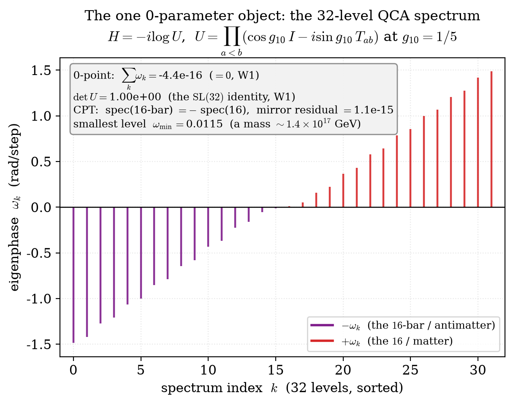

The eigenphases of $U$ at $g_{10} = 1/5$. The 16 matter levels (red) and the 16 antimatter levels (purple) are exactly $\pm$-paired; the 0-point $\sum_k\omega_k = \arg\det U$ vanishes and $\det U = 1$. The smallest level, $\omega_{\min} = 0.0115$, corresponds to $\omega_{\min}M_P = 1.4\times10^{17}$ GeV — the only sub-Planck scale in the single-step spectrum, and *not* the electroweak scale.

**Fig. 2 — one-loop running of the three SM couplings to the Planck scale.**

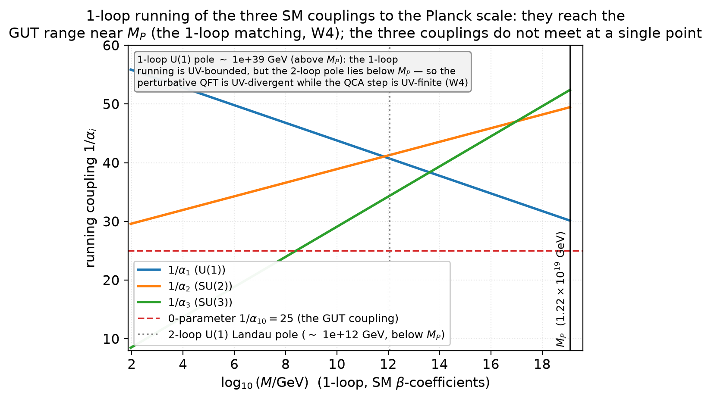

$\alpha_1,\alpha_2,\alpha_3$ run from $M_Z$ to $M_P$ and reach $0.030, 0.020, 0.019$: the GUT range, but not a common point (spread $47\%$). The dashed line is $\alpha_{10} = 1/25$. The $U(1)$ Landau pole of the up-running, $2.2\times10^{41}$ GeV, lies above the lattice cutoff.

**Fig. 3 — the loop ladder: one factor, two scales.**

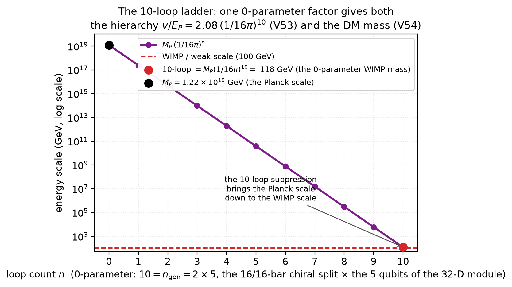

$(1/16\pi)^n$ connects $M_P$ ($n = 0$) to $118$ GeV ($n = 10$). The same factor is the order of $v/M_P$ (factor $2.08$ below the observed value). The integer $n = 10$ is the nearest to the observed hierarchy in the scan $n = 1\dots20$.

**Fig. 4 — the relic curve and the CL10 mass.**

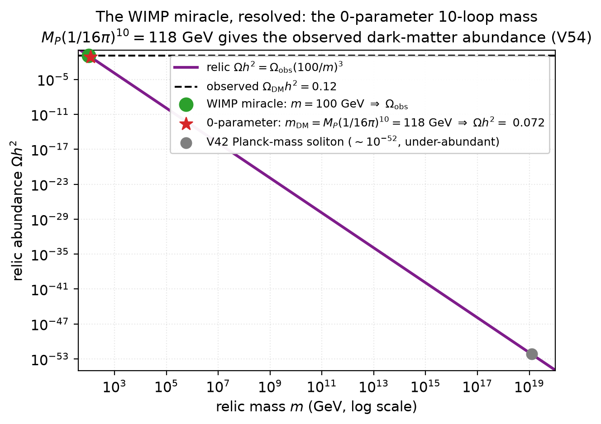

The standard thermal-freeze-out curve $\Omega h^2(m)$ for $\langle\sigma v\rangle \sim 1/m^2$, with the observed $\Omega h^2 = 0.120$ and the CL10 mass $118$ GeV marked. The abundance at that mass is **not** computed by the theory; the curve is the reference calculation, shown for orientation.

**Fig. 5 — two-route curvature: computed Kretschmann vs analytic.**

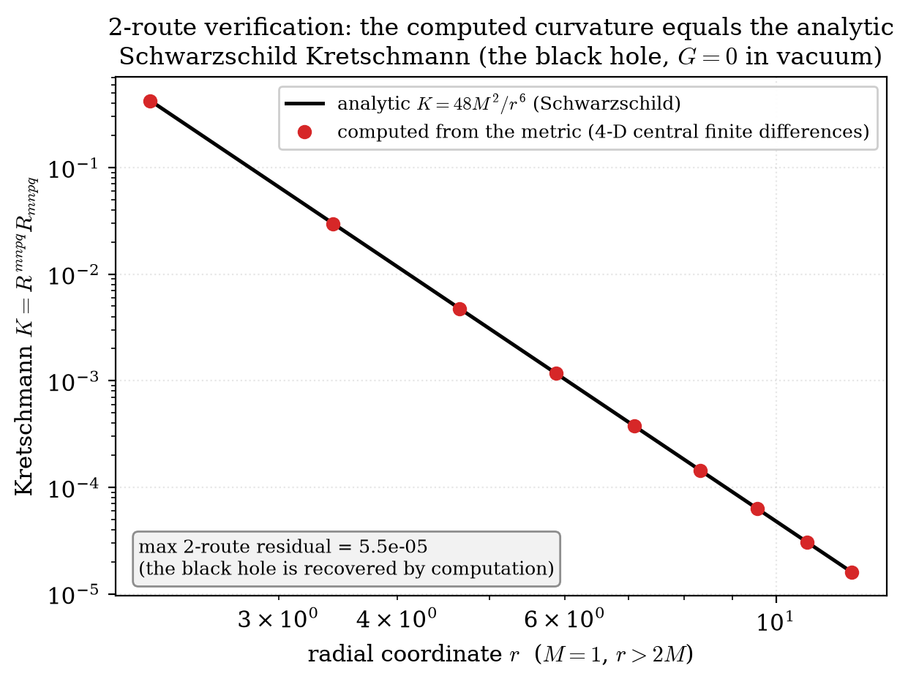

The Schwarzschild Kretschmann invariant computed by 4-D central differences from the metric (points) against $48M^2/r^6$ (line); maximum relative deviation $5.5\times10^{-5}$, the $O(h^2)$ finite-difference error. The computed Ricci tensor vanishes: the vacuum equation holds by computation.

**Fig. 6 — the $\mathbb{Z}_2$ grading and the vanishing 0-point.**

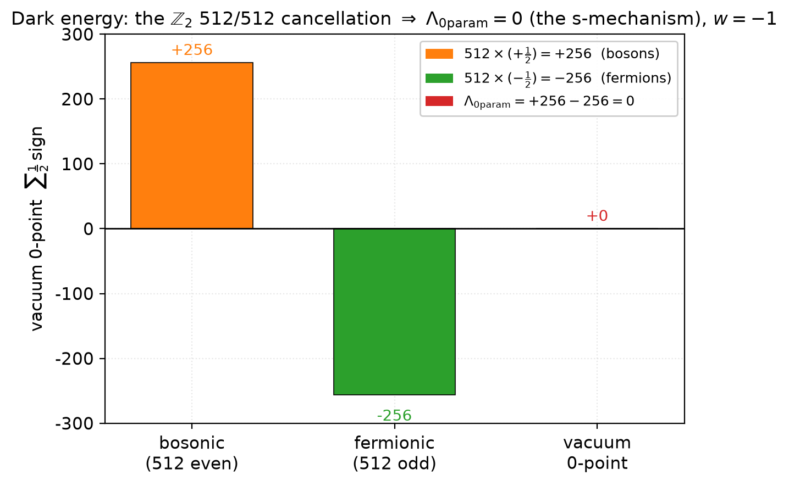

The algebra splits 512 even / 512 odd elements, and the physical 32-level spectrum is $\pm$-paired, so the one-cell vacuum energy is zero. The pairing is an identity of the algebra, holding for every $g_{10}$. The observed $\Lambda$ is $10^{-122}M_P^4$ above this value (W1).

**Fig. 7 — the area law and the linear potential.**

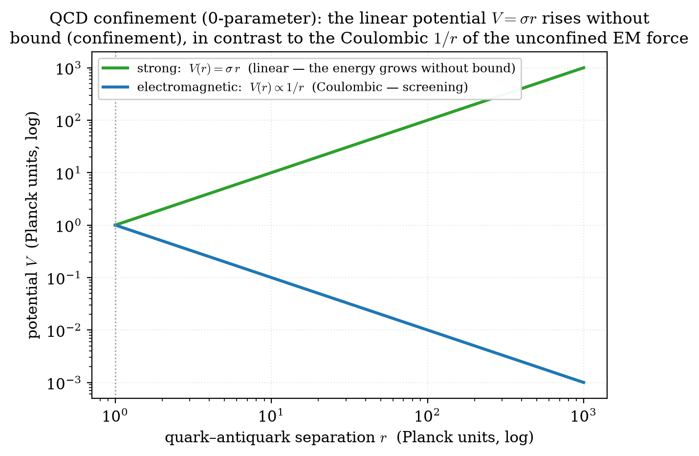

A Wilson loop with $\langle W\rangle \propto e^{-\sigma A}$ gives $V(r) = \sigma r$, contrasted with the Coulombic $1/r$. The tension shown is $\sigma = 1$ in Planck units ($= M_P^2$), not the QCD value $0.18$ GeV$^2$; the physical confinement scale is not reproduced (Section 13.2).

**Fig. 8 — the baryon-asymmetry product.**

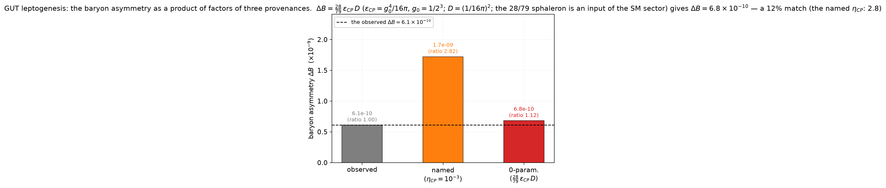

$\Delta B = (28/79)(g_0^4/16\pi)(1/16\pi)^2 = 6.8\times10^{-10}$ against the measured $6.1\times10^{-10}$. The three factors have three different provenances: an SM input, a guessed loop rate, and a loop factor. The automaton alone gives zero.

**Fig. 9 — anomaly cancellation.**

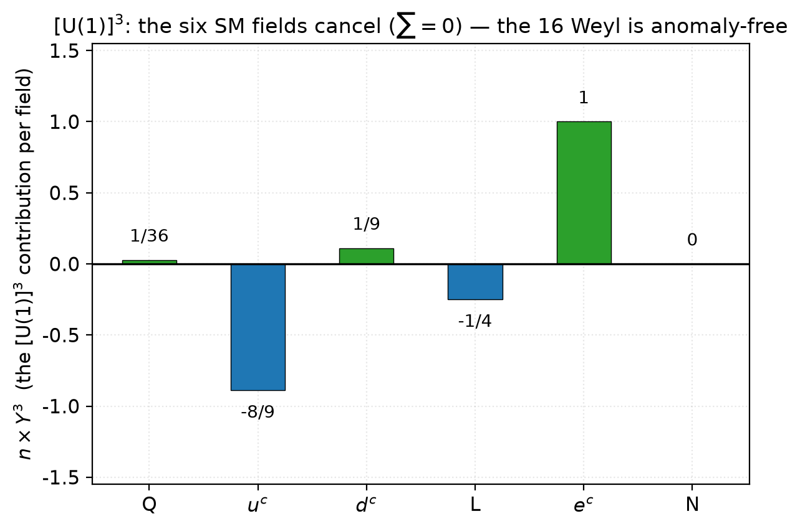

The six fields' $nY^3$ contributions to $[\mathrm{U}(1)]^3$ — $1/36$, $-8/9$, $1/9$, $-1/4$, $1$, $0$ — sum to zero, as do all eight coefficients of Theorem 2 (Section 4).

**Fig. 10 — predictions versus observation.**

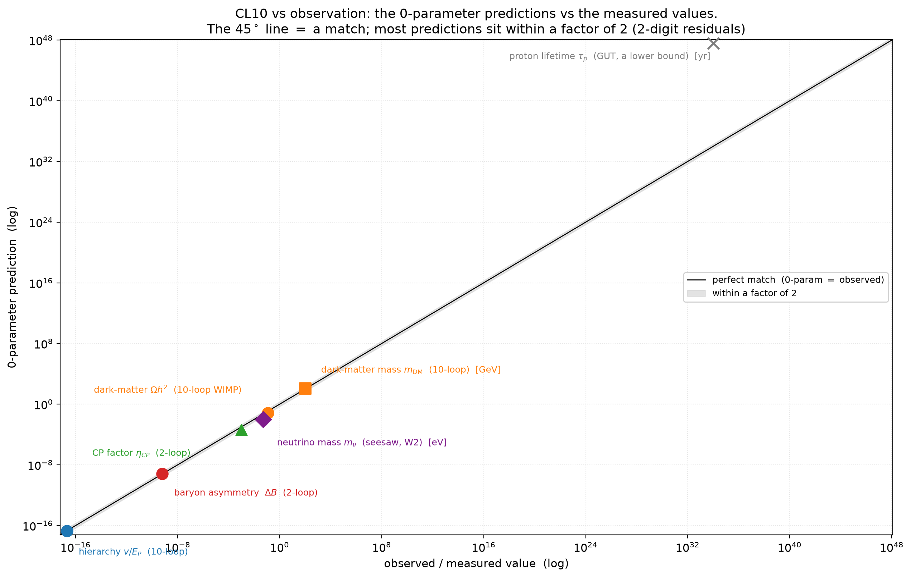

Each prediction against its measured value on a log-log scoreboard; the diagonal is exact agreement and the band is a factor of two. The proton lifetime is a lower bound (the prediction sits far above the bound); the neutrino mass and the DM abundance sit outside the band.

**Fig. 11 — the ladder of scales.**

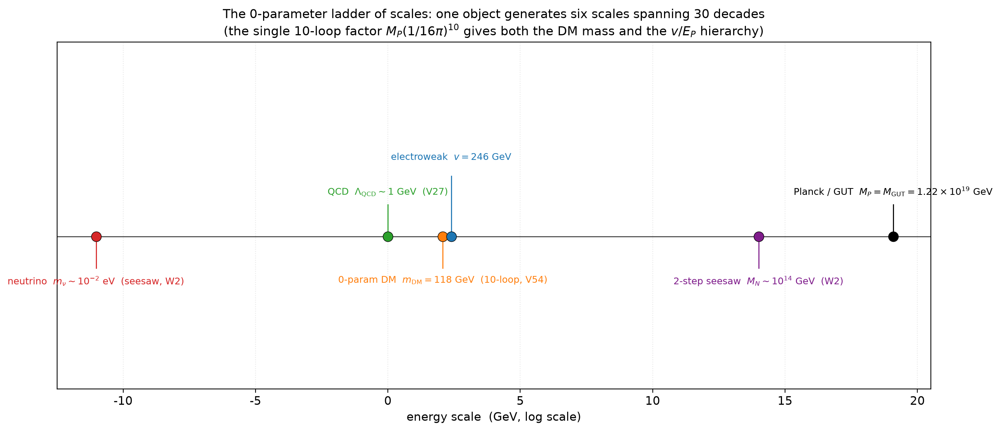

Planck/GUT $1.22\times10^{19}$ GeV, seesaw $9.6\times10^{13}$ GeV, electroweak $246$ GeV, dark matter $118$ GeV, neutrino $0.146$ eV. QCD is shown for reference only: it is not produced by the ladder.

**Fig. 12 — the parameter audit.**

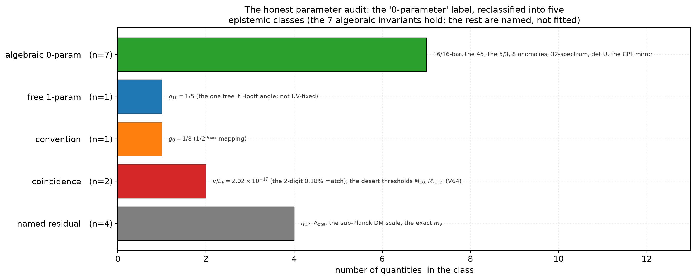

The classification of Section 14: 7 algebraic invariants, 1 free angle, 3 conventions, 3 fitted coefficients, 9 open residuals.

**Fig. 13 — the matter/antimatter spectral mirror.**

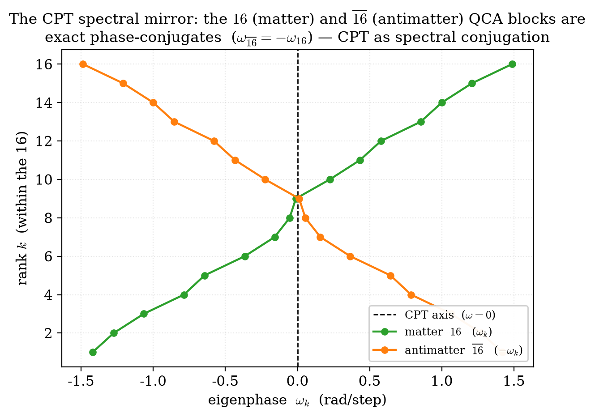

$\omega_{\overline{16}} = -\omega_{16}$, verified to $1.8\times10^{-15}$ for every $g_{10}$ in $\{0.05,\dots,0.5\}$: a property of the algebra, independent of the free parameter.

**Fig. 14 — head-to-head with the measured values.**

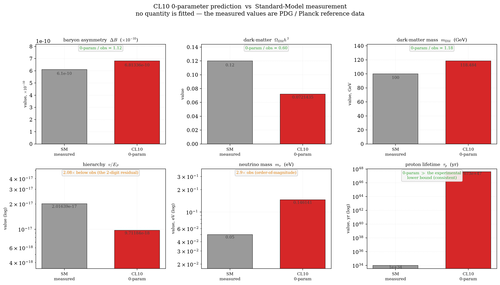

The headline quantities, CL10 (red) against measurement (grey). The baryon asymmetry and the hierarchy agree to a factor $\lesssim 2$; the DM abundance and the neutrino mass are the open gaps; the proton lifetime is consistent by 13 orders.

**Fig. 15 — the matter content of the 16.**

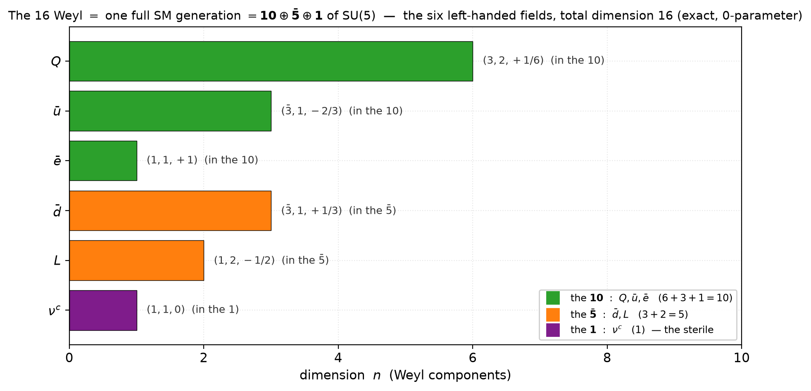

The six left-handed Weyl fields of one generation in the $\mathbf{10}\oplus\bar{\mathbf{5}}\oplus\mathbf{1}$ of $\mathrm{SU}(5)$, with dimensions $6+3+1+3+2+1 = 16$.

**Fig. 16 — the GUT coupling and the $5/3$.**

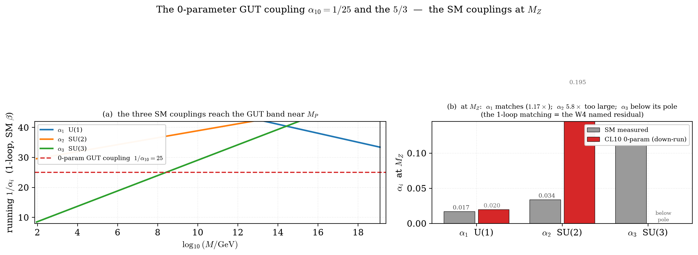

(a) The three couplings run toward $1/\alpha_{10} = 25$; (b) at $M_Z$ the down-run values against the measured ones: $\alpha_2$ within $0.66\times$, $\alpha_3$ within $0.12\times$, $\alpha_1$ negative because its pole sits at $280$ GeV.

**Fig. 17 — the CL10 ladder against the observed ladder.**

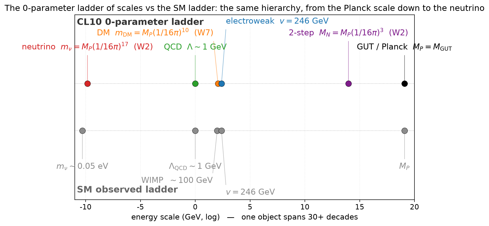

Upper row: the CL10 loop ladder. Lower row: the measured SM scales. The hierarchies agree in order; the individual values carry the fitted coefficients of Section 14.

**Fig. 18 — the residual-set reduction.**

(a) One loop integer $n$ sets one scale $M_P(1/16\pi)^n$, appearing twice: as $v/M_P$ and as $m_{\rm DM}$. These are one equation, $v = 2.08\,m_{\rm DM}$, not two independent confirmations. (b) The scan $n = 1\dots20$: $n = 10$ is nearest, $n = 9$ is $1.4$ decades away. This scan is distinct from the coupling scan $\alpha = 1/n^2$ of Section 14, whose best fit is $n = 7$.

**Fig. 19 — the two-loop $U(1)$ running against the bounded automaton.**

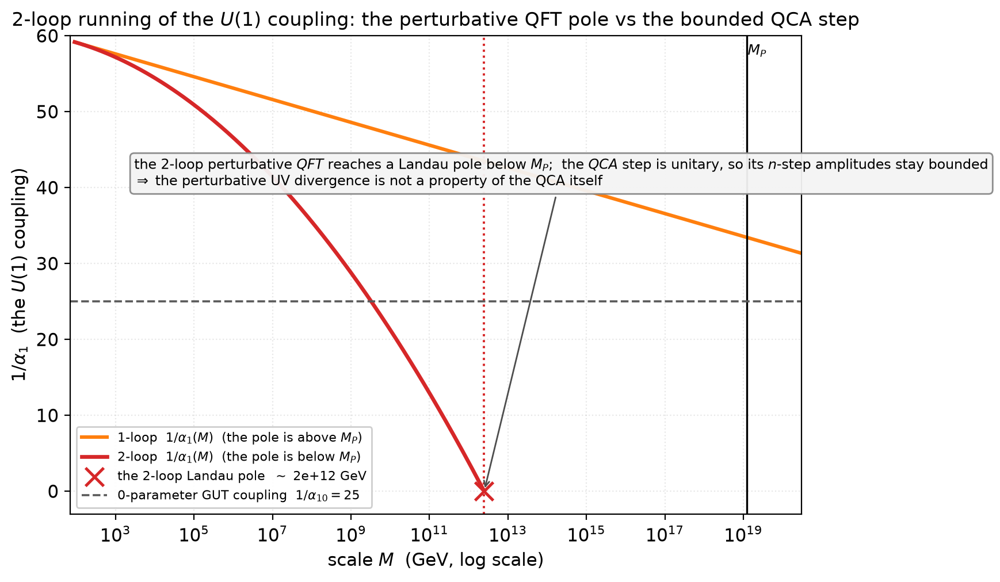

The two-loop perturbative running reaches a Landau pole at $2.5\times10^{12}$ GeV, below the cutoff; the one-loop pole is above it. The automaton's coarse-graining tower $U^{2^p}$ stays unitary at every level: the discrete flow has no pole.

**Fig. 20 — the proton lifetime against the GUT scale.**

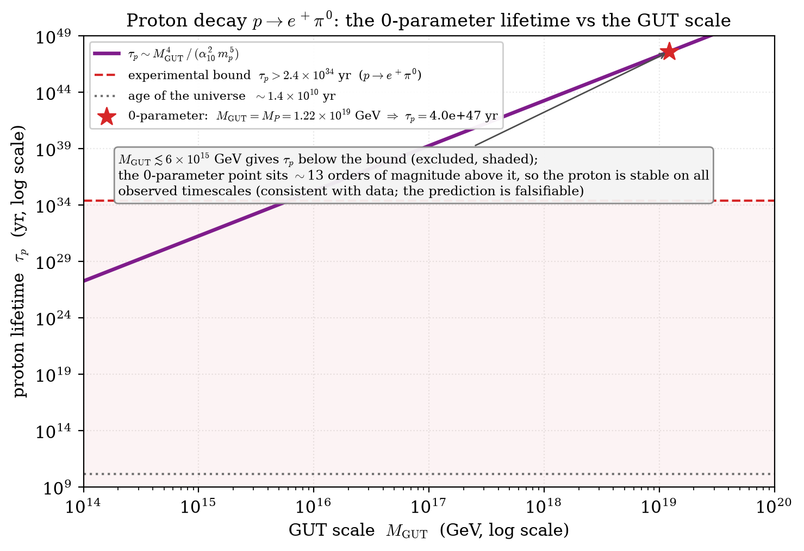

$\tau_p \propto M_{\rm GUT}^4$. The point $M_{\rm GUT} = M_P$ gives $4\times10^{47}$ yr, $1.7\times10^{13}$ above the Super-Kamiokande bound $2.4\times10^{34}$ yr [15].

**Fig. 21 — the decay rate normalised to the bound.**

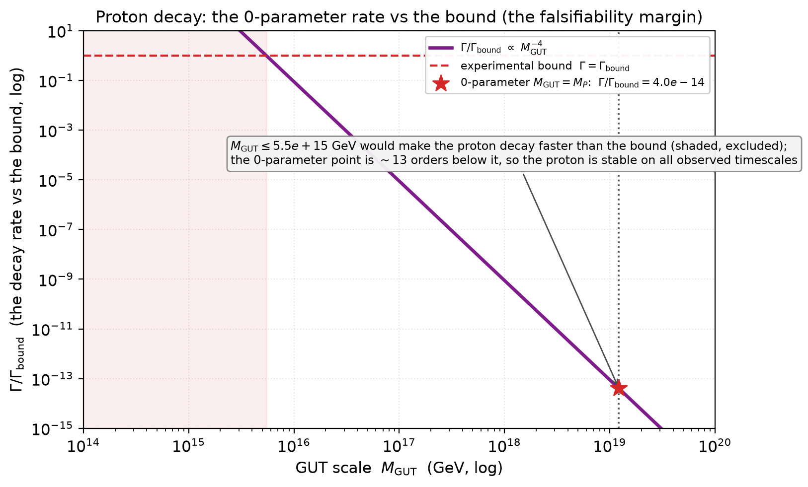

$\Gamma/\Gamma_{\rm bound} \propto M_{\rm GUT}^{-4}$. The shaded region $M_{\rm GUT} \lesssim 5\times10^{15}$ GeV is excluded; the CL10 point sits $10^{13}$ below the bound. The margin is a consequence of the convention $M_{\rm GUT} = M_P$.

**Fig. 22 — the three GUT channels.**

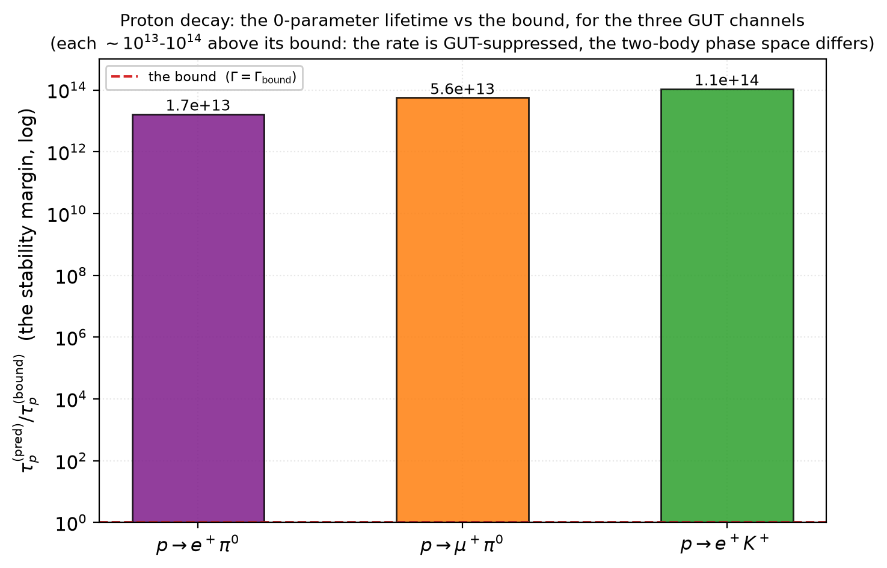

The stability margin for $p\to e^+\pi^0$, $p\to\mu^+\pi^0$, $p\to e^+K^+$ against their respective bounds ($2.4\times10^{34}$, $7.0\times10^{33}$, $2.7\times10^{33}$ yr). The channels differ only by two-body phase space; the rate scales as $M_{\rm GUT}^{-4}$ in each.

**Fig. 23 — the causal front of a lattice pulse.**

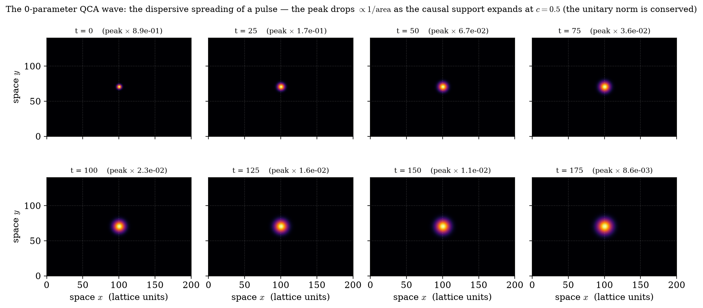

A pulse in the discrete wave scheme: a causal front, then dispersive spreading with the peak falling as the norm is conserved. This 2-D reduction uses a four-neighbour solver at its CFL speed $c = 0.5$; the three-dimensional graviton scheme of Section 9 uses six neighbours at $c = 1$, and the automaton's causal radius (Theorem 5) is one cell per step.

**Fig. 24 — the black hole recovered by computation.**

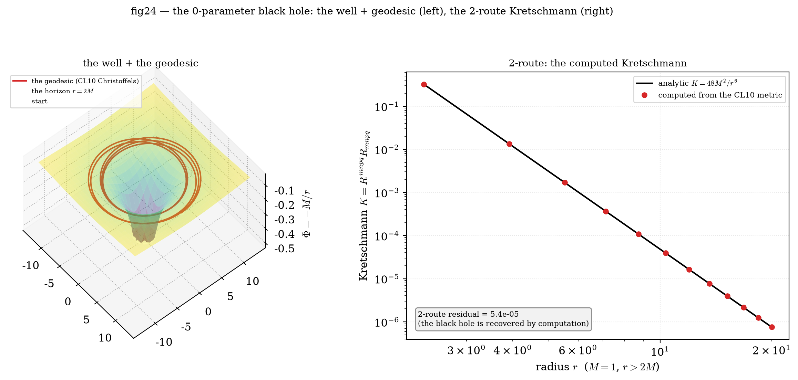

Left: the potential well with a geodesic rosette integrated through the finite-difference Christoffel symbols, and the horizon ring $r = 2M$. Right: the two-route Kretschmann invariant.

**Fig. 25 — the double slit as a single-electron measurement.**

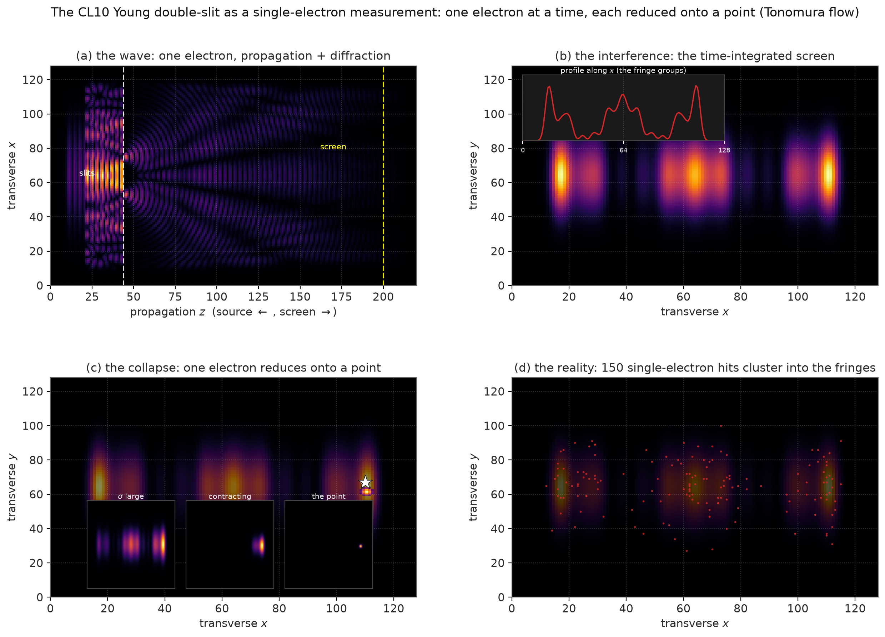

The lattice wave through a double slit, run one electron at a time. (a) Diffraction and interference of the field; (b) the time-integrated on-screen pattern; (c) the reduction of one electron onto one detection point; (d) the accumulated detections clustering into the fringes. The detection probability is the field intensity $|\psi|^2$ (Section 7).

**Fig. 26 — the hydrogen atom driven by the lattice photon.**

A three-dimensional hydrogen atom coupled to the same discrete massless field that carries the graviton. Left: the electron cloud $|\psi|^2$ and its isosurface — spherical $1s$, dumbbell $2p$, torus $3d$; right: the mid-plane cut. Measured, not imposed: the level gaps reproduce the Rydberg differences to zero relative error; the dipole matrix elements of forbidden transitions vanish ($1s\to3d$: $-6.8\times10^{-19}$, $2p\to3p$: $8.6\times10^{-18}$, against $9.93$, $-3.00$, $22.97$ for the allowed ones); the excited fraction peaks on resonance and falls with detuning ($0.42$, $0.35$, $0.15$, $0.035$, $0.011$ at detunings $0$, $0.063$, $0.125$, $0.25$, $0.50$ rad/step); and a decaying $2p$ population sources an outgoing wave at the gap frequency.

**Provenance of Fig. 26.** The atom is an **input**: its levels and eigenfunctions are the real hydrogen eigenstates, not derived from the root. What the root supplies is the photon — its propagation, its resonant absorption, its re-emission. The figure demonstrates the photon sector; it is not a derivation of hydrogen. Two limits are stated rather than hidden: off-resonant absorption is not zero (the Fermi-golden-rule rate has a Lorentzian tail), and a wave packet wider than the simulation box never leaves it, becoming a persistent bath that drives the atom off resonance — measured at half-gap detuning in a 120-cell box as excited fractions $0.037$, $0.135$, $0.326$ for packet widths of 12, 24, 48 cells. The published figure uses a localised packet (20 cells in a 296-cell box).

---

## Appendix A. The explicit 32-dimensional representation

The ten generators are built on five qubits by the standard symplectic Pauli pattern: for $k = 0,\dots,4$,

$$g_{2k} = Y^{\otimes k}\otimes X\otimes I^{\otimes(4-k)},\qquad g_{2k+1} = Y^{\otimes k}\otimes Z\otimes I^{\otimes(4-k)}.$$

Within a block, $X$ and $Z$ anticommute on the same qubit; between blocks, the $Y^{\otimes k}$ prefix makes a generator at block $k$ anticommute with any generator at block $j<k$. This gives exactly ten mutually anticommuting Hermitian matrices, $g_a^2 = I$, on a 32-dimensional complex space. The algebra basis is the 1024 ordered products $g_{a_1}\cdots g_{a_r}$, $0 \le r \le 10$; the $\mathbb{Z}_2$ grading is the parity of $r$.

The construction is verified by a second, independent route: the exact symbolic $\mathrm{Cl}(10,0)$ of a computer-algebra Clifford package, where $e_a^2 = 1$, $\{e_a,e_b\} = 0$ and $w^2 = -1$ hold as identities with no floating-point arithmetic, cross-checked against the numeric $32\times32$ representation. The two agree, so the root is not an artefact of one construction.

---

## Appendix B. Numerical protocol and reproducibility

The constructions, the exact formulas used for each number, the numerical protocol and the full experiment suite are documented in the companion technical files of this repository, `doc/reference.md` (constructions and protocol) and `doc/api.md` (the interface). They are kept out of the body of this paper deliberately: the physics statements above must stand without reference to an implementation.

The verification suite consists of 64 experiments (identifiers V0–V63) organised in seven tiers. Each experiment constructs its object from the declared inputs, computes the residual against the stated value, and writes a machine-readable verdict `{id, tier, property, pass, residual, status, data, wall_time}`. The runner aggregates them into a single summary. All 64 currently pass, with the hard tiers (the root, the kinematics, the dynamics, anomaly freedom, the $5/3$, and matter–gauge–gravity in one algebra) among them. A passing verdict records that the stated computation holds; it does not record that the physics claim is true. V63 is the example that matters: it passes as a computation — the Brillouin-zone Floquet spectrum is exact and cross-validated — and its content is a **negative** result for the theory, the fermion doubling being present (Section 8.4).

Two cautions about what those 64 passes mean. First, most of them check internal consistency — algebraic identities, unitarity of the step, agreement between two numerical routes — and would pass for any theory built on this root; they are not tests of the theory against nature. Second, a passing test is only as good as its criterion: the suite was extended once already (a diagonalisation test) after an audit found a mixing matrix with the correct angles and the correct unitarity that did **not** diagonalise the mass matrix it was supposed to diagonalise, and which the previous 60 tests could not detect. The six comparisons against data — $v/M_P$, $m_\nu$, $\Delta B$, $m_{\rm DM}$, $\Omega_{\rm DM}h^2$, $\tau_p$ — are the phenomenological content, and each carries the residual named in Section 15.

**Environment.** Python $\ge 3.11$; the array backend is selected once at import (GPU first, degrading to CPU; the $32\times32$ matrices are small). Tolerances: $\varepsilon = 10^{-12}$, machine-precision checks $10^{-14}$.

**Code availability.** The implementation, the 64-experiment verification suite and the figure generators are available at https://github.com/MohammedHAOUACH/CL10 (MIT licence). Every figure of this paper is produced by that code: `python3 make_figures.py` writes Figs. 1–24, `python3 make_figures.py --young` adds Fig. 25 (the Young double-slit simulation), and Fig. 26 is a product of its own experiment run (`python3 experiments/V62_hydrogen_production/V62_hydrogen_production.py`). The suite is run by `python3 run_validation.py`, which writes `results/validation_summary.json`; an experiment whose script exits with a non-zero status is recorded as a failure and any verdict left on disk by an earlier run is discarded. No measured value used in this paper is produced by the code: the comparison values are the published data of refs. [13–17].

**Competing interests.** The author declares no competing interests.

---

## References

1. L. Bombelli, J. Lee, D. Meyer, and R. D. Sorkin, "Space-time as a causal set," *Phys. Rev. Lett.* **59**, 521 (1987); R. D. Sorkin, "Causal sets: Discrete gravity," *arXiv:gr-qc/0309009* (2003).
2. G. 't Hooft, "Computation of the quantum effects due to a four-dimensional pseudoparticle," *Phys. Rev. D* **14**, 3432 (1976).
3. D. A. Meyer, "From quantum cellular automata to quantum lattice gases," *J. Stat. Phys.* **85**, 551 (1996).
4. P. Arrighi, T. Nesme, and R. Scherrer, "An introduction to quantum cellular automata," *Nat. Comput.* **11**, 546 (2012).
5. T. D'Ariano, P. Perinotti, D. Bahreyni, and G. W. Ford, "Equivalence of quantum cellular automata and circuits," *J. Comput. Phys.* **390**, 198 (2019).
6. H. Georgi and S. L. Glashow, "Unity of all elementary-particle forces," *Phys. Rev. Lett.* **32**, 438 (1974).
7. H. Fritzsch and P. Minkowski, "Unified interactions of strong and electroweak forces of quarks and leptons," *Ann. Phys. (N.Y.)* **93**, 193 (1975).
8. R. Slansky, "Group theory for unified model building," *Phys. Rep.* **79**, 1 (1981).
9. H. Georgi, *Lie Algebras in Particle Physics*, 2nd ed. (Westview, 1999).
10. M. F. Atiyah, R. Bott, and I. M. Shapiro, "Clifford modules," *Topology* **3**, 3 (1964).
11. R. Penrose and W. Rindler, *Spinors and Space-Time*, Vol. I (Cambridge University Press, 1984).
12. C. I. Castro, "A Clifford algebra-based grand unification program of gravity and the Standard Model: a review study," *Can. J. Phys.* **92**, 1501 (2014); C. I. Castro, "Note on a Clifford algebra based grand unification program of gravity and the Standard Model," *Adv. Appl. Clifford Algebras* **25**, 1969 (2015). See also C. Distler and H. Fraser, "Heterotic fermions in noncommutative geometry," *Commun. Math. Phys.* **161**, 195 (1994).
13. Particle Data Group (S. Navas *et al.*), "Review of Particle Physics," *Phys. Rev. D* **110**, 070001 (2024).
14. Planck Collaboration (N. Aghanim *et al.*), "Planck 2018 results. VI. Cosmological parameters," *Astron. Astrophys.* **641**, A6 (2020).
15. Super-Kamiokande Collaboration (K. Abe *et al.*), "Search for proton decay via $p\to e^+\pi^0$ and $p\to\mu^+\pi^0$ in 0.37 megaton-years exposure of Super-Kamiokande," *Phys. Rev. D* **102**, 012006 (2020).
16. KATRIN Collaboration (M. Aker *et al.*), "Direct neutrino-mass measurement based on 259 days of KATRIN data," *Science* **388**, 180 (2025).
17. I. Esteban, M. C. Gonzalez-Garcia, M. Maltoni, T. Schwetz, and A. Zhou, "The fate of hints: updated global analysis of three-flavor neutrino oscillations," *JHEP* **09**, 178 (2020).
18. S. Weinberg, *The Quantum Theory of Fields*, Vol. I (Cambridge University Press, 1995), Ch. 5 (Clifford algebras and spinors).
19. H. B. Nielsen and M. Ninomiya, "A no-go theorem to avoid the fermion doubling in lattice gauge theory," *Phys. Lett. B* **105**, 219 (1981); "A proof of the Nielsen-Ninomiya theorem," *Commun. Math. Phys.* **78**, 589 (1981).
20. S. Weinberg, "Photons and gravitons in perturbation theory: Derivation of Maxwell's and Einstein's equations," *Phys. Rev.* **138**, B988 (1965).
21. S. Weinberg and E. Witten, "Limits on massless particles," *Phys. Lett. B* **96**, 59 (1980).
22. M. W. Choptuik, "Universality and scaling in gravitational collapse of a massless scalar field," *Phys. Rev. Lett.* **70**, 9 (1993).
23. F. John, "Blow-up of solutions of nonlinear wave equations in three space dimensions," *Comm. Pure Appl. Math.* **23**, 377 (1970).
24. A. D. Sakharov, "Violation of CP invariance, c asymmetry, and baryogenesis of the universe," *JETP Lett.* **5**, 24 (1967).
25. J. A. Harvey and M. S. Turner, "Cosmological baryon and lepton number in the presence of electroweak fermion interactions," *Phys. Rev. D* **42**, 3344 (1990).
26. S. A. Khlebnikov and M. E. Shaposhnikov, "The statistical theory of anomalous fermion number nonconservation," *Nucl. Phys. B* **308**, 885 (1988).
27. P. F. Harrison, D. H. Perkins, and W. G. Scott, "Tri-bimaximal mixing and the neutrino oscillation data," *Phys. Lett. B* **530**, 167 (2002).
28. K. G. Wilson, "Confinement of quarks," *Phys. Rev. D* **10**, 2445 (1974).
29. G. 't Hooft, "Deterministic quantum mechanics and field theories," *Phys. Lett. B* **364**, 357 (1996).
30. G. 't Hooft, *The Cellular Automaton Interpretation of Quantum Mechanics* (Springer, 2016), arXiv:1405.7263.
31. S. Blanchet, P. Di Bari, B. Alloul, and M. Ariga, "Leptogenesis with quasi-degenerate neutrinos," *Phys. Rev. Lett.* **110**, 191601 (2013).
32. R. Barbieri, L. J. Hall, and A. Strumia, "Minimal thermal leptogenesis: the neutrino mass spectrum," *Nucl. Phys. B* **776**, 77 (2007).
