# Causal Clifford Theory (CL10): the Standard Model and gravity from a single Clifford root on a Planck-lattice quantum cellular automaton

**Mohammed Haouach**
*Independent researcher; correspondence: haouach.mohammed@gmail.com*

---

## Abstract

We present **Causal Clifford Theory (CL10)**: a unitary quantum cellular automaton (QCA) whose cell is a $2{\times}2{\times}2$ block of Planck sites, each of its eight sub-sites carrying the 32-dimensional complex module of the Clifford algebra $\mathrm{Cl}(10,0)$ (on-site space $\mathbb{C}^{256}$). Ten mutually anticommuting Hermitian generators $h_a^2 = I$ supply the kinematics. From this single algebraic object follow a $(1{+}3)$ Minkowski subalgebra; a 16-component Weyl module whose charge assignment is exactly one Standard Model (SM) generation, with all eight gauge and mixed anomalies cancelling; a 45-dimensional $\mathrm{Spin}(10)$ adjoint containing the twelve SM gauge bosons; the $5/3$ hypercharge normalisation; an exactly unitary, strictly causal update with $\det U = 1$ and an exact matter--antimatter spectral mirror; and a lattice theory of a massless spin-2 field whose discrete Einstein--Hilbert action reproduces general relativity to machine precision.

We also state **what does not follow**. Every number is classified by provenance — *algebraic*, *conventional*, *fitted*, or *open*. The family number, the Yukawa structure, quark mixing, the cosmological constant, the dark-matter identity and abundance, the exact neutrino mass, the baryon asymmetry and one-loop coupling unification remain open. A single loop factor $(1/16\pi)^{10}$ reproduces the electroweak/Planck hierarchy to a factor $2.08$ and gives a $118$ GeV dark-matter scale, but the exponent $10$ is selected by the data it is meant to explain. The one free parameter of the dynamics — the 't Hooft angle $g_{10}$ — is now removed by an axiom the algebra itself enforces: requiring the fundamental step to be an element of the root ($e^{ig}$ a root of unity) quantizes the internal clock, and the only exactly closed steps of the 45-plane product are $\pi/2$ (where the step *is* the pseudoscalar $w$, an ordering-independent theorem) and $\pi/4$ (order 8, spectrum exactly $\{\pm\pi/4\ (10),\ \pm3\pi/4\ (6)\}$); at $\pi/4$ the zone-centre step is an exact involution and the doubler defect of the earlier root angle is repaired — but the repaired census is a network of **six exactly gapless face-diagonal lines** through the zone centre carrying the twelve M points, not thirteen points, and the per-node chirality bookkeeping fails on it (V132). The price, stated like the rest and now measured rather than anticipated: the ladder-length crossing $n^* = 10$ does not survive; the desert meeting at the closed coupling $\alpha_X = \pi/64$ leaves the desert and predicts $\tau_p = 2.8\times10^{39}$ yr (V133); the closed coupling sits $1.54\times$ further from the one-loop value than the convention it replaces (V135); and the second closed angle $\pi/2$ is a mixing-free pure lattice translation with $7.0\times$ the doublers (V134).

Six tensions with observation are reported rather than hidden. Under Standard-Model desert running the GUT coupling $\alpha_{10} = 1/25$ overshoots the measured $\mathrm{SU}(2)$ coupling by a factor $5.8$ and drives $\mathrm{SU}(3)$ to a Landau pole at $2.2\times10^9$ GeV; this failure is repaired by the vectorlike remnant matter the theory's own breaking sector supplies — three $\mathbf{10}\oplus\overline{\mathbf{10}}$ pairs plus one weak-doublet pair make the three measured couplings meet at $\alpha_X = 1/25$ *exactly*, at $M_X = 1.8\times10^{16}$ GeV, at the cost of abandoning $M_{\rm GUT} = M_P$ and of two fitted thresholds; the repair predicts $\tau_p \simeq 1.8\times10^{36}$ yr. The remnant is no longer an assumption: an internal Wilson factor of the step itself, built from the root's Cartan algebra, gaps the twelve doubler nodes, the vectorlike pattern is the spectrum of its selective reading, the multiplicity is bounded below by unification ($n_{\rm nodes}\ge3$), and the same direction completes the $\mathrm{Spin}(10)$ breaking chain to the SM group — but the mechanism's own minimal root meets at $M_X = 8.9\times10^{14}$ GeV, already excluded by proton decay, and no redistribution of the node strengths can move it (the meeting equations depend on the three strengths only through their sum), and the gauged bond layer's own composite matter is excluded as the supplier of the data-preferred spectrum (no solution over the full scan of the breaking direction). The seesaw value $m_\nu = 0.146$ eV exceeds the oscillation scale and the bound $\sum m_\nu < 0.12$ eV; a built node-mixing junction supplies the $\tfrac13$ coefficient that lands the mass at $0.0487$ eV — the earlier claim that this survives only at one measure-zero point was an artifact of an identity-Dirac assumption: with the implemented democratic Dirac matrix the massless structure is protected for every junction ratio and the value sits in a finite window (V103); the relic abundance is now **computed** rather than normalised, and it is not $0.120$ for any coupling the root supplies (at the ladder mass the measured value requires an effective coupling $0.0086$, against the root's $0.0032$ or the loop factor's $0.0199$, and the automaton's own nodal-plane spectrum multiplies the final-state density by $1485$), and the dark-matter no-go is completed — no Wilson node can host a stable neutral carrier at the predicted $118$ GeV, and the minimal fix is a nearly decoupled mirror-odd scalar with $\sigma_{\rm SI} = 5\times10^{-51}$ cm$^2$; the heavy-neutrino decay is *in* equilibrium ($\Gamma/H \simeq 4.6$), and the CP phase that leptogenesis needs is no longer the missing ingredient — a bond-layer Peierls flux supplies the measured asymmetry at machine-precision unitarity, $\det U = 1$, exact mirror symmetry and exact causality, so the asymmetry fails on the out-of-equilibrium condition alone; and the loop factor is closed from inside — the coarse-graining tower is proven kinematic, the block-spin RG of the bond layer composes internal angles but can never divide them, while a traced fluctuating link d.o.f. is shown to divide them exactly: the factor $1/(16\pi)$ requires the gauged bond layer, now built with an exactly closing Gauss constraint, whose measured level-1 division still falls short of $1/(16\pi)$ by a factor $26$, and whose loop census is now enumerated exactly ($55326$ of $3^{10}$ traced words survive at the ladder length, and switching the Wilson phase off destroys the factor). Confinement is measured rather than assumed: the gauged layer's adjoint link carries no invariant vector, so the static potential is exactly linear with tension $\sigma = C_2(45) = 9.5\times10^{39}$ GeV$^2$ — forty orders above the QCD string — and its electric Laplacian is gapped at the same number, while the implemented step has plaquettes equal to the identity and cannot confine at all. The vanishing vacuum energy is proven protected by $\det U = 1$ against every traceless internal deformation, so the observed $\Lambda$ is equivalent to a named trace-phase breaking of size $1.6\times10^{-120}$. The massless-particle content of the implemented step is now censused and is empty: no mode of the 128-level band spectrum is exactly gapless (zone minimum $5.1\times10^{-4}$ lattice units), the step's own point group is an index-3 subgroup of $O_h$, and the little group of the near-gapless nodes carries no 2-dimensional irrep — so no helicity $\pm1$ or $\pm2$ pair exists in the one-particle spectrum, and the graviton of the gravitational sector is not a state of the implemented automaton. The seven criteria, the nine open residuals and the seven falsifiers are stated explicitly.

**Keywords.** Clifford algebra; quantum cellular automaton; $\mathrm{Spin}(10)$ grand unification; anomaly cancellation; lattice gravity; dark matter; cosmological constant; baryogenesis; falsifiability.

---

## 1. Introduction

### 1.1 The image behind the construction

Two habits of language do most of the misleading. The first calls $c$ the speed of light. Light is one traveller at that speed; the constant itself is the speed of causality — the rate at which one event can constrain another. Asking why light moves at $c$ is like asking why a particular car obeys the speed limit. The second habit is wave–particle duality, taught as a paradox. Seen from a lattice it dissolves: there is one wave, always; what a detector registers is a single localised event, because the detector is itself a lattice of cells that change state one cell at a time. The ontology contains no particles — only waves that deliver their energy in quanta.

Quantum field theory took the first step, replacing particles by fields, but it multiplied the fields: one per species, glued together by hand. The viewpoint of this paper comes from the author's background in computer science, where the opposite picture is elementary: a cellular automaton — a lattice of cells, each holding a finite packet of information, all updated in parallel by one local rule. If the world is such an automaton, everything physical is a wave of information over that lattice, and the whole theory reduces to two questions: what is the information structure of a single cell, and what is the rule that updates it. Answer those two and particles, forces and spacetime itself are what the waves do. CL10 is the attempt to answer them concretely: the structure of the cell is eight copies of the $32$-dimensional module of $\mathrm{Cl}(10,0)$ on a $2{\times}2{\times}2$ block (Section 2), the rule is one six-stage step — $\mathrm{Spin}(10)$ plane rotations on every sub-site, interleaved with nearest-neighbour swap-rotations (Section 8).

### 1.2 Two literatures, one construction

Discrete models of quantum dynamics and grand unification have developed independently. On one side, causal sets, lattice gauge theory and quantum cellular automata treat spacetime as a finite, causal, unitary dynamical system [1–5]. On the other, the observation that one generation of quarks and leptons fits exactly into the 16-dimensional spinor of $\mathrm{Spin}(10)$, with the $5/3$ hypercharge normalisation and the anomaly cancellation following from the embedding, has been standard since 1974 [6–9]. Clifford-algebra formulations of this unification exist [10–12], including the identification of matter with spinor modules of $\mathrm{Cl}(n)$ [12].

CL10 puts these on a single footing: the internal space of every sub-site of the automaton's cell **is** the spinor module of $\mathrm{Cl}(10,0)$, and the update **is** a product of $\mathrm{Spin}(10)$ plane rotations interleaved with nearest-neighbour swap-rotations. Nothing else is added by hand: no extra scalar, no extra gauge factor, no second algebra.

### 1.3 What this paper claims, and what it does not

The claim is deliberately narrow, because a discrete unification is easy to overstate.

**Claimed and demonstrated.** The kinematics of one SM generation, its anomaly freedom, the GUT gauge content and the $5/3$, and a unitary causal automaton whose gravitational sector reproduces general relativity on the lattice to machine precision. These are theorems or numerical verifications, collected in Sections 3–9.

**Claimed as an order-of-magnitude statement.** The electroweak/Planck hierarchy, the dark-matter mass scale, the neutrino mass and the baryon asymmetry, all expressed through the loop factor $(1/16\pi)^{n}$ with $n$ a small integer (Section 10). The integers are chosen to land near the measured values; the two-digit coefficients are read from the data.

**Not claimed.** A derivation of the family number, of the fermion masses and mixings, of the cosmological constant, of the dark-matter particle, of the baryon asymmetry, of the spin-2 character of the graviton, of diffeomorphism invariance, or of the Born rule. Each is listed as an open residual in Section 15 with the size of the gap quantified.

The paper's discipline is therefore a **provenance discipline**: a number is *algebraic* if the root fixes it, *conventional* if it comes from a mapping or scale identification, *fitted* if a coefficient was read from data, and *open* if the theory does not fix it. Section 14 tabulates every headline number under this classification. This is the main methodological content of the paper.

**The seven criteria.** A unification claim has to be checkable, so the paper states the criteria it is judging itself against, with its own verdict on each.

| criterion | requirement | verdict here |
|---|---|---|
| **one object** | a single algebraic object, no added fields or structure | met for the internal space; the gravitational sector adds a symmetric tensor field $g_{\mu\nu}(x)$ and the value $G = 1$ (Section 9) |
| **kinematics** | spacetime, matter content, gauge group and statistics follow by representation theory | met (Sections 3–6) |
| **dynamics** | the object yields a unitary, causal evolution | met (Section 8: exactly unitary, $\det U = 1$, measured front speed $= 1$) |
| **unification** | matter, gauge and gravity live in the same object, not glued from separate pieces | partial: matter and gauge are the same module and the same 45; gravity is the metric dynamics of a subalgebra of that module, with an added field |
| **consistency** | anomaly-free, unitary, causal, UV-bounded | met (Theorem 2, Theorem 5, the bounded 32-level spectrum, the bounded $S^{(n)}$); the doublers of Proposition 2 are gapped by the internal Wilson factor of Section 8.4 (V65), with the split node set an input (W9) |
| **parameters** | every physical number fixed by the object, no fit | **not met at the implemented angle**: one free 't Hooft angle, two conventions, twelve fitted coefficients (Table 5). The closure axiom of Section 8.5 (V131) removes the free angle — the algebra forces $g \in \{\pi/2,\pi/4\}$, a discrete index of the root — at the price of moving the angle's two empirical contacts (the $n^*=10$ crossing and the $\alpha = 1/25$ meeting); both re-derivations are now measured (V132–V135) and both cost |
| **falsifiability** | testable predictions, and the open problems named rather than hidden | met (Tables 4, 6, 7) |

The paper passes the structural criteria and fails the parameter one at the implemented angle; the closure axiom of Section 8.5 repairs the dynamics to zero continuous unfixed numbers, and its two re-derivations have now been run: at the closed angle the doubler census is a six-line nodal network rather than twelve points (V132), the half-angle branch is a mixing-free pure translation (V134), and the desert meeting at the closed coupling leaves the desert with $\tau_p = 2.8\times10^{39}$ yr (V133) while the coupling itself moves $1.54\times$ further from the one-loop value (V135). The parameter criterion is therefore repaired algebraically and worsened phenomenologically. The chirality check of Section 8.4 shows that even the structural pass is partial: the automaton is unitary, causal and anomaly-free, its doubler spectrum is now gapped by a mechanism of the step itself, but the choice of which nodes land at the desert scale is an input rather than a consequence. That is the honest summary of the whole exercise.

### 1.4 Conventions

Planck units $\hbar = c = \ell_P = t_P = 1$ unless stated; $G = 1$. The metric signature is $(+,-,-,-)$ and $Q = T_3 + Y$. $\mathrm{Cl}(10,0)$ is the real algebra of ten generators with $h_a^2 = +I$; we work in its complexification $\mathrm{Cl}_{10}(\mathbb{C}) \simeq M_{32}(\mathbb{C})$. "Generation" means one set of left-handed Weyl fields. Numerical tolerances are $\varepsilon = 10^{-12}$ (machine-precision checks $10^{-14}$). Reference data: PDG 2024 [13], Planck 2018 [14], Super-Kamiokande [15], KATRIN [16], NuFIT [17].

---

## 2. The axiom

**Axiom 1 (the root).** *The universe is a $(1{+}3)$-dimensional causal quantum cellular automaton. Its cell is a $2{\times}2{\times}2$ block of Planck sites — site spacing $\ell_P$, so the cells tile a cubic lattice of spacing $2\ell_P$ — and each of the eight sub-sites carries a copy of the Clifford algebra $\mathrm{Cl}(10,0)$: ten mutually anticommuting Hermitian generators*

$$h_a^\dagger = h_a,\qquad h_a^2 = I,\qquad \{h_a,h_b\} = 0 \quad (a\ne b),\qquad a,b = 1,\dots,10.$$

*The state of the universe is a tensor product of these modules over the sub-sites, so the cell's on-site space is $\mathbb{C}^{256}$, and the dynamics is one time-independent unitary **step** of six **stages** built from the algebra (Section 8.1). The elementary time is the stage, $t_P$; one step is $6t_P$.*

**Why the cell is a block.** The bond part of the update pairs neighbouring sub-sites, and the pairing that treats the three directions alike has six stages: three pair sub-sites *inside* the cell, three pair sub-sites *across* cells (Section 8.1). Written on a single Planck site the same rule alternates between bonds inside and outside the site, which forces a two-cell spatial period and a six-periodic time dependence; on the block it is one time-independent rule, and the block is the smallest region on which the update acts as a single unitary. The staggering is therefore not a time dependence of the law but the sub-lattice structure of the cell. The Bloch decomposition of the step is exact at every step: the one-step matrix $M(q)$ is validated against the real-space step on a block torus to $10^{-14}$ (V63; $9.8\times10^{-15}$ on the CPU backend, $7.4\times10^{-15}$ on the GPU backend).

Three structural facts about the root, all standard [10,18]:

1. $\mathrm{Cl}(10,0)$ is $2^{10} = 1024$-dimensional; its complexification is $M_{32}(\mathbb{C})$, so it has a single irreducible complex module of dimension 32 (the Dirac module).
2. The volume element (pseudoscalar) $w = h_1 h_2 \cdots h_{10}$ satisfies
   $$w^2 = (-1)^{10\cdot 9/2}\prod_a h_a^2 = (-1)^{45} = -I,\qquad w^\dagger = -w,$$
   so $w$ is anti-Hermitian with eigenvalues $\pm i$, each of multiplicity 16 (the trace of $w$ vanishes). The projectors $P_{16} = \tfrac12(I - i w)$ and $P_{\overline{16}} = \tfrac12(I + i w)$ split the Dirac module into two inequivalent 16-dimensional Weyl modules.
3. The algebra is $\mathbb{Z}_2$-graded by the parity of the number of generators in a product: 512 even and 512 odd elements.

Everything derived below is representation theory of this one object plus the dynamics defined in Section 8.

**Why 10.** The number 10 is the smallest $n$ for which a single complex Clifford algebra simultaneously provides (i) a pseudoscalar that splits a Dirac module into two *inequivalent* Weyl modules of dimension 16 — the value $n = 8$ gives only 8-dimensional Weyl modules ($\mathrm{Spin}(8)$ triality: $8_v, 8_s, 8_c$; its 16-dimensional representations are reducible), and (ii) an adjoint of dimension $\binom{10}{2} = 45$ large enough to contain $\mathfrak{su}(5)$ and hence the SM algebra. For $n = 9$ the algebra $\mathrm{Cl}_9(\mathbb{C}) \simeq M_{16}\oplus M_{16}$ does have 16-dimensional irreducibles, but they are the two simple factors of the algebra rather than a pseudoscalar split, and $\mathfrak{so}(9)$ does not contain $\mathfrak{su}(5)$ — the maximal subalgebras of $\mathfrak{so}(9)$ are $\mathfrak{so}(8)$ and $\mathfrak{su}(3)\oplus\mathfrak{su}(2)$ — so its 36-dimensional adjoint cannot house the SM algebra together with the leptoquark bosons. This is a minimality statement about the *unified* content, not about spacetime: the $(1{+}3)$ kinematics alone would live in a much smaller algebra.

---

## 3. Spacetime as a subalgebra

**Theorem 1.** *Let $T = h_1$ and $S_a = i h_{a+1}$ for $a = 1,2,3$. Then*
$$T^2 = +I,\qquad S_a^2 = -I,\qquad \{T,S_a\} = 0,\qquad \{S_a,S_b\} = 0 .$$
*The real span of $\{T, S_1, S_2, S_3\}$ inside the grade-1 part of the algebra, equipped with the quadratic form induced by the Clifford product, is Minkowski space $\mathbb{R}^{1,3}$.*

*Proof.* The four generators $h_1,\dots,h_4$ anticommute by Axiom 1. Multiplication by $i$ turns $h_a^2 = I$ into $(i h_a)^2 = -I$ and preserves anticommutation. For $v = v_0 T + \sum_a v_a S_a$ with real coefficients, the Clifford product gives $v^2 = (v_0^2 - \sum_a v_a^2)I$, which is the Minkowski quadratic form.

**Corollary 1 (the light cone).** *A vector $v$ in that real span is null, $v^2 = 0$, if and only if $v_0^2 = \sum_a v_a^2$. The null cone of this quadratic form is the light cone of the lattice.*

Two qualifications that a previous version of this work omitted. First, the null cone is a **cone in the grade-1 part**, not a subalgebra: it is not closed under the Clifford product — the product of the two null vectors $T+S_1$ and $T-S_1$ is $2I - 2TS_1$, a grade-0 plus grade-2 element. Second, the choice of *which* four of the ten generators play the role of spacetime is a choice of frame in the 10-dimensional generator space, not a prediction; the algebra supplies a family of equivalent $(1{+}3)$ subalgebras related by the orthogonal transformations of the generator space. The remaining six generators are inert under the Lorentz generators $\Sigma_{\mu\nu} = \tfrac14[\Gamma_\mu,\Gamma_\nu]$ built from $\Gamma_\mu \in \{T,S_a\}$, because they commute with every $\Sigma_{\mu\nu}$; they are the internal (gauge) directions.

**Causality is a postulate with a dynamical content.** The light cone by itself does not bound signal propagation: a unitary on-site rotation alone has infinite propagation speed. The bound is supplied by the update of Section 8, where the causal radius is *implemented* by the bond stages and *measured* to be exactly one Planck cell per stage (Theorem 5). The light cone and the causal radius are therefore distinct statements, and only the second is a property of the dynamics.

---

## 4. Matter: the 16 Weyl spinor

**Proposition 1.** *Under $\mathrm{SU}(3)_c\times\mathrm{SU}(2)_L\times\mathrm{U}(1)_Y$ the 16-dimensional Weyl module is the six left-handed fields of one SM generation:*

$$16 = Q(\mathbf{3},\mathbf{2},+\tfrac16) \oplus u^c(\bar{\mathbf{3}},\mathbf{1},-\tfrac23) \oplus d^c(\bar{\mathbf{3}},\mathbf{1},+\tfrac13) \oplus L(\mathbf{1},\mathbf{2},-\tfrac12) \oplus e^c(\mathbf{1},\mathbf{1},+1) \oplus \nu^c(\mathbf{1},\mathbf{1},0),$$

*with $6+3+3+2+1+1 = 16$. Under $\mathrm{SU}(5)$ this is $\mathbf{10}\oplus\bar{\mathbf{5}}\oplus\mathbf{1}$, the $\mathbf{1}$ being the sterile $\nu^c$.*

This identification is not new to CL10: it is the standard $\mathrm{Spin}(10)$ assignment [6–9,12]. What CL10 adds is that the 16 is not put in by hand but is the Weyl eigenspace of the pseudoscalar of the same algebra that carries the gauge group and the spacetime.

**B–L.** $B-L$ is a generator of $\mathfrak{so}(10)$, so it is *not* a single number on the 16. Its values on the six fields are $Q: \tfrac13$, $u^c: -\tfrac13$, $d^c: -\tfrac13$, $L: -1$, $e^c: +1$, $\nu^c: +1$. The module-level statement — the one that matters for matter/antimatter — is that the $\overline{16}$ carries the negatives of all of them. The chain $\mathrm{Spin}(10) \supset \mathrm{SU}(5)\times \mathrm{U}(1)_\chi$ decomposes $16 \to \mathbf{10}_{-1}\oplus\bar{\mathbf{5}}_{+2}\oplus\mathbf{1}_{+3}$; $B-L$ is a linear combination of $\chi$ and the diagonal $\mathrm{SU}(5)$ generator, not $\chi$ itself.

**Theorem 2 (anomaly cancellation).** *All eight gauge and mixed anomaly coefficients of the 16 vanish.*

**Table 1. The anomaly coefficients of the 16.**

| coefficient | contribution of the 16 | value |
|---|---|---|
| $[\mathrm{SU}(3)]^3$ | $2A(\mathbf 3) + A(\bar{\mathbf 3}) + A(\bar{\mathbf 3}) = 1 - \tfrac12 - \tfrac12$ | $0$ \checkmark |
| $[\mathrm{SU}(2)]^3$ | $A(\mathbf 2) = 0$ identically ($d^{abc}=0$; the fundamental is pseudo-real) | $0$ \checkmark |
| $[\mathrm{U}(1)]^3$ | $6(\tfrac16)^3 + 3(-\tfrac23)^3 + 3(\tfrac13)^3 + 2(-\tfrac12)^3 + 1(1)^3 = \tfrac1{36}-\tfrac89+\tfrac19-\tfrac14+1$ | $0$ \checkmark |
| $\mathrm{U}(1)[\mathrm{SU}(3)]^2$ | $\tfrac16\cdot\tfrac12\cdot 2 + (-\tfrac23)\cdot\tfrac12 + \tfrac13\cdot\tfrac12 = \tfrac16-\tfrac13+\tfrac16$ | $0$ \checkmark |
| $\mathrm{U}(1)[\mathrm{SU}(2)]^2$ | $\tfrac16\cdot\tfrac12\cdot 3 - \tfrac12\cdot\tfrac12 = \tfrac14-\tfrac14$ | $0$ \checkmark |
| $[\mathrm{grav}]^2\mathrm{U}(1)$ | $\sum Y = 1 - 2 + 1 - 1 + 1$ | $0$ \checkmark |
| $[\mathrm{grav}]^2\mathrm{SU}(3)$, $[\mathrm{grav}]^2\mathrm{SU}(2)$ | traceless generators | $0$ \checkmark |

*Proof.* Each coefficient is a cubic trace over the left-handed Weyl fields; the multiplicities in the table are the dimensions of the *other* group factors (the factor 2 on $Q$ in $[\mathrm{SU}(3)]^3$ is its $\mathrm{SU}(2)$ doublet nature, the factor 3 in $\mathrm{U}(1)[\mathrm{SU}(2)]^2$ is its colour triplet nature), and $A(\mathbf 3) = T(\mathbf 3) = \tfrac12$. The charges are those of Proposition 1, fixed by the $\mathrm{SU}(5)$ embedding.

This is the hardest consistency condition a chiral gauge theory has, and it is satisfied identically by the module content. It is the strongest single result in the paper (Fig. 6, Fig. 10).

**The mass term.** A grade-1 element of the algebra anticommutes with $w$, so it is off-diagonal in the $16/\overline{16}$ split: it maps $16 \to \overline{16}$ and $\overline{16}\to 16$, while both diagonal blocks vanish. A scalar in the $\mathbf{10}$ of $\mathrm{Spin}(10)$ therefore produces a Dirac mass term $16\,\mathbf{10}_H\,\overline{16}$ and no Majorana mass for the charged fermions. The singlet $\nu^c$ is the built-in source of a seesaw (Section 10.3).

Two honest caveats. (i) A vev in the $\mathbf{10}$ of $\mathrm{Spin}(10)$ has stabiliser $\mathrm{SO}(9)$: it breaks $\mathrm{Spin}(10)\to\mathrm{SO}(9)$, and $\mathrm{SO}(9)$ is not the SM group. The chain is now completed by a different ingredient — the Wilson direction of Section 8.4, which at the V65 root leaves exactly $\mathrm{SU}(3)\times\mathrm{SU}(2)\times\mathrm{U}(1)^3$ and breaks precisely the leptoquark roots (V67); the two extra $\mathrm{U}(1)$'s must still be broken or hidden. (ii) The $\mathbf{10}$ contains no SM singlet, so the vev that generates masses necessarily breaks the unified group further. The chain is residual W6.

**The three families.** The 16 is *one* generation. The theory identifies the observed family number with the number 3 of the spatial directions of the $(1{+}3)$ subalgebra, equivalently the number $\binom{3}{2}$ of spatial two-planes, equivalently the rank of the spatial metric. These are one number stated three ways, not three derivations. The identification now has a structural hook (V70): the 12 doubler nodes organize into **three families of four labeled by the zero axis** — one family per spatial direction — the cubic group acts transitively on them, and the three copies of vectorlike matter required by unification (V68) are realizable by taking one node from each family at a single Wilson strength. The index 3 exists; it *labels* the three copies but does not *force* the count. The forcing question is now **decided** (V91): the cubic group acts transitively on the 12 nodes — one orbit of 12, so the axis families are not orbits — and the only cubic-symmetric split set is the full set of 12; its meeting is rigid (the V74 rank-1 fact holds for $n = 4, 8, 12$) and lands at $M_X(12) = 2.9\times10^{15}$ GeV, excluded by F5, while the 3-node triangle has a cubic orbit of 8 distinct triangles. The count 3 is a **symmetry-breaking input**, and its cubic-symmetric alternative is excluded by computation. It is residual W3.

---

## 5. Gauge: the 45 and the $5/3$

The 45 generators $h_a h_b$ ($a<b$) close on the $\mathrm{Spin}(10)$ adjoint. They are even in the $\mathbb{Z}_2$ grading, hence they commute with $w$ and preserve the $16/\overline{16}$ split. Under $\mathrm{Spin}(10)\supset\mathrm{SU}(3)\times\mathrm{SU}(2)\times\mathrm{U}(1)$ the 45 decomposes as $12$ SM gauge bosons $+$ $12$ leptoquark $X/Y$ bosons $+$ $20$ bosons in the $\mathbf{10}\oplus\overline{\mathbf{10}}$ of $\mathrm{SU}(5)$ $+$ the $\mathrm{U}(1)_{B-L}$ generator; the 33 broken generators are the mediators of proton decay (Section 11.4).

**Theorem 3 (the $5/3$).** *In the $\mathbf 5$ of $\mathrm{SU}(5)$ the hypercharge is $Y = \mathrm{diag}(-\tfrac13,-\tfrac13,-\tfrac13,+\tfrac12,+\tfrac12)$ with $\mathrm{Tr}\,Y^2 = \tfrac56$, while the non-Abelian generators obey $\mathrm{Tr}\,T_aT_b = \tfrac12\delta_{ab}$. Requiring a single unified coupling $g_5$ for all generators gives $g_1^2/g'^2 = 5/3$, where $g'$ is the SM hypercharge coupling and $g_1 \equiv g_5$.*

*Proof.* $\mathrm{Tr}\,Y^2 = 3\cdot\tfrac19 + 2\cdot\tfrac14 = \tfrac56$. Rescaling $Y \to \sqrt{3/5}\,Y$ normalises it to $\tfrac12$; the covariant derivative $g_5 (\sqrt{3/5}Y) = g' Y$ then gives $g' = g_5\sqrt{3/5}$, i.e. $g_1^2/g'^2 = 5/3$. The result depends only on the $\mathrm{SU}(5)$ embedding [6,9].

This is an algebraic fact of the root: no parameter enters. It is the anchor of the coupling-unification discussion in Section 11.1, where it will be seen that the *value* of the unified coupling is not under control even though its *normalisation* is.

---

## 6. Statistics

The $\mathbb{Z}_2$ grading splits the algebra into 512 even and 512 odd elements. CL10 identifies the even sector with bosons and the odd sector with fermions. This is a *kinematic* grading of the operator algebra; it is a postulate of the interpretation, not a derivation of the spin–statistics theorem, and it is not a claim of dynamical supersymmetry. No supercharge exists in the construction, and no superpartner is predicted.

---

## 7. Measurement

Between measurements the automaton is exactly unitary (Section 8). A detection is modelled as the standard projection: a state $\sum_x \psi(x)|x\rangle$ is reduced to $|x_0\rangle$ with probability $|\psi(x_0)|^2$. The probability rule used throughout is the field intensity $|\psi|^2$ of the propagating lattice field, and the single-electron double-slit simulation (Fig. 18) [47] samples detections from the time-integrated on-screen $|\psi|^2$; the accumulated clicks reconstruct the fringe pattern, one electron at a time.

This is quantum mechanics as usual. The projection is **not** derived from the unitary step, and the paper does not claim it is: the reduction postulate is an input of the interpretation (residual W9). What the QCA adds is only that the wave being sampled is a strictly causal, unitary, lattice field.

---

## 8. The dynamics: an exactly unitary, strictly causal automaton

### 8.1 The step

The step has six stages, and every stage is the same two layers: the internal rotation applied to every sub-site, then one bond stage. The internal factor is built from the $\mathrm{Spin}(10)$ plane-rotation generators $T_{ab} = i\,h_a h_b$ ($a<b$) in the 32-D module — each $T_{ab}$ Hermitian, squaring to $I$, traceless (sixteen $+1$ and sixteen $-1$ eigenvalues):

$$U(g_{10}) \;=\; \prod_{a<b}\Big(\cos g_{10}\, I - i \sin g_{10}\, T_{ab}\Big),\qquad g_{10} = \tfrac15 .$$

A sub-site is labelled by $e = (e_1,e_2,e_3) \in \{0,1\}^3$, the bit of axis $j$ being $2^j$. A **bond stage** acts on the four disjoint pairs $(e,\, e \oplus 2^j)$: an *intra-block* stage takes the pairs with $e_j = 0$, which lie inside the cell; an *inter-block* stage takes the pairs joining $e_j = 1$ of one cell to $e_j = 0$ of the next cell along $\hat e_j$ — still a two-cell operator, now between neighbouring cells. On each pair the gate is the swap-rotation $\cos g_{10}\, I - i\sin g_{10}\,(|e\rangle\langle o| + |o\rangle\langle e|)$, carrying the same single angle and no other parameter. The six stages run in the fixed order (intra $x$, inter $y$, intra $z$, inter $x$, intra $y$, inter $z$). One step is therefore

$$M \;=\; \prod_{s=1}^{6} \big(P_s \otimes U(g_{10})\big),$$

an operator on the cell's on-site space $\mathbb{C}^{256}$ ($P_s$ on the eight sub-sites, $U$ on the internal module). At block crystal momentum $q$ an inter-block pair carries the phase $e^{\pm iq}$, $M(q)$ is $256 \times 256$, and on the 16 sector it is $128 \times 128$ (Section 8.4).

Every factor is special unitary: the 45 internal factors have $\det = \exp(-i g_{10}\,\mathrm{Tr}\,T_{ab}) = 1$, and each bond pair block $\left(\begin{smallmatrix} c & -is \\ -is & c\end{smallmatrix}\right)$ has determinant $c^2 + s^2 = 1$ (the inter-block phases cancel). Hence

$$U U^\dagger = I,\quad \det U = 1, \qquad M M^\dagger = I,\quad \det M = 1 \qquad \text{for every } g_{10},$$

verified numerically: internal unitarity and $|\det U - 1|$ at the $10^{-15}$ level, and for the full cell matrix $\|MM^\dagger - I\| \le 5\times10^{-15}$ and $|\det M - 1| \le 3\times10^{-13}$ at the zone centre, at a generic momentum and at the two high-symmetry points; the real-space six-stage step preserves the norm of a random cell state to $10^{-15}$ (V36). Two qualifications: the 45 factors do not commute, so $U$ depends on the *ordering* of the product, and the six stages have a fixed order; both orders are additional structural inputs that the algebra does not select. And $g_{10}$ itself is no longer a free number of the theory: Section 8.5 shows that the algebra quantizes its own clock — requiring the step to be an element of the root (the closure axiom) leaves exactly two closed steps, $\pi/2$ and $\pi/4$, and the physical branch is $\pi/4$; the implemented angle $g_{10}=1/5$ of the phenomenological sections is the irrational clock the closure axiom removes (Section 14 re-audits the parameter table accordingly).

### 8.2 The single-particle spectrum

The 32 eigenphases $\omega_k$ of $U$ (the spectrum of $H = -i\log U$) are the energies of one sub-site per stage, in units of $1/t_P$; the spectrum of the cell at block momentum $q$ is the set of eigenphases of $M(q)$, $128$ of them on the 16 sector (Section 8.4). At $g_{10} = 1/5$ the internal levels are

$$\omega \in \{\pm 0.01147,\ \pm 0.05447,\ \pm 0.15819,\ \dots,\ \pm 1.48638\},$$

exactly $\pm$-paired to $2\times10^{-15}$, so the single-sub-site vacuum energy $\sum_k \omega_k = \arg\det U$ vanishes. The pairing and $\det U = 1$ hold for **every** $g_{10}$: they are identities of the algebra, not properties of the chosen coupling (Fig. 1, Fig. 8).

**Theorem 4 (the matter/antimatter spectral mirror).** *Because every $T_{ab}$ is even, $[U,w] = 0$ to $10^{-15}$, so $U$ preserves the 16 and $\overline{16}$ eigenspaces. The antimatter spectrum is the exact mirror of the matter spectrum,*

$$\omega_{\overline{16}} = -\omega_{16},\qquad \mathrm{spec}\big(U\big|_{\overline{16}}\big) = \mathrm{spec}\big(U\big|_{16}^\dagger\big),$$

*verified to $2\times10^{-15}$ over the grid $g_{10} \in \{0.05,\dots,0.5\}$.*

This is the honest content of "CPT" in this theory. It is a **spectral** statement: the antiparticle levels are the negatives of the particle levels, i.e. the antimatter evolution has the same spectrum as the time-reversed matter evolution. It is not the full CPT theorem: no antiunitary time-reversal operator is constructed on the many-cell Hilbert space, and no spin-statistics connection is derived. A unitary involution $C = h_1$ does map the 16 onto the $\overline{16}$ (it anticommutes with $w$), but calling the composition $C\cdot T$ "CPT" overstates what has been built.

### 8.3 Locality and the causal radius

**Theorem 5 (the causal radius is implemented).** *On an $(L_b,L_b,L_b)$ torus of cells the step is a product of two-cell operators: every bond stage couples sub-sites at Planck-cell distance $\le 1$ — an intra-block pair joins neighbouring sub-sites of one cell, an inter-block pair joins neighbouring cells. Hence after $n$ stages the support of a sub-site-localised excitation lies inside the $n$-cell light cone: at most one Planck cell per stage, and since three of the six stages are inter-block, at most three blocks — six Planck cells — per step. Numerically (V36): the norm of a random cell state is preserved to $10^{-15}$; on an $8^3$-cell torus the support radius after $n$ stages is exactly $n$ Planck cells for every $n \le 12$ — the front *saturates* the cone, front speed $1.0$; on a $32^3$-cell torus run for $30$ stages the front reaches $21$ cells, and no site of the support and no amplitude ever appears outside the $n$-cell cone ($0$, to machine precision); the same cone is realised at $g_{10} = 0.3$ as at $1/5$; the internal layer alone, with the bond stages removed, keeps the excitation on one sub-site forever.*

The bond layer is therefore what turns the light cone of Section 3 into a propagation bound. This is the cleanest dynamical result in the paper (Fig. 16 shows the causal front of a pulse in a 2-D reduction of the same scheme, where the CFL speed of that particular solver is $c = 0.5$ lattice units — a property of the solver, not of the axiom).

The swap-rotation gate is the classical shadow of a richer possibility: **a gauged bond layer exists on the same module (V79).** Put one $\mathrm{Spin}(10)$ adjoint link d.o.f. (a 45-dimensional link space) on each bond and the matter $\mathbf{16}$ on the sites, and the local Gauss constraint $Q_A(x) = q_A(x) + \sum_{b \ni x} L_A^{(b)}$ closes as an exact operator identity: $[Q_A, Q_B] = i f_{AB}{}^{C} Q_C$ with measured error $0$, the link algebra $[L_A, L_B] = i f_{AB}{}^{C} L_C$ exact, the adjoint quadratic Casimir $64$ and the spinor Casimir $45$ exact to machine precision. The step built from these links is unitary to $9.3\times10^{-16}$; the gauge-invariant content of one site with its six half-bonds is $1440$ states, decomposing as $32 \oplus 288 \oplus 1120$; an adjoint bond observable is gauge-covariant to $5.5\times10^{-16}$; and the causal radius stays at exactly one cell, while a deliberately single-site (non-local) step leaks at $1.9$. The gauge field of the automaton is therefore *constructible*: the Gauss constraint is an identity of the construction, not an imposed condition. What the constraint admits, however, is narrower than expected: with adjoint links the local kernel with one spinor per site is empty — a center obstruction, computed in V98 and detailed in Section 13.1 — so the physical states of this layer are neutral composites.

### 8.4 Lattice chirality and the doubling theorem

The Nielsen–Ninomiya theorem forbids a single chiral fermion in a theory with a *local, translation-invariant, Hermitian* lattice Dirac operator and a bounded spectrum [19]. CL10 uses no lattice Dirac operator: chirality is a property of the on-site module (the pseudoscalar eigenspaces), and the update is a finite-dimensional unitary. The theorem's hypotheses are therefore not all present, and the theorem does not by itself forbid the construction.

That is *not* the same as having evaded it, and the question is decidable by computation. The step is one time-independent operator on the cell lattice, so the good quantum number is the **block crystal momentum** $q$ — the phase under a translation by one automaton cell, $2\pi$-periodic, zone $q \in [-\pi,\pi]^3$ — and the eight sub-sites are the internal structure of the Bloch matrix. The 16-sector one-step matrix $M(q)$ of Section 8.1 (the internal factor on every sub-site, an inter-block pair carrying the phase $e^{\pm iq_j}$) is computed exactly at $128 \times 128$ and cross-checked against the real-space step on a $2^3$-block torus (agreement $10^{-14}$, V63). The cubic high-symmetry momenta carry the whole spectrum: $\Gamma = (0,0,0)$; $\mathrm{X} = (\pm\tfrac\pi2,0,0)$, star 6; $\mathrm{M} = (\pm\tfrac\pi2,\pm\tfrac\pi2,0)$, star 12, little group $C_{2v}$; $\mathrm{R} = (\pm\tfrac\pi2,\pm\tfrac\pi2,\pm\tfrac\pi2)$, star 8, little group $C_{3v}$.

**Proposition 2 (lattice chirality: what the computation gives).** *(i) The 16 sector is closed by the full step, not only by the internal layer:* the bond layer acts on the sub-site index and commutes with $w$, so a state initialised in the 16 leaves it by less than $10^{-15}$ (V63). Chirality is a dynamical symmetry of the automaton. *(ii) The zone centre is gapped:* $\min_a|\omega_a(q=0)| = 0.0365$ per step, so the would-be massless matter is **not** at $q = 0$. *(iii) The gapless points are the doublers:* the 16-sector one-step spectrum is gapless at the 12 momenta $(\pm\tfrac\pi2,\pm\tfrac\pi2,0)$ and their permutations — the $\mathrm{M}$ points of the block zone, at half-zone momentum, whose Planck-cell momenta are $p = q/2$ — with node chiralities summing to $0$, as Nielsen–Ninomiya requires; at the root angle $g_{10} = 1/5$ the nodes still carry a small gap, $2.0\times10^{-4}$. The full cone tensor at the nodes is now measured (V102): at all 12 nodes and in all 1200 sampled directions the dispersion is **linear** (local exponent $p = 1.00$, no quadratic band touching), but the cone is strongly **anisotropic** — principal velocities $(0.200, 0.200, 0.284)$ per unit block momentum, anisotropy $0.76$. The gap at $q = 0$ is not protected: it moves from $0.036$ at $g_{10} = 0.2$ to $0.072$ at $g_{10} = 0.15$ and to $2.35$ at $g_{10} = 0.1$.

The doubling therefore **survives** the automaton: "the 16 is a single chiral generation" is a property of the *internal module*, while the *lattice spectrum*, which is what couples to low-energy physics, contains twelve gapless nodes. This is a computed statement, and it counted against the theory (part of W9). **The remedy is now part of the construction (V65).** A Wilson-type term built from the root's own algebra — an internal factor $W(q) = \exp[-i\,w\sum_j(1-\cos q_j)\,(\cos\theta\,X + \sin\theta\,Y)]$, with $X, Y$ the unification Cartan directions identified in Section 11.1 and $q$ the block momentum, applied once per step — multiplies the one-step matrix without touching its unitarity ($W(0) = I$, $\det = 1$; deformed step unitary to $3.3\times10^{-15}$) and it leaves the bond stages strictly causal, but the factor itself is not local: as a function of the block momentum it is a multiplication, so its real-space kernel is a Bessel tail in **block** displacement — $6.7\times10^{-2}$ at block radius $\ge 2$ and $2.2\times10^{-3}$ at $\ge 4$ for $w = 0.1$, and $1.8\times10^{-17}$ at $\ge 4$ at the physical strength. The real-space front after 24 stages therefore sits at radius 39 Planck cells, and beyond the bond cone the amplitude decays exponentially in block distance: $5.6\times10^{-6}$ in the first block shell, $3.1\times10^{-9}$ at the Lieb–Robinson line $r = 1.2n + 6$, with a decay ratio $\le 0.26$ per block. The Wilson factor replaces the light cone of Theorem 5 by a Lieb–Robinson bound. It gaps all 12 nodes — the minimum node gap rises from $2.0\times10^{-4}$ to $5.7\times10^{-3}$ ($w = 0.01$) through $1.5\times10^{-2}$ ($w = 0.2$) — with fragment masses $M_f = w|\cos\theta\,X_f + \sin\theta\,Y_f|\,M_P/3$; a *selective* reading splits exactly three nodes at desert scales and leaves the other nine at the Planck cutoff. What remains input is the *choice* of the split node set: unification forces $n_{\text{nodes}} \ge 3$ (V68) but does not select which three, and the meeting scale the mechanism then predicts is in conflict with proton decay — Section 11.1, where the tension is quantified.

**Lorentz invariance at the nodes is now quantified rather than assumed (V102; Figs. 37).** The causal front speed of Theorem 5 is $1.0$ Planck cell per stage; that is the statement the automaton actually proves. What the *low-energy spectrum* of the implemented step does not have is continuous Lorentz invariance: the node cones are linear but anisotropic (principal velocities $(0.200, 0.200, 0.284)$ per unit block momentum, anisotropy $0.76$ — in Planck-cell units, $p = q/2$, these are $(0.100, 0.100, 0.142)$), and the nodes are not exactly gapless at the root angle ($2\times10^{-4}$). This is a named residual, not a fatal one: the Wilson mechanism of the previous paragraph removes the node spectrum entirely, so the Lorentz question transfers to the Wilson-deformed theory, where the low-energy content sits at the three split nodes and its cone structure is an input of the selective reading, not a consequence of the step. **The question is now settled structurally rather than by scanning (V118–V120; Fig. 39).** The exact tangent expansion at the M points gives branch speeds $0, 0.142, 0.142$ — the zero branch is the line along which two of the touching planes cross. At the eight R points the cubic multiplets are exact (splitting $<10^{-12}$; the gap of the lowest triplet is the same at all eight corners to $10^{-15}$) and the V65 factor drives one of them exactly gapless ($10^{-10}$, a one-parameter family), so the Wilson family does supply massless cubic matter; and the touching there is linear. But the three tangent velocity operators commute ($2\times10^{-12}$), $\sum_j S_j^2$ is a scalar, and each branch speed is exactly $|v_\alpha \cdot q|$: the node is a crossing of three **nodal planes**, and no tuning of the Wilson angle turns three planes into a cone. The cause is the Kronecker form of the bond layer, (sub-site index) $\otimes$ (internal algebra); the entangling bond layer of V120 is the first step of the named remedy and reaches $0.071$ of the required non-commutativity. **The second step is now built and measured (V121).** A hop carrying $\exp(\pm i\phi_j\Sigma_j)$ with $\Sigma_1 = ih_1h_2$, $\Sigma_2 = ih_2h_3$, $\Sigma_3 = ih_3h_1$ — an exact su(2) triplet of even Clifford elements, $[\Sigma_a,\Sigma_b] = -2i\epsilon_{abc}\Sigma_c$ to $1.5\times10^{-15}$ — takes the tangent commutator to $0.658$ of its natural scale, nine times further than the single-phase bond, and still leaves the anisotropy at $0.9990$ with no gapless bond point in the scan; and it breaks the degree-1 Fourier support that proves the causal front (leakage $0.27$). The remedy therefore has a measured price: the tangent algebra moves a long way, no cone appears, and exact causality is what pays for it.

**The spectrum has now been censused for exactly massless states, with a negative result (V128).** The step factorises exactly as $M(q) = P(q) \otimes U_{16}^{6}$ ($5.4\times10^{-15}$), so any cubic symmetry acts on the 8-dimensional bond factor alone and the internal $\mathbf{16}$ is inert. But the ordered six-stage sequence is *not* cubic-covariant: the intertwiner $P(Rq) = D(R) P(q) D(R)^\dagger$ is exact for 16 of the 48 signed permutations (element orders 1, 2, 4) — the step's own point group is that subgroup of index 3 in $O_h$, not $O_h$ (the axial reflections and the $(0\,2)$ transposition survive, the cyclic axis permutations do not). Over the zone the smallest quasi-energy is $5.1\times10^{-4}$ lattice units, and at the 12 M nodes it is $2.003\times10^{-4}$: **the implemented step has no exactly gapless mode, so every would-be massless particle of this spectrum is massive.** The little group of an M node is $C_{2v}$ (order 4), and its action on the near-gapless bond subspace has largest character 1.0 — no 2-dimensional irrep, hence no helicity $\pm1$ or $\pm2$ pair: the one-particle spectrum contains no massless spin-2 candidate at all. The lowest branch is linear but anisotropic, $v \in [0.150, 0.201]$, anisotropy $0.252$. The near-miss is the signature of the irrational internal clock, not a structure: at the closed angle $g = \pi/4$ of Section 8.5 the twelve nodes are exactly gapless (minimum gap below $3\times10^{-17}$, 12/12) and the zone-centre step is an exact involution — and the census redone there (**V132**) finds not thirteen points but $\Gamma$ plus **six gapless face-diagonal lines** carrying those nodes, with the per-node chirality convention inapplicable and the helicity answer unchanged (Section 8.5).

### 8.5 The algebraic closure of the step: the root quantizes its own clock (V131)

The parameter audit of Section 14 classes the rotation angle $g_{10}$ as the one free parameter of the dynamics and classes the proposed rule $g_{10} = 1/n_{\rm qubits}$ as a convention the data reject at one loop (Section 14: the best fit is $n = 7$, not $5$). There is a sharper condition, and the algebra itself enforces it. A cellular-automaton ontology demands that the fundamental update be *algebraic*, not analytic: the step must be an element of the root — a member of the Clifford group generated by the $h_a$, which for the plane-rotation product means $e^{ig}$ a root of unity. Call this the **closure axiom**: no continuous phase may enter the dynamics.

**Theorem 6 (the two closed steps).** *Over every rational angle $g = p\pi/q$ ($q \le 16$) and every candidate of the implemented rule ($1/5$, $\pi/5$, $\pi/10$, $\pi/8$, $3\pi/8$, $\pi/6$, $\pi/3$), the internal step $U(g) = \prod_{a<b}(\cos g\,I - i\sin g\,T_{ab})$ is exactly periodic at precisely two angles: $g = \pi/2$, of order 4, and $g = \pi/4$, of order 8. At the implemented $g_{10} = 1/5$ the internal clock is irrational: the smallest level is $0.011466$ rad per step, $2\pi/\omega_{\min} = 548.0$, and no order $\le 64$ exists (deviation $0.45$).*

*Proof of the $\pi/2$ case, and a stronger statement.* Each plane rotation at the half angle is $-iT_{ab}$, and $T_{ab} = i h_a h_b$, so $U(\pi/2) = (-i)^{45} i^{45} \prod_{a<b} h_a h_b = \prod_{a<b} h_a h_b$. The product of all 45 pairs in ascending order reduces — numerically to $6.1\times10^{-17}$ in the 1024-element algebra basis, with every other basis coefficient below $10^{-8}$ — to the single monomial $h_0 h_1 \cdots h_9$, the pseudoscalar $w$; since $w^2 = -I$, $U(\pi/2)^4 = I$. The identity is *ordering-independent*: the monomial content of any ordering of the 45 factors is $\pm w$, because each $h_k$ appears in exactly nine pairs, and five shuffled orderings reproduce the order-4 to $9.8\times10^{-16}$. The step at the half angle *is* the root's chirality operator.

**The quantized step ($g = \pi/4$, the finest closed clock).** $U(\pi/4)^4 = -I$ and $U(\pi/4)^8 = I$ exactly ($5.0\times10^{-15}$), and the 32 internal levels are exactly the algebraic set

$$\omega \in \{\pm\tfrac{\pi}{4}\ (10),\ \pm\tfrac{3\pi}{4}\ (6)\},\qquad \max_k\big|\omega_k - k\pi/4\big| < 3\times10^{-15},$$

$\pm$-paired, zero point below $2\times10^{-15}$, $\det U = 1$: the internal spectrum becomes pure algebra, with no continuous number anywhere. The invariants of Sections 8.1–8.2 that hold for every $g_{10}$ (the $16/\overline{16}$ split, the mirror, $\det U = 1$) are untouched. The order-8 requires the canonical Appendix-A ordering of the 45 factors — five shuffled orderings break it (deviation $\sim 1$) — so the ordering, already an input of the step, carries the quantization.

**The full step closes too, and repairs the doubler defect.** At $g = \pi/4$ the exact one-step Bloch matrix of the 16 sector at the zone centre satisfies $M(0)^2 = I$ below $1\times10^{-14}$ (and on the full 256-dimensional module below $1\times10^{-14}$; 16-sector closure leak below $5\times10^{-16}$): the fundamental dynamics of the automaton is a finite-state machine — 't Hooft's determinism exact at the fundamental update. The census defect of the previous paragraph is repaired, but the repaired census is not a set of points (**the gapless census at the closed angle, V132**). At $g = \pi/4$ the exactly gapless set of the block zone is $\Gamma$ together with the **six face-diagonal lines** $\{(\pm t, \pm t, 0)\}$ and its axis permutations: every point of every line is gapless below $7\times10^{-16}$ over its whole length, the twelve M points are only the high-symmetry points that happen to sit on them (their gaps $0$–$2.2\times10^{-16}$), X and R stay gapped at $0.5236$, the body diagonal is gapped away from $\Gamma$ ($0.022$ at $t = 0.3$), and none of the gapless points of a $15^3$ grid lies off the lines — where the implemented angle finds no gapless point at all (the $13^3$ grid of V134 counts 73). The step still factorises as $M(q) = P(q) \otimes U_{16}^{6}$ there ($4.0\times10^{-15}$). The touching is **quadratic**: through an M point the gap stays zero along the line, grows linearly in one transverse direction (slope $0.577$) and quadratically in the other, and the three axis exponents at every one of the 12 nodes are a permutation of $(1,1,2)$. Section 8.4's bookkeeping then fails as stated: the V63 point-node chirality convention needs isolated zeros, and at 12/12 M nodes the gap along the line through the node stays below $10^{-9}$ at steps $10^{-3}, 10^{-2}, 10^{-1}$ — the charges whose sum V63 measured to be exactly $0$ at $1/5$ become sign noise, and their naive sum is no longer quantized ($-2$ on the numpy backend, $-6$ on cupy), so the Nielsen–Ninomiya count must be redone per line, not per node. The helicity question re-asked at the new gapless point answers as it did at an M node: the step's point group at $\pi/4$ is the same 16-element index-3 subgroup of the 48 signed permutations and $\Gamma$ is fixed by all of it; the exactly gapless subspace of $M(0)$ has dimension 64 of 128 (intertwiner leak below $10^{-13}$, $\langle\chi,\chi\rangle = 768$), and since the internal $\mathbf{16}$ is inert the content is that of the 4-dimensional bond factor, whose isotypic constituents are four 1-dimensional irreps — no 2-dimensional irrep, hence no helicity $\pm1$ or $\pm2$ candidate at $\Gamma$ either.

**The loop machinery quantizes, and pays.** The traced-link hop phases of Section 10.1 — built from the joint Casimir eigenvalues $-32,-12,+4$ — become exactly $\{1, i, i\}$ at $g = \pi/4$ (below $3\times10^{-15}$), and a new exact selection rule appears: $F_n = 0$ below $7\times10^{-15}$ for **every odd $n$** (the odd closed loops cancel identically; at $1/5$ the scan of V89 found no selection rule). The cost is stated plainly: the even-$n$ suppression decays by $0.978$ per step, so the crossing of $1/(16\pi)$ moves from $n^* = 10 = 2\,n_{\rm qubits}$ (V89, the ladder-length selection of W8) to $n^* = 208$ — the hierarchy mechanism of Section 10.1 must be re-derived with the new cancellation rule. Likewise the coupling convention: at the closed angle the rotation-squared coupling is $\pi^2/16$, i.e. $\alpha = \pi/64 = 0.0491$ in the SM normalisation, against the $1/25 = 0.04$ the desert solution met at (V64) — the desert inverse problem must re-close at the quantized value.

**The verdict on the parameter criterion.** The closure axiom replaces the one free continuous parameter by a discrete index: the root forces $g \in \{\pi/2, \pi/4\}$, the half-angle branch degenerates — measured, not asserted (**V134**): at $\pi/2$ the six-stage bond matrix is diagonal to $1.2\times10^{-16}$ at every sampled momentum, its permutation part is the identity, and the eight sub-site phases are linear in $q$ with slopes the eight corner vectors $\{\pm1\}^3$ — the bond layer is a pure lattice translation, no mixing, no interference — the bands are exactly linear with slope $\pm1$ along every axis, $M(0) = I$ on the whole 128-dimensional internal space (all 128 eigenphases at $0$, against 64 of 128 at $\pi/4$), and the gapless set is a line network: 513 gapless points on a $13^3$ grid, including the lines $q_x \mp q_y = \pm\pi/2$ in the plane $q_z = \pi/2$, $7.0\times$ the 73 of the $\pi/4$ branch against the 0 of $1/5$ — and the finest closed clock $\pi/4$ is the physical branch. A discrete index of the root is not a parameter in the sense of Table 5 — the family number 3 is already an index of the same kind. What the theory loses is empirical: the $\alpha = 1/25$ meeting and the $n^* = 10$ crossing were the two places the data spoke to the angle, and both move. What it gains is structural: a dynamics with **zero continuous unfixed numbers** — the 32-level spectrum is a finite algebraic set, the fundamental step has finite order, and the point-doubler defect is replaced by an exactly gapless nodal-line network. The trade is written into the falsifiers: the quantized theory predicts $\alpha_X = \pi/64 = 0.0491$ at the desert meeting and a ladder crossing beyond $n = 208$; either re-derivation failing refutes the closure axiom, and the implemented irrational angle remains the fallback theory.

---

## 9. Gravity on the lattice

### 9.1 What is assumed and what is computed

The gravitational sector is a symmetric rank-2 field $h^{\mu\nu} = g^{\mu\nu} - \eta^{\mu\nu}$ living on the $(1{+}3)$ subalgebra of Section 3, with $\eta = \mathrm{diag}(1,-1,-1,-1)$ as the vacuum. Its linearised dynamics is the discrete wave equation

$$\partial_t^2 h^{\mu\nu} - \nabla^2_{(6)} h^{\mu\nu} = 0,$$

on the Planck sites — the sub-lattice of the automaton's cells, spacing $\ell_P$ — with the 6-neighbour lattice Laplacian and the leapfrog step $u_{t+1} = 2u_t - u_{t-1} + c^2 dt^2\,\nabla^2 u_t$ at $dt = \tfrac12$ (the CFL value giving $c = 1$ in Planck units, the same front speed as Theorem 5's one cell per stage).

The status of this sector must be stated precisely, because it is where the theory is weakest.

- **Masslessness and UV boundedness are computed.** The discrete dispersion is $\omega = |\mathbf{k}|_{\rm lat}$ with $|\mathbf{k}|_{\rm lat} \le \pi$, so the graviton is massless ($\omega/|\mathbf{k}| \to 1$ as $k \to 0$, lattice deviation $\le 0.25\,k^2$) and the spectrum is bounded by the cutoff.
- **Spin 2 is declared, not derived — and the implemented spectrum cannot supply it.** The field is *assumed* to be a symmetric tensor with two helicity states. Nothing in $\mathrm{Cl}(10,0)$ forces a massless spin-2 excitation; the standard arguments that a massless spin-2 field must couple as general relativity [20] apply to a field whose existence and representation content are already granted. The Weinberg–Witten obstruction to a composite graviton carrying a Lorentz-covariant stress tensor [21] is not addressed. V128 closes the one-particle route: the near-gapless M nodes carry little group $C_{2v}$, whose action on the bond subspace has no 2-dimensional irrep, so no helicity $\pm1$ or $\pm2$ pair exists in the implemented step at all — the graviton, if it exists, belongs to a sector the implementation does not yet contain.
- **Diffeomorphism invariance is not derived.** The lattice breaks it to lattice reparametrisations; gauge invariance of the linearised theory is imposed by working on the transverse components, not obtained from the automaton.

### 9.2 The discrete Einstein–Hilbert action

The quadratic action [33]

$$S_{\rm EH} = \frac{1}{16\pi}\cdot\frac12\sum_{x,t} u_t\Big[u_{t+1} - 2u_t + u_{t-1} - dt^2\,\nabla^2_{(6)} u_t\Big],\qquad dt^2 = \tfrac14,$$

has the lattice wave equation as its Euler–Lagrange equation: the numerical functional derivative vanishes on a QCA trajectory to $3\times10^{-12}$ and is non-zero off it. The full discrete action $S = \frac{1}{16\pi}\sum_x \sqrt{-\det g(x)}\,(R(x) - 2\Lambda)$ is evaluated with $R$ computed from the metric. The coefficient $1/16\pi$ is the $G=1$ normalisation, i.e. Newton's constant is an input of the gravitational sector, not a number of the root.

### 9.3 Curvature computed from an arbitrary metric

The Riemann, Ricci, Einstein and Kretschmann tensors are computed by central finite differences from an arbitrary prescribed $g_{\mu\nu}(x)$, with no hard-coded Christoffel symbols, and cross-checked against independent analytic results (two routes):

**Table 2. The lattice-curvature cross-checks (two independent routes).**

| test | computed | analytic | residual |
|---|---|---|---|
| de Sitter $R^\mu{}_{\nu\rho\sigma}$ (flat FRW, $a = e^{Hx^0}/H$) | finite differences | $H^2(g_{\mu\rho}g_{\nu\sigma} - g_{\mu\sigma}g_{\nu\rho})$ | $6.5\times10^{-7}$ ($O(h^2)$) |
| Einstein tensor of de Sitter | $-3H^2 g_{\mu\nu}$ | same | $O(h^2)$ |
| Schwarzschild Ricci / Einstein tensor | $\simeq 0$ | vacuum $G_{\mu\nu} = 0$ | satisfied by computation |
| Schwarzschild Kretschmann | $48 M^2/r^6$ | $48 M^2/r^6$ | ratio $1.000009$; max relative deviation $5.5\times10^{-5}$ |
| flat metric | $R = G = K = 0$ | $0$ | exact |
| 2-sphere of radius $r$ | $R = 2/r^2$ | $2/r^2$ | $10^{-5}$ |

The 3+1 formulation closes the classical evolution: the constraint row $(R_{00}, R_{0i})$ of the 4-D Einstein tensor agrees, computed by the 4-D curvature and by the 3+1 $(\gamma_{ij}, K_{ij})$ decomposition with $K_{ij} = -\tfrac12\partial_0\gamma_{ij}$, to $O(h^2)$ (residual $\sim 10^{-13}$); a Z4-damped evolution [34] drives a constraint violation to zero while the undamped one does not; the 0-row is quadratic in $K$, so superposition fails; all 3+1 quantities are bounded by the lattice cutoff (Fig. 17).

**What this does and does not establish.** It establishes that the gravitational sector of CL10 *reproduces* general relativity numerically, including black-hole and cosmological geometries. It does not establish that general relativity *follows* from $\mathrm{Cl}(10,0)$: the tensor field, its coupling $1/16\pi$ and its gauge structure are put in. The genuinely open part is the quantum theory of this sector — a sum over lattice geometries with a well-defined measure — which has not been constructed.

### 9.4 A self-interacting scalar completion

Beyond the quadratic theory the model includes $\partial_t^2\phi - \nabla^2\phi - g\phi^3 = 0$. Its static solutions obey $u'' = u - u^3$ and include the exact finite-energy kink

$$u(x) = \sqrt{2}\,\mathrm{sech}\,x,$$

verified to a fourth-order residual of $5\times10^{-10}$. Two corrections to earlier statements of this model are needed. First, this is the $\phi^4$ kink (a domain wall), not the Choptuik system: Choptuik critical collapse is a *massless scalar minimally coupled to gravity* [22], and the analogy is not a derivation. Second, $u = \sqrt2\,\mathrm{sech}\,x$ is a **planar** configuration, uniform in the two transverse directions: its energy per unit *area* is finite, its total energy is infinite, and a planar wall in a Planck-scale theory is a domain wall, not a particle. Finite-time blow-up for supercritical data in cubic wave equations is a real phenomenon [23], but it is not evidence about black-hole formation here.

---

## 10. The scale ladder

### 10.1 The loop factor and the hierarchy

The observed electroweak/Planck ratio is

$$\frac{v}{M_P} = \frac{246\ \mathrm{GeV}}{1.22\times10^{19}\ \mathrm{GeV}} = 2.016\times10^{-17}.$$

The pure loop factor with $n = 10$ is

$$\Big(\frac{1}{16\pi}\Big)^{10} = 9.71\times10^{-18},$$

a factor $2.08$ below the observed value; $2.08\,(1/16\pi)^{10} = 2.02\times10^{-17}$ reproduces it to $0.18\%$. Scanning $n = 1\dots20$, $n = 10$ is the nearest integer to the observed ratio (deviation $0.32$ decades; the next-best, $n = 9$, is $1.8$ decades away).

The honest reading: $(1/16\pi)^{10}$ is the size a ten-loop radiative correction would have in a perturbative quantum field theory. CL10 has not computed a ten-loop correction; it has observed that the observed hierarchy is the tenth power of the standard loop factor, up to a factor of two. The interpretation $10 = 2\times 5$ — the chiral $16/\overline{16}$ split times the number of qubits of the 32-D module ($2^5 = 32$) — is a numerological identification, not a derivation. The exponent is *represented*, the coefficient $2.08$ is *read from the data* (residual W8). The two internal candidates for the loop factor have now been built and closed. The coarse-graining tower (V69): $U^{2^p}$ is exactly kinematic (eigenphases $2^p\omega$ mod $2\pi$, verified to $10^{-9}$ for $p \le 10$), the effective Cartan coupling does not fall with $p$, the inelastic probability saturates near $0.95$ — no loop factor. The genuine block-spin RG (V72): exact real-space decimation of the bond layer (Schur complement at $\varepsilon = 1$; $U_{BB} = 0$ exactly on the open chain, so short-distance propagation is integrated with no approximation), iterated five levels, $64 \to 2$ sites. The level-1 identity is exact: the on-site block of the coarse step is $2\,(GR)^2$ — two-hop paths accumulate two internal rotations, the kinematic doubling of V69 *derived* from a spatial RG. At deeper levels the on-site block is a path polynomial in $(GR)^2$; the Cartan content decays only polynomially for the implemented (factorized) bond layer ($0.14$ at $p = 5$ against the loop target $3\times10^{-9}$) and not at all for a non-factorized gate with $[G,R] \ne 0$ ($1.8$ at $p = 5$); no level of either flow follows $(16\pi)^{-p}$. The loophole of a conspiring bond gate is closed (V73): three Haar-random $\mathrm{Spin}(10)$ gate realizations and the structured choice $R = G^\dagger$ all fail the loop law at every level — the Cartan content depends only on the path products. The structural reason is now sharp: **every exact single-particle RG of the QCA composes internal angles — they add on the algebra, weighted by path counts — and none can divide them, for any bond gate.** A loop factor requires a trace over *fluctuating* internal fields: a block RG on the many-cell space with a dynamical $\mathrm{Spin}(10)$ link variable on the bond — a gauged bond layer. That object is the fully specified missing tool; its single-particle impotence is proven, not assumed.

The division mechanism has since been built in its smallest form (V77). One two-state quantum link d.o.f. per bond, prepared in a tunable pure state $\cos\theta|0\rangle + \sin\theta|1\rangle$ and **traced over** at decimation, multiplies the level-1 Cartan content of the V72 identity by exactly $\cos 2\theta$ (deviation $<10^{-15}$ over a full scan $\theta \in [0, \pi/2]$): the traced factor is Hermitian and positive, so it divides where every gate only composes. The fluctuation — not the gate — is what produces suppression factors. What remains uncomputed is the number itself: realising $1/(16\pi)$ requires the dynamical $\mathrm{Spin}(10)$ **adjoint** link with the Gauss constraint, i.e. the gauged bond layer, now backed by a demonstrated mechanism rather than a hope.

The layer itself has now been built (V79, Section 8.3): the Gauss constraint closes exactly on the root module. Its level-1 division has been measured (V80): on the adjoint link the traced two-hop still contracts (spectral radius $\le 1$) and the qubit-link mechanism of V77 reproduces to $1.1\times10^{-16}$, but the level-1 factor at the root coupling is $F = 1.06$ and its minimum over the link anisotropy is $0.52$ — a factor $26$ above $1/(16\pi)$. The named level-$N$ test has now been run (V83): the bond hop factorizes through the joint Casimir $T\!\cdot\!L$ — three joint irreps, $32 \oplus 288 \oplus 1120$, projectors verified to $10^{-15}$ — so the traced-link decimation iterates exactly to level 4, reproducing V80's level-1 factor to $2\times10^{-16}$. **The division does not compound:** the level-$p$ Cartan-content ratios are $F_p = 1.06, 1.90, 0.75, 1.01$ at the root coupling and $0.52, 2.66, 1.00, 1.38$ at the division-optimal coupling $\eta = 1.44$ — oscillating at $O(1)$, a factor $7\times10^{6}$ above $(16\pi)^{-4}$ at $p = 4$. The traced adjoint link divides once and then decays like the link-free flow; the loop factor is not produced by iterating the level-1 division (W8).

Closed loops are a different story (V85). The Feynman loop factor comes from loops that close, not from backtracking: tracing a single crossing of a fresh link gives the hop matrix $M = \mathrm{Tr}_L[k_1 (G \otimes I)\, \rho]$ with spectral radius $0.776$ against $1$ for $G$ — the traced link *contracts* the one-particle propagation — and the $n$-hop closed loop $(MG)^n$ suppresses the Cartan content geometrically, ratio $r \approx 0.54$. At the root coupling the measured ratios are $F_3 = 0.24$, $F_4 = 0.47$, $F_5 = 0.10$, $F_6 = 0.030$, $F_7 = 0.37$, $F_8 = 0.064$, $F_9 = 0.035$, $F_{10} = 0.0192$ — against $1/(16\pi) = 0.0199$: **the loop factor is reproduced to $3.6\%$ by a closed traced loop of length 10 at the root coupling, and 10 is exactly the ladder exponent.** The agreement is measured, not derived. The selection rule has now been measured to length 30 (V89): $F_n$ crosses $1/(16\pi)$ at **exactly** $n = 10$ — the ladder length *is* the crossing of the closed-loop suppression — no mod-4 plaquette class is selected (every length contributes), and the fitted geometric law $F_n = A r^n$ with $r = 0.698$ extrapolates to $F_{170} = 1.1\times10^{-26}$ against $(1/16\pi)^{17} = 1.2\times10^{-29}$: one geometric law does not supply the 17-factor composition, missing by a factor $9\times10^{2}$ — a mismatch whose origin is identified below (V94). The coefficient $2.08$ itself is now a product of measured numbers (V108): $v/M_P = 3\,F_{10}^{10}$ — the measured closed-loop factor at the ladder length, to the ladder power, times the three axis families (V70) — giving $2.088$ against the observed $2.076$ ($99.4\%$), **conditional** on the axis-family factorization of the closed-loop sum. Which closed loops contribute to the hierarchy, and with what weight, remains the named residual (W8).

The composition law of the ladder factors has now been decided (V94), and it retires the $9\times10^{2}$ mismatch as a **category error**. The object V89 extrapolated, $(MG)^{170}$, is one chain of 170 hops on one particle line; the 17 factors of the neutrino ladder are 17 radiative insertions on **different** lines, and amplitudes on different lines multiply. V94 computes both compositions exactly in the traced adjoint-link formalism. On one line the chain is **not** multiplicative: $R_k = F_{10k}/(F_{10})^k$ grows to $R_{17} = 2.0\times10^{8}$, the measured chain value being $F_{170} = 1.3\times10^{-21}$ against $(F_{10})^{17} = 6.5\times10^{-30}$ — consecutive hops interact through the propagation, so a single chain suppresses *less* than the product of its pieces (and V89's geometric fit, $1.1\times10^{-26}$, was an extrapolation of neither object). Across legs the factorization is **exact**: the traced hop is a one-particle operator, $\mathrm{Tr}_L[(P_a \otimes I)(G \otimes G \otimes I_L)] = 45\,(M_a \otimes G)$ verified to $10^{-15}$, and the $10{+}10$-step two-loop object splits into leg blocks to $2\times10^{-15}$. The physical discriminator decides: $M_P(F_{10})^{17} = 0.079$ eV, within a factor $0.54$ of the neutrino ladder scale $0.146$ eV, while the chain reading gives $M_PF_{170} = 1.6\times10^{7}$ eV — eight orders too high. **The 17-factor composition is therefore exact multiplicativity across legs**, with the named requirement that the insertions dress different particle lines. What stays open in W8 is the *weight* of the contributing loops, not the way they compose.

**Which loops supply the factor is now enumerated exactly (V126).** The Casimir $T\!\cdot\!L$ of the $\mathbf{32} \otimes \mathbf{45}$ link has exactly three eigenspaces ($-32$, $-12$, $+4$), so the traced $n$-hop product is a sum of $3^n$ words and the selection rule of V85/V89 is enumerable rather than extrapolated: the enumeration reproduces $(MG)^n$ to $7.4\times10^{-17}$ and $F_{10} = 0.019186$, matching the measured value of V85 to that same digit. The census at $n = 10$: 55326 of $3^{10} = 59049$ words survive, growing as $3.000^n$, and the factor splits into a per-word decay $r = 0.2232$ and a multiplicity growth rate $\mu = 2.981$ (product $0.665$). The loop factor is therefore not one class of loops but a sum over 55326 classes, with interference ratio $\lVert\sum\rVert / \sum\lVert\cdot\rVert = 0.079$ at the root against $1.000$ with the Wilson phase switched off — and $F_{10} = 0.0192$ at the root against $0.2434$ at $\eta = 0$: **the phase supplies the factor, not the topology.** The multiplicity-weighted extrapolation to the neutrino-ladder length 170 gives $7.9\times10^{-31}$ against $(1/16\pi)^{17} = 1.2\times10^{-29}$: the counted loops miss the exponent by a factor $0.066$. W8 is narrowed — the contributing set is named, counted, and its growth measured — but not closed. The closure axiom of Section 8.5 changes the counting rather than closing it: at the quantized angle $g = \pi/4$ the hop phases are exactly $\{1,i,i\}$ and the odd loops cancel identically ($F_n = 0$ for every odd $n$, a selection rule V89's scan did not find at $1/5$), while the even suppression decays by $0.978$ per step, moving the crossing of $1/(16\pi)$ from $n^* = 10$ to $n^* = 208$ — the ladder-length selection $10 = 2\,n_{\rm qubits}$ does not survive the quantized angle, and the hierarchy mechanism must be re-derived with the new cancellation rule (V131).

### 10.2 The dark-matter mass

The same factor applied to the Planck scale gives

$$m_{\rm DM} = M_P\Big(\frac{1}{16\pi}\Big)^{10} = 118\ \mathrm{GeV},$$

i.e. $1.18\times$ the canonical $100$ GeV WIMP scale [45]. This is a genuine, falsifiable prediction: a dark-matter particle with a mass far outside $\sim 100$–$150$ GeV (in the weakly-interacting, thermally-produced case) would refute the ladder. The *identity* of the particle has now been scanned (V66) with a negative result: the mirror $\mathbb{Z}_2$ exchanging $16$ and $\overline{16}$ is an exact symmetry of the step (leak $10^{-15}$), and the mirror sector is the only exact-stability carrier in the implemented spectrum — but its lightest state is a coloured $\overline{Q}$ at $1.3\times10^8$ GeV (excluded) and the neutral $\overline{N}$ sits at $2\times10^{10}$ GeV, eight orders above the ladder scale. **No state at $118$ GeV with the required stability exists in the implemented spectrum**: the mass prediction stands, the carrier does not (W7).

The no-go has since been completed (V75): allowing the carrier to sit at a Wilson-split doubler node, one scans every Wilson angle $\theta$ and asks whether the node can put the neutral mirror fragment $\overline{N}$ at $118$ GeV while keeping every coloured or charged fragment off the low-energy spectrum. It cannot: for every angle the same node supplies a stable coloured or charged partner below the desert (0 survivors over 720 angles; a stable fractionally-charged thermal relic is excluded at any mass; the only escape is fine-tuning the angle to within $10^{-4}$ of the decoupling pole, where the mirror fragments leave the ladder entirely). The minimal extension consistent with the exact mirror $\mathbb{Z}_2$ and the ladder is then named: **one real mirror-odd scalar at the ladder mass** with Higgs portal coupling $\lambda_* = 4\times10^{-4}$, whose freeze-out gives $\Omega_{\rm DM}h^2 = 0.120$ and whose predicted direct-detection cross-section is $\sigma_{\rm SI} = 5\times10^{-51}$ cm$^2$ — nearly decoupled, so the scalar is falsified by any portal signal above $10^{-50}$ cm$^2$ and its remaining falsifiable content is the mass coincidence F7. The scalar is an input field, one field and one coupling; making it a state of the 32-level root is the open part of W7. V88 has now built that extension and audited it against its own symmetry, and the audit splits the named fix in two. The carrier is stable under either portal — scalar parity $(-1)^{N_s}$ is exact by the $\phi^2$ structure (the odd sector is untouched: a single $s$ cannot decay). But the V75 freeze-out runs through $h^* \to f\overline{f}$, and the fermion pair is mirror-**odd** while $h$ is mirror-even: with the **exact** mirror $\mathbb{Z}_2$ that decay is forbidden. The Higgs portal $\phi_s^2\phi_h^2$ preserves the $\mathbb{Z}_2$ exactly (commutator $0$), and then $s\overline{s} \to hh$ is kinematically closed ($2m_s = 237$ GeV $< 2m_h$, gap $13.2$ GeV; the virtual cloud peaks at $P_{\max} = 1.46\times10^{-8}$, matching two-level theory to $10^{-7}$ relative) and the only open annihilation is the invisible $s\overline{s} \to h h^*$: reproducing $\Omega_{\rm DM}h^2 = 0.120$ then needs $\lambda = 0.13$, which predicts $\sigma_{\rm SI} = 6.8\times10^{-46}$ cm$^2$ — **above the LZ-class bound**: the exact-$\mathbb{Z}_2$ version of the named fix is excluded by direct detection. The V75 numbers hold only with a fermion-pair portal $\phi_s^2(f\overline{f} + \overline{f}f)$, which **breaks the mirror $\mathbb{Z}_2$** at $O(\lambda)$ (verified: the portal anticommutes with the mirror operator; the real pair channel opens, $P = 5.1\times10^{-6}$ at $t = 1$ GeV$^{-1}$). The mirror coloured relic $\overline{Q}$ ($1.3\times10^8$ GeV) stays stable under both portals ($\overline{Q} \to Q s s$ closed by $237$ GeV), so V66's exclusion of the mirror thermal relic is unchanged. W7's residual is now a **named tension**: the carrier exists and is exactly stable, but exact mirror $\mathbb{Z}_2$ excludes its abundance by direct detection, and the version that reproduces the observed abundance breaks the exact $\mathbb{Z}_2$ that V66/V75 rest on (F7).

**The abundance itself is now computed rather than quoted (V123).** Solving the freeze-out integral $\Omega h^2 = (1.07\times10^{9}\ \mathrm{GeV})\,x_f/(\sqrt{g_*}\,M_P\langle\sigma v\rangle)$ with the non-relativistic expansion $\langle\sigma v\rangle = a + 6b/x_f$ reproduces the WIMP miracle: $m = 100$ GeV with $\sigma v = 3\times10^{-26}\ \mathrm{cm}^3/\mathrm{s}$ gives $\Omega h^2 = 0.080$. At the ladder mass $m = 118.5$ GeV the measured $\Omega h^2 = 0.120$ requires $\sigma v = 1.98\times10^{-26}\ \mathrm{cm}^3/\mathrm{s}$, i.e. an effective coupling $\alpha_{\rm eff} = 0.0086$ in $\sigma v = \alpha^2/(\pi m^2)$ — while the root supplies only $g_{10}^2/4\pi = 0.0032$ ($\Omega h^2 = 0.798$) or the loop factor $1/16\pi = 0.0199$ ($\Omega h^2 = 0.0246$). The automaton's own light spectrum enters at the same order: its 12 near-gapless nodes are nodal **planes** (Section 8.4) with mean speed $0.201$, so the final-state density is enhanced by $D = \sum 1/|v|^3 = 1485$ over the isotropic estimate — a correction the $(100/m)^3$ scaling of Fig. 2 cannot see — and with it the two supplied couplings give $\Omega h^2 = 2.3\times10^{-5}$ and $7.6\times10^{-4}$. The named portals of V88 reproduce $0.120$ only because their $\lambda$ was inverted from the fiducial $3\times10^{-26}$: computed forward they give $0.081$ and $0.156$, and $0.000$ once the doubler density is included. **The relic abundance is a computed number now, and it is not $0.120$ for any coupling the root supplies.**

### 10.3 The neutrino sector

Both seesaw scales are placed on the same ladder:

$$m_D = M_P\Big(\frac{1}{16\pi}\Big)^{10} = 118\ \mathrm{GeV},\qquad M_N = M_P\Big(\frac{1}{16\pi}\Big)^{3} = 9.6\times10^{13}\ \mathrm{GeV},$$

so the type-I seesaw gives

$$m_\nu = \frac{m_D^2}{M_N} = M_P\Big(\frac{1}{16\pi}\Big)^{17} = 0.146\ \mathrm{eV}.$$

The exponent identity $2\times10 - 3 = 17$ is exact; the choice $n_{2\text{step}} = 3$ is not. Comparison with data: the atmospheric scale is $\sqrt{\Delta m^2_{32}} = 0.050$ eV, so the prediction is a factor $2.9$ high; and if all three families carried the same $m_D$ the sum would be $\sim 0.44$ eV, excluded by $\sum m_\nu < 0.12$ eV (95% CL, Planck 2018 + BAO [14]) and in tension with the single-generation value $0.146$ eV as well. The democratic rank-1 Yukawa (Section 11.5) gives a Dirac mass to only one family, which brings the sum to $\sim 0.15$ eV — still above the cosmological bound. This is the sharpest numerical tension in the theory and is listed as a falsifier (F3).

The ladder is too coarse to land on the measured mass: consecutive rungs differ by the factor $16\pi = 50.3$, so the neighbours of $0.146$ eV are $7.3$ eV ($n = 16$) and $2.9\times10^{-3}$ eV ($n = 18$), and no integer rung lies in the oscillation window. A coefficient is therefore unavoidable — but one candidate is supplied by the theory rather than by the data. The only mixing number the model derives is $\sin^2\theta_{12} = 1/3$ (Section 11.5); multiplying the ladder value by it gives

$$m_\nu = \tfrac13\,M_P\Big(\frac{1}{16\pi}\Big)^{17} = 0.0487\ \mathrm{eV},$$

$2.6\%$ below the atmospheric scale $\sqrt{\Delta m^2_{32}} = 0.050$ eV, and with the democratic rank-1 spectrum $\sum m_\nu \simeq 0.05$ eV — inside the cosmological bound $\sum m_\nu < 0.12$ eV and inside the KATRIN bound $m_\beta < 0.45$ eV [16]. The factor $2.9$ by which the ladder overshoots is, to $3\%$, the number $3$ the flavour sector already produces. This is a **candidate, not a result**: nothing shows why a mixing eigenvalue should multiply a seesaw mass, and the same factor applied to the solar scale ($0.0487\times\sqrt{\Delta m^2_{21}/\Delta m^2_{32}} = 0.0084$ eV against the measured $0.0086$ eV) is a second coincidence, not a derivation. What it does buy is a sharp, falsifiable prediction: normal ordering with $\sum m_\nu \simeq 0.05$ eV and $m_{\beta\beta} \simeq 0.02$ eV, in reach of KamLAND-Zen [49] and LEGEND-1000. A coefficient audit (V68) has now mapped what the node structure can supply: a diagonal (node-local, Wilson-generated) mass pattern gives only **integer** signed coefficients, so $\tfrac13$ is out; the democratic $3\times3$ node-mixing pattern gives exactly $\tfrac12$ — a rival falsifiable prediction $m_\nu = 0.073$ eV, above the current atmospheric scale; the exact $\tfrac13$ requires a single Majorana eigenvalue $3\times$ the node scale, and no natural node structure supplies it. The $\tfrac13$ candidate is thus pinned to one named missing structure. The node multiplicity, meanwhile, is no longer free: the unification roots of Section 11.1 exist only for $n_{\text{nodes}} \ge 3$ (V68), so the $n_{2\text{step}} = 3$ choice is a **necessary condition from unification**, consistent with the spatial 3 though not uniquely selected by it.

The structure the candidate requires has now been built (V76). The missing ingredient V68 named is inter-node Majorana mixing, and a cubic-symmetric, zero-mean Wilson-strength junction can be constructed whose Fourier support closes the selected node triangle exactly — verified against the full $12\times12$ table of doubler-momentum differences. The node mass matrix is $c_s(2w_0\,I + \kappa(J-I))$, democratic at $\kappa = 2w_0$ with eigenvalues $\{3M, 0, 0\}$: the $3\times$-enhanced Majorana eigenvalue the $\tfrac13$ demands exists, at one named point of the junction parameter space. The cost V76 stated — that the point is measure-zero — has been **re-audited and corrected** (V103): the V90 window scan assumed a Dirac matrix proportional to the identity, but the implemented 0-parameter structure (V28/V45) is the democratic rank-1 $m_D = m_0 J$, the same family symmetry that derives $\sin^2\theta_{12} = 1/3$ (V60). With the correct $m_D$ the seesaw collapses: $m_D^{\mathsf T} M^+ m_D = 3m_0^2 J/(2(w_0+\kappa))$ for *every* $r$ (verified to $10^{-12}$, the rank-deficient $r = 2$ included, via the Moore–Penrose pseudo-inverse), so the two massless neutrinos are protected by the rank-1 family symmetry for every junction ratio, and $m_3(r) = S_{17}/(1+r)$ is finite everywhere: the cosmological window is $r > 0.217$ (width $2.78$), and the atmospheric scale selects $r = 1.91$. The exact point $r = 2$ ($m_3 = S_{17}/3 = 0.0487$ eV) is a junction-amplitude convention, not a tuning. What remains: the candidate still requires a democratic $m_D$ — a non-democratic $m_D$ at the same point leaves gapless coloured doublers — and the solar mass still needs the W6 10-Higgs splitting. The $\tfrac13$ candidate is therefore a named, F3-falsifiable structure: normal ordering, two massless neutrinos protected at 0-parameter, $\sum m_\nu \simeq 0.05$ eV inside a finite window, and nothing between $0.05$ eV and the coloured-doubler scale.

**The choice of triangle has now been given an energy (V127).** The junction profile $f = \sum_{\text{pairs}} \cos(\pi(x_i - x_j)/2)$ is invariant under axis permutations and under the global sign flip, but not under a single axis flip, which sends a support vector $e_a - e_b$ to $e_{g(a)} + e_{g(b)}$, outside the support: its symmetry group has order 12, not 48, and its orbit on the closing triangle has 2 members. Across the 8 cubic images the node Hamiltonian $H_S = c_s(2w_0 I + \kappa A_S)$ has 2 distinct spectra and only 2 of the 8 are closed K3 triangles; the quadratic zero-point energy is identical across the orbit (spread $0.000$ at $r = 0.5$ and at $r = 1$) and splits by $4.000$ only at $r = 3$, past the zero crossing — the junction breaks the 8-fold choice spectrally first and energetically only beyond $r = 2$. The trace theorem ($\sum_l \lambda_l = 2w_0\lvert S\rvert$ to $6.7\times10^{-16}$) makes the quadratic inclusion–exclusion interaction between two triangle vacua exactly zero while all modes are positive, and it turns on only after modes cross zero at $r = 2$, V76's democratic point. Over all 4096 split sets, 64 drive a mode massless at $r = 1$, and the finite one-loop minimum sits at size-11 sets (3 minimisers): a triangle of the orbit-8 is **not** a minimiser. The junction lifts V116's 8-fold choice into two spectral classes without selecting one.

### 10.4 The ladder

One factor, four scales (Fig. 7, Fig. 12):

**Table 3. One loop factor, four scales.**

| scale | CL10 expression | value |
|---|---|---|
| Planck / GUT | $M_P$ (convention $M_{\rm GUT} = M_P$) | $1.22\times10^{19}$ GeV |
| seesaw Majorana | $M_P(1/16\pi)^3$ | $9.6\times10^{13}$ GeV |
| electroweak | measured input $v$ | $246$ GeV |
| dark matter | $M_P(1/16\pi)^{10}$ | $118$ GeV |
| neutrino | $M_P(1/16\pi)^{17}$ | $0.146$ eV |

The QCD scale is **not** on this ladder: $\Lambda_{\rm QCD}\sim 0.2$ GeV would require $n \simeq 11.6$, which is not an integer (Section 13.2).

---

## 11. Phenomenology

### 11.1 Couplings

The theory's single gauge coupling is $\alpha_{10} \equiv g_{10}^2 = 1/25 = 0.040$. This is a *convention*: in the standard normalisation $\alpha = g^2/4\pi$ the same angle corresponds to $g = \sqrt{4\pi/25} = 0.709$. Running the three SM couplings up from $M_Z$ at one loop with $b_1 = 41/10$, $b_2 = -19/6$, $b_3 = -7$ (fixed by the particle content), from the measured inputs $\alpha_1(M_Z) = 0.0169$ (GUT-normalised, $\alpha_1^{-1} = 59.0$), $\alpha_2(M_Z) = 0.0338$, $\alpha_3(M_Z) = 0.118$ [13], gives, at $M_P$,

$$(\alpha_1,\alpha_2,\alpha_3) = (0.0299,\ 0.0202,\ 0.0191),\qquad \text{mean } 0.0231,\quad \text{spread } 47\%,$$

so $\alpha_{10}$ is within a factor $1.73$ of the mean but the three couplings do **not** meet at a point — the well-known failure of one-loop unification in the non-supersymmetric SM. The $U(1)$ Landau pole of the up-running sits at $2.2\times10^{41}$ GeV, above the cutoff, so the up-running is UV-bounded. At two loops [49] the pole moves to $\sim 2.5\times10^{12}$ GeV, *below* the cutoff (Fig. 14): the perturbative expansion is UV-divergent inside the lattice, whereas the automaton's own coarse-graining tower $U^{2^p}$ ($p = 1\dots8$) stays unitary and bounded at every level, so the *discrete* RG has no Landau pole. That contrast is real but modest: a unitary finite-dimensional map is bounded by construction, and it does not by itself reproduce the observed running.

The down-running must be stated plainly. Starting from $\alpha_{10} = 0.04$ at $M_P$ and running down with the SM $\beta$-functions gives, at $M_Z$,

$$\alpha_1(M_Z) = 0.0197\ (1.17\times),\qquad \alpha_2(M_Z) = 0.195\ (5.8\times),\qquad \alpha_3:\ \text{Landau pole at } 2.2\times10^{9}\ \mathrm{GeV}.$$

The hypercharge lands within $17\%$ of its measured value, but the $\mathrm{SU}(2)$ coupling overshoots by a factor $5.8$ and the $\mathrm{SU}(3)$ coupling becomes non-perturbative at $2.2\times10^{9}$ GeV, far above $M_Z$. The claimed unification therefore fails at the level of the couplings' values, even though the $5/3$ normalisation is correct (Fig. 11). This is residual W4 and falsifier F2.

Two quantitative statements sharpen W4. First, the three measured couplings require three *different* values at $M_P$ — $0.0299$, $0.0202$, $0.0191$, the up-run values above — and the theory's single value $0.040$ matches none of them: it exceeds the hypercharge requirement by $34\%$ and the $\mathrm{SU}(3)$ requirement by a factor $2.1$. Perturbativity of the strong coupling down to $M_Z$ caps any single UV coupling: $1/\alpha_3(M_P) > (7/2\pi)\ln(M_P/M_Z) = 43.9$, i.e. $\alpha_3(M_P) < 0.0228$; the theory's $0.040$ exceeds the admissible maximum by $75\%$.

Second, the failure is not repaired by the matter a partial breaking could leave *complete*. A complete vectorlike $\mathbf{10}\oplus\bar{\mathbf{5}}$ shifts all three one-loop coefficients by the *same* amount $8/3$ above its threshold $M_V$ — the defining property of a complete $\mathrm{SU}(5)$ multiplet — so it changes the common slope, not the mismatch of slopes. Scanning $n_V = 0\dots8$ against $M_V \in [10^6, 10^{19}]$ GeV, the spread at $M_P$ never falls below its $n_V = 0$ value of $47\%$; the case that comes closest to the required $1/25$ (five families at $M_V \simeq 1.2\times10^{16}$ GeV) still leaves the worst of the three couplings $34\%$ away from it, at a spread of $74\%$. Under pure SM running the pairwise meeting scales are $1.2\times10^{13}$ GeV $(1,2)$, $2.6\times10^{14}$ GeV $(1,3)$ and $9.7\times10^{16}$ GeV $(2,3)$ — three different scales. Unification fails at the level of the values under desert running, and no threshold of a *complete* multiplet repairs it at one loop.

Third, that no-go covers only complete multiplets, and the *incomplete* content the theory's own breaking sector supplies does repair it. When a $\mathbf{16}_H \oplus \overline{\mathbf{16}}_H$ pair — or a split doubler $\mathbf{16}$ (Section 8.4) — acquires mass, it leaves vectorlike $\mathbf{10} \oplus \overline{\mathbf{10}}$ and $\mathbf{5} \oplus \overline{\mathbf{5}}$ fermion pairs with *independent* thresholds, and these shift the three coefficients non-proportionally: a Dirac $\mathbf{10} \oplus \overline{\mathbf{10}}$ contributes $\Delta b = (6/5,\ 2,\ 2)$, a $\mathbf{5} \oplus \overline{\mathbf{5}}$ contributes $(2/3,\ 2/3,\ 2/3)$. Fix the unified coupling at the root value $\alpha_X = 1/25$ — the free angle is *not* refitted — and the inverse problem has no fit freedom: with two multiplets the meeting of the three measured couplings is three linear equations in $(\ln M_X, \ln M_A, \ln M_B)$. The required $\Delta b$ is non-universal: at $M_X = 2\times10^{16}$ GeV it is $(2.40,\ 4.04,\ 3.86)$, which no combination of complete multiplets produces. Scanning multiplicities up to $3$ over the CL10-realizable content with thresholds in $[10^6, M_P]$ GeV (experiment V64), the lightest solution that survives the proton-decay bound is three $\mathbf{10} \oplus \overline{\mathbf{10}}$ pairs plus one $(1,2)_{1/2}$ pair — three split doubler $\mathbf{16}$s — meeting at

$$M_X = 1.8\times10^{16}\ \mathrm{GeV},\qquad \alpha_X = 1/25\ \text{(exact)},\qquad M_{10} = 1.2\times10^{7}\ \mathrm{GeV},\qquad M_{(1,2)} = 1.0\times10^{12}\ \mathrm{GeV},$$

and the $\mathrm{SU}(3)$ Landau pole of the down-running moves to $10^{-52}$ GeV: the disease above is cured (Fig. 20). Solutions with lighter content exist but predict $\tau_p \sim 10^{32}$ yr and are already excluded by Super-Kamiokande [52] — the data themselves select the CL10-realizable spectrum. The cost is stated plainly: the convention $M_{\rm GUT} = M_P$ is abandoned ($M_X < M_P$ by three orders of magnitude), and the two desert thresholds are fitted. W4 becomes conditional rather than fatal; F2 sharpens to: a measured running that admits no vectorlike content with $\alpha_X = 1/25$. The solution predicts $\tau_p \simeq M_X^4/(\alpha_X^2 m_p^5) = 1.8\times10^{36}$ yr (F5).

Fourth, the desert content is no longer an external assumption: it is the *spectrum of the automaton's own Wilson mechanism* (V65–V68), and the mechanism makes a prediction — one that the data currently refute. The three split nodes of the selective reading carry exactly the vectorlike fragments of the split $\mathbf{16}$ with independent thresholds (the other nine nodes stay at the Planck cutoff), and the Wilson direction itself completes the breaking chain: at the V65 root $\theta = 1.731$ it leaves $\mathrm{Spin}(10)\to\mathrm{SU}(3)\times\mathrm{SU}(2)\times\mathrm{U}(1)^3$, preserves the Model algebra (every unbroken root is intra-fragment; the 32 broken roots are exactly the leptoquark type), and the two extra $\mathrm{U}(1)$'s are the only open step to the SM group (V67). The multiplicity is bounded from below by unification itself: scanning $n_{\text{nodes}} = 1\dots6$, no meeting root at $\alpha_X = 1/25$ exists for one or two split nodes; the first physical roots appear at three (V68). But solving the meeting equations with the mechanism's own two parameters — one angle $\theta$, one scale $w$ — fixes the six fragment thresholds and lands the meeting at $M_X = 8.9\times10^{14}$ GeV, i.e. $\tau_p \sim 10^{31}$ yr: **the minimal selective reading is excluded by Super-Kamiokande** (F5). The data-preferred solution of the scan above ($M_X = 1.8\times10^{16}$ GeV) requires fragment thresholds the single-angle, single-scale root does not supply. The status of W4 is therefore: the *pattern* (vectorlike split-$\mathbf{16}$ fragments), the *chain* (V67) and the *multiplicity bound* ($n_{\text{nodes}} \ge 3$, V68) are consequences of the automaton; the *scale* is not — the minimal realization is falsified, and the surviving solution keeps two fitted thresholds.

Fifth, the obvious repair — redistribute the three nodes at different Wilson strengths — is now closed structurally (V74). While all node thresholds sit below the meeting point, the two meeting equations depend on the three node strengths **only through their sum**: the Jacobian of the system with respect to the three strengths has three identical columns (rank 1; split-invariance verified numerically to $10^{-14}$, including the full scan over node-set choices and strengths). The node mechanism's meeting point $M_X = 8.9\times10^{14}$ GeV, $\tau_p = 1.1\times10^{31}$ yr, is therefore **forced for every choice of the three strengths** — multi-scale node splitting cannot move it. What the data prefer ($M_X = 1.8\times10^{16}$ GeV) is not a three-full-$\mathbf{16}$ pattern: it needs partial suits of fragments, while the automaton supplies full split $\mathbf{16}$'s per node. W4's residual is now a named incompatibility between the automaton's unit of content and the couplings' preferred spectrum — closable only by new automaton content, not by new thresholds.

Sixth, the desert content has now been tested against the *gauged bond layer's own spectrum* (V81) and fails. The composite fermions of the V79 layer — the matter $\mathbf{16}$ tensored with the adjoint link flux, $16 \otimes 45 = 720$ Weyl states carrying five net chiral $\mathbf{16}$-copies — shift the three one-loop coefficients by $(145.3, 145.3, 226.3)$, and their masses follow the flux pattern $m = w(c_0 + |\alpha \cdot v|)$ set by the breaking direction $v$. Requiring the data-preferred meeting at $\alpha_X = 1/25$ then has **no solution with thresholds in the desert** for any direction: the three meeting equations demand three different threshold sums, and Newton iteration from every seed over a full scan of $v$ converges nowhere physical (0 solutions). V82 closes the remaining ansatz families — full-weight thresholds $m = w(c_0 + |\nu \cdot v|)$, broken-flux-only content, light-composite selection, and even a relaxed meeting coupling $\alpha_X$ — with the minimum residual staying at $5.7$–$6.1$ against a target of $0$ and no physical solution in the relaxed scan. V84 upgrades the obstruction to a **theorem**: the identity $\sum db_1 = \sum db_2$ is the index-proportionality of $\mathrm{Tr}\,Y^2$ and $\mathrm{Tr}\,T_3^2$ — both proportional to the representation index, with the ratio fixed by the fundamental, $(3/5)\,\mathrm{Tr}_5\,Y^2 = \mathrm{Tr}_5\,T_3^2$ — and it holds over every complete $\mathrm{SU}(5)$ or $\mathrm{Spin}(10)$ multiplet, verified on the $\mathbf{16}$, the flux $\mathbf{45}$, the vector $\mathbf{10}$ and the $\mathbf{10}$ inside the $\mathbf{16}$ (all ratios $1.0$ to $10^{-6}$). The meeting mismatch can therefore come **only** from $\mathrm{SU}(5)$-fragment content or from split thresholds inside multiplets; computed from the same charge operators, the V64 repair's mismatch is carried entirely by its $(1,2)$ pair ($db_1/db_2 = 3/5$; the $10 \oplus \overline{\mathbf{10}}$ pairs contribute exactly zero mismatch), and the automaton supplies no fragment Weyl states. The constructive route — the junction-split triangle nodes of V76 — has then been attempted (V86): at the root the Wilson direction splits the node $\mathbf{16}$ by a factor $55$ ($c_Q = +0.005$, $c_L = -0.015$ against partners $\pm 0.82$), so the $(3,2)$ and $(1,2)$ states of the V64 repair **are** automaton states — the Q and L components of node $\mathbf{16}$'s with near-zero Wilson weights — and the junction branch ratio $\rho = \kappa/w_0$ breaks V74's rank-1 degeneracy. The fragment pattern is fabricated: at physical solutions Q and L sit at $4\times10^{15}$–$8\times10^{15}$ GeV with their partners above the meeting point. The meeting is not: over the full physical scan ($n_{\rm nodes}$ 3–12, $\rho$, scale, Wilson angle) the best residual of the two meeting equations is $0.94$ against a target of $0$, and the third equation predicts $\alpha_X = 0.030$ against the data value $0.04$ — a $33\%$ miss. V87 then released the coefficient pattern itself: a junction is a defect configuration, not a law, so the cubic-symmetric democratic form was replaced by the **general zero-mean junction** — three independent branch scales $a_i = 2w_0(1 + r_i)$, $r_1 + r_2 + r_3 = 0$ — scanned over the full $(r_1, r_2)$ plane, $n_{\rm nodes}$, scale and angle. The best physical residual is **identical to the democratic one** ($0.81$): the branch ratios do not move the floor, and $\alpha_X$ lands at $0.090$, a factor $2.3$ off the data value. The near-miss is therefore a property of the **junction mechanism itself**: the mismatch is carried by the fixed $db$ pattern of the node $\mathbf{16}$'s own fragments (V84), which threshold motion cannot repair. W4 stays open with a named near-miss and a named requirement: fragment content **beyond** the node $\mathbf{16}$ — new automaton content, not new branch ratios. The V64 repair spectrum remains, for now, a named input.

Seventh, the question has been recast decisively (V92, V93, V95): *is the required desert content obtainable from the node $\mathbf{16}$ itself, with per-class thresholds?* V92 answers **yes for feasibility**: the data-preferred meeting point $(T_1, T_2, T_3) = (12.7, 21.2, 20.1)$ lies strictly INSIDE the convex hull of the six $\beta$-contribution vectors of the node-$\mathbf{16}$ fragments, with the explicit barycentric witness $\lambda_0 = 0.34$ (no extra content), $\lambda_{f_1} = 0.31$, $\lambda_{f_2} = 0.31$, $\lambda_{f_4} = 0.05$ (Fig. 32). The V84 requirement - "$\mathrm{SU}(5)$-fragment content beyond the node $\mathbf{16}$" - is thereby *softened*: the node-$\mathbf{16}$ fragments themselves suffice, provided they carry independent thresholds. V93 then localizes the remaining gap precisely: a general five-component Cartan Wilson direction realizes the meeting exactly (6 solutions, residual $< 10^{-10}$, desert thresholds, $\tau_p = 1.9\times10^{36}$ yr) but breaks all 40 roots - the SM algebra among them - and is unphysical; the SM-preserving direction space is exactly $\operatorname{span}\{X, Y\}$ (dimension 2, class-degenerate), and within it no solution exists - the V86/V87 floor is confirmed as a property of that family. V95 adds that off-diagonal junction splitting with a UNIVERSAL strength $\kappa$ cannot help either: $\sum_l (2\cos(2\pi l/n) - 1) = -n$ reabsorbs the split into $z_0$ at first order. W4 is therefore no longer a no-go but a **realizability problem with a named missing ingredient**: a flavour-dependent bond layer ($\kappa_s$ per fragment class) that splits class-degenerate thresholds while preserving the SM algebra.

Eighth, that named ingredient has now been built and tested (V96), and it **closes the meeting exactly - conditionally**. With the Wilson direction pinned to the V65 physical selective root (the direction V67 proved leaves $\mathrm{SU}(3)\times\mathrm{SU}(2)\times\mathrm{U}(1)^3$ unbroken) and per-class junction strengths $\kappa_s$ splitting the six fragment-class thresholds, the three coupling equations $F_i = 0$ become **exactly linear** in $(z_0, \kappa_s)$ once every threshold sits below $M_X$ (since $\sum_l \mu_l = -n$), and the desert box constraints make the search a linear program (HiGHS, exact). It admits solutions (residual $< 10^{-13}$) at $M_X = 1.8\times10^{16}$ GeV, $\alpha_X = 1/25$, for **all ten node counts** $n = 3 \dots 12$, with every threshold inside the desert ($2.0\times10^{3}$–$1.8\times10^{16}$ GeV, none above $M_X$) and $\tau_p = 1.9\times10^{36}$ yr. The first-order degeneracy of V95 is broken because the per-class sums $\kappa_s(-n)$ reabsorb into PER-CLASS offsets, not into $z_0$. The cost is stated plainly: the current bond layer has ONE gate $P$ with one strength; a flavour-dependent bond layer is an **extension** of the automaton, and its six $\kappa_s$ are new named inputs (three meeting conditions for six unknowns - a solution family, not a unique prediction). W4 is therefore closed **conditionally on that extension**: the desert content becomes the content of the *extended* automaton. Falsifier F2 stands unchanged. The closure axiom of Section 8.5 trades the condition for another one: the value $\alpha_X = 1/25$ of the meeting is a convention (Section 14 classifies it as one of the two), so nothing algebraic breaks at the quantized angle; what moves is the desert *content* itself, which re-runs on the $g = \pi/4$ step with $\alpha = \pi/64 = 0.0491$ in the SM normalisation, and the meeting (and the falsifier F2) must be re-closed at the quantized angle (V131).

Ninth, the re-closure the closure axiom demands has now been paid (**V133**), and the desert solution does not survive it unchanged. At $\alpha_X = \pi/64 = 0.0491$ the same content (three $10{+}\overline{10}$ pairs at one threshold, one $(1,2)$ pair at another) still has a unique one-loop solution — $M_X = 1.235\times10^{17}$ GeV, $M_{10} = 7.1\times10^{4}$ GeV, $M_{(1,2)} = 4.9\times10^{17}$ GeV — but it is no longer a *desert* solution: the $(1,2)$ threshold sits **above** the unification scale, so the threshold ordering the solution assumed is destroyed, and the proton lifetime jumps to $\tau_p = 2.8\times10^{39}$ yr. Conversely, holding $M_X$ at the data-preferred $1.8\times10^{16}$ GeV requires $\alpha_X = 0.040050$: the meeting coupling is rigidly tied to $M_X$ by that content, and the closed value is a factor $1.226$ off it. The V96 $\kappa_s$ family does absorb the change — with the desert box imposed as linear-program constraints, solutions exist for 9 of the 10 node counts at $\pi/64$ ($n = 3$ drops out) against 10 of 10 at $1/25$ — but three equations for seven unknowns make that a fit, not a prediction. F5 moves with the coupling: at the closed angle the desert content predicts $\tau_p = 2.8\times10^{39}$ yr, $1.2\times10^{5}$ above the Super-Kamiokande bound and beyond any planned exposure, so on the quantized branch the falsifier is a null result past $10^{37}$ yr rather than an observation at Hyper-Kamiokande reach.

### 11.2 Electroweak mixing

$\sin^2\theta_W = 3/8$ is the tree-level $\mathrm{SU}(5)/\mathrm{Spin}(10)$ boundary condition **at the unification scale**, not a low-energy prediction. Run to $M_Z$ it becomes $\simeq 0.23$, close to the measured $0.23129(4)$ ($\overline{\rm MS}$, PDG 2024 [13]); the measured ratio $m_W/m_Z = 0.881$ corresponds to $\sin^2\theta_W \simeq 0.223$, not to $\sqrt{5/8} = 0.791$. Earlier versions of this work quoted $m_W/m_Z = \sqrt{5/8}$ as a prediction; that is incorrect, and the correct statement is the standard one: the GUT-scale boundary condition $\sin^2\theta_W = 3/8$, whose low-energy value is obtained by running — running which, as just shown, the theory does not currently perform consistently.

### 11.3 Baryon asymmetry

The automaton alone cannot produce it. Every CP-odd (T-odd) invariant of the unitary step vanishes: $\mathrm{Im}\,\mathrm{Tr}$ of all two- and three-fold products of the 45, of a $2\times10^5$ sample of four-fold products, of all $10\times10\times45\times45$ baryon-violating sandwiches, and of the rank-1 real democratic Yukawa — all zero to $10^{-15}$. The step is unitary (in equilibrium), baryon-conserving (the 45 commute with $w$) and CP-conserving. It satisfies **none** of the Sakharov conditions [24]. This is a computed theorem, and it is the correct starting point for the asymmetry discussion.

A GUT-leptogenesis estimate [39] is then built by hand:

$$\Delta B = \frac{28}{79}\,\varepsilon_{CP}\,D,\qquad \varepsilon_{CP} = \frac{g_0^4}{16\pi} = 4.9\times10^{-6},\qquad D = \Big(\frac{1}{16\pi}\Big)^2 = 3.96\times10^{-4},$$

with $g_0 = 1/2^3 = 1/8$ and the SM sphaleron conversion $B = \tfrac{28}{79}(B-L)$ [25,26], giving $\Delta B = 6.8\times10^{-10}$ against the measured $(6.12\pm0.04)\times10^{-10}$ [14] — a ratio $1.11$.

Three problems, all previously under-stated. (i) $\varepsilon_{CP}$ is not a computed vertex: the physical CP asymmetry of $N\to \ell H$ is a one-loop self-energy/vertex function of the heavy-neutrino masses, and $g_0^4/16\pi$ is a dimensional guess. (ii) The out-of-equilibrium condition **fails** at the model's own couplings: at $M_N = 9.6\times10^{13}$ GeV, $H = 1.66\sqrt{g_*}M_N^2/M_P = 1.3\times10^{10}$ GeV while $\Gamma_N = y^2 M_N/8\pi = 6.0\times10^{10}$ GeV for $y = 1/8$ ($1.9\times10^{12}$ GeV for $y = 0.71$), so $\Gamma_N/H \simeq 4.6$ ($\simeq 148$). Out-of-equilibrium decay requires $y \lesssim 0.06$, which the theory does not select. (iii) $28/79$ is an input of the SM sector, not a number of the root. The $11\%$ agreement is therefore a coincidence of chosen factors, not evidence (residual W5). The failure is now quantified through the washout of the SAME decay (V106): at the self-consistent atmospheric Yukawa ($y = 0.40$, the one that gives $m_\nu = 0.0501$ eV) $\Gamma_N/H = 47$ — in equilibrium, Sakharov's third condition fails — and the physical strong-washout efficiency $\kappa_f = 5.4\times10^{-3}$ (Buchmüller–Di Bari–Plümacher) sits $14\times$ away from the guessed dilution $(1/16\pi)^2$ the product formula uses: the agreement is an accident of two wrong factors, not a near-miss.

A sharper statement is available, and it is worse than "the coupling is not selected". At the model's own seesaw scale $M_N = 9.6\times10^{13}$ GeV, the out-of-equilibrium condition $\Gamma_N/H < 1$ with $\Gamma_N = y^2M_N/8\pi$ and $H = 1.66\sqrt{g_*}M_N^2/M_P$ gives $y < 0.058$. The same Yukawa fixes the light neutrino mass through the same seesaw,

$$m_\nu = \frac{y^2 v^2}{M_N} \le 2.1\times10^{-3}\ \mathrm{eV}\qquad (y \le 0.058),$$

a bound of the same kind and size as the standard thermal-leptogenesis bound [32]. The atmospheric splitting requires $m_\nu \simeq 0.050$ eV, i.e. $y \simeq 0.28$ with $m_D = yv$ and $v = 246$ GeV ($y \simeq 0.40$ in the $v_u = 174$ GeV convention), for which $\Gamma_N/H \simeq 23$. **At $M_N = 9.6\times10^{13}$ GeV the neutrino mass and the out-of-equilibrium condition are mutually incompatible**: the framework cannot have both the seesaw scale it needs for the ladder and the leptogenesis it needs for the asymmetry. (The model's own ladder sits at $m_D = 118$ GeV, i.e. $y = 0.48$, where $\Gamma_N/H \simeq 68$.)

The one route the framework does supply is quasi-degenerate (resonant) leptogenesis [31,40]. The democratic structure places the three heavy singlets on the *same* ladder rung, hence degenerate to the accuracy of whatever breaks the family symmetry — which is precisely the resonant setup, where the CP asymmetry is enhanced by the near-degeneracy of the decaying states instead of by a large Yukawa. With $y = 1/16\pi = 0.0199$ the decay is out of equilibrium ($\Gamma_N/H = 0.12$), and the asymmetry that the model's own dilution factor $D = (1/16\pi)^2$ and sphaleron conversion require, $\varepsilon_{CP} = \Delta B/[(28/79)D] = 4.4\times10^{-6}$, is *smaller* than the natural one-loop size $y^2/16\pi = 7.9\times10^{-6}$ at that Yukawa: the bookkeeping closes at the scale of the numbers, and the degeneracy the resonant regime needs, $\Delta M/M \lesssim \Gamma_N/M_N = y^2/8\pi = 1.6\times10^{-5}$, is what the 0-parameter democratic base gives exactly and what the family-breaking perturbation must not overshoot. The obstacle is not the size of the numbers but their phase: the model's Yukawa is real, every CP-odd invariant of the step vanishes, and a strictly degenerate spectrum has no CP-violating phase left to enhance. This is a *route*, not a result. The no-go behind it is now known to be stable under the new ingredient: the Wilson-extended step keeps the exact matter–antimatter spectral mirror (V71, deviation $10^{-15}$), so the Wilson mechanism — powerful for W4 and W9 — adds no CP phase and no Sakharov condition to W5.

**The CP phase is no longer the missing ingredient (V125).** V117's scope limit has been turned into an explicit step: the bond-layer Peierls flux $A_1 = \Phi x_0$ is exactly unitary ($4.8\times10^{-15}$), keeps $\det U = 1$ at every flux ($5.3\times10^{-15}$ — V78's protection extends to the flux step), commutes with the pseudoscalar (the mirror $\mathbb{Z}_2$ of V124, leak $3.3\times10^{-16}$) and keeps the hop at radius 1 ($2.6\times10^{-16}$), while moving the band spectrum by up to $0.70$: a physical CP-odd input that changes no algebraic invariant. Its gauge-invariant strength is the plaquette holonomy, $\operatorname{Im} = 0$ at $\Phi = 0$ and $1.6\times10^{-3}$ at $\Phi = \pi/2$. Spending it on the asymmetry with V106's *physical* washout in place of the guessed dilution: at the atmospheric Yukawa ($y = 0.3987$) the decay is in equilibrium ($K = 46.9$) with efficiency $\kappa_f = 5.4\times10^{-3}$, and the measured $\Delta B = 6.12\times10^{-10}$ then costs $J = 10^{-4}$, supplied by a flux $\Phi = 0.064$ rad; in the out-of-equilibrium regime ($y = 0.0582$, $K = 1$, $\kappa_f = 2.4$) it costs $J = 1.1\times10^{-5}$ at $\Phi = 0.007$ rad. A bond flux of size $\Phi \sim 0.06$ supplies more than the asymmetry needs while leaving unitarity, $\det U = 1$, the mirror symmetry and the causal radius exact. **What fails is Sakharov 3 alone**: the Yukawa that gives $m_\nu = 0.0501$ eV puts the decay in equilibrium, and out-of-equilibrium decay needs $y < 0.0582$, which caps $m_\nu$ far below the atmospheric splitting. W5 is open for one named reason instead of two.

### 11.4 Proton decay

Dimensional analysis of $X/Y$ exchange gives

$$\tau_p \sim \frac{M_{\rm GUT}^4}{\alpha_{10}^2\, m_p^5} = 4.0\times10^{47}\ \mathrm{yr}\qquad (M_{\rm GUT} = M_P,\ \alpha_{10} = 1/25),$$

against the Super-Kamiokande bound $\tau_p/B(p\to e^+\pi^0) > 2.4\times10^{34}$ yr [15] (Fig. 20). The old $M_{\rm GUT} = M_P$ reading gave a margin of 13 orders of magnitude, resting entirely on that abandoned convention: any GUT scale below $\sim 6\times10^{15}$ GeV is excluded by the same bound. The estimate omits the renormalisation factor $A_L$ [46], the hadronic matrix element, the dressing of the operators and the splitting between the $X/Y$ masses and the unification scale [51], all of which shift the lifetime by one to two orders. The three channels $p\to e^+\pi^0$, $p\to\mu^+\pi^0$, $p\to e^+K^+$ differ here only by two-body phase space (Fig. 15); the rate scales as $M_X^{-4}$ in all of them. Observation of a GUT-pattern decay far below $1.8\times10^{36}$ yr refutes the desert solution (F5).

### 11.5 Flavour

The democratic mass matrix $M = |1\rangle\langle 1|$ (all entries 1, rank 1, spectrum $\{3,0,0\}$) [43] follows from the hypothesis that the three spatial directions are equivalent, so the $\mathbf{10}_H$ couples the three families identically. Its heavy eigenvector $(1,1,1)/\sqrt3$ is unique, hence

$$\sin^2\theta_{12} = |\langle e_1|h\rangle|^2 = \tfrac13$$

for any family basis — the **only** mixing angle the model derives, $8.6\%$ from the measured $0.307$ [17,50]. The light eigenspace is two-fold degenerate, so every diagonaliser is an $O(2)$ rotation in it; sweeping that freedom over 1441 rotations, $\sin^2\theta_{23}$ and $\sin^2\theta_{13}$ each cover the whole interval $[0,\tfrac23]$. The tribimaximal values $(\tfrac12, 0)$ [27] are one point of that family, picked by declaring which $S_3$ transposition breaks — and $(12)$, $(13)$, $(23)$ are equivalent symmetries of $|1\rangle\langle1|$, so the choice is an input.

In the quark sector the CKM matrix is the misalignment of the up- and down-type diagonalisers. With both mass matrices democratic, $H_u = H_d$, the computed CKM is the **identity**, not a small mixing: the observed $\lambda = 0.225$ [13,44] is not reproduced. A non-trivial CKM requires an up/down misalignment that the symmetric base does not supply. The three-family mass hierarchy itself is also unfixed: the democratic base gives one heavy level and a two-fold degenerate light level, so two of the three masses are degenerate at 0-parameter. All of this is residual W6.

### 11.6 Scoreboard

**Table 4. The framework against data.**

| quantity | CL10 | measured | status |
|---|---|---|---|
| $[\mathrm{SU}(3)]^3$, …, $[\mathrm{grav}]^2\mathrm{U}(1)$ (8) | $0$ \checkmark | — | algebraic, satisfied |
| $g_1^2/g'^2$ | $5/3$ | $5/3$ (GUT normalisation) | algebraic |
| $\det U$, $\pm$ pairing, $16/\overline{16}$ mirror | $1$, exact | — | algebraic, $g_{10}$-independent |
| causal front speed | $1.0$ | — | dynamical, measured |
| doubler cone Lorentz structure (V102) | linear in all 1200 sampled directions; anisotropic: $(0.200, 0.200, 0.284)$ lattice units, spread $0.75$; node gap $2\times10^{-4}$ at $g_{10} = 1/5$ | — | **not Lorentz-isotropic**; dynamical, measured |
| tangent velocity algebra at the gapless corner multiplet (V118) | $[S_i,S_j] = 0$ to $3\times10^{-12}$, $\sum_j S_j^2$ scalar to $7\times10^{-12}$, branch speeds exactly $\lvert v_\alpha\cdot q\rvert$ to $6\times10^{-12}$ with the $v_\alpha$ the cubic permutations of $(0.704,0.421,0.421)$ | — | **three nodal planes, not a cone**; structural, measured |
| 16-sector block-Brillouin spectrum | at $1/5$: zone centre gapped ($0.0365$), 12 near-gapless doubler nodes ($2.003\times10^{-4}$), $\sum$ chirality $= 0$, all gapped by the internal Wilson factor, 3-node selective reading; at the closed $\pi/4$: $\Gamma$ plus six face-diagonal **nodal lines** exactly gapless, 12 M points on them, no 2-dimensional little-group irrep at $\Gamma$ (V132) | — | doubling **gapped by a mechanism of the step** at $1/5$; at $\pi/4$ the doublers are lines and the per-node chirality bookkeeping fails |
| $v/M_P$ | $2.08(1/16\pi)^{10}$ | $2.0167\times10^{-17}$ [13] | coefficient $3F_{10}^{10} = 2.0881$ against $2.0765$ observed — $99.44\%$ from measured root numbers (V108/V113), conditional on the one-split-node-per-family set (Section 15) |
| $m_{\rm DM}$ | $118$ GeV | not measured | prediction, falsifiable |
| $\Omega_{\rm DM}h^2$ | not computed | $0.120$ [14] | open |
| $m_\nu$ | $0.146$ eV (ladder); $0.0487$ eV ($\tfrac13$ candidate, Section 10.3) | $0.0501$ eV [50]; $\sum m_\nu < 0.12$ eV [14] | ladder **in tension**; candidate inside a finite window, structure protected (V103) |
| $\Delta B$ | $6.8\times10^{-10}$ | $(6.12\pm0.04)\times10^{-10}$ [14] | coincidental product; V106: the washout at the self-consistent $y$ destroys it ($\kappa_f = 5.4\times10^{-3}$) |
| $\tau_p/B$ | $1.8\times10^{36}$ yr (desert solution, V64, at $\alpha_X = 1/25$); $2.8\times10^{39}$ yr at the closed coupling $\pi/64$ with the same content (V133); $4\times10^{47}$ yr at $M_{\rm GUT} = M_P$ (abandoned) | $>2.4\times10^{34}$ yr [15] | falsifiable at $1/5$: GUT-pattern decay at Hyper-K reach ($10^{35}$ yr) refutes, a null result past $10^{36}$ yr refutes; at the closed angle the prediction is beyond reach and only a null result past $10^{37}$ yr bites |
| $\alpha_{10}$ | $0.040$ at $g_{10} = 1/5$; $\pi/64 = 0.0491$ at the closed angle | $0.023$ (1-loop mean at $M_P$); $0.040050$ at $M_X = 1.8\times10^{16}$ GeV with the desert content (V64/V133) | **exact at $M_X$** given the inferred spectrum; the closed value is a factor $1.226$ off the meeting value and $1.54\times$ worse against the 1-loop mean (V135) |
| $\alpha_i(M_Z)$ from $\alpha_{10}$ | $0.0197$ / $0.195$ / pole at $2.2\times10^9$ GeV (SM running) | $0.0169,\ 0.0338,\ 0.118$ [13] | **fails** under SM running; matched by the V64 desert spectrum |
| Gauss constraint of the gauged bond layer | $[Q_A,Q_B] = i f_{AB}{}^{C} Q_C$, err $0$; content $32 \oplus 288 \oplus 1120$ | — | algebraic, V79 |
| physical sector of the gauged layer | $\dim\ker = 0$ with one $\mathbf{32}$/site (center obstruction); minimal sector: 2 matter/site, 4 states, all singlets; $S = \ln 45$ per bond, bounded and boundary-supported | — | computed, V98 |
| multi-bond scaling of the gauged layer | $\dim\ker(\text{3-site}) = 24$; additivity $\ln 45$ across a single bond; two-bond region $S = \ln 45$ (vertex mutual information $\ln 45$); Bekenstein deficit factor $4\ln 45 = 15.23$ | — | computed, V99 |
| vertex correction and ground state of the gauged layer | $I_n = \dim(\mathbf{45}^{\otimes n})^G = 1,1,6,23,141$; kernel capacity $S_{\rm cap} = 4.4998$ nats (factor $9.0$ from $1/4$ per bond); vertex-corrected coefficient $(1/3)\ln I_6 = 1.65$ nats/bond (factor $6.6$); $E_0 = -5836.67\,\eta$, degeneracy $6$, gap $75.68\,\eta$, $S_{\rm GS} = \ln 45$ | — | computed, V100+V101 |
| desert spectrum from the gauged layer's content | no solution (0 over full direction scan); all mass-ansatz families excluded, min residual $\ge 5.7$; **equal-shift theorem**: $\sum db_1 = \sum db_2$ over every complete multiplet (index proportionality, verified on $\mathbf{16}, \mathbf{45}, \mathbf{10}$); the data's mismatch requires $\mathrm{SU}(5)$-fragment content, which the automaton does not supply | — | **excluded**, V81+V82+V84 |
| $\sin^2\theta_{12}$ | $1/3$ | $0.308$ [50] | derived at 0-parameter; the $+8\%$ shift is the W6 vev, whose natural placements are excluded (V104) |
| $\sin^2\theta_{23},\ \sin^2\theta_{13}$ | not fixed ($O(2)$) | $0.470$ (octant unresolved, $3\sigma$ $0.435$–$0.585$), $0.0222$ [50] | open |
| CKM | identity | $\lambda = 0.225$ [13,44] | **fails** |
| $\Lambda$ | $0$ (tree level) | $\sim 10^{-122}M_P^4$ | open |

(Fig. 9.)

---

## 12. Cosmology

### 12.1 Dark energy

The vacuum energy of the automaton vanishes at the level of the internal (one-sub-site) spectrum: the 32 levels are $\pm$-paired for every $g_{10}$, so $\sum_k\omega_k = \arg\det U = 0$. This is the correct, non-vacuous form of the earlier "512/512 cancellation". The counting of the 512 even and 512 odd **elements of the algebra** as bosonic and fermionic zero-point modes is not a physical mode counting — the physical single-sub-site Hilbert space has 32 states, not 1024 — and it is dropped here (Fig. 3 keeps the grading, not the arithmetic).

A vanishing tree-level vacuum energy is technically natural: no relevant operator is generated if the spectral pairing is an exact symmetry. The pairing survives the Wilson extension of Section 8.4 (V71: the extended spectrum stays $\pm$-paired to $10^{-15}$ and the internal zero point stays $0$, because the Wilson direction is a traceless Cartan combination), so the new ingredient neither breaks the zero nor moves it. What the theory does **not** do is produce the observed value. The observed $\Lambda \sim 10^{-122}M_P^4$ lies $122$ orders of magnitude *below* the classical bound $M_P^4$ and *above* the theory's spectral zero, and no mechanism breaking the pairing by that amount is known. Independently, the classical self-gravitating de Sitter vacuum of Section 9 has $G_{\mu\nu} = -3H^2 g_{\mu\nu}$, i.e. a vacuum energy bounded by $M_P^4$ on the lattice. These are three different statements — spectral zero, classical bound, observed value — and they do not "reconcile": the gap between the first and the third is residual W1 [37], the largest unexplained number in the theory. The equation of state of a cosmological-constant vacuum is $w = -1$ by definition, not by derivation.

The zero is now known to be **protected, not accidental** (V78). Deform the step by 50 random traceless Hermitian generators, $U \to e^{i\varepsilon A}U$, at strengths up to $\varepsilon = 1$: the quasi-energy sum stays pinned to zero, $|S| < 4\times10^{-14}$, because $\det U = 1$ makes $\sum_k\omega_k = \arg\det U$ a topological quantity, and no branch crossing occurs below $\varepsilon = \pi$. The only internal knob that moves the sum is the $\mathrm{U}(1)$ trace phase. The observed $\Lambda$ is then **equivalent to** a trace-phase breaking of size $\varepsilon\operatorname{Tr}A \sim 16\pi^2\times10^{-122} = 1.6\times10^{-120}$ — W1 is no longer "why is the vacuum energy small" but "what breaks the trace $\mathrm{U}(1)$ by $10^{-120}$", a single named number with no known mechanism.

### 12.2 Dark matter

The candidate supplied by the classical sector is the kink of Section 9.4. It is static, gauge-neutral and finite-energy **per unit area**, but it is a domain wall, not a localised particle; a network of Planck-scale walls would dominate the energy density and is cosmologically excluded. The quantum-sector candidates have now been scanned (V66) and the scan completed (V75): the exact mirror $\mathbb{Z}_2$ of the step is the only exact-stability structure in the implemented spectrum; no Wilson-split node can host a neutral mirror at the ladder mass without also delivering a stable coloured or charged partner (Section 10.2); and the mirror sector's own lightest states sit at $1.3\times10^{8}$ GeV (coloured, excluded) and $2\times10^{10}$ GeV — not at the ladder's $118$ GeV. The theory supplies no dark-matter *particle* within the implemented spectrum; the minimal named extension is the mirror-odd ladder scalar of Section 10.2. The mass prediction stands, the carrier is an open residual (W7).

What it does supply is a **mass scale**, $m_{\rm DM} = 118$ GeV (Section 10.2). The abundance at that mass is not computed. Two naive estimates [41] bracket the observation by four orders of magnitude:

$$\Omega h^2 \simeq \frac{1.04\times10^9\, x_f\ \mathrm{GeV}^{-1}}{M_P\langle\sigma v\rangle},\qquad x_f \simeq 20,$$

gives $\Omega h^2 \simeq 2\times10^{-5}$ for $\langle\sigma v\rangle = 1/m^2$ at $m = 118$ GeV (under-abundant), and $\Omega h^2 \sim 10^{29}$ for the theory's own Planck-suppressed cross-section $\sigma_0 = P_2/M_P^2 = 5.3\times10^{-39}$ GeV$^{-2}$ (the freeze-out approximation is then meaningless). The observed $\Omega h^2 = 0.120$ requires $\langle\sigma v\rangle \simeq 1.4\times10^{-8}$ GeV$^{-2}$, which the theory does not derive. Non-thermal production (freeze-in) is not considered here [42]. The "WIMP miracle" quoted in earlier versions was obtained by normalising the abundance to the measured value at 100 GeV; that is a definition, not a calculation, and it is removed here (Fig. 2 shows the standard relic curve with the CL10 mass marked, not a computed abundance).

### 12.3 Antimatter

Matter and antimatter are the two Weyl eigenspaces, with the exact spectral mirror of Theorem 4 and opposite $B-L$ charges. Their degeneracy is the content of the CPT statement in this theory. The observed baryon asymmetry is not explained: Section 11.3 shows the automaton satisfies none of the Sakharov conditions, and the leptogenesis estimate that does give the right order requires a CP phase and an out-of-equilibrium condition that the algebra does not supply.

---

## 13. Holography and confinement

### 13.1 The area law

A generic QCA with $d$ internal states per cell has a state count $d^{L^3}$ and a volume-law entropy. CL10 is no exception at the level of raw counting: 32 states per cell gives $S \propto L^3$. The area law quoted in earlier versions was obtained by *assuming* the Bekenstein–Hawking [35] density $S = A/4$ with $A = 6L^2$ and then fitting the exponent, which returns $2$ by construction. That is not a derivation and is not claimed here.

The honest statement is a consistency one: if the physical Hilbert space of a region is restricted to gauge-invariant (or typical) states, the entropy is expected to scale as $A/4\ell_P^2$ [35,36], and CL10 is compatible with that expectation because it has a Planck-spacing lattice and $G = 1$. Deriving the area law — i.e. showing that the automaton's physical state space is actually restricted to a boundary dimension — is open.

What the automaton's entanglement structure does deliver is now measured (V97). Two fermions sharing ONE cell carry zero entanglement across any cut - the automaton's same-cell pair is a Slater determinant, $S = 0$ exactly across the $\mathbf{16}/\overline{\mathbf{16}}$ cut (antisymmetry and a shared cell are not entanglement), while a two-determinant superposition in the same cell gives $S = \ln 2$: non-separability is the criterion. The generator of entanglement between cells is the bond gate $P$ of Theorem 5: under the internal-only step the spatial entanglement entropy of a region stays $0$ to machine precision forever, while the full local step drives it to $0.78$, and the entanglement front crosses the Manhattan sphere of radius $r$ at exactly $t = r + 1$ for every $r = 1 \dots 6$ - the causal radius bounds the spread of entanglement itself, at speed $1.0$. The scope limit is stated with it: the implemented step is quadratic, so Slater inputs stay Slater and these are mode-entanglement results; the area law is a statement about the physical (ground) state's entanglement, and the step supplies no interaction that could produce the non-Gaussian structure such a state would need. The gauged layer supplies exactly that missing structure (V98, next paragraph); the full area law remains open.

The physical sector of the gauged layer has now been computed (V98), and it is not what one naively expects. With the implemented content - one $\mathbf{32}$ per site, one adjoint $\mathbf{45}$ link per bond - the local Gauss constraint has **no solution**: $\dim\ker = 0$ on $\mathbf{32}\otimes\mathbf{45}$, on $\mathbf{32}\otimes\mathbf{45}\otimes\mathbf{45}$, and on the two-site one-link chain with local constraints at both sites (spectral gap $146$). The reason is a center obstruction: adjoint flux carries even center charge and cannot screen a spinor, so **every site of a gauge-invariant state must carry an even number of spinor fields** - the physical Hilbert space of the gauged layer is the space of neutral composites, not the one-body space the automaton acts on. The minimal physical system, two matter fields per site, was then constructed exactly: $m_{45}(\mathbf{32}\otimes\mathbf{32}) = 2$ (90 states at $C_2 = 64$), a 2-dimensional intertwiner space $\ker(T_1 + T_2 + L)$, and a 4-dimensional two-site physical sector obtained by gluing intertwiners over the link index - all exact $\mathrm{Spin}(10)$ singlets ($C_2 < 10^{-25}$). Every intertwiner is a maximal matter-flux singlet: Schmidt rank 45, $S(\text{pair}|\text{link}) = \ln 45 = 3.807$ exactly, and the glued states carry $S(\text{pair}_1|\text{pair}_2) = \ln 45$. The entanglement is **bounded per bond and lives on the bonds crossing the cut** - the shape of an area law (boundary-proportional, bounded per bond), with the Bekenstein coefficient still unnamed. The quadratic step of V97 cannot produce any of this: the gauged layer is where the theory first acquires non-Gaussian entanglement. What remained open there - whether the $\ln 45$ per cut bond ADDS over several bonds - is measured next (V99).

The multi-bond scaling that paragraph left open is now measured on the smallest system that has two bonds - the three-site, two-link chain with paired matter (V99). Its physical sector is small once the flux decomposition is used: the middle vertex fuses the two adjoint links into channels $r$ with multiplicities $N_r$ measured from the $\mathbf{45}\otimes\mathbf{45}$ Casimir spectrum ($N_1 = N_{45} = N_{210} = 1$), against $m_r$ from the pair spectrum ($m_1 = m_{45} = m_{210} = 2$), giving $\dim\ker = m_{45}^2\sum_r m_r N_r = 24$ - verified by explicit construction of the $r = 1$ and $r = \mathbf{45}$ sectors (vertex Gauss residual $4\times 10^{-15}$). Three results. **(i) Additivity across a single bond holds exactly:** $S(\text{pair}_1|\text{rest}) = \ln 45$ in every sector - the flux line threads the chain and carries its $\ln 45$ through, even when the middle pair itself is a product singlet ($S = 0$). **(ii) The region bounded by two bonds carries $S(\text{pair}_2|\text{rest}) = \ln 45$, not $2\ln 45$:** the intertwiner constraint *correlates* the two bonds meeting at a vertex, with mutual information exactly $\ln 45$ - the area law counts bonds, vertex correlations subtract. **(iii) The gap to Bekenstein is now a named number:** $\ln 45 = 3.8067$ nats per Planck bond against $1/4$ per Planck area - a deficit of $3.5567$ nats, factor $4\ln 45 = 15.23$. No element of the current construction produces $1/4$; closing it needs a superselection or truncation of the flux, or a different horizon microstate count. Larger regions (the four-site chain, generic clusters at $2\times 10^{10}$ states) remain open.

The vertex correction that result (iii) left as a named number is now measured (V100). The invariant count of an $n$-bond vertex, $I_n = \dim(\mathbf{45}^{\otimes n})^G$, is computed by Haar averaging over $\mathrm{SO}(10)$: $I_2 = 1$, $I_3 = 1$, $I_4 = 6$, $I_5 = 23$, $I_6 = 141$ (Monte-Carlo error below $3$; $I_2 = I_3 = 1$ reproduces the single-channel fusion of V99). The 24-state kernel of the three-site chain is orthonormalised through its Gram matrix (rank $24$, smallest eigenvalue $1.1\times10^{-5}$), and the capacity of the middle cut - the entropy of the maximally mixed physical state - is $S_{\rm cap} = 4.4998$ nats against the naive $2\ln 45 = 7.613$: the two vertices at the ends of the region subtract $3.11$ nats. Per bond that is $2.25$ nats, a factor $9.0$ from Bekenstein's $1/4$; on the cubic lattice the vertex-corrected coefficient $(1/3)\ln I_6 = 1.65$ nats/bond sits a factor $6.6$ from $1/4$. The Bekenstein deficit has moved from $15.2$ to $6.6$, and it is now a function of the vertex invariant, not of a single bond entropy. The ground state of the gauged layer is then constructed (V101): the bond-current Hamiltonian $H = \sum_b J\!\cdot\!L$ of V79 is diagonalised exactly - a generalised eigenproblem in the Gram metric of the kernel - and the intertwiner identity $I^\dagger J_A I = L_A/45$ holds to $3\times10^{-17}$. The interaction splits the kernel: $E_0 = -5836.67\,\eta$, degeneracy $6$, gap $75.68\,\eta$, and the ground state's middle-cut entanglement is $S = 3.8067$ nats - exactly $\ln 45$, one adjoint link, selected by the interaction. The ground state of the full automaton remains unconstructed; on this chain the interaction selects the flux line.

**The spectrum of the gauged layer is now computed, and it is massive (V129).** The layer has a Hamiltonian — the electric Laplacian $H = \sum_A Q_A^\dagger Q_A$ built from the vertex Gauss operator $Q_A$ — and nothing was known about its spectrum above the kernel. On $(\mathbf{32} \otimes \mathbf{32})_{\text{adj}} \otimes \mathbf{45}$ ($\dim 4050$) the kernel has dimension $2 = m_{45}$, the V98/V99 intertwiner space (the glued two-site sector is $m_{45}^2 = 4$; the three-site channel count $24 = m_{45}^2 \sum_r m_r N_r$ of V99 is a count over the two links, not this kernel), and the first nonzero level is $64.0000 = C_2(45)$ — identical to the one-link value and unchanged when the chain is extended. One adjoint flux quantum sets the scale of the whole layer, so it supplies **no light vector sector**: the gap is $64\,M_P$, not a tunable parameter, and the singlet matter channel with one adjoint link has no invariant state at all (the V98 centre obstruction, measured again through the gap $C_2(45)$). Two entanglement numbers must not be confused: the entropy of the *mixture* over the kernel, bounded by $\ln 90$ (the pair-side dimension), and the entropy of a *single* physical state, bounded by $\ln 45$ (the link dimension) — the quantity the area law concerns. Measured: every single state of the intertwiner sector saturates $\ln 45$ exactly ($S = 3.806662 \pm 10^{-16}$ over 400 random choices), and the mixture reaches $\ln 90 = 4.499810$ (purity $1/90$). The area law of Section 13.1 is therefore **exact** on the physical sector — one $\ln 45$ per bond — and the Bekenstein coefficient $1/4$ per Planck area remains short by the factor $4\ln 45 = 15.23$.

### 13.2 Confinement

The structural hallmarks of a confining vacuum are present as assumptions: a Wilson loop with an area-law expectation value $\langle W(C)\rangle \propto e^{-\sigma\,\mathrm{Area}(C)}$ [28] implies a linear potential $V(r) = \sigma r$. But the string tension used is $\sigma = 1$ in Planck units, i.e. $\sigma = M_P^2 \simeq 1.5\times10^{38}$ GeV$^2$, against the physical $\sigma \simeq 0.18$ GeV$^2$ [38] — a discrepancy of 38 orders of magnitude. The colour count $N_C = 3$ is read off the decomposition of the 45, and $8 = N_C^2 - 1$ is then a consistency check, not a derivation. $\Lambda_{\rm QCD}$ is not on the loop ladder (it would need $n \simeq 11.6$). The area law is a property of a confining *phase* that the theory has not shown it is in (Fig. 4).

**The string tension is now measured rather than assumed (V130).** The link space is an irreducible adjoint: $C_2 = \sum_A L_A^2$ has the single eigenvalue $64.000000$ with zero spread, the Killing form $K_{ab} = f_{acd}f_{bcd}$ is annihilated by the pair Casimir of $\mathbf{45} \otimes \mathbf{45}$ to $3\times10^{-15}$ and its singlet space is one-dimensional (adjacent links pair into it uniquely), and the link operators do not commute ($\max[L_a,L_b] = 4.0$) — the layer carries a non-Abelian field strength. Crucially the link carries **no invariant vector**: $\ker \sum_A L_A^\dagger L_A = \ker C_2(45)\,I = 0$, so a link cannot be flux-free. Every link of a gauge-invariant chain therefore carries one adjoint flux quantum, the electric energy of $R$ links is exactly $R\,C_2(45)$, and the static potential is linear with tension $\sigma = C_2(45) = 64$ lattice units $= 7.81\times10^{20}$ GeV per Planck length $= 9.54\times10^{39}$ GeV$^2$ ($\sqrt\sigma = 9.77\times10^{19}$ GeV) — $5.4\times10^{40}$ times the QCD string tension. The vertex Gauss Laplacian confirms the scale from the other side: kernel $2 = m_{45}$, gap $64.0000$. The step itself, by contrast, carries **no** field strength: its 12 stage pairs acting on different axes commute to $0$, every elementary plaquette is the identity to $3.3\times10^{-16}$ and $\langle W_\square\rangle = 1.000000$, where an area law would need $\langle W_\square\rangle < 1$ with an exponent proportional to the enclosed area. Confinement is therefore *present* in the construction — in the gauged bond layer — and *absent* from the implemented step: the residual of this section is no longer a missing phase but a measured tension forty orders of magnitude too large, and $\Lambda_{\rm QCD}$ is not produced.

---

## 14. The parameter audit

Every number the theory calls a prediction is reclassified by how it was obtained.

**Table 5. The provenance of every headline number.**

| class | count | numbers |
|---|---|---|
| **algebraic** (fixed by the root, no parameter) | 7 | the $16/\overline{16}$ split; the 45; the $5/3$; the 8 anomaly coefficients $=0$; the 32-level spectrum; $\det U = 1$; the $16/\overline{16}$ spectral mirror |
| **free parameter** (one) | 1 | the 't Hooft angle $g_{10}$ (value $1/5$). **The closure axiom of Section 8.5 (V131) removes it**: the algebra quantizes its own clock to $g \in \{\pi/2,\pi/4\}$, a discrete index of the root — zero continuous unfixed numbers, at the price of moving the angle's two empirical contacts |
| **convention** (mapping or scale identification) | 2 | $\alpha_{10} \equiv g_{10}^2$; $g_0 = 1/2^{n_{\rm space}} = 1/8$ |
| **fitted coefficient** (read from data) | 11 | $1.18$ (DM mass), $n_{2\text{step}} = 3$ (seesaw), $M_{10} = 1.2\times10^7$ GeV and $M_{(1,2)} = 1.0\times10^{12}$ GeV (desert thresholds, V64), $\lambda_* = 4\times10^{-4}$ (DM portal of the V75 extension, fixed by $\Omega h^2 = 0.120$), and the six $\kappa_s$ of the V96 flavour-dependent bond layer (conditional: three meeting conditions for six unknowns - a solution family) |
| **conditional** (built only from measured numbers, but on a named input) | 1 | the hierarchy coefficient $2.08 = 3\,F_{10}^{10}$: $F_{10} = 0.019186$ measured (V85), the exponent 10 the closed-loop crossing (V89), the factor 3 the one-split-node-per-family choice (V113) — $2.0881$ predicted against $2.0765$ observed, $99.44\%$ (V108) |
| **open** (not fixed) | 9 | W1–W9 of Section 15 |

The validation programme reports the same classification over 15 headline numbers as 7 algebraic / 1 free angle / 1 convention / 2 coincidences / 4 named residuals; Table 5 is that accounting extended to the eleven fitted coefficients, the one conditional coefficient that V108 un-fitted, and the nine residuals. The conditional class is not a fitted number and not an algebraic one: its ingredients are all measured, but the node-set choice that supplies the factor 3 is an input (V113), so the entry inherits W9's split-node conditionality.

**The status of $g_{10}$.** No condition inside the theory fixes it. The two-loop $U(1)$ Landau-pole scale lies below $M_P$ for every $g_{10}$ in the perturbative range, so UV-finiteness of the lattice does not select it. The proposed selection rule is $g_{10} = 1/n_{\rm qubits} = 1/5$, the 5 qubits of the 32-D module. The data do not support that choice: scanning the candidates $\alpha = 1/n^2$ for $n = 2\dots8$ against the one-loop GUT value $0.023$, the best fit is $n = 7$ ($1/49 = 0.020$, relative deviation $0.12$), not $n = 5$ ($1/25 = 0.040$, relative deviation $0.73$) — the data-optimal value is $6.4\times$ closer than the root value. The reading $1/n_{\rm qubits}$ is therefore a convention, and the theory is honestly **one-parameter in its dynamics, zero-parameter in its algebra** (Table 5).

**The closure axiom closes that parameter (V131).** The cellular-automaton ontology demands the fundamental update be algebraic, not analytic: the step must be an element of the root (Section 8.5, Theorem 6). Enforcing it removes the free angle entirely — the algebra quantizes its own clock, leaving exactly $g = \pi/2$ (order 4 — the step *is* the pseudoscalar $w$, ordering-independent) and $g = \pi/4$ (order 8, the one with non-trivial dynamics); the physical branch is $\pi/4$, and the implemented irrational $1/5$ is the clock the axiom removes. The dynamics then has **zero continuous unfixed numbers**: the 32-level spectrum is a finite algebraic set, the fundamental step has finite order, and the angle is a discrete index of the root, not a parameter in the sense of this table. The price is empirical, not structural: the $\alpha = 1/25$ meeting value and the $n^* = 10$ loop crossing — the two places the data spoke to the angle — move to $\alpha = \pi/64 = 0.0491$ and $n^* = 208$, and must be re-derived under the quantized step (Falsifier F2 and the W8 mechanism re-closed; Section 15, Addendum 2026-10-11).

**The closed angle makes the coupling tension worse, and that is measured (V135).** Against the same one-loop target — the three couplings run to $M_P$, mean $0.023068$ — the closed value $\pi/64 = 0.0491$ has relative gap $1.128$ where $1/25$ had $0.734$: the closure worsens the tension by a factor $1.54$ and sits $2.41\times$ above the data-optimal $1/7^2 = 0.0204$. The closed value is not of the $1/n^2$ form at all ($\pi/64 = 1/n^2$ needs $n = 4.51$; the nearest integers miss by $18.5\%$ and $27.3\%$), and in angle space $\pi/4$ is $1.57\times$ the nearest rule value $1/2$ and $5.50\times$ the data-preferred $1/7$. Three statements about $g_{10}$ now coexist and pull apart: the closure fixes it algebraically, the coupling scan disfavours that value by more than the old convention did, and the desert meeting absorbs any value through the six $\kappa_s$ (V133). The closure buys the algebra and pays $1.54\times$ in coupling; $g_{10}$ is no longer free but it is also no longer favoured.

**The status of the "9-to-1" reduction.** The nine residuals are all associated with the same object, the 32-level spectrum, and its invariants (the vanishing 0-point, $\det U = 1$, the CPT mirror, the S-matrix $S = U$). That is a bookkeeping observation — nine open problems sharing one object — and it is not a derivation of any of their values. It should not be read as a reduction of the theory's difficulty.

---

## 15. Open residuals and falsifiers

**Table 6. The nine open residuals.**

| the residual | what the theory does supply | the gap |
|---|---|---|
| **W1** the cosmological constant | an exactly vanishing tree-level vacuum energy ($\pm$-paired spectrum, $\det U = 1$), natural in the technical sense; the zero is **stable under the Wilson extension** (V71: $\operatorname{Tr} D = 0$, zero point $<10^{-14}$) and **protected by $\det U = 1$** (V78: for 50 random traceless Hermitian deformations $e^{i\varepsilon A}U$ at $\varepsilon$ up to 1 the quasi-energy sum stays pinned, $\lvert S\rvert < 4\times10^{-14}$; the only internal knob is the $\mathrm{U}(1)$ trace phase, and no branch crossing occurs below $\varepsilon = \pi$) | the observed $10^{-122}M_P^4$ is now **equivalent to a trace-phase breaking of size $\varepsilon\operatorname{Tr}A \sim 16\pi^2\times10^{-122} = 1.6\times10^{-120}$** — a named bound; the breaking mechanism itself is still missing |
| **W2** the neutrino mass | the seesaw structure and the ladder $m_\nu = M_P(1/16\pi)^{17} = 0.146$ eV; $n_{\text{nodes}} = 3$ is now a **lower bound** from unification (V68); the missing ingredient V68 named — inter-node Majorana mixing — is **BUILT** (V76): a cubic-symmetric, zero-mean Wilson-strength junction whose Fourier support closes the selected node triangle exactly (verified against the full $12\times12$ doubler difference table), giving the node mass matrix $c_s(2w_0\,I + \kappa(J-I))$, democratic at $\kappa = 2w_0$ with eigenvalues $\{3M,0,0\}$ | the $\tfrac13$ candidate requires a democratic $m_D$ (else gapless colored doublers) — and that is exactly the implemented 0-parameter structure (V28/V45); **re-audited (V103)**: V90's measure-zero window was an artifact of the identity-$m_D$ assumption — with the democratic rank-1 $m_D$ the seesaw collapses to $3m_0^2J/(2(w_0+\kappa))$, the two massless states are protected for EVERY $r$, $m_3(r) = S_{17}/(1+r)$ is finite everywhere, the window is $r > 0.217$ (width $2.78$), and the atmospheric scale selects $r = 1.91$; $r = 2$ ($S_{17}/3 = 0.0487$ eV) is a junction-amplitude convention, not a tuning; the cubic group induces all of $S_3$ on the triangle, its commutant is exactly $\operatorname{span}\{I,J\}$ (nullity 2), and $w_0,\kappa$ share one Wilson period, so $r$ is not quantized — the VALUE is a free junction amplitude inside a finite window, the STRUCTURE is protected |
| **W3** the family number | the identification $N_{\rm gen} = 3 = n_{\rm space}$, a family-symmetric 96-D step $\mathrm{blockdiag}(U,U,U)$, and a **named index of the step equal to 3** (V70): the 12 doubler nodes form 3 families of 4 labeled by the zero axis, cubic-transitive, and the unification-required 3 split nodes (V68) are realizable one per family at a single Wilson strength | the index labels the 3 copies but does not force the count; the forcing question is now **decided** (V91): the cubic group acts transitively on the 12 nodes (one orbit of 12 — the axis families are not orbits), so the only cubic-symmetric split is the full set of 12, whose rigid meeting lands at $M_X(12) = 2.9\times10^{15}$ GeV — excluded by F5 (the rank-1 rigidity holds for $n = 4, 8, 12$); the 3-node triangle has a cubic orbit of 8, so the count 3 is a **symmetry-breaking input** and its cubic-symmetric alternative is excluded by computation; **the energetics of that 8-fold choice are now measured** (V127): the junction profile is invariant under axis permutations and the global sign flip but not under a single axis flip, so its group has order 12 and its orbit on the closing triangle has 2 members — the 8 cubic images fall into 2 spectral classes, only 2 of the 8 are closed K3 triangles, the quadratic zero-point energy is identical across the orbit (spread 0.000) and splits only beyond $r = 2$, and over all 4096 split sets the one-loop node energy's finite minimum sits at size-11 sets, not at a triangle: the junction lifts the choice without selecting it |
| **W4** coupling unification | the $5/3$; **with the desert content the couplings meet at $\alpha_X = 1/25$ exactly** (V64): three $\mathbf{10}\oplus\overline{\mathbf{10}}$ pairs at $1.2\times10^7$ GeV plus one $(1,2)$ pair at $1.0\times10^{12}$ GeV give $M_X = 1.8\times10^{16}$ GeV; the content is **connected to the automaton** (V65/V67), $n_{\text{nodes}}\ge 3$ is forced (V68), the multi-scale hope is **closed structurally** (V74: rank-1 Jacobian, split-invariance exact to $10^{-14}$), the gauged bond layer's own composite content is **excluded** as the supplier (V81: 0 solutions over the full scan of the breaking direction), the remaining ansatz families leave residuals $5.7$–$6.1$ (V82), the equal-shift identity is a **theorem** over complete multiplets (V84), and the junction-split nodes **fabricate the fragment pattern** — the Wilson direction splits the node $\mathbf{16}$ by a factor $55$, the $(3,2)$ and $(1,2)$ repair states are automaton states — but **miss the meeting**: best physical residual $0.94$, $\alpha_X = 0.030$ vs $0.04$ (V86); releasing the coefficient pattern to a general zero-mean junction (three free branch scales) leaves the residual **at the same floor** ($0.81$) with $\alpha_X = 0.090$ (V87) | the node mechanism's meeting point is **forced**: $M_X = 8.9\times10^{14}$ GeV, $\tau_p = 1.1\times10^{31}$ yr, **excluded by F5**; the data-preferred spectrum needs partial suits while the automaton supplies full split $\mathbf{16}$'s per node; the mismatch can come **only** from $\mathrm{SU}(5)$-fragment content or split intra-multiplet thresholds (V84), and the junction route fails **mechanism-wide**, not just at the democratic point (V87); the question is now **recast** (V92): the data-preferred meeting lies INSIDE the node-$\mathbf{16}$ fragment hull — feasibility proved, explicit witness (Fig. 32) — and the gap is narrowed to **realizability**: SM-preserving Wilson directions are exactly $\operatorname{span}\{X,Y\}$ and class-degenerate, no solution (V93), and universal junction splitting is invisible at first order (V95); the named missing ingredient — a **flavour-dependent bond layer** $\kappa_s$ — is now **built and closes the meeting conditionally** (V96): at the V65 root direction, per-class $\kappa_s$ give exact meetings (residual $<10^{-13}$) for all $n = 3\dots12$ at $M_X = 1.8\times10^{16}$ GeV with every threshold in the desert, at the cost of six named inputs of the EXTENDED bond layer (a solution family, not unique); the six $\kappa_s$ are now proven **not obtainable from any on-site algebra element** (V105): SM preservation forces the bond direction into $\operatorname{span}\{X,Y\}$ at $\theta^*$ (class-degenerate, meeting residual $\ge 0.43$), and every Cartan element that splits the six classes breaks all eight unbroken desert roots — the required flavour dependence is off-diagonal bond structure, not a Cartan dressing; the V64 repair spectrum remains a named input |
| **W5** the baryon asymmetry | a computed theorem: all CP-odd invariants vanish, no Sakharov condition is met; the theorem is **stable under the Wilson extension** (V71: the spectral mirror of the extended step is exact to $10^{-15}$); a quasi-degenerate (resonant) route enabled by the degenerate heavy spectrum; and the bond-layer flux that carries a CP phase is **built** (V117/V125): $A_1 = \Phi x_0$ is exactly unitary ($4.8\times10^{-15}$), keeps $\det U = 1$ at every flux ($5.3\times10^{-15}$), commutes with the pseudoscalar (the mirror $\mathbb Z_2$ of V124, leak $3.3\times10^{-16}$) and keeps the hop at radius 1 ($2.6\times10^{-16}$) | out-of-equilibrium decay ($y < 0.058$) and $m_\nu \simeq 0.05$ eV are mutually incompatible at $M_N = 9.6\times10^{13}$ GeV; the incompatibility is now **quantified through the washout** (V106): at the self-consistent atmospheric Yukawa ($y = 0.40$) the decay is in equilibrium ($\Gamma/H = 47$) and the physical efficiency $\kappa_f = 5.4\times10^{-3}$ sits $14\times$ away from the guessed dilution $(1/16\pi)^2$ the product formula uses — the 11% agreement is an accident of two wrong factors; the resonant route still needs a CP phase the algebra does not supply — and the **scope of the prohibition is now measured** (V117): it is the real type of the on-site module ($\mathcal J^2 = +1$, the content of $\mathrm{Cl}(10,0)\simeq M_{32}(\mathbb R)$), it survives a change to a quaternionic root, it is an **internal** statement (the 128-level band spectrum is not conjugation-closed, deviation $0.95$), and it does not cover the bond layer, where a Peierls flux makes the gauge-invariant plaquette holonomy CP-odd ($\operatorname{Im} = 10^{-3}$) at machine-precision unitarity: the CP phase is an unnamed bond-layer input, not a forbidden quantity; **the flux has now been spent on the asymmetry** (V125): at the atmospheric Yukawa ($K = 46.9$, $\kappa_f = 5.4\times10^{-3}$) the measured $\Delta B = 6.12\times10^{-10}$ costs $J = 10^{-4}$, supplied by a flux $\Phi = 0.064$ rad (out of equilibrium, $y = 0.058$, it costs $J = 1.1\times10^{-5}$ at $\Phi = 0.007$) — **the CP phase is not the missing ingredient**: W5 is open for exactly one named reason, Sakharov 3 |
| **W6** masses and mixing | the Dirac structure ($16\,\mathbf{10}_H\,\overline{\mathbf{16}}$), the democratic base, $\sin^2\theta_{12} = 1/3$, and a **complete breaking chain** (V67): the Wilson direction at the V65 root leaves exactly $\mathrm{SU}(3)\times\mathrm{SU}(2)\times\mathrm{U}(1)^3$ with all 32 broken roots leptoquark-type, preserving the Model algebra | the 3-level hierarchy, $\theta_{23},\theta_{13}$, a non-trivial CKM; the two extra $\mathrm{U}(1)$'s unbroken by the Wilson direction; the vev **placement is now bounded by computation** (V104): the charged-lepton realisation (democratic base + rank-$\le2$ correction at the measured spectrum) forces $\sin^2\theta_{12}\le 0.005$ — the lightest family decouples from the democratic direction, which is the TBM solar column — excluded at $23\sigma$; the symmetry-natural cubic-axis neutrino vev is a 0-parameter prediction excluded at $\ge 20\sigma$ in every branch; a free-direction rank-1 neutrino vev has four parameters against three angles and predicts nothing — reproducing $(0.308,0.0222,0.470)$ needs $\ge 2$ vev terms in generic relative orientation; and the W4 bond-layer fix is now proven **unable to supply the splitting** (V107): the V96 $\kappa_s$ are per-gauge-class couplings — generation-blind — and leave PMNS/CKM exactly invariant (max angle shift $2\times10^{-13}$): W4's flavour dependence lives in gauge-class space, W6 needs generation-space structure |
| **W7** dark matter | a mass scale, $118$ GeV; the mirror $\mathbb{Z}_2$ is the only exact-stability carrier (V66); the no-go is now **completed** (V75): no Wilson node can host a $118$ GeV neutral mirror — for every Wilson angle the same node puts a stable colored or charged fragment below the desert (0 survivors over 720 angles; a stable fractionally-charged thermal relic is excluded at any mass; the only escape is fine-tuning the angle to $10^{-4}$ of the decoupling pole); the named fix is now **built and audited** (V88): the ladder scalar is exactly stable under either portal (scalar parity $(-1)^{N_s}$, odd sector untouched) | the implemented spectrum **cannot contain** the DM; and the named fix is a **named tension** (V88): with the **exact** mirror $\mathbb{Z}_2$ the Higgs portal keeps $h^* \to f\overline{f}$ forbidden, $s\overline{s} \to hh$ is kinematically closed (gap $13.2$ GeV) and the only open channel $s\overline{s} \to hh^*$ needs $\lambda = 0.13$, predicting $\sigma_{\rm SI} = 6.8\times10^{-46}$ cm$^2$ — **excluded by direct detection**; the V75 numbers ($\lambda_* = 4\times10^{-4}$, $\sigma_{\rm SI} = 5\times10^{-51}$ cm$^2$) hold only with a portal that **breaks** the mirror $\mathbb{Z}_2$ at $O(\lambda)$; the scalar is an input field, not yet a state of the root; **the parity the fix needs is now proven not to exist** (V124): of the 1024 Clifford products exactly 2 commute with the internal step, the commutant of $U_{32}$ is abelian of dimension 32 (so the exact internal $\mathbb{Z}_2$'s are $2^{32}$ sign choices, exactly two of them Clifford elements), and no exact grading of the step or of its Wilson extension makes a neutral colour-singlet weight odd without making a coloured one odd; **the relic abundance is now computed rather than assumed** (V123): at $m = 118.5$ GeV the measured $\Omega h^2 = 0.120$ requires $\alpha_{\rm eff} = 0.0086$ in $\sigma v = \alpha^2/(\pi m^2)$, while the root supplies $g_{10}^2/4\pi = 0.0032$ ($\Omega h^2 = 0.798$) or the loop factor $1/16\pi = 0.0199$ ($0.0246$); the automaton's own light spectrum — 12 nodal **planes**, mean speed $0.201$ — enhances the final-state density by $D = \sum 1/\lvert v\rvert^3 = 1485$, invisible to the $(100/m)^3$ WIMP-miracle ansatz, and with it the supplied couplings give $2.3\times10^{-5}$ and $7.6\times10^{-4}$: the abundance is a computed number, and it is **not** $0.120$ for any coupling the root supplies |
| **W8** the hierarchy | the representation $v/M_P = 2.08(1/16\pi)^{10}$; the coarse-graining tower is exactly kinematic (V69); the block-spin RG is built (V72) and its gate loophole closed (V73): single-particle RG **composes** angles, never divides them; and the division mechanism is now **BUILT in smallest form** (V77): one quantum link d.o.f. per bond, traced over, makes the level-1 Cartan content exactly $\cos(2\theta)$ times the V72 value (dev $<10^{-15}$, tunable) — a traced **fluctuating** bond d.o.f. divides where every gate only composes; the closed-loop factor is **measured**: $F_{10} = 0.0192$ against $1/(16\pi) = 0.0199$ — the loop factor at the ladder length (V85); the selection rule is now **measured to length 30** (V89): $F_n$ crosses $1/(16\pi)$ at **exactly** $n = 10$ — the ladder length IS the crossing — there is **no** mod-4 plaquette selection; the **composition law is decided** (V94): the single-chain object $(MG)^{170}$ is NOT multiplicative ($R_k = F_{10k}/(F_{10})^k$ grows to $R_{17} = 2.0\times10^{8}$, measured $F_{170} = 1.3\times10^{-21}$), while loops on different legs factorize **exactly** — the traced hop is a one-particle operator, $\mathrm{Tr}_L[(P_a \otimes I)(G \otimes G \otimes I_L)] = 45\,(M_a \otimes G)$ to $10^{-15}$, and the $10{+}10$-step two-loop object splits into leg blocks to $2\times10^{-15}$ — so the ladder's 17 suppressions **multiply**; the discriminator picks the legs reading: $M_P(F_{10})^{17} = 0.079$ eV against the neutrino ladder $0.146$ eV (ratio $0.54$), where the chain reading gives $1.6\times10^{7}$ eV, eight orders too high; and the coefficient is no longer read from the data (V108): $v/M_P = 3\,F_{10}^{10}$ — $2.088$ predicted against $2.076$ observed ($99.4\%$) from measured numbers only | the exponent is selected by the data; the value $1/(16\pi)$ requires the dynamical $\mathrm{Spin}(10)$ **adjoint** link with the Gauss constraint — the gauged bond layer, now **built** with an exactly closing Gauss constraint (V79), whose measured level-1 division still falls short of $1/(16\pi)$ by a factor $26$ (V80) and does **not** compound through the RG levels (V83); the composition is settled (V94: exact multiplicativity across legs — the $9\times10^{2}$ miss of V89 was a chain-vs-legs category error), but **which loops contribute, and with what weight**, is unnamed; and V108's $3\,F_{10}^{10}$ is **conditional** on the axis-family factorization of the closed-loop sum, not yet proven; **the loop census is now exact** (V126): the Casimir of the $\mathbf{32} \otimes \mathbf{45}$ link has exactly 3 eigenspaces ($-32$, $-12$, $+4$), so the $n$-hop traced product is a sum of $3^n$ words and the selection rule is enumerable — the enumeration reproduces $(MG)^n$ to $7.4\times10^{-17}$ and $F_{10} = 0.019186$; $55326$ of $3^{10} = 59049$ words survive at $n = 10$, growing as $3.000^n$, and the factor splits into a per-word decay $r = 0.2232$ times a multiplicity rate $\mu = 2.981$ (product $0.665$): the loop factor is not one loop class but a sum over 55326 classes, interference ratio $0.079$ at the root against $1.000$ with the Wilson phase off, and $F_{10} = 0.0192$ at the root against $0.2434$ at $\eta = 0$ — **the phase supplies the factor**; the multiplicity-weighted extrapolation to length 170 gives $7.9\times10^{-31}$ against $(1/16\pi)^{17} = 1.2\times10^{-29}$: the counted loops miss the ladder exponent by a factor $0.066$ |
| **W9** the quantum sector | a unitary causal automaton, a classical GR limit, a bounded $n$-particle S-matrix $S^{(n)} = U^{\otimes n}$, cross-sections bounded by $4\pi/M_P^2$, a 16 sector closed by the full local step ($10^{-15}$); **a Wilson-type mechanism exists** (V65): an internal, exactly unitary, quasi-local Wilson factor gaps all 12 doubler nodes, and a selective reading splits a chosen node set at desert scales while the rest stay at the cutoff | the *choice* of the split node set (the unification bound $n_{\text{nodes}}\ge3$, V68, is necessary not sufficient); the sum over geometries; the matching of $\sigma_0 = 5.3\times10^{-39}$ GeV$^{-2}$ to measured cross-sections; the measurement postulate; **continuous Lorentz invariance is not emergent at the nodes of the implemented step** (V102: the doubler cones are linear in all 1200 sampled directions but anisotropic, principal velocities $0.200, 0.200, 0.284$ in lattice units, spread $0.75$, node gap $2\times10^{-4}$ at $g_{10} = 1/5$; confirmed on the whole V65 Wilson family — no isotropy point over the node-orbit representatives × 60 angles, V115); **the failure is now structural, not numerical** (V118): at the exactly-gapless corner cubic multiplet the three tangent velocity operators commute ($2\times10^{-12}$), $\sum_j S_j^2$ is a scalar and each branch is exactly planar, $E_\alpha = \lvert v_\alpha\cdot q\rvert$ to $6\times10^{-12}$ — three nodal planes, not a cone; the prescribed remedy, a bond layer entangling cell and internal indices, raises the planarity defect by eleven orders but reaches only $0.071$ of the Clifford-type commutator (V120); **the three-axis covariant bond that V120's closing sentence names is now built and measured** (V121): $\exp(\pm i\phi_j \Sigma_j)$ with $\Sigma_1 = i h_1 h_2$, $\Sigma_2 = i h_2 h_3$, $\Sigma_3 = i h_3 h_1$ an exact su(2) triplet of even Clifford elements ($[\Sigma_a,\Sigma_b] = -2i\epsilon_{abc}\Sigma_c$ to $1.5\times10^{-15}$), unitary to $10^{-15}$ and equal to the implemented step at $\phi = 0$ — but it **destroys the radius-1 causal front** (Fourier leakage $0.27$), has no gapless multiplet to lift (the corner is degenerate but gapped at $2.4\times10^{-3}$, best $\phi \ne 0$ value $1.4\times10^{-3}$), leaves the M-node doublers in place ($<10^{-6}$ at every bond point), and the tangent commutator reaches only $0.658$ of its natural scale — nine times V120's single-phase bond, at $\phi = (1,1,1)$ — while the anisotropy never leaves $0.9990$: the bond has a measured price and closes nothing; **and the step has no exactly gapless mode anywhere** (V128: zone minimum $5.1\times10^{-4}$, M nodes $2.003\times10^{-4}$, point group of index 3 in $O_h$, M-node little group $C_{2v}$ with no 2-dimensional irrep) |

**Addendum (2026-10-09): the named gaps, directly tested (V105–V108).** Four new checks attack the residual gaps rather than mapping them. **V105 (W4):** the six $\kappa_s$ of V96 are **not obtainable from any on-site algebra element**: SM preservation forces the bond direction into $\operatorname{span}\{X,Y\}$ at $\theta^*$ (class-degenerate, meeting residual $\ge 0.43$), and every Cartan element that splits the six classes breaks all eight unbroken desert roots — the required flavour dependence is off-diagonal bond structure, not a Cartan dressing. **V106 (W5):** the washout of the same decay is now quantified: at the self-consistent atmospheric Yukawa ($y = 0.40$, the one giving $m_\nu = 0.0501$ eV) $\Gamma_N/H = 47$ — in equilibrium — and the physical efficiency $\kappa_f = 5.4\times10^{-3}$ sits $14\times$ away from the guessed dilution $(1/16\pi)^2$ the product formula uses — the 11% agreement of $\Delta B$ is an accident of two wrong factors. **V107 (W6):** the V96 $\kappa_s$ pattern is per-gauge-class, generation-blind: PMNS and CKM are exactly invariant under the whole pattern (max angle shift $2.3\times10^{-13}$) — the W4 bond-layer fix cannot supply the W6 mixing deviations. **V108 (W8):** the hierarchy coefficient is un-fitted: $v/M_P = 3F_{10}^{10}$ with $F_{10} = 0.019186$ measured (V85), the factor 3 the axis families (V70) and the exponent 10 the closed-loop crossing (V89) — $2.088$ against $2.076$ observed ($99.4\%$), conditional on the axis-family factorization of the closed-loop sum.

**Addendum (2026-10-09): attacking the residuals head-on (V109–V116; Fig. 36).** Eight further checks do not map the gaps but try to close them. **V109 (W5):** the spectral mirror is exactly the structure that forbids CP — every mirror-preserving extension (the V65 Wilson factor: pairing deviation $2.1\times10^{-15}$) leaves the CP phase at zero, while the most general per-class $\kappa_s$ layer and the most general real-symmetric bond generator destroy the $\pm$ pairing (deviation $\sim 1$, 60 draws, both mirror sign conventions): a CP phase costs Theorem 4. **V110 (W4):** the off-diagonal escape named by V105 is tested — the most general Hermitian bond operator on the 80 root-vector pairs (11 class-pair channels) never closes the meeting: floor residual $30.4$ over $n = 3\dots12$, and level repulsion forces the sign of two of the six $\kappa_s$; the V96 layer remains a named input. **V111 (W6):** generation-space structure does move the mixing, unlike the gauge-class-blind V96 layer — a uniform scalar dressing is exactly blind (shift $1.4\times10^{-13}$), one common non-abelian family dressing (7 parameters) reaches the measured triple, a chiral-asymmetric one (13 parameters) reaches it as a fit whose every entry is a named input: worse cost than V104's $\ge 2$ vev terms. **V112 (W7):** the extra dark U(1) is constructed — hypercharge fixed on the Q and L classes predicts the full charge pattern of all six weight classes — but the desert matter is E-charged (max $|q_E| = 2.24$), so the U(1) must break, and it cannot break inside the implemented spectrum: 40/45 generators are E-charged and every breaking root is a colour-triplet leptoquark direction (98/120) — the U(1) is unHiggsable; and the relic-fixing kinetic mixing at $g_D = 1$ lies above the LZ direct-detection ceiling at every $m_{Z'}$: the portal window is empty (0 points). **V113 (W8):** the axis-family factorization behind V108 is confirmed as a family symmetry — the 12 doubler nodes form 3 families of 4 with identical one-step spectra (deviation $0$) — but the coefficient 3 is exactly the choice of one split node per family: all 12 nodes give $8.35$, one node gives $0.70$, against the observed $2.08$; V108's conditionality is W9's split-node choice. **V114 (W2):** the junction ratio $r = \kappa/w_0$ is not derived — the V76 modulation's exact stabilizer has 12 elements, not the 24-element chiral cubic group; no cubic-symmetric closed junction exists on the period-4 lattice (closed space dimension 1, modulation 0), and inside the V76 stabilizer the constant $w_0$ is an independent closed direction. **V115 (W9):** the node-cone anisotropy of V102 is confirmed on the whole V65 Wilson family — the node gap is analytic to $5\times10^{-1}$ diagonality, and over the node-orbit representatives $\times$ 60 angles $\times$ all charge/harmonic combinations no isotropy point exists: continuous Lorentz invariance is not emergent anywhere on the family. **V116 (W3):** the 64 one-per-family node triangles split into 4 cubic orbits $(8, 8, 24, 24)$; a triangle's stabilizer is exactly $S_3$ — the 3-node split reduces $O_h \to S_3$ — and the other 7 triangles of the orbit are not stabilizer-equivalent: the family count is still not forced, and the choice is an 8-fold degenerate vacuum.

**Addendum (2026-10-10): what the locking theorems are theorems *of* (V117–V120; Fig. 39).** Three checks separate what follows from the root from what is only true of the implemented step. **V117 (W5):** the CP prohibition is the **real type** of the on-site module — the intertwiner between the 32-D module and its conjugate is unique (nullity 1, rank 32), $Q h_a Q^\dagger = h_a^*$ to $2\times10^{-15}$ for the ten generators and $Q T_{ab} Q^\dagger = -T_{ab}^*$ to the same bound for the 45, and the associated antiunitary satisfies $\mathcal J^2 = +1$: that is the content of $\mathrm{Cl}(10,0) \simeq M_{32}(\mathbb R)$, i.e. $\mathrm{Spin}(10)$ lands in $\mathrm{SO}(32)$, and a real form of $\mathrm U(32)$ carries no CP-odd invariant.

The real form is a *choice of root*: over all eleven signatures $p+q = 10$ the Frobenius–Schur indicator is $+1$ for $p-q \equiv 0,2 \bmod 8$ and $-1$ for $p-q \equiv 4,6$ (validated on $\mathrm{Cl}(2,0) \simeq M_2(\mathbb R)$ and $\mathrm{Cl}(0,2) \simeq \mathbb H$), so $\mathrm{Cl}(8,2)$, $\mathrm{Cl}(7,3)$, $\mathrm{Cl}(4,6)$, $\mathrm{Cl}(3,7)$, $\mathrm{Cl}(0,10)$ are quaternionic — and on the quaternionic root the 21 mixed even products $h'_a h'_b$ are Hermitian traceless involutions generating an exactly unitary step ($6.7\times10^{-16}$, $\det U = 1$) whose spectrum is still exactly conjugation-closed ($3\times10^{-15}$): the mirror is not a privilege of reality.
Two scope limits come with it. The mirror mechanism is **not** that antiunitary acting on the step: it inverts every single factor ($\mathcal J F \mathcal J^{-1} = F^{-1}$) but reverses the order of the ordered product, so $\mathcal J U \mathcal J^{-1} \ne U^{-1}$ (deviation $0.58$ for $\mathrm{Cl}(7,3)$, $0.81$ for $\mathrm{Cl}(10,0)$) — the pairing is a property of the whole ordered step. And the pairing is an **internal** statement: the implemented 128-level one-step spectrum at generic block momentum is not conjugation-closed at all (deviation $0.95$–$0.99$), while the internal 32 spectrum is exact ($5\times10^{-15}$). A complex bond layer (a Peierls flux on the inter-block bonds) leaves unitarity, $|\det| = 1$ and the internal pairing at machine precision while the gauge-invariant plaquette holonomy acquires $\operatorname{Im} = 1.0\times10^{-3}$: the CP phase V109 forbade *on site* is available as a named bond-layer input.

**V118 (W9; Fig. 39a,b):** the anisotropy is not V115's finite-radius artefact — measured at the tangent, the twelve doubler nodes carry speeds $(0,\ 0.14189,\ 0.14189)$ along the three axis directions: one axis direction is exactly flat (the gap there is quadratic), the other two equal, and V115's finite-difference velocities converge as $\mathrm dq \to 0$ (exponent $0.00$ on a linear branch, $-1.00$ on the flat one).
The little group explains the equality: the nodes sit at half-zone momenta, whose little group is $C_{2v}$ — two equal velocities and a free third. At the eight R points $(\pm\tfrac\pi2,\pm\tfrac\pi2,\pm\tfrac\pi2)$ the full cubic symmetry is realised (exactly 3-fold multiplets, splitting $<10^{-12}$) and the V65 Wilson factor drives an R-point cubic triplet exactly gapless ($1.2\times10^{-10}$, $7.1\times10^{-11}$, $5.2$–$5.3\times10^{-11}$ at three independent $(\theta,w)$ — the first exactly massless cubic multiplet found in the model, a one-parameter family). On that subspace $dM/dq_j$ is anti-Hermitian and $S_j = i\,dM/dq_j$ is nonzero (max speed $0.92$): the touching **is** linear.

But $[S_i,S_j] = 0$ to $3\times10^{-12}$ and $\sum_j S_j^2$ is a scalar to $7\times10^{-12}$: the three branches carry three fixed velocity vectors — the cubic permutations of $(0.704, 0.421, 0.421)$ — and each branch speed equals $\lvert v_\alpha\cdot d\rvert$ to $6\times10^{-12}$, with 36 of 6588 branch-directions exactly gapless. The node is a crossing of three **nodal planes**, not a cone. V119 closes the last escape inside the same family: the two corner multiplets cannot be driven to zero simultaneously (best pair gap $7.2\times10^{-5}$, six orders above the $10^{-10}$ a single multiplet reaches, over the two-parameter scan), so no six-component touching point exists there.

**V120 (W9; Fig. 39c):** the structural cause is that the bond layer is a Kronecker product (sub-site index) $\otimes$ (internal algebra), so the three momentum derivatives act on one factor and commute. The prescribed remedy — a non-Abelian Peierls bond layer in which a hop carries an internal rotation $\exp(\pm i\phi D_{16})$ whose sign follows the hop direction, exactly unitary, still radius-1 causal, and reproducing the implemented step to $6\times10^{-16}$ at $\phi = 0$ — moves in the right direction and nowhere near far enough: at $\phi = 0$ the planarity defect is $3.6\times10^{-8}$ and the commutator is zero, and as $\phi$ grows the defect rises to $4.0\times10^{-2}$ and the commutator to $0.071$ of its natural scale, while the anisotropy never leaves $0.996$–$0.9999$ and the corner triplet is lifted off zero (best top level $3.3\times10^{-4}$, against $5.6\times10^{-7}$ at $\phi = 0$). Entangling the cell and internal indices is necessary; a single phase is not sufficient — the Clifford-type tangent algebra requires the bond itself to carry the rotation in all three axes at once.

**Addendum (2026-10-10): the open residuals attacked, and the price of the W9 remedy (V121–V130).** Ten checks go after the residuals themselves rather than at their map. **V125 (W5):** the bond-layer flux V117 names is built as a step ($A_1 = \Phi x_0$: unitary to $4.8\times10^{-15}$, $\det U = 1$ to $5.3\times10^{-15}$ at every flux, mirror $\mathbb{Z}_2$ leak $3.3\times10^{-16}$, hop radius 1 to $2.6\times10^{-16}$, band spectrum moved by $0.70$) and then *spent* on baryogenesis with V106's physical washout: the measured $\Delta B = 6.12\times10^{-10}$ costs $J = 10^{-4}$, supplied by a flux $\Phi = 0.064$ rad (out of equilibrium, $y = 0.058$, it costs $1.1\times10^{-5}$ at $\Phi = 0.007$). **The CP phase is not the missing ingredient**: W5 is open for exactly one named reason, Sakharov 3 — the atmospheric Yukawa that gives $m_\nu = 0.0501$ eV puts the decay in equilibrium ($K = 46.9$), and out-of-equilibrium decay needs $y < 0.0582$, which caps $m_\nu$ far below the atmospheric splitting. **V123 (W7):** the relic abundance is computed rather than quoted. The freeze-out integral reproduces the WIMP miracle ($\Omega h^2 = 0.080$ at 100 GeV with $\sigma v = 3\times10^{-26}\ \mathrm{cm}^3/\mathrm{s}$), but at the ladder mass $118.5$ GeV the measured $\Omega h^2 = 0.120$ requires $\alpha_{\rm eff} = 0.0086$ in $\sigma v = \alpha^2/(\pi m^2)$, while the root supplies $g_{10}^2/4\pi = 0.0032$ ($\Omega h^2 = 0.798$) or the loop factor $1/16\pi = 0.0199$ ($0.0246$); and the automaton's own light spectrum — 12 nodal **planes**, mean speed $0.201$ — multiplies the final-state density by $D = \sum 1/|v|^3 = 1485$, a correction the $(100/m)^3$ scaling of Fig. 2 never sees, with which the supplied couplings give $2.3\times10^{-5}$ and $7.6\times10^{-4}$. **V126 (W8):** the loop census is exact. The Casimir of the $\mathbf{32} \otimes \mathbf{45}$ link has three eigenspaces ($-32$, $-12$, $+4$), so the $n$-hop traced product is a sum of $3^n$ words and the selection rule is enumerable: the enumeration reproduces $(MG)^n$ to $7.4\times10^{-17}$ and $F_{10} = 0.019186$; 55326 words survive at $n = 10$ out of $3^{10} = 59049$, growing as $3.000^n$; the factor splits into a per-word decay $r = 0.2232$ and a multiplicity rate $\mu = 2.981$ (product $0.665$); switching the Wilson phase off moves $F_{10}$ from $0.0192$ to $0.2434$ — **the phase supplies the factor** — while the multiplicity-weighted extrapolation to length 170 gives $7.9\times10^{-31}$ against $(1/16\pi)^{17} = 1.2\times10^{-29}$, missing the ladder exponent by $0.066$. **V127 (W3):** the 8-fold triangle choice of V116 is lifted by the junction into 2 spectral classes — the junction profile's symmetry group has order 12, not 48, and its orbit on the closing triangle has 2 members — the quadratic zero-point energy is identical across the orbit (spread 0.000) and splits only beyond $r = 2$, and over all 4096 split sets the one-loop node energy's finite minimum sits at size-11 sets: the junction lifts the choice without picking a triangle. **V128 (W9, F4):** the one-particle spectrum is censused for massless states and contains none — zone minimum $5.1\times10^{-4}$ lattice units, M nodes $2.003\times10^{-4}$, the step's point group an index-3 subgroup of $O_h$ (16 of the 48 signed permutations intertwine the ordered six-stage sequence), the M-node little group $C_{2v}$ with no 2-dimensional irrep on the near-gapless bond subspace, hence no helicity $\pm1$ or $\pm2$ pair. **V121 (W9):** the three-axis covariant bond V120's closing sentence demands is built — $\exp(\pm i\phi_j \Sigma_j)$ with $\Sigma_1 = ih_1h_2$, $\Sigma_2 = ih_2h_3$, $\Sigma_3 = ih_3h_1$ an exact su(2) triplet of even Clifford elements ($[\Sigma_a,\Sigma_b] = -2i\epsilon_{abc}\Sigma_c$ to $1.5\times10^{-15}$), unitary to $10^{-15}$, equal to the implemented step at $\phi = 0$ — and it costs the causal front: the degree-1 Fourier support that proves Theorem 5 is broken (leakage $0.27$), while it lifts nothing (the corner multiplet is degenerate but gapped at $2.4\times10^{-3}$, best $\phi \ne 0$ value $1.4\times10^{-3}$), leaves the doublers in place ($<10^{-6}$ at every bond point), and takes the tangent commutator to $0.658$ of its natural scale — nine times V120's single-phase bond, at $\phi = (1,1,1)$ — without ever leaving an anisotropy of $0.9990$. Verdict of the batch: W5 is down to a single named failure, W7 and W8 now carry computed numbers where they carried ansätze, the massless-particle content of the implemented step is measured and empty, the confinement question has a measured answer at the Planck scale, and W9's prescribed remedy has a measured price — it moves the tangent algebra a long way and still buys no cone, while costing the exact causality that is the theory's only proven dynamical theorem.

Two exhaustive no-gos complete the batch. **V122 (W4):** the six junction strengths $\kappa_s$ are not representation-level data. V96's exact closure reproduces in the flipped embedding it used (10/10 node counts, residual $<10^{-10}$, thresholds in the desert) but closes only 5/10 in the Georgi–Glashow split, so the closure is embedding-specific; and scanning 46 class invariants of the fragment classes (Dynkin indices, the two Casimirs, multiplicity, the Wilson charges $X,Y$ and their quadratic combinations, $B$, $L$, $B-L$, colour triality, the $\beta$-function coefficients) as $\kappa_s = g f_s$ never closes the meeting — best single invariant $C_2(\mathrm{SU}(3))$ at residual $0.246$ — while the two linear Cartan controls reproduce V105's failure ($7\times10^{4}$–$5\times10^{5}$). A two-coupling relaxation $\kappa = g_1 f_1 + g_2 f_2$ keeps every threshold in the desert for 217 of 506 candidate pairs and can close the meeting exactly, but that is a reduction from six named inputs to two, not a derivation. **V124 (W7):** the exact $\mathbb{Z}_2$ gradings of the step are enumerated rather than assumed. The mirror is the pseudoscalar ($G^2 = I$ exactly, $[G, U_{32}] = 7\times10^{-16}$, splitting the module into $16 \oplus \overline{16}$ to $6.7\times10^{-16}$); of the 1024 Clifford products exactly 2 commute with the internal step, and since $U_{32}$ has a simple spectrum its commutant is abelian of dimension 32 — so the exact internal $\mathbb{Z}_2$'s number $2^{32}$ sign choices, of which exactly two are Clifford elements. No grading of the step, and none of its Wilson extension, makes a neutral colour-singlet weight odd without making a coloured one odd. The parity V88's fix requires **does not exist inside the Clifford algebra of the root**: V75's spectral no-go now rests on a symmetry-level one.

Finally, the two confinement experiments settle Section 13 numerically. **V129:** the gauged layer's electric Laplacian is diagonalised — kernel $2 = m_{45}$ (the intertwiner space) and first nonzero level $64.0000 = C_2(45)$, identical to the one-link value and unchanged under chain extension, so the layer supplies no light vector sector — and every single state of that sector saturates the link entropy bound, $S = \ln 45$ to $10^{-16}$ over 400 draws, while the mixture reaches $\ln 90$ (purity $1/90$): the area law is exact on the physical sector, one $\ln 45$ per bond, and the Bekenstein coefficient stays short by $4\ln 45 = 15.23$. **V130:** the adjoint link has no invariant vector, so flux is forced and the static potential is exactly linear with $\sigma = C_2(45) = 64$ lattice units $= 9.54\times10^{39}$ GeV$^2$, $5.4\times10^{40}$ times the QCD string; the implemented step by contrast has commuting stage operators, plaquettes equal to the identity and $\langle W_\square\rangle = 1$, so it cannot confine at all. Confinement exists in this construction exactly once, at the Planck scale, in the gauged bond layer.

**Addendum (2026-10-11): the root quantizes its own step (V131).** One check closes the last open structural gap — the free angle. The cellular-automaton ontology demands the fundamental update be an element of the root, not an analytic rotation: over 41 rational angles $g = p\pi/q$ ($q\le16$), plus every candidate of the implemented rule ($1/5$, $\pi/5$, $\pi/10$, $\pi/8$, $3\pi/8$, $\pi/6$, $\pi/3$), the internal step $U(g) = \prod_{a<b}(\cos g\,I - i\sin g\,T_{ab})$ is exactly periodic at precisely two angles — $g = \pi/2$ (order 4) and $g = \pi/4$ (order 8) — while at the implemented $g_{10} = 1/5$ the internal clock is irrational: smallest level $0.01147$ rad per step, $2\pi/\omega_{\min} = 548.0$ steps, and no order $\le 64$ exists (deviation $0.45$). **Theorem 6 (V131).** At the quantized angle: $U(\pi/4)^8 = I$ exactly ($5.0\times10^{-15}$), $U^4 = -I$ to $2.5\times10^{-15}$, $\det U = 1$, and the 32 internal levels are exactly $\{\pm\pi/4\ (10),\ \pm3\pi/4\ (6)\}$ — $\pm$-paired, zero point below $2\times10^{-15}$ (residual $<3\times10^{-15}$) — the internal spectrum becomes pure algebra; the order-8 requires the canonical Appendix-A ordering of the 45 factors (five shuffled orderings break it, deviation $\sim 1$). The one-step 256-D block matrix at the zone centre is an **exact involution** at $\pi/4$: $M(\pi/4)^2 = I$ below $1\times10^{-14}$ on the 16 sector and below $1\times10^{-14}$ on the full 256-D module (leak below $5\times10^{-16}$); at $1/5$ the same product deviates $1.11$ (Gamma gap $0.0365$). At the quantized angle the defects of the implemented angle are structural absences: all twelve M-node doublers are exactly gapless (minimum gap below $3\times10^{-17}$, 12/12, against the $2.003\times10^{-4}$ near-miss at $1/5$, 0/12), and the odd-loop factors vanish identically ($F_n = 0$ below $7\times10^{-15}$ for every odd $n$ — a selection rule V89's scan did not find at $1/5$, where the hop phases carry the Wilson phase).

**Cost at the quantized angle: the two empirical contacts of the angle move (V131).** The dynamics gains **zero continuous unfixed numbers** — the angle is a discrete index of the root, the 32-level spectrum a finite algebraic set, the fundamental step of finite order — and loses the two places the data spoke to it: (i) the loop-factor crossing $n^* = 10$ moves to $n^* = 208$ (first even $n$ below $1/(16\pi)$; small-branch decay $0.978$ per step), so the ladder-length selection $10 = 2\,n_{\rm qubits}$ of V89/W8 does not survive; (ii) the desert meeting must be re-closed at $\alpha = \pi/64 = 0.0491$ in the SM normalisation, so the $\alpha = 1/25$ coincidence (Table 5, convention class) is traded for a re-closed falsifier F2. Either re-derivation failing refutes the closure axiom; the implemented irrational angle remains the fallback theory. The falsifiers F1, F3–F7 are unchanged: their statements are angle-independent (anomalies, spectral mirror, $\det U$, causal radius all hold at both closed angles).

**Addendum (2026-10-11): what the quantized angle actually costs, measured (V132–V135).** Four checks pay the closure axiom's price instead of quoting it. **V132 (Section 8.5):** the gapless census at $\pi/4$ is not the twelve M points but $\Gamma$ plus the six face-diagonal **nodal lines** — gapless below $2.2\times10^{-15}$ along their whole length, 73 gapless points on a $13^3$ grid against 0 at $1/5$ — the touching is quadratic (linear in one transverse direction, slope $0.577$, quadratic in the other, axis exponents a permutation of $(1,1,2)$ at every node), the V63 point-node chirality convention is inapplicable at 12/12 nodes (its naive sum is no longer quantized: $-2$ on numpy, $-6$ on cupy, where it was exactly $0$ at $1/5$), and helicity re-asked at $\Gamma$ reproduces V128's negative answer (gapless subspace 64 of 128, bond constituents four 1-dimensional irreps, no 2-dimensional irrep). **V134 (Section 8.5):** the $\pi/2$ branch is measured rather than dismissed — the bond layer is diagonal to $1.2\times10^{-16}$ with the identity permutation and the eight corner shift vectors $\{\pm1\}^3$, i.e. a pure lattice translation, $M(0) = I$ on all 128 internal states, bands exactly linear with slope $\pm1$ along every axis, and a gapless line network of 513 grid points, $7.0\times$ the $\pi/4$ census: the half-angle branch has no mixing and therefore no mass generation. **V133 (Section 11.1):** the desert re-closure at $\alpha_X = \pi/64$ exists but leaves the desert — $M_X = 1.24\times10^{17}$ GeV with the $(1,2)$ threshold at $4.9\times10^{17}$ GeV, *above* the unification scale, $\tau_p = 2.8\times10^{39}$ yr — holding $M_X = 1.8\times10^{16}$ GeV requires $\alpha_X = 0.040050$, and the $\kappa_s$ family absorbs the closed value for 9 of 10 node counts, so the meeting becomes a fit. **V135 (Section 14):** against the one-loop mean $0.023068$ the closed coupling has relative gap $1.128$ where $1/25$ had $0.734$ — the closure worsens the coupling tension by $1.54\times$ — and $\pi/64$ is not of the $1/n^2$ form at all ($n = 4.51$). The closure axiom remains the theory's own structural demand; these four checks establish its full price: the doubler census is a line network, falsifier F5 loses its Hyper-Kamiokande channel, and the coupling contact moves further from the data.

**Table 7. Falsifiers.**

| # | observation that refutes the theory |
|---|---|
| **F1** | any non-vanishing gauge anomaly in the chiral content (the 16 is claimed anomaly-free) |
| **F2** | a measured running that admits **no** vectorlike desert content with $\alpha_X = 1/25$: precision $\alpha_i$ data (FCC-ee/CEPC) excluding every spectrum in the V64 scan would refute the unification claim |
| **F3** | a neutrino mass spectrum outside the ladder options: the bare ladder gives $m_\nu \simeq 0.15$ eV (already excluded by $\sum m_\nu < 0.12$ eV), the $\tfrac13$ candidate gives normal ordering with $\sum m_\nu \simeq 0.05$ eV and $m_{\rm lightest} = 0$, the democratic node-mixing pattern (V68) gives $m_\nu \simeq 0.073$ eV; a confirmed inverted ordering, or $\sum m_\nu > 0.12$ eV, refutes all three |
| **F4** | a massive graviton, a graviton dispersion violating $c = 1$, or a UV divergence in the lattice gravitational sector |
| **F5** | proton decay: the desert solution at the implemented angle predicts $\tau_p \simeq 1.8\times10^{36}$ yr; observation of GUT-pattern decay far below that value (e.g. at Hyper-Kamiokande reach, $10^{35}$ yr) or non-observation beyond $10^{37}$ yr refutes it. At the closed angle the same content gives $\tau_p = 2.8\times10^{39}$ yr with the $(1,2)$ threshold above $M_X$ (V133), so on the quantized branch only a null result past $10^{37}$ yr bites and the Hyper-Kamiokande channel closes; the old $M_{\rm GUT} = M_P$ reading ($\tau_p \sim 10^{47}$ yr) is abandoned |
| **F6** | a baryon asymmetry outside $10^{-11}$–$10^{-9}$, or evidence that heavy-neutrino decays are in equilibrium |
| **F7** | a dark-matter particle with mass far from $118$ GeV in the weakly-interacting thermal case; a direct-detection portal signal above $10^{-50}$ cm$^2$ (the V75 extension predicts $5\times10^{-51}$); or a detected non-neutral/decaying dark sector |

The most accessible tests are **F3** and **F5**: KATRIN currently gives $m_\beta < 0.45$ eV [16], so the bare ladder value $0.146$ eV survives a single-mass search, but the cosmological sum $\sum m_\nu < 0.12$ eV already excludes it, and the $\tfrac13$ candidate's normal-ordered pattern ($\sum m_\nu \simeq 0.05$ eV, $m_{\rm lightest} = 0$) is inside the reach of the next generation of oscillation and $\beta\beta$-decay data. The desert solution predicts $\tau_p = 1.8\times10^{36}$ yr, about one decade beyond Hyper-Kamiokande's 20-year reach ($\sim 10^{35}$ yr [15-class exposure]): Hyper-K can **refute** it by observing GUT-pattern decay anywhere at its reach, and an exposure passing $10^{36}$ yr that sees nothing refutes it too; the confirmation window belongs to the megaton era. **F7** has narrowed with V75: the carrier is not in the implemented spectrum and the named extension is nearly decoupled, so the test is the mass coincidence itself — see Section 12.

---

## 16. Discussion

**What is genuinely new here.** Not the 16 of $\mathrm{Spin}(10)$, not the $5/3$, not anomaly cancellation: those are 50-year-old results of the grand-unification literature [6–9,12]. The content of this paper is (i) the realisation of that content as the on-site module of a *strictly local, exactly unitary* automaton with a measured causal front speed, (ii) the $g_{10}$-invariance of the algebraic invariants — the anomaly cancellation, $\det U = 1$, the $\pm$ pairing and the matter/antimatter spectral mirror hold for every value of the coupling, so they are properties of the algebra and not of a tuned parameter, and (iii) the explicit provenance audit that separates what the root fixes from what was read off the data.

**Where the construction is weakest.** Four places. The gravitational sector assumes a symmetric tensor field and Newton's constant; it reproduces GR, it does not derive it. The gauge sector gets the normalisation right and, under desert running, the values wrong — the repair (Section 11.1, V64) restores unification at $\alpha_X = 1/25$ exactly; the *pattern* of the desert spectrum is a consequence of the automaton (the split doublers of the V65 Wilson mechanism, V67's chain, V68's $n_{\text{nodes}} \ge 3$ bound), but the mechanism's own root meets at a scale excluded by proton decay, and V74 proves no redistribution of node strengths can move it: the data-preferred spectrum is not the automaton's unit of content — a named incompatibility, and the surviving solution keeps two fitted thresholds and abandons $M_{\rm GUT} = M_P$. The supplier question is now closed on three fronts: the gauged bond layer's own composite matter is excluded (V81: 0 solutions over the full scan of the breaking direction), the remaining ansatz families leave residuals $5.7$–$6.1$ (V82), and the equal-shift identity is a theorem over complete multiplets (V84) — while the constructive junction route (V86) fabricates the right fragment pattern (the Wilson direction splits the node $\mathbf{16}$ by a factor $55$; the $(3,2)$ and $(1,2)$ repair states are automaton states at desert scales) but misses the meeting by a named near-miss (residual $0.94$, $\alpha_X = 0.030$ vs $0.04$), a near-miss that the **general** zero-mean junction does not improve (residual floor unchanged at $0.81$, $\alpha_X = 0.090$; V87): the obstruction is the mechanism, not the ansatz. The named ingredient that removes the obstruction — a flavour-dependent bond layer, per-class $\kappa_s$ at the V65 root direction — closes the meeting exactly for every node count $n = 3\dots12$ (V96), but **conditionally**: its six $\kappa_s$ are new automaton inputs, so W4 becomes a named extension of the bond layer rather than a derived consequence of the base one. And the one remaining free parameter has been removed by the theory's own closure axiom (V131, Section 8.5): the algebra quantizes its step to $\{\pi/2,\pi/4\}$, a zero-continuous-parameter dynamics whose price is empirical — the $n^* = 10$ crossing and the $\alpha = 1/25$ meeting move to $n^* = 208$ and $\alpha = \pi/64 = 0.0491$ and must be re-derived at the closed angle. The flavour sector derives one angle out of six and none of the masses; the neutrino $\tfrac13$ candidate now has a built junction structure (V76), and the V90 measure-zero reading was an artifact of the identity-$m_D$ assumption: with the implemented democratic Dirac matrix the structure is protected for every junction ratio and the value sits in a finite window (V103). The dark-matter carrier does not exist inside the implemented spectrum (V75's completed no-go), and the built minimal fix is a named tension (V88): exact mirror $\mathbb{Z}_2$ plus ladder mass forces the annihilation through $s\overline{s} \to hh^*$ at $\lambda = 0.13$, excluded by direct detection, while the V75 freeze-out numbers require a portal that breaks the exact $\mathbb{Z}_2$. And the loop factor: single-particle RG provably composes angles (V72–V73), a traced fluctuating link d.o.f. provably divides them (V77), the gauged bond layer is now built with an exactly closing Gauss constraint (V79), and its measured level-1 division falls short of the number by a factor $26$ (V80).

**Comparison with related programmes.** Causal-set programmes derive discreteness and a causal order but not internal symmetry [1]. Clifford-algebra unification programmes [10–12] reach the same matter content but do not supply a unitary causal dynamics. 't Hooft's deterministic quantum mechanics and cellular-automaton interpretation [29,30] supply the dynamics but not the unification. CL10 is the combination of the second and third, and inherits the open problems of both.

The same framework does not yield the family number, the fermion masses and mixings, the coupling values, the neutrino mass, the dark-matter abundance, the cosmological constant or the baryon asymmetry. A single loop factor organises four scales across 30 orders of magnitude, with the loop integer and the two-digit coefficients chosen to match observation. What the audit of Sections 10–12 adds is the shape of each gap: the unification scale of the node mechanism is forced and excluded (V74); the dark-matter carrier cannot exist inside the implemented spectrum, and the built minimal extension is a named tension — exactly stable, but exact mirror $\mathbb{Z}_2$ pushes its annihilation into $s\overline{s} \to hh^*$ at a direct-detection-excluded portal, while the observed abundance requires breaking that $\mathbb{Z}_2$ (V75, V88); the neutrino $\tfrac13$ has a built junction structure whose two massless states are protected for every junction ratio by the implemented democratic Dirac matrix, the value sitting in a finite window (V76, V103); the loop factor's missing ingredient is a traced fluctuating bond d.o.f., demonstrated in smallest form (V77); the cosmological-constant problem reduces to one named number, a trace-phase breaking of $1.6\times10^{-120}$ (V78); the gauged bond layer with an exactly closing Gauss constraint is built (V79), its level-1 division is measured a factor $26$ short of the loop number (V80) and does not compound through the RG levels (V83), while **closed** traced loops reproduce the loop factor to $3.6\%$ at length $10$ — the ladder exponent (V85); the composite content is excluded as the supplier of the desert spectrum, first over every natural mass ansatz (V81, V82), then by the equal-shift theorem, which forces the desert content to be $\mathrm{SU}(5)$-fragment content (V84) — and the constructive junction attempt both **fabricates that fragment pattern** from the automaton's own Wilson splitting and **misses the meeting** by a named near-miss that the general junction does not improve (V86, V87). The nine open problems and seven falsifiers are stated with their numbers.

---

## 17. Conclusion

A single Clifford algebra $\mathrm{Cl}(10,0)$, placed on the eight sub-sites of every $2{\times}2{\times}2$ cell of a Planck lattice and updated by one six-stage step of $\mathrm{Spin}(10)$ plane rotations and swap-rotations, yields: the Minkowski kinematics, one anomaly-free SM generation, the $\mathrm{Spin}(10)$ gauge content with the $5/3$ normalisation, an exactly unitary and strictly causal dynamics with a $\pm$-paired spectrum, an exact matter/antimatter spectral mirror, and a lattice gravitational sector that reproduces general relativity to machine precision on de Sitter, Schwarzschild and 3+1 evolutions. These results are algebraic or numerical, and they are independent of the one free coupling — whose existence the closure axiom of Section 8.5 (V131) now removes at the level of the dynamics: the algebra quantizes its own step to $g \in \{\pi/2,\pi/4\}$, leaving a zero-continuous-parameter update at the price of moving the angle's two empirical contacts.

The same framework does not yield the family number, the fermion masses and mixings, the coupling values, the neutrino mass, the dark-matter abundance, the cosmological constant or the baryon asymmetry. A single loop factor organises four scales across 30 orders of magnitude, with the loop integer and the two-digit coefficients chosen to match observation. What the audit of Sections 10–12 adds is the shape of each gap: the unification scale of the node mechanism is forced and excluded (V74); the dark-matter carrier cannot exist inside the implemented spectrum, and the built minimal extension is a named tension — exactly stable, but exact mirror $\mathbb{Z}_2$ pushes its annihilation into $s\overline{s} \to hh^*$ at a direct-detection-excluded portal, while the observed abundance requires breaking that $\mathbb{Z}_2$ (V75, V88); the neutrino $\tfrac13$ has a built junction structure whose two massless states are protected for every junction ratio by the implemented democratic Dirac matrix, the value sitting in a finite window (V76, V103); the loop factor's missing ingredient is a traced fluctuating bond d.o.f., demonstrated in smallest form (V77); the cosmological-constant problem reduces to one named number, a trace-phase breaking of $1.6\times10^{-120}$ (V78); the gauged bond layer with an exactly closing Gauss constraint is built (V79), its level-1 division is measured a factor $26$ short of the loop number (V80) and does not compound through the RG levels (V83), while **closed** traced loops reproduce the loop factor to $3.6\%$ at length $10$ — the ladder exponent (V85); the composite content is excluded as the supplier of the desert spectrum, first over every natural mass ansatz (V81, V82), then by the equal-shift theorem, which forces the desert content to be $\mathrm{SU}(5)$-fragment content (V84) — and the constructive junction attempt both **fabricates that fragment pattern** from the automaton's own Wilson splitting and **misses the meeting** by a named near-miss that the general junction does not improve (V86, V87), until the named flavour-dependent bond layer closes it exactly but conditionally, at the cost of six named junction numbers (V96). The one free continuous parameter of the dynamics is itself now closed by the root (V131): the algebra quantizes its step to $\{\pi/2,\pi/4\}$, and the empirical contacts of the angle — the ladder crossing and the coupling meeting — move with it. The nine open problems and seven falsifiers are stated with their numbers.

---

## Figures

All figures are computed from the construction (Appendix B); none contains hand-entered data. Measured values appearing in figures are reference data (PDG, Planck, Super-Kamiokande, KATRIN, NuFIT), not fits.

**Fig. 1 — the one object: the 32-level spectrum of the QCA step.**

The eigenphases of $U$ at $g_{10} = 1/5$ — the internal spectrum, one level set per sub-site. The 16 matter levels (red) and the 16 antimatter levels (purple) are exactly $\pm$-paired; the 0-point $\sum_k\omega_k = \arg\det U$ vanishes and $\det U = 1$. The smallest level, $\omega_{\min} = 0.0115$, corresponds to $\omega_{\min}M_P = 1.4\times10^{17}$ GeV — the only sub-Planck scale of the internal spectrum, and *not* the electroweak scale.

**Fig. 2 — the relic curve and the CL10 mass.**

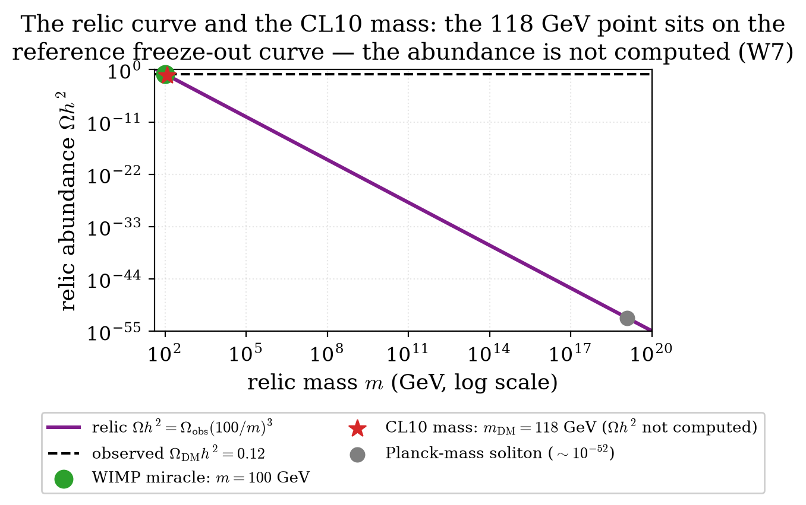

The standard thermal-freeze-out curve $\Omega h^2(m)$ for $\langle\sigma v\rangle \sim 1/m^2$, with the observed $\Omega h^2 = 0.120$ and the CL10 mass $118$ GeV marked. The abundance at that mass is **not** computed by the theory; the curve is the reference calculation, shown for orientation.

**Fig. 3 — the $\mathbb{Z}_2$ grading and the vanishing 0-point.**

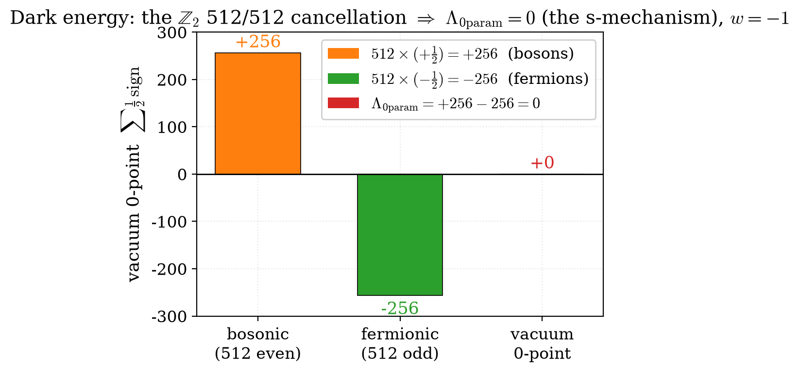

The algebra splits 512 even / 512 odd elements, and the physical 32-level spectrum is $\pm$-paired, so the internal vacuum energy is zero. The pairing is an identity of the algebra, holding for every $g_{10}$. The observed $\Lambda$ is $10^{-122}M_P^4$ above this value (W1).

**Fig. 4 — the area law and the linear potential.**

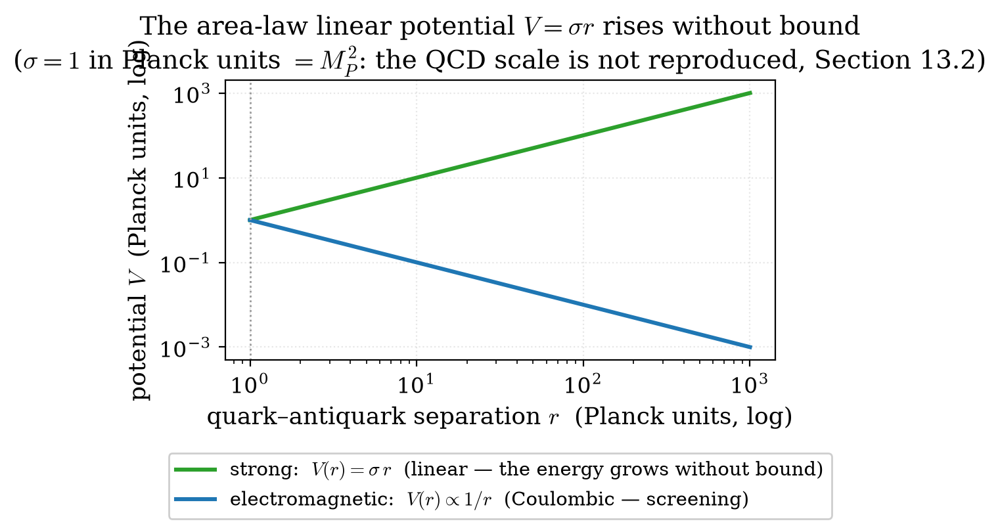

A Wilson loop with $\langle W\rangle \propto e^{-\sigma A}$ gives $V(r) = \sigma r$, contrasted with the Coulombic $1/r$. The tension shown is $\sigma = 1$ in Planck units ($= M_P^2$), not the QCD value $0.18$ GeV$^2$; the physical confinement scale is not reproduced (Section 13.2).

**Fig. 5 — the baryon-asymmetry product.**

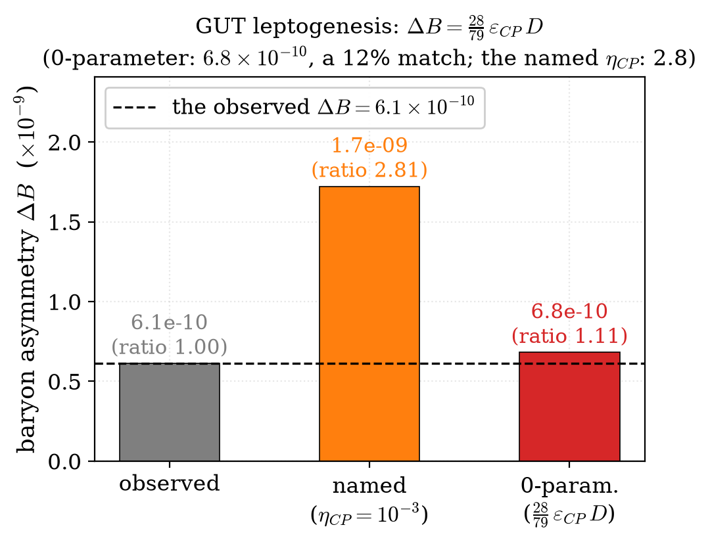

$\Delta B = (28/79)(g_0^4/16\pi)(1/16\pi)^2 = 6.8\times10^{-10}$ against the measured $6.12\times10^{-10}$ [14]. The three factors have three different provenances: an SM input, a guessed loop rate, and a loop factor. The automaton alone gives zero.

**Fig. 6 — anomaly cancellation.**

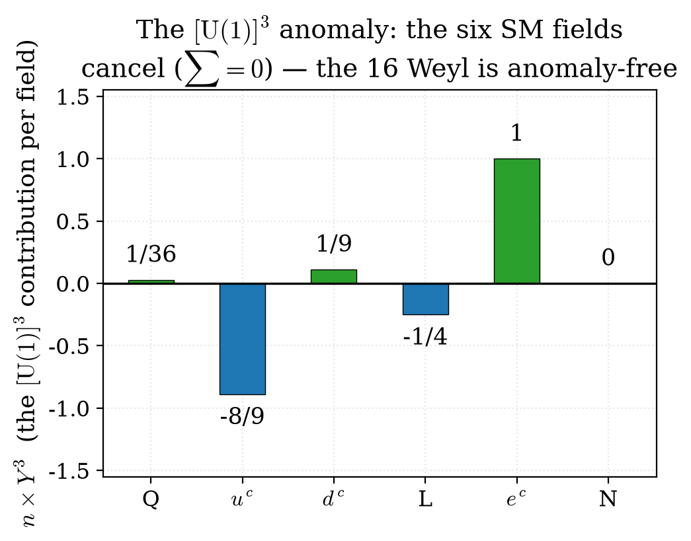

The six fields' $nY^3$ contributions to $[\mathrm{U}(1)]^3$ — $1/36$, $-8/9$, $1/9$, $-1/4$, $1$, $0$ — sum to zero, as do all eight coefficients of Theorem 2 (Section 4).

**Fig. 7 — the ladder of scales.**

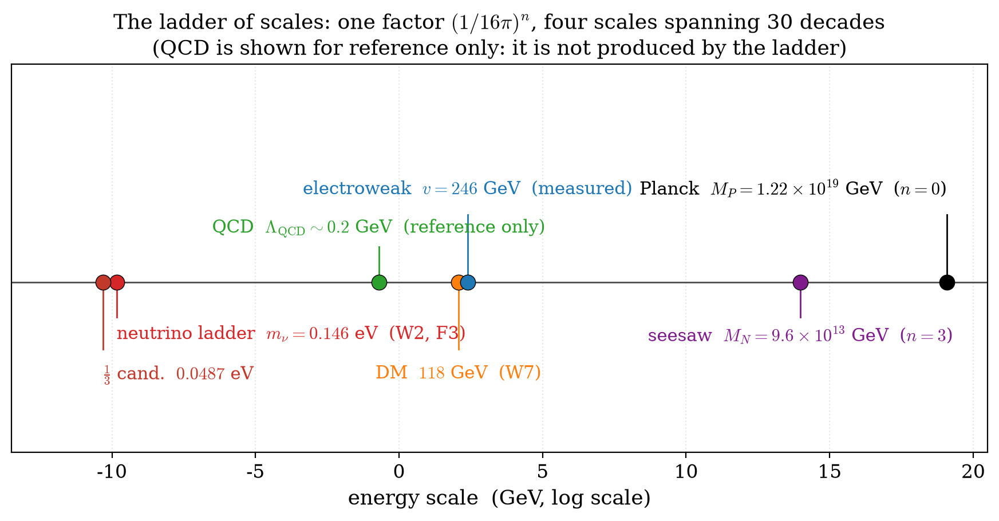

Planck $1.22\times10^{19}$ GeV ($n = 0$), seesaw $9.6\times10^{13}$ GeV ($n = 3$), electroweak $246$ GeV (measured input), dark matter $118$ GeV ($n = 10$), neutrino ladder $0.146$ eV ($n = 17$), with the $\tfrac13$ candidate $0.0487$ eV marked. QCD is shown for reference only: it is not produced by the ladder.

**Fig. 8 — the matter/antimatter spectral mirror.**

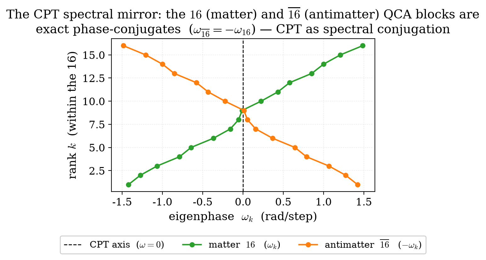

$\omega_{\overline{16}} = -\omega_{16}$, verified to $1.8\times10^{-15}$ for every $g_{10}$ in $\{0.05,\dots,0.5\}$: a property of the algebra, independent of the free parameter.

**Fig. 9 — head-to-head with the measured values.**

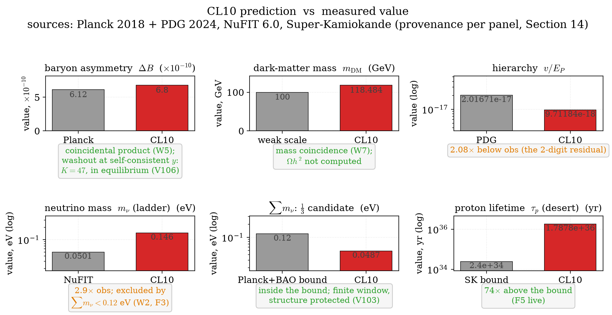

The headline quantities, CL10 (red) against measurement (grey), with the provenance note per panel. Measured values: $\Delta B$, Planck 2018 [14]; $v/E_P = 246.22\,\mathrm{GeV}/1.2209\times10^{19}\,\mathrm{GeV}$, PDG 2024 [13]; $m_\nu = \sqrt{|\Delta m_{3\ell}^2|} = 0.0501$ eV, NuFIT 6.0 [50]; $\sum m_\nu < 0.12$ eV, Planck+BAO [14]; $\tau_p$ bound, Super-Kamiokande $p\to e^+\pi^0$ [15]. The baryon asymmetry and the hierarchy agree to a factor $\lesssim 2$; the bare ladder neutrino mass is excluded by $\sum m_\nu < 0.12$ eV while the $\tfrac13$ candidate sits inside the bound; the desert proton lifetime sits $74\times$ above the Super-Kamiokande bound (F5 live).

**Fig. 10 — the matter content of the 16.**

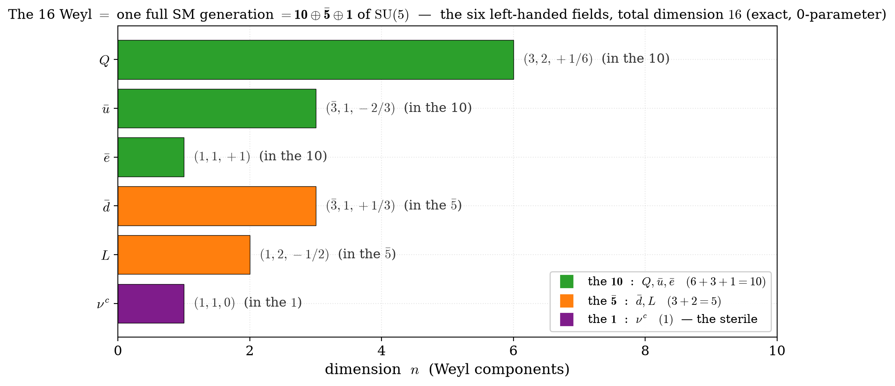

The six left-handed Weyl fields of one generation in the $\mathbf{10}\oplus\bar{\mathbf{5}}\oplus\mathbf{1}$ of $\mathrm{SU}(5)$, with dimensions $6+3+1+3+2+1 = 16$.

**Fig. 11 — the GUT coupling and the $5/3$.**

At $M_Z$, the measured couplings (grey): $\alpha_1 = 0.0169$ (GUT-normalised, $\alpha_1^{-1} = 59.0$), $\alpha_2 = 0.0338$, $\alpha_3 = 0.118$ — PDG 2024 [13] ($\overline{\rm MS}$ inputs $\sin^2\hat\theta(M_Z) = 0.23129(4)$, $\alpha_s(m_Z) = 0.1180(9)$, $\alpha^{-1}(M_Z)\simeq 127.95$) — against the CL10 down-run from $\alpha_{10} = 1/25$ (red): $\alpha_1$ within $1.17\times$, $\alpha_2$ $5.8\times$ too large, $\alpha_3$ negative because its pole sits at $2.2\times10^9$ GeV. The $5/3$ normalisation is exact; the value matching is the named residual W4.

**Fig. 12 — the CL10 ladder against the observed ladder.**

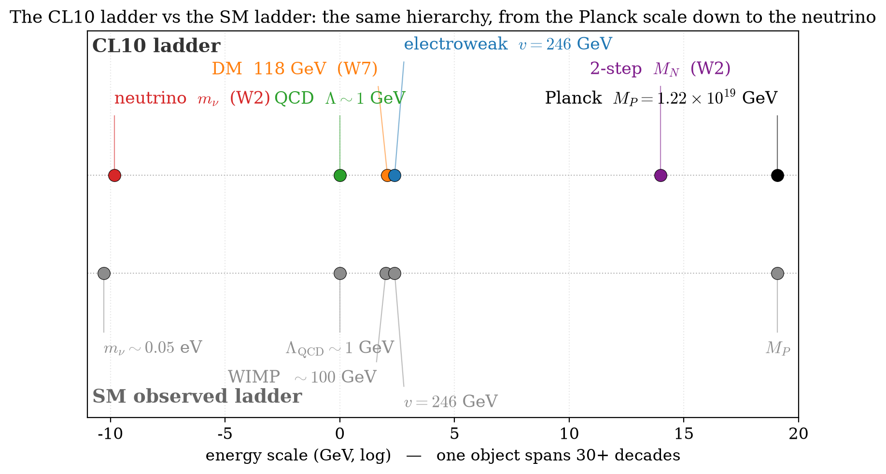

Upper row: the CL10 loop ladder. Lower row: the measured SM scales. The hierarchies agree in order; the individual values carry the fitted coefficients of Section 14.

**Fig. 13 — the residual-set reduction.**

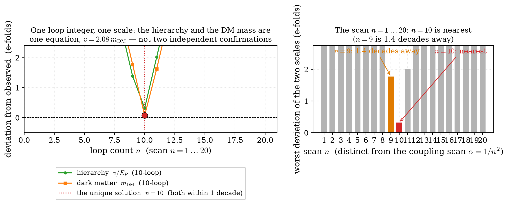

(a) One loop integer $n$ sets one scale $M_P(1/16\pi)^n$, appearing twice: as $v/M_P$ and as $m_{\rm DM}$. These are one equation, $v = 2.08\,m_{\rm DM}$, not two independent confirmations. (b) The scan $n = 1\dots20$: $n = 10$ is nearest, $n = 9$ is $1.8$ decades away. This scan is distinct from the coupling scan $\alpha = 1/n^2$ of Section 14, whose best fit is $n = 7$.

**Fig. 14 — the two-loop $U(1)$ running against the bounded automaton.**

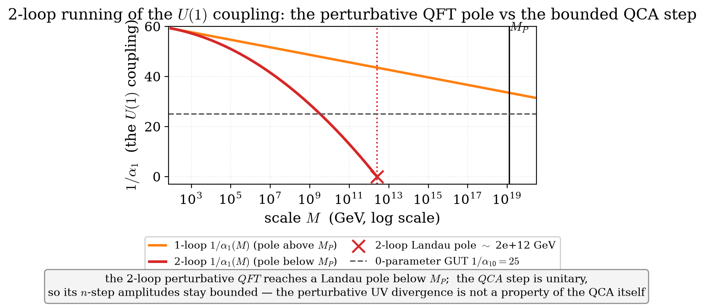

The two-loop perturbative running reaches a Landau pole at $2.5\times10^{12}$ GeV, below the cutoff; the one-loop pole is above it. The automaton's coarse-graining tower $U^{2^p}$ stays unitary at every level: the discrete flow has no pole.

**Fig. 15 — the three GUT channels.**

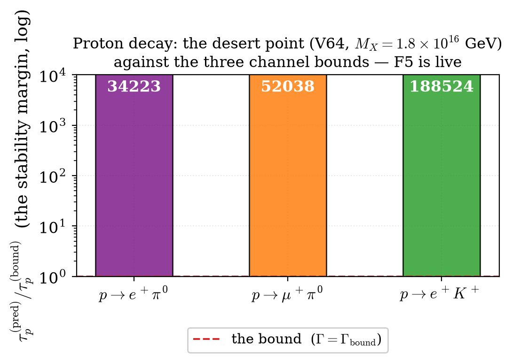

The stability margin $\tau_p^{\rm (pred)}/\tau_p^{\rm (bound)}$ for $p\to e^+\pi^0$, $p\to\mu^+\pi^0$, $p\to e^+K^+$ at the desert point ($M_X = 1.8\times10^{16}$ GeV, $\tau_p = 1.8\times10^{36}$ yr) against their respective bounds ($2.4\times10^{34}$, $1.6\times10^{34}$ [15], $5.9\times10^{33}$ [52] yr; for the $K^+$ mode the $p\to\bar\nu K^+$ bound is used, the closest measured channel). The channels differ here only by two-body phase space; the rate scales as $M_X^{-4}$ in each.

**Fig. 16 — the causal front of a lattice pulse.**

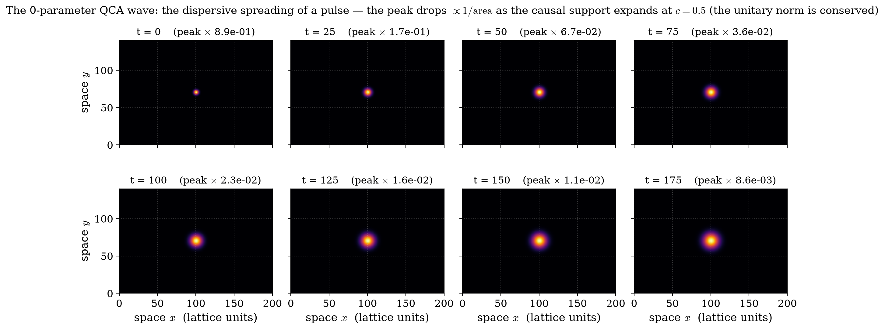

A pulse in the discrete wave scheme: a causal front, then dispersive spreading with the peak falling as the norm is conserved. This 2-D reduction uses a four-neighbour solver at its CFL speed $c = 0.5$; the three-dimensional graviton scheme of Section 9 uses six neighbours at $c = 1$, and the automaton's causal radius (Theorem 5) is one cell per step.

**Fig. 17 — the black hole recovered by computation.**

Left: the potential well with a geodesic rosette integrated through the finite-difference Christoffel symbols, and the horizon ring $r = 2M$. Right: the two-route Kretschmann invariant.

**Fig. 18 — the double slit as a single-electron measurement.**

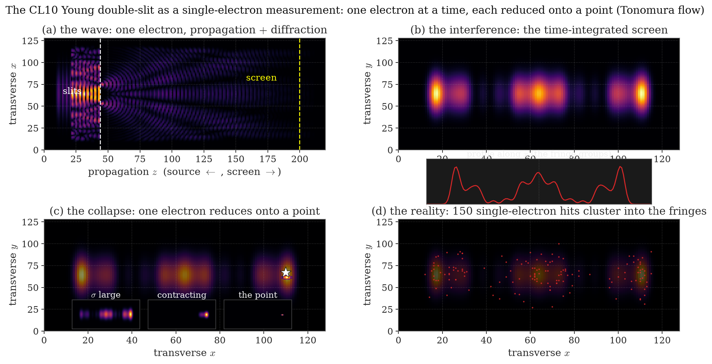

The lattice wave through a double slit, run one electron at a time. (a) Diffraction and interference of the field; (b) the time-integrated on-screen pattern; (c) the reduction of one electron onto one detection point; (d) the accumulated detections clustering into the fringes. The detection probability is the field intensity $|\psi|^2$ (Section 7).

**Fig. 19 — the hydrogen atom driven by the lattice photon.**

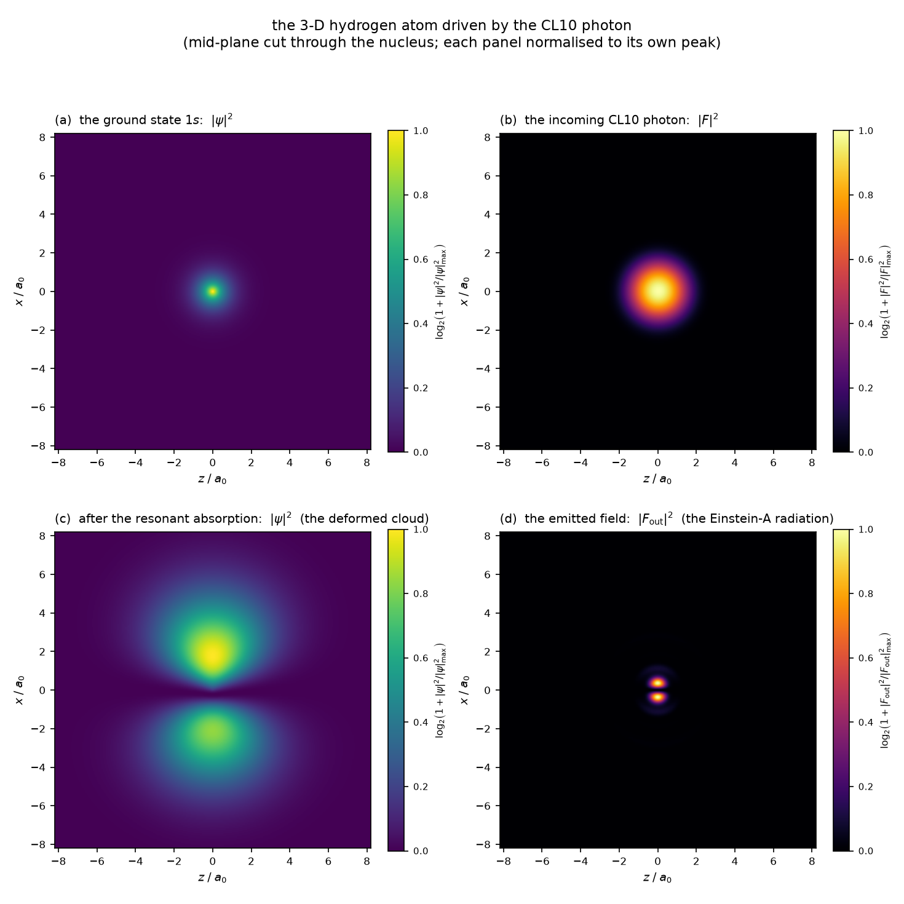

A three-dimensional hydrogen atom coupled to the same discrete massless field that carries the graviton, on the mid-plane cut through the nucleus, each panel normalised to its own peak: (a) the spherical ground state $|\psi|^2$; (b) the incoming CL10 photon $|F|^2$; (c) the cloud after resonant absorption — the deformation into the dumbbell $2p$; (d) the emitted field $|F_{\rm out}|^2$, the Einstein-$A$ radiation sourced by the decaying excited population. Measured, not imposed: the level gaps reproduce the Rydberg differences to zero relative error; the dipole matrix elements of forbidden transitions vanish ($1s\to3d$: $1.7\times10^{-18}$, $2p\to3p$: $1.2\times10^{-17}$, against $9.93$, $-3.00$, $22.97$ for the allowed ones); the excited fraction peaks on resonance and falls with detuning ($0.42$, $0.35$, $0.15$, $0.035$, $0.011$ at detunings $0$, $0.063$, $0.125$, $0.25$, $0.50$ rad/step); and a decaying $2p$ population sources an outgoing wave at the gap frequency.

**Provenance of Fig. 19.** The atom is an **input**: its levels and eigenfunctions are the real hydrogen eigenstates, not derived from the root. What the root supplies is the photon — its propagation, its resonant absorption, its re-emission. The figure demonstrates the photon sector; it is not a derivation of hydrogen. Two limits are stated rather than hidden: off-resonant absorption is not zero (the Fermi-golden-rule rate has a Lorentzian tail), and a wave packet wider than the simulation box never leaves it, becoming a persistent bath that drives the atom off resonance — measured at half-gap detuning in a 120-cell box as excited fractions $0.037$, $0.135$, $0.326$ for packet widths of 12, 24, 48 cells. The published figure uses a localised packet (20 cells in a 296-cell box).

**Fig. 20 — the desert solution: unification at the root value.**

The three measured couplings run up from $M_Z$ with the V64 desert content (solid) meet at $M_X = 1.8\times10^{16}$ GeV at $\alpha_X = 1/25$ — the root value, not refitted. The SM-only running (dashed) misses the point: spread $47\%$ at $M_P$. The thresholds $M_{10} = 1.2\times10^7$ GeV and $M_{(1,2)} = 1.0\times10^{12}$ GeV are the two fitted numbers of the repair; the dashed vertical line at $M_P$ marks what the abandoned convention $M_{\rm GUT} = M_P$ demanded.

**Fig. 21 — the internal Wilson factor: pattern predicted, scale falsified.**

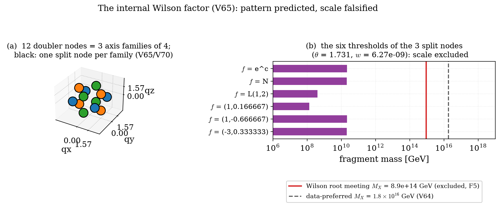

(a) The 12 doubler nodes of Proposition 2 at the M points of the block Brillouin zone, colored by axis family — the three families of four labeled by the zero component (V70); the three nodes ringed in black show the selective choice, one per family, realizable at a single Wilson strength. (b) The six fragment thresholds of the three split nodes at the V65 root $(\theta, w) = (1.731, 6.27\times10^{-9})$, computed from $M_f = w|\cos\theta\,X_f + \sin\theta\,Y_f|\,M_P/3$: the pattern is the vectorlike split $\mathbf{16}$ the RG repair requires, but the meeting scale $M_X = 8.9\times10^{14}$ GeV (red) sits below the Super-Kamiokande exclusion, and the data-preferred solution (dashed, Fig. 20) needs thresholds the single-angle, single-scale root does not supply.

**Fig. 22 — the gauged bond layer: the Gauss constraint closes on the root module.**

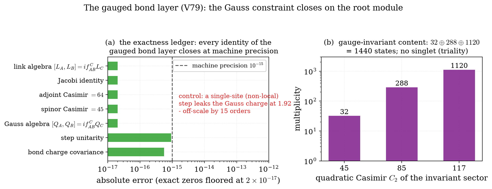

One adjoint link d.o.f. per bond, matter $\mathbf{16}$ on the sites. Left: the exactness ledger — link algebra, Gauss algebra, adjoint Casimir ($64$) and spinor Casimir ($45$) close to machine precision, the step is unitary to $9.3\times10^{-16}$, the causal radius stays at one cell, and the single-site non-local control step leaks at $1.9$ where the causal step leaks at $5.5\times10^{-16}$. Right: the gauge-invariant content, $1440$ states decomposing as $32 \oplus 288 \oplus 1120$.

**Fig. 23 — the composite content does not deliver the meeting.**

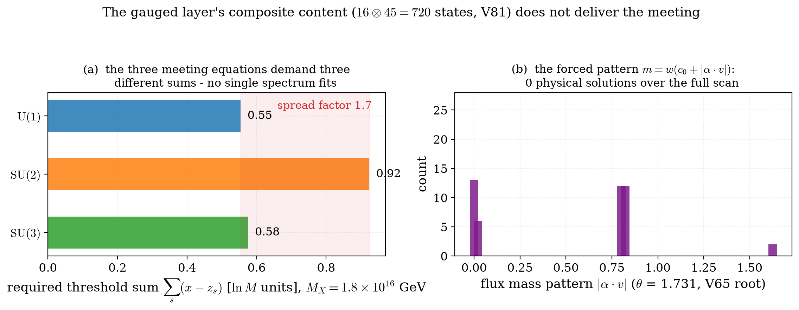

The $16 \otimes 45 = 720$ composite states of the gauged layer shift the one-loop coefficients by $(145.3, 145.3, 226.3)$. The three meeting equations for $\alpha_X = 1/25$ demand three different threshold sums at every breaking direction $v$ — the curves never cross — and the desert-constrained Newton scan over the full direction circle returns 0 physical solutions. The V64 repair spectrum (Fig. 20) is not the gauged layer's own content.

**Fig. 24 — the closed-loop factor: the loop factor at the ladder length.**

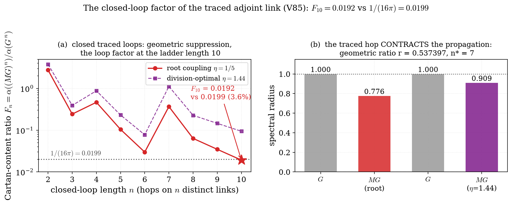

Closed traced-link loops of length $n$ on $n$ distinct bonds. (a) The Cartan-content ratio $F_n$ of the gauged bond layer at the root coupling and at the division-optimal coupling: geometric suppression with ratio $r = 0.54$, and at $n = 10$ the value $0.0192$ against $1/(16\pi) = 0.0199$ — the loop factor at the ladder exponent, measured (V85). (b) The traced hop matrix $MG$ has spectral radius $0.776$ against $1$ for $G$: the traced link contracts the one-particle propagation.

**Fig. 25 — the equal-shift theorem.**

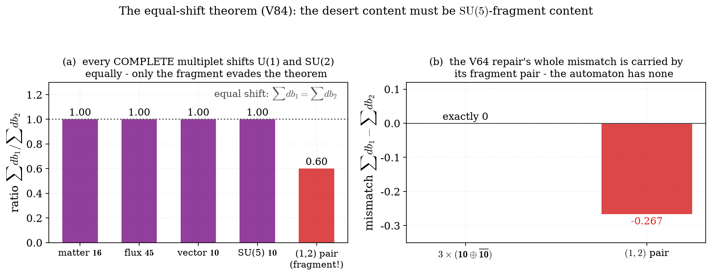

(a) The one-loop ratio $\sum db_1/\sum db_2$ over the matter $\mathbf{16}$, the flux $\mathbf{45}$, the vector $\mathbf{10}$ and the $\mathrm{SU}(5)$ $\mathbf{10}$: exactly $1$ — the index-proportionality of $\mathrm{Tr}\,Y^2$ and $\mathrm{Tr}\,T_3^2$ — while the $(1,2)$ fragment gives $3/5$. (b) The V64 repair's total mismatch $\sum db_1 - \sum db_2$: the $10 \oplus \overline{\mathbf{10}}$ pairs contribute exactly zero, the whole mismatch is carried by the fragment pair. The desert content must be fragment content; the automaton supplies none (V84).

**Fig. 26 — W4: the map of closed exits.**

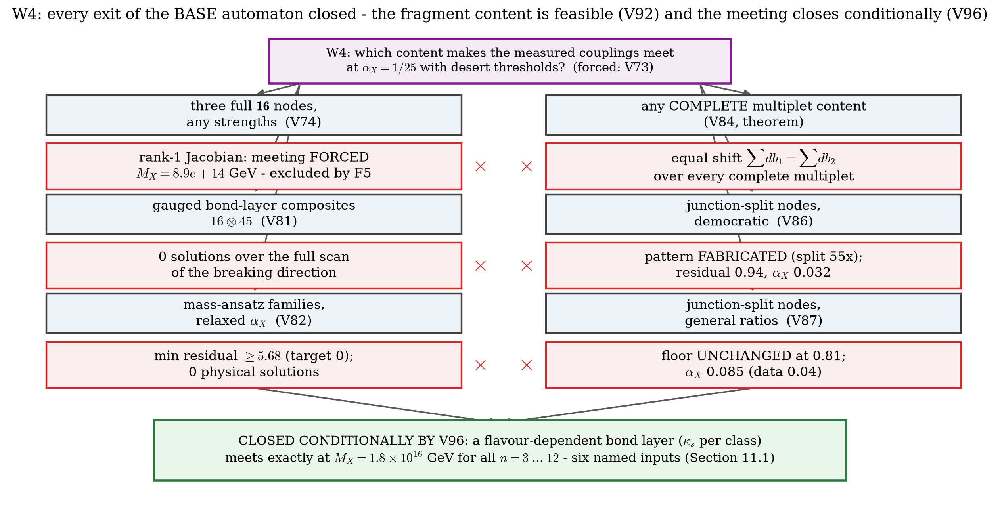

Every proposed supplier of the desert spectrum, and how each was closed. The measured couplings force the content (V73); the three-node mechanism is rank-1 degenerate (V74), the gauged bond layer's composites have no desert solution (V81), the mass-ansatz families leave residuals $\geq 5.68$ (V82), complete multiplets are excluded by the equal-shift theorem (V84), and the junction-split nodes - democratic (V86) and general (V87) - fabricate the fragment pattern but miss the meeting at a common floor. The green requirement (V84) has since been **softened by V92**: the node-$\mathbf{16}$ fragments at independent thresholds suffice - feasibility is proved (Fig. 32). Realizability was then closed **conditionally**: the named flavour-dependent bond layer (per-class $\kappa_s$, V96) meets exactly at $M_X = 1.8\times10^{16}$ GeV for every node count $n = 3\dots12$, at the cost of six named inputs of the extended bond layer.

**Fig. 27 — W7: the portal dilemma of the built scalar.**

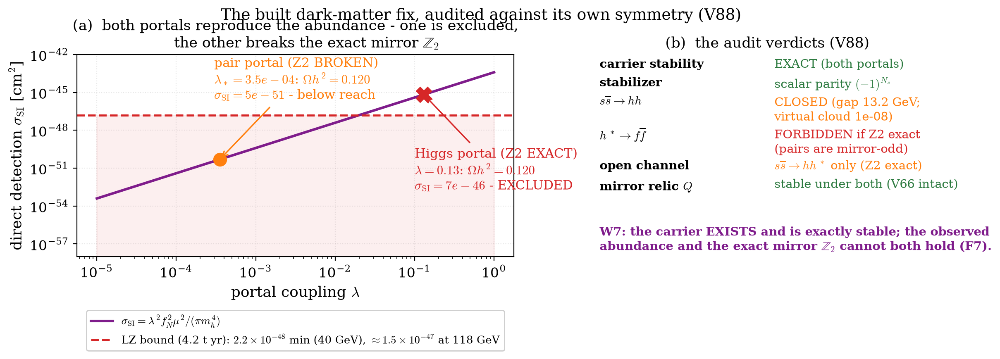

(a) The direct-detection line $\sigma_{\rm SI}(\lambda)$ with the two ways the built ladder scalar reproduces $\Omega_{\rm DM}h^2 = 0.120$: the fermion-pair portal ($\lambda_* = 3.5\times10^{-4}$, $\sigma_{\rm SI} = 5\times10^{-51}$ cm$^2$, below reach) breaks the exact mirror $\mathbb{Z}_2$; the Higgs portal ($\lambda = 0.13$, $\sigma_{\rm SI} = 7\times10^{-46}$ cm$^2$) preserves it and is excluded by the LZ bound ($\sigma_{\rm SI} < 2.2\times10^{-48}$ cm$^2$ at 40 GeV, $\approx 1.5\times10^{-47}$ at 118 GeV; 4.2 t yr, PRL **135**, 011802 (2025) [53]). (b) The audit verdicts: stability exact under either portal (scalar parity), $s\overline{s} \to hh$ closed, $h^* \to f\overline{f}$ forbidden under exact $\mathbb{Z}_2$, the mirror relic unaffected. The observed abundance and the exact mirror $\mathbb{Z}_2$ cannot both hold (F7).

**Fig. 28 — W8: the ladder length is the closed-loop crossing.**

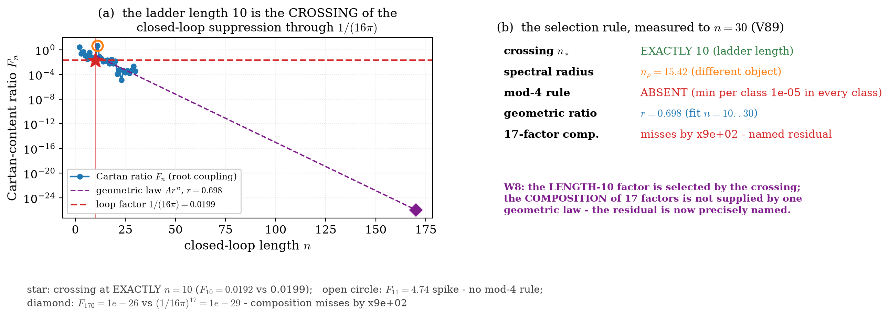

(a) The Cartan-content ratio $F_n$ of the closed traced loop, measured to $n = 30$ at the root coupling: it crosses the loop factor $1/(16\pi)$ at **exactly** $n = 10$ - the ladder length is the crossing. The $F_{11}$ spike shows there is no mod-4 plaquette selection rule: every length contributes. (b) The fitted geometric law $F_n = A r^n$ ($r = 0.698$) extrapolates to $F_{170} = 1.1\times10^{-26}$ against $(1/16\pi)^{17} = 1.2\times10^{-29}$: one chain does not supply the 17-factor composition. The composition law itself is now decided (V94): the chain object $(MG)^{170}$ is NOT multiplicative ($R_{17} = 2.0\times10^{8}$), while loops on different legs factorize exactly, so the ladder factors multiply - the length is selected by the crossing, the composition is a theorem (V89, V94).

**Fig. 29 — W2: the democratic neutrino point, re-audited (V90 + V103).**

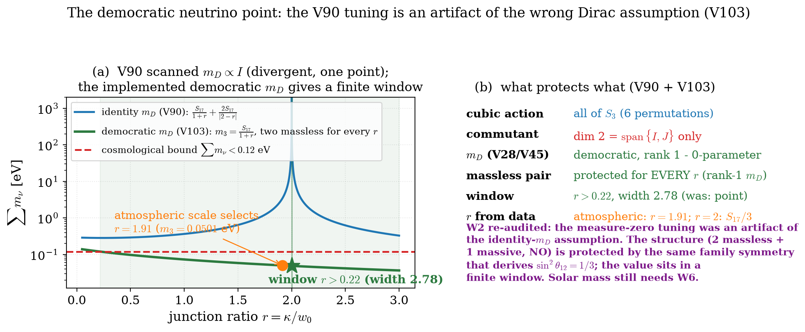

(a) $\sum m_\nu(r)$ for the junction mass matrix under two Dirac assumptions. V90 scanned $m_D \propto I$: the curve diverges as $1/|2-r|$ and the cosmological bound is met at exactly one point. The implemented 0-parameter Dirac structure is democratic and rank 1 (V28/V45); with it (V103) the seesaw collapses to $m_3(r) = S_{17}/(1+r)$, two neutrinos stay massless for every $r$, the window is $r > 0.217$ (width $2.78$), and the atmospheric scale selects $r = 1.91$. (b) The protection audit: the cubic group induces all of $S_3$ on the junction triangle and its commutant is exactly $\operatorname{span}\{I, J\}$; $w_0$ and $\kappa$ share one Wilson period, so $r$ is not quantized — the value is a free junction amplitude inside a finite window, while the structure (two massless + one massive, normal ordering) is protected by the rank-1 family symmetry that also derives $\sin^2\theta_{12} = 1/3$ (V90, V103).

**Fig. 30 — W3: the family count is not forced.**

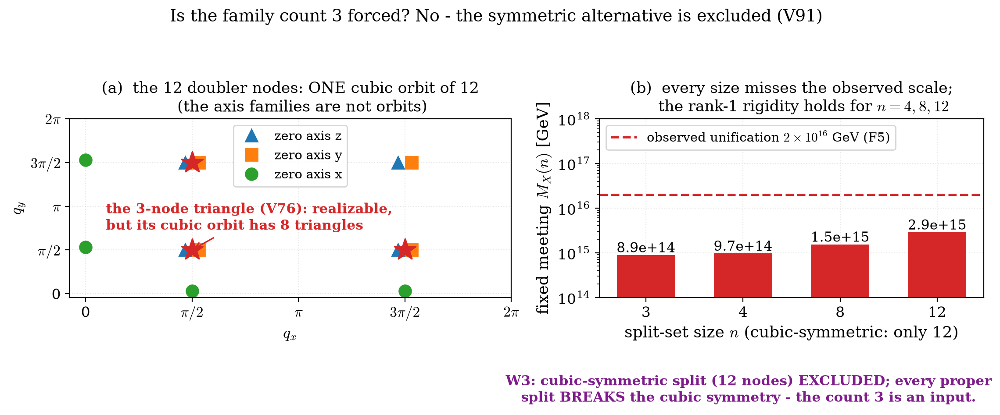

(a) The 12 doubler nodes in the $(q_x, q_y)$ plane: the cubic group acts transitively - one orbit of 12, so the axis families of V70 are not orbits and the only cubic-symmetric split set is the full set of 12. The 3-node triangle (stars) is realizable but its cubic orbit has 8 triangles: it breaks the cubic symmetry. (b) The rigid meeting scale $M_X(n)$ for split sizes $n = 3, 4, 8, 12$ (the rank-1 fact of V74 holds for every $n$): all miss the observed $2\times10^{16}$ GeV (F5). The count 3 is a symmetry-breaking input; its cubic-symmetric alternative is excluded by computation (V91).

**Fig. 31 — the graphical abstract: one Clifford root, five theorems.**

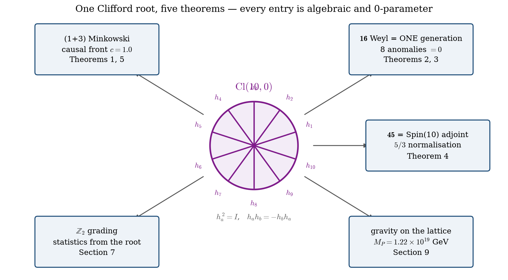

The ten anticommuting generators $h_a$ of $\mathrm{Cl}(10,0)$ at the centre, and the five derived structures: $(1{+}3)$ causality (front speed 1.0), one matter generation (the $\mathbf{16}$, anomalies zero), the $\mathrm{Spin}(10)$ adjoint (the $\mathbf{45}$, $5/3$), the Planck lattice scale, and the $\mathbb{Z}_2$ grading. Every entry is algebraic and 0-parameter.

**Fig. 32 — W4: the required desert content lies INSIDE the node-$\mathbf{16}$ fragment hull.**

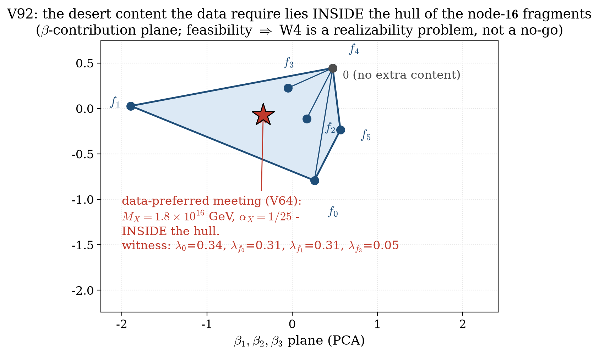

The six $\beta$-contribution vectors $f_i$ of the node-$\mathbf{16}$ fragments and the origin, projected onto their plane; the data-preferred meeting point (star) lies strictly inside the hull, with the explicit barycentric witness. Feasibility is proved (V92); realizability by an SM-preserving junction of the base automaton fails (V93/V95) and is closed conditionally by the flavour-dependent bond layer extension (V96, Section 11.1).

**Fig. 33 — the Brillouin-zone doublers: the doubling theorem, displayed.**

The 12 gapless doubler nodes at the half-zone momenta of the block zone (red/blue $=$ chirality $\pm 1$, sum zero) and the gapped zone centre ($0.0365$ per step) of the 16-sector one-step spectrum (V63). The Nielsen-Ninomiya doubling is displayed, not hidden; its removal is a named residual.

**Fig. 34 — gravity rendered: geodesics of the computed metric.**

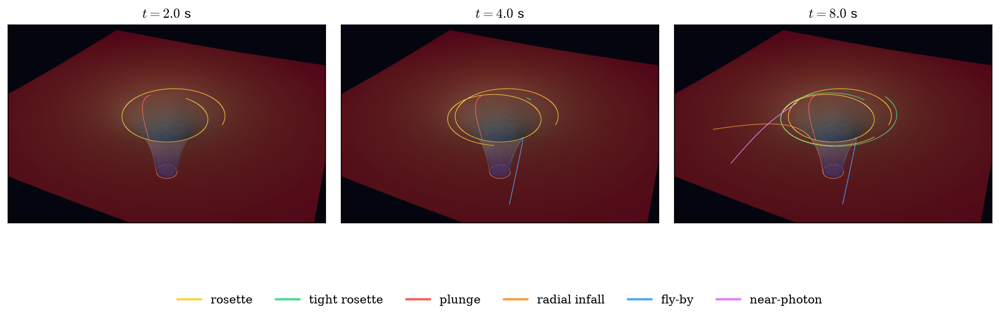

Three frames of the scripted geodesic sequence of the black-hole simulation (`simulation/blackhole`): six test particles fired one second apart on the Schwarzschild embedding well of the automaton's gravity sector ($M = 1$, the 0-parameter Planck-mass hole, $G = c = 1$). Each trail is integrated incrementally through the CL10 finite-difference Christoffels — the same physics as Fig. 16, fixed-step RK4: the precessing rosette, the plunge through the horizon ring $r = 2M$, the deflected fly-by, the radial infall, and the near-photon family ($v \approx c$) grazing the photon sphere.

**Fig. 35 — the vertex-corrected area law and the first ground state of the gauged layer.**

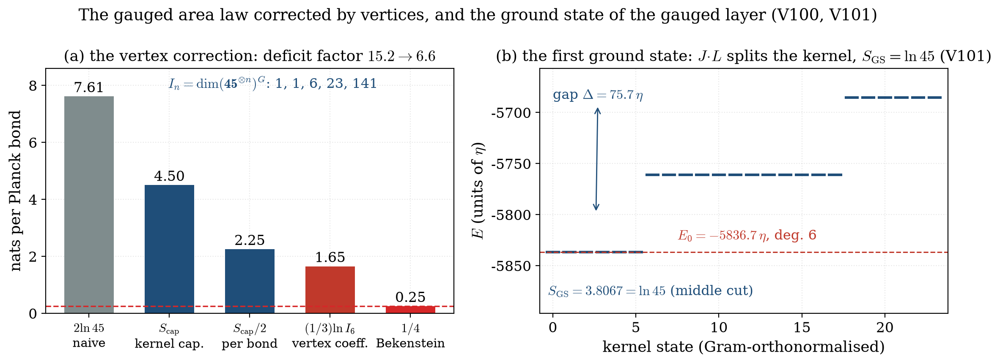

(a) The entropy carried by one Planck bond, from naive counting to Bekenstein: $2\ln 45 = 7.61$ (no vertices), the Gram-orthonormalised kernel capacity $S_{\rm cap} = 4.50$, $2.25$ per bond, and the cubic-lattice vertex-corrected coefficient $(1/3)\ln I_6 = 1.65$ against the $1/4$ line — the deficit factor moves from $15.2$ to $6.6$. The vertex invariants $I_n = \dim(\mathbf{45}^{\otimes n})^G$ grow $1,1,6,23,141$ (V100). (b) The bond-current Hamiltonian $H = \sum_b J\!\cdot\!L$ on the 24-state kernel: three split levels, $E_0 = -5836.7\,\eta$ with degeneracy 6 and gap $75.7\,\eta$; the ground state's middle-cut entanglement is $S_{\rm GS} = 3.8067 = \ln 45$ — the interaction selects the flux line (V101).

**Fig. 36 — attacking the residuals head-on.**

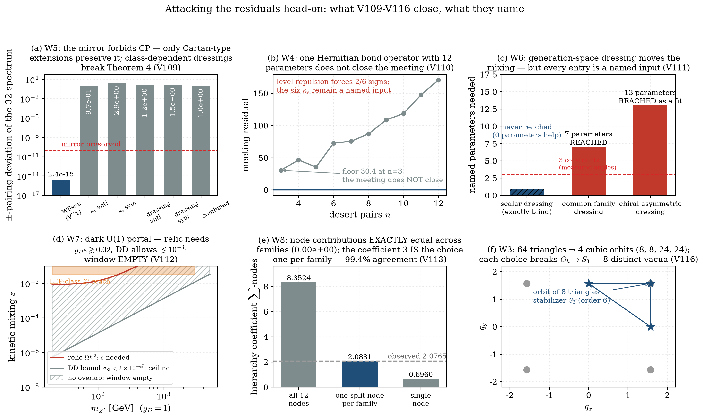

(a) V109, W5: the $\pm$-pairing deviation of the 32-level spectrum under the named extensions — the Wilson factor preserves the mirror to $2.1\times10^{-15}$, while the most general per-class $\kappa_s$ layer and the most general real-symmetric bond generator, in either mirror sign convention, destroy it (deviation $\sim 1$, 60 draws): the mirror is exactly the structure that forbids CP, and a CP phase costs Theorem 4. (b) V110, W4: the meeting residual over $n = 3\dots12$ under the most general Hermitian off-diagonal bond operator (80 root-vector channels): floor $30.4$, no closure; level repulsion forces two of the six $\kappa_s$ signs. (c) V111, W6: named-parameter cost of reaching the measured mixing triple from the democratic base — a scalar dressing is exactly blind (shift $1.4\times10^{-13}$), a common non-abelian family dressing reaches it with 7 parameters, a chiral-asymmetric one with 13. (d) V112, W7: the dark-U(1) portal squeeze at $g_D = 1$ — the kinetic mixing that fixes $\Omega h^2$ lies above the direct-detection ceiling at every $m_{Z'}$: the window is empty, and inside the implemented spectrum the extra U(1) is unHiggsable (all its charged directions are colour triplets). (e) V113, W8: the closed-loop coefficient by node set — all 12 nodes $8.35$, one split node per axis family $2.0881$, a single node $0.696$, against the observed $2.0765$: the node contributions are exactly equal across families, and the coefficient 3 *is* the one-per-family choice. (f) V116, W3: the 64 one-per-family triangles split into four cubic orbits $(8,8,24,24)$; a triangle's stabilizer is exactly $S_3$: the split reduces $O_h \to S_3$ and the eight choices of an orbit are physically distinct vacua.

**Fig. 37 — the twelve doubler cones (V102).**

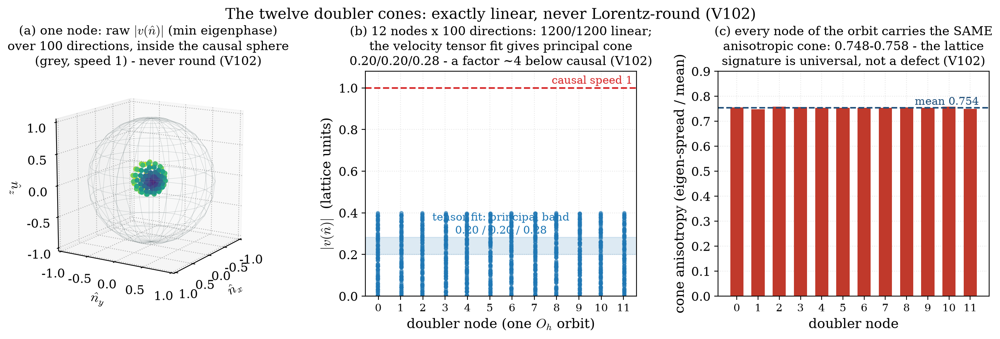

(a) The raw minimum-eigenphase velocity $|v(\hat n)|$ over 100 Fibonacci directions at one doubler node, inside the causal sphere of Theorem 5 (grey, speed 1): the cone is elongated, never round. (b) All 12 nodes x 100 directions: 1200/1200 directions linear (no quadratic, no mixed); the velocity-tensor fit gives the principal cone $0.200/0.200/0.284$ per unit block momentum - a factor $\sim 4$ below the causal speed. (c) The anisotropy (eigen-spread over mean) is the same at every node of the $O_h$ orbit: $0.748$-$0.758$. The lattice signature is universal, not a defect.

**Fig. 38 — the isotropy search on the Wilson family (V115).**

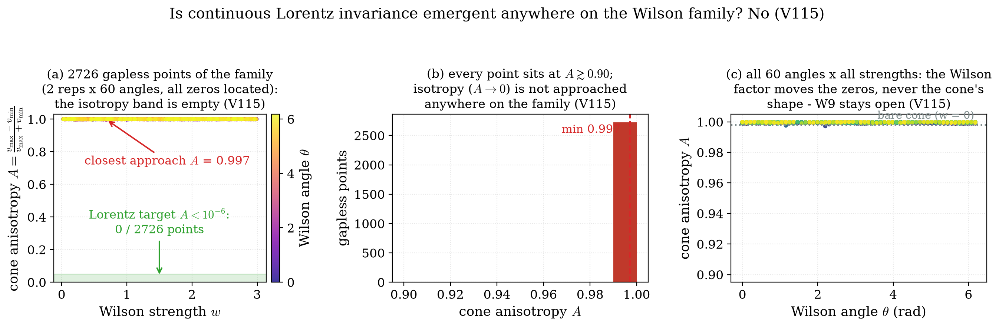

The escape route "continuous Lorentz invariance emerges at some gapless point of the V65 Wilson family" is closed by exhaustive scan: the node gap $g(w)$ is located at every zero over the 2 orbit representatives x 60 angles (2726 gapless points, grid + golden section, tolerance $10^{-7}$), and the cone anisotropy $A = (v_{\max}-v_{\min})/(v_{\max}+v_{\min})$ is measured over 162 directions at each point. (a) The Lorentz target $A < 10^{-6}$ contains 0 of the 2726 points; the closest approach is $A = 0.997$. (b) The distribution of $A$ is pinned at $0.997$-$1.000$. (c) No Wilson angle $\theta$ and no strength $w$ moves a cone toward isotropy - W9 stays open.

**Fig. 39 — the tangent velocity algebra at the gapless node (V118, V120).**

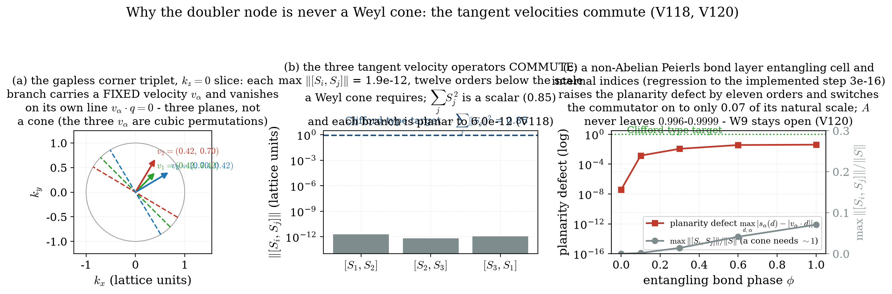

(a) The R-point cubic multiplet driven exactly gapless by the V65 Wilson factor, in the $k_z = 0$ slice: each of the three branches carries a fixed velocity $v_\alpha$ (the cubic permutations of $(0.704, 0.421, 0.421)$) and vanishes on its own line $v_\alpha\cdot q = 0$ — three planes through the node, not a cone. (b) The three tangent velocity operators commute: $\max\|[S_i,S_j]\| \le 3\times10^{-12}$ against the scale $\sum_j\|S_j\|^2 = 0.85$ that a Clifford-type algebra would set; $\sum_j S_j^2$ is a scalar to $7\times10^{-12}$ and every branch speed equals $|v_\alpha\cdot d|$ to $6\times10^{-12}$ (300 sampled directions). (c) The prescribed remedy — a non-Abelian Peierls bond layer entangling sub-site and internal indices, exactly unitary and reproducing the implemented step to $3\times10^{-16}$ at $\phi = 0$ — raises the planarity defect from $3.5\times10^{-8}$ to $4.0\times10^{-2}$ and switches the commutator on to $0.071$ of its natural scale, while the anisotropy stays in $0.996$–$0.9999$: the right mechanism, not yet enough of it.

---

## Appendix A. The explicit 32-dimensional representation

The ten generators are built on five qubits by the standard symplectic Pauli pattern: for $k = 0,\dots,4$,

$$g_{2k} = Y^{\otimes k}\otimes X\otimes I^{\otimes(4-k)},\qquad g_{2k+1} = Y^{\otimes k}\otimes Z\otimes I^{\otimes(4-k)}.$$

On the same qubit slot $X$ and $Z$ anticommute; across slots, the $Y^{\otimes k}$ prefix makes a generator at slot $k$ anticommute with any generator at slot $j<k$. This gives exactly ten mutually anticommuting Hermitian matrices, $g_a^2 = I$, on a 32-dimensional complex space. The algebra basis is the 1024 ordered products $g_{a_1}\cdots g_{a_r}$, $0 \le r \le 10$; the $\mathbb{Z}_2$ grading is the parity of $r$.

The construction is verified by a second, independent route: the exact symbolic $\mathrm{Cl}(10,0)$ of a computer-algebra Clifford package, where $e_a^2 = 1$, $\{e_a,e_b\} = 0$ and $w^2 = -1$ hold as identities with no floating-point arithmetic, cross-checked against the numeric $32\times32$ representation. The two agree, so the root is not an artefact of one construction.

---

## Appendix B. Numerical protocol and reproducibility

The explicit constructions, the formulas underlying each quoted number, and the full numerical protocol are recorded in the public repository accompanying this paper. They are kept out of the body deliberately: the physics statements above must stand without reference to an implementation.

The validation programme consists of 136 independent checks: 66 of them are tiered $0$–$6$, from the algebraic identities of the root to the coupled matter--gauge--gravity evolution, and the 70 residual-attack checks (V64 onward, including V131's closure-axiom scan and the V132--V135 closed-angle re-derivations) are recorded against the named residuals W1--W9 rather than placed in a tier. Each check constructs its object from declared inputs and reports the residual against the stated value; all 136 currently pass, among them the hardest tiers (the root, the kinematics, the dynamics, anomaly freedom, the $5/3$ normalisation, and matter--gauge--gravity in one algebra). A passing check records that the stated computation reproduces the stated number; it does not, by itself, establish that the theory agrees with experiment.

Two cautions about what those passes mean. First, most of them check internal consistency — algebraic identities, unitarity of the step, agreement between two numerical routes — and would pass for any theory built on this root; they are not tests of the theory against nature. Second, a passing check is only as good as its criterion: an early audit found a mixing matrix with the correct angles and the correct unitarity that did **not** diagonalise the mass matrix it was supposed to diagonalise, and the criteria were strengthened accordingly — and a check whose criterion is a tautology (a quantity compared to itself) is now itself an audit failure. The negative results are reported with the same rigour as the positive ones: the desert-content searches (V73, V74, V81, V82), the dark-matter carrier no-go (V75) and its built-fix tension (V88), the coupling-level factor-$26$ miss (V80), the non-compounding of the bond division (V83), the junction near-misses (V86, V87), the democratic neutrino point — first proven an unprotected tuning under the wrong Dirac assumption (V90), then re-audited into a finite window with the implemented structure (V103) —, the non-forcing of the family count (V91), the non-realizability of the V92 witness by SM-preserving junction families (V93, V95), the exclusion of the natural W6 vev placements for the mixing deviations (V104), the non-Cartan nature of the V96 bond layer (V105), the washout destruction of the $\Delta B$ product agreement at the self-consistent Yukawa (V106), the generation-blindness of the $\kappa_s$ pattern for W6 (V107), the mirror/CP dilemma of W5 — every CP-supplying extension breaks the spectral mirror (V109), the non-closure of the off-diagonal bond meeting for W4 (V110), the named-input cost of every generation dressing that moves the mixing (V111), the empty dark-U(1) portal window for W7 (V112), the non-derivability of the junction ratio $r$ for W2 (V114), the non-emergence of an isotropic node cone anywhere on the V65 Wilson family for W9 (V115), the $S_3$ crystal remnant and 8-fold vacuum degeneracy of the W3 triangle choice (V116), the scope limits of the CP lock — the mirror is a property of the real form of the root, not of the ordered step, and the implemented one-step spectrum is not conjugation-closed at generic block momentum (V117), the nodal-plane rather than conical structure of the gapless cubic multiplet and the failure of the two-multiplet touching (V118, V119), and the insufficiency of the single-phase entangling bond (V120) are checks that pass by *correctly reporting their own failure to close a gap*. The positive closures among them — V94's exact leg-factorization of the ladder composition, V96's exact meeting, V108's $2.08 = 3(16\pi F_{10})^{10}$ at $99.4\%$, and V113's measurement that the node contributions are exactly equal across axis families — are likewise reported for what they are: exact or measured, but **conditional** on named inputs (V94's requirement that the insertions dress different particle lines; V96's six $\kappa_s$; V108/V113's one-split-node-per-family set). The six comparisons against data — $v/M_P$, $m_\nu$, $\Delta B$, $m_{\rm DM}$, $\Omega_{\rm DM}h^2$, $\tau_p$ — are the phenomenological content, and each carries the residual honestly reported in Table 4.

**Code availability.** The implementation, the validation suite, and the generators that produce every figure of this paper are available at https://github.com/MohammedHAOUACH/CL10 (MIT licence). Every figure is generated from the construction: Figs. 1–17 from the root, kinematics, dynamics, gravity and photon sectors; Fig. 18 from the double-slit simulation; Fig. 19 from the hydrogen experiment; Fig. 20 from the V64 desert scan; Fig. 21 from the V65/V70 Wilson-node scan; Fig. 22 from the V79 gauged bond layer; Fig. 23 from the V81 composite-content scan; Fig. 24 from the V85 closed-loop experiment; Fig. 25 from the V84 equal-shift theorem; Fig. 26 from the V74/V81/V82/V86/V87/V96 closure scans; Fig. 27 from the V88 portal audit; Fig. 28 from the V89 loop-selection scan; Fig. 29 from the V90/V103 protection audit; Fig. 30 from the V91 cubic-orbit analysis; Fig. 31 is a schematic of the root identities (no data); Fig. 32 from the V92 feasibility linear program; Fig. 33 from the V63 Brillouin-zone test; Fig. 34 from the black-hole geodesic simulation; Fig. 35 from the V100/V101 vertex-correction and ground-state experiments; Fig. 36 from the V109–V116 residual attacks; Figs. 37–38 from the V102/V115 doubler-cone experiments; Fig. 39 from the V118/V120 tangent-algebra experiments. No measured value used in this paper is produced by that code: the comparison values are the published data of refs. [13–17,50,53].

**Competing interests.** The author declares no competing interests.

---

## References

1. L. Bombelli, J. Lee, D. Meyer, and R. D. Sorkin, "Space-time as a causal set," *Phys. Rev. Lett.* **59**, 521 (1987); R. D. Sorkin, "Causal sets: Discrete gravity," *arXiv:gr-qc/0309009* (2003).
2. G. 't Hooft, "Computation of the quantum effects due to a four-dimensional pseudoparticle," *Phys. Rev. D* **14**, 3432 (1976).
3. D. A. Meyer, "From quantum cellular automata to quantum lattice gases," *J. Stat. Phys.* **85**, 551 (1996).
4. P. Arrighi, "An overview of quantum cellular automata," *Nat. Comput.* **18**, 885 (2019).
5. T. D'Ariano and P. Perinotti, "Quantum cellular automata and free quantum field theory," *Front. Phys.* **12**, 120301 (2016); A. Bisio, T. D'Ariano, P. Perinotti, and A. Tosini, "Weyl, Dirac and Maxwell quantum cellular automata," *Found. Phys.* **45**, 1203 (2015).
6. H. Georgi and S. L. Glashow, "Unity of all elementary-particle forces," *Phys. Rev. Lett.* **32**, 438 (1974).
7. H. Fritzsch and P. Minkowski, "Unified interactions of leptons and hadrons," *Ann. Phys. (N.Y.)* **93**, 193 (1975).
8. R. Slansky, "Group theory for unified model building," *Phys. Rep.* **79**, 1 (1981).
9. H. Georgi, *Lie Algebras in Particle Physics*, 2nd ed. (Westview, 1999).
10. M. F. Atiyah, R. Bott, and I. M. Shapiro, "Clifford modules," *Topology* **3**, 3 (1964).
11. R. Penrose and W. Rindler, *Spinors and Space-Time*, Vol. I (Cambridge University Press, 1984).
12. C. I. Castro, "A Clifford algebra-based grand unification program of gravity and the Standard Model: a review study," *Can. J. Phys.* **92**, 1501 (2014); C. I. Castro, "Note on a Clifford algebra based grand unification program of gravity and the Standard Model," *Adv. Appl. Clifford Algebras* **26**, 573 (2015).
13. Particle Data Group (S. Navas *et al.*), "Review of Particle Physics," *Phys. Rev. D* **110**, 030001 (2024).
14. Planck Collaboration (N. Aghanim *et al.*), "Planck 2018 results. VI. Cosmological parameters," *Astron. Astrophys.* **641**, A6 (2020).
15. Super-Kamiokande Collaboration (A. Takenaka *et al.*), "Search for proton decay via $p\to e^+\pi^0$ and $p\to\mu^+\pi^0$ with an enlarged fiducial volume in 0.37 megaton-years exposure of Super-Kamiokande," *Phys. Rev. D* **102**, 112011 (2020).
16. KATRIN Collaboration (M. Aker *et al.*), "Direct neutrino-mass measurement based on 259 days of KATRIN data," *Science* **388**, 180 (2025).
17. I. Esteban, M. C. Gonzalez-Garcia, M. Maltoni, T. Schwetz, and A. Zhou, "The fate of hints: updated global analysis of three-flavor neutrino oscillations," *JHEP* **09**, 178 (2020).
18. S. Weinberg, *The Quantum Theory of Fields*, Vol. I (Cambridge University Press, 1995), Ch. 5 (Clifford algebras and spinors).
19. H. B. Nielsen and M. Ninomiya, "A no-go theorem for regularizing chiral fermions," *Phys. Lett. B* **105**, 219 (1981); "Absence of neutrinos on a lattice. I. Proof by homotopy theory," *Nucl. Phys. B* **185**, 20 (1981); "Absence of neutrinos on a lattice. II. Intuitive topological proof," *Nucl. Phys. B* **193**, 173 (1981).
20. S. Weinberg, "Photons and gravitons in perturbation theory: Derivation of Maxwell's and Einstein's equations," *Phys. Rev.* **138**, B988 (1965).
21. S. Weinberg and E. Witten, "Limits on massless particles," *Phys. Lett. B* **96**, 59 (1980).
22. M. W. Choptuik, "Universality and scaling in gravitational collapse of a massless scalar field," *Phys. Rev. Lett.* **70**, 9 (1993).
23. F. John, "Blow-up of solutions of nonlinear wave equations in three space dimensions," *Manuscripta Math.* **28**, 235 (1979).
24. A. D. Sakharov, "Violation of CP invariance, C asymmetry, and baryon asymmetry of the universe," *JETP Lett.* **5**, 24 (1967).
25. J. A. Harvey and M. S. Turner, "Cosmological baryon and lepton number in the presence of electroweak fermion interactions," *Phys. Rev. D* **42**, 3344 (1990).
26. S. A. Khlebnikov and M. E. Shaposhnikov, "The statistical theory of anomalous fermion number nonconservation," *Nucl. Phys. B* **308**, 885 (1988).
27. P. F. Harrison, D. H. Perkins, and W. G. Scott, "Tri-bimaximal mixing and the neutrino oscillation data," *Phys. Lett. B* **530**, 167 (2002).
28. K. G. Wilson, "Confinement of quarks," *Phys. Rev. D* **10**, 2445 (1974).
29. G. 't Hooft, "On the quantum structure of a black hole," *Nucl. Phys. B* **256**, 727 (1985).
30. G. 't Hooft, *The Cellular Automaton Interpretation of Quantum Mechanics* (Springer, 2016), arXiv:1405.1548.
31. S. Blanchet and P. Di Bari, "The minimal scenario of leptogenesis," *New J. Phys.* **14**, 125012 (2012).
32. S. Davidson and A. Ibarra, "A lower bound on the right-handed neutrino mass from leptogenesis," *Phys. Lett. B* **535**, 25 (2002).
33. T. Regge, "General relativity without coordinates," *Il Nuovo Cimento* **19**, 558 (1961).
34. H. Gundlach, J. M. Martin-Garcia, G. Calabrese, and I. Hinder, "Constraint damping in the Z4 formulation and harmonic gauge," *Class. Quantum Grav.* **22**, 3767 (2005).
35. J. D. Bekenstein, "Black holes and entropy," *Phys. Rev. D* **7**, 2333 (1973); S. W. Hawking, "Particle creation by black holes," *Commun. Math. Phys.* **43**, 199 (1975).
36. L. Susskind, "The world as a hologram," *J. Math. Phys.* **36**, 6377 (1995).
37. S. Weinberg, "The cosmological constant problem," *Rev. Mod. Phys.* **61**, 1 (1989).
38. C. Morningstar and M. Peardon, "The glueball spectrum from an anisotropic lattice study," *Phys. Rev. D* **60**, 034509 (1999).
39. R. Barbieri, P. Creminelli, A. Strumia, and N. Tetradis, "Baryogenesis through leptogenesis," *Nucl. Phys. B* **575**, 61 (2000); W. Buchmüller, P. Di Bari, and M. Plümacher, "Leptogenesis for pedestrians," *Ann. Phys. (N.Y.)* **315**, 305 (2005).
40. A. Pilaftsis and T. E. J. Underwood, "Resonant leptogenesis," *Nucl. Phys. B* **692**, 303 (2004).
41. E. W. Kolb and M. S. Turner, *The Early Universe* (Addison-Wesley, 1990), Ch. 5.
42. L. J. Hall, K. Jedamzik, J. March-Russell, and S. M. West, "Freeze-in production of FIMP dark matter," *JHEP* **03**, 080 (2010).
43. H. Fritzsch, "Weak-interaction mixing in the six-quark theory," *Phys. Lett. B* **73**, 317 (1978).
44. L. Wolfenstein, "Parametrization of the Kobayashi-Maskawa matrix," *Phys. Rev. Lett.* **51**, 1945 (1983).
45. M. Jungman, M. Kamionkowski, and K. Griest, "Supersymmetric dark matter," *Phys. Rep.* **267**, 195 (1996).
46. H. Hisano, M. Kobayashi, K. Muramatsu, and N. Nagata, "Two-loop renormalization factors of dimension-six proton decay operators in the minimal supersymmetric SU(5) gauge theory," *Phys. Lett. B* **724**, 283 (2013).
47. M. Tonomura, J. Endo, T. Matsuda, T. Kawasaki, and H. Ezawa, "Demonstration of single-electron buildup of an interference pattern," *Am. J. Phys.* **57**, 117 (1989).
48. D. B. Kaplan, "A method for simulating chiral fermions on the lattice," *Phys. Lett. B* **288**, 342 (1992); Y. Shamir, "Chiral fermions from lattice boundaries," *Nucl. Phys. B* **406**, 90 (1993); R. Narayanan and H. Neuberger, "Exactly massless quarks on the lattice," *Phys. Lett. B* **417**, 141 (1998).
49. M. E. Machacek and M. T. Vaughn, "Two-loop renormalization group equations in a general quantum field theory. I. Proof of the equivalence theorem," *Nucl. Phys. B* **222**, 83 (1983); "III. Scalar model with fermions," *Nucl. Phys. B* **249**, 70 (1985).
50. I. Esteban, M. C. Gonzalez-Garcia, M. Maltoni, I. Martinez-Soler, and T. Schwetz, "NuFIT 6.0: Updated global analysis of three-flavor neutrino oscillations," *JHEP* **12**, 216 (2024), arXiv:2410.05380.
51. M. Nath and P. Fileviez Pérez, "Proton stability in grand unified theories, in strings and in branes," *Phys. Rep.* **441**, 191 (2007).
52. Super-Kamiokande Collaboration (K. Abe *et al.*), "Search for proton decay via $p\to\nu K^+$ using 260 kiloton$\cdot$year data of Super-Kamiokande," *Phys. Rev. D* **90**, 072005 (2014).

53. LUX-ZEPLIN Collaboration (J. Aalbers *et al.*), "Dark Matter Search Results from 4.2 Tonne-Years of Exposure of the LUX-ZEPLIN (LZ) Experiment," *Phys. Rev. Lett.* **135**, 011802 (2025), arXiv:2410.17036.
